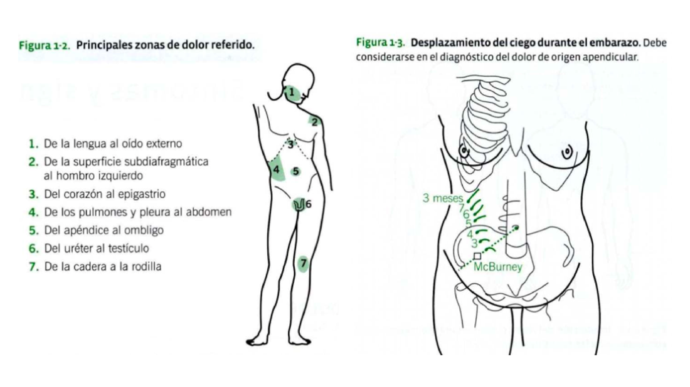
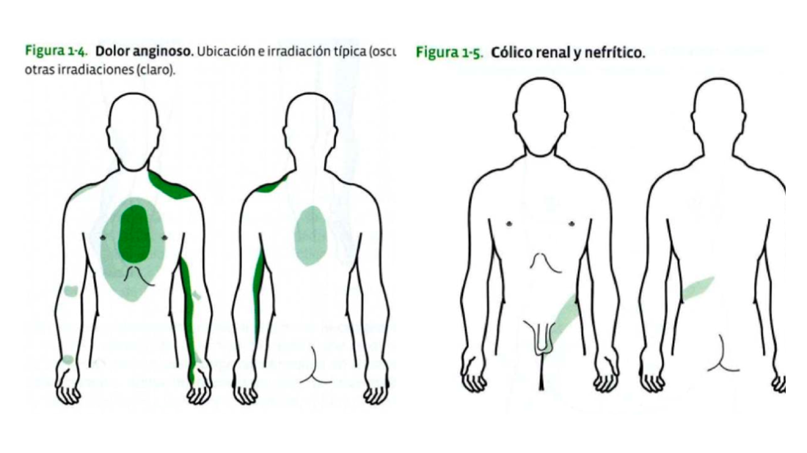
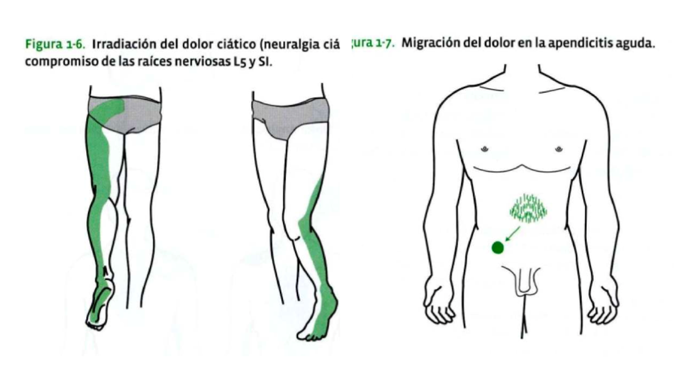
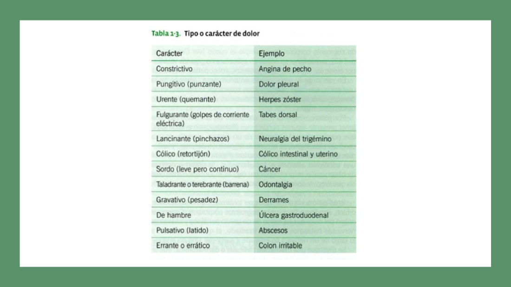
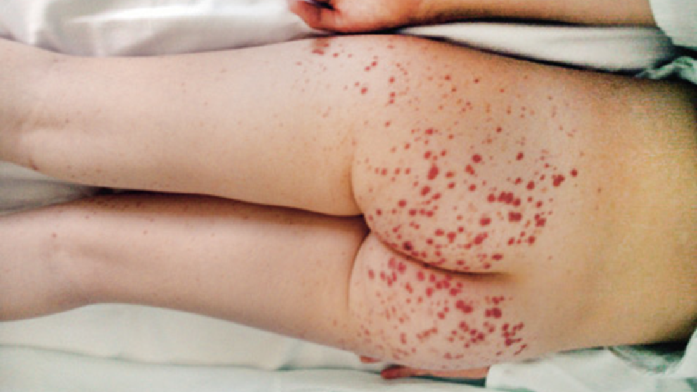
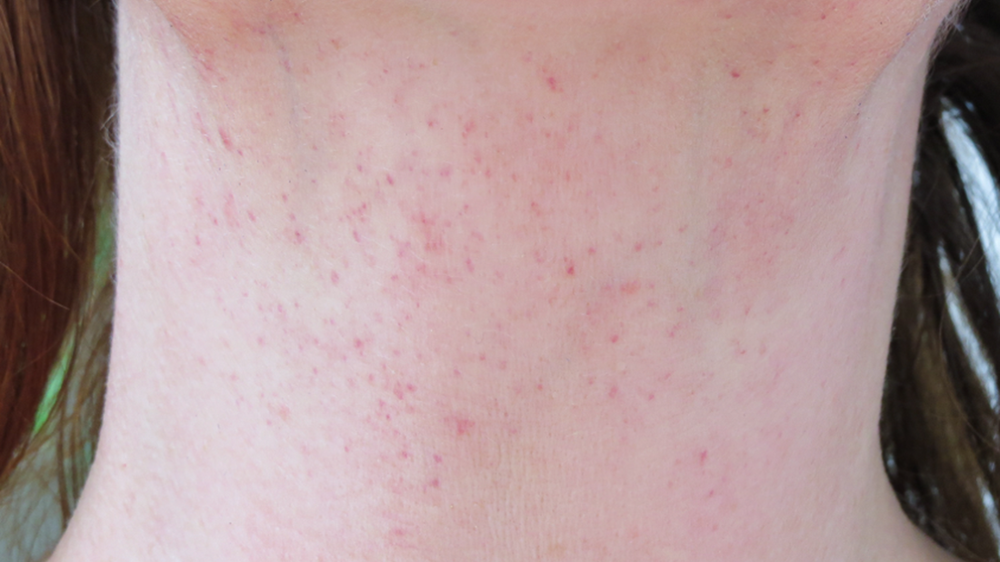
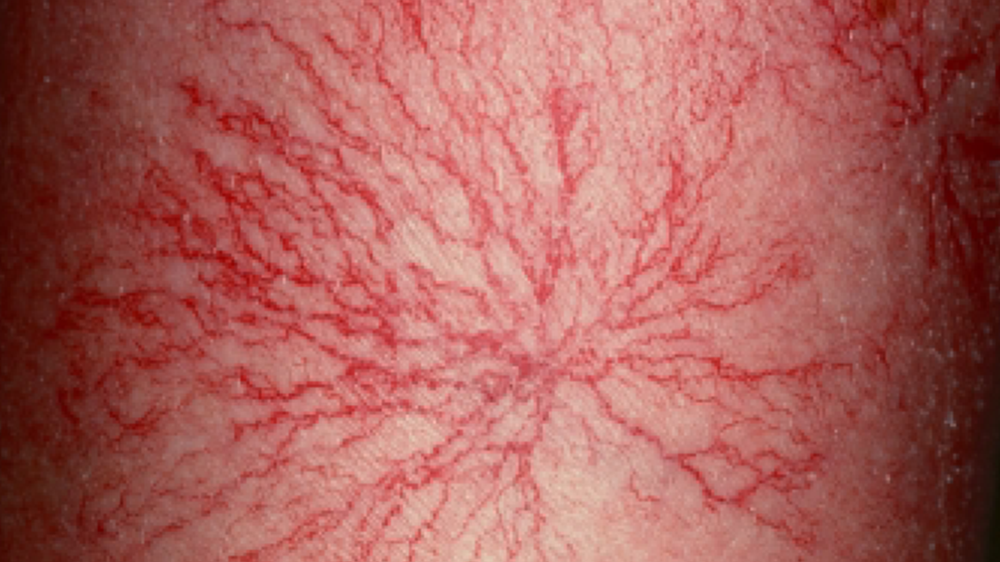
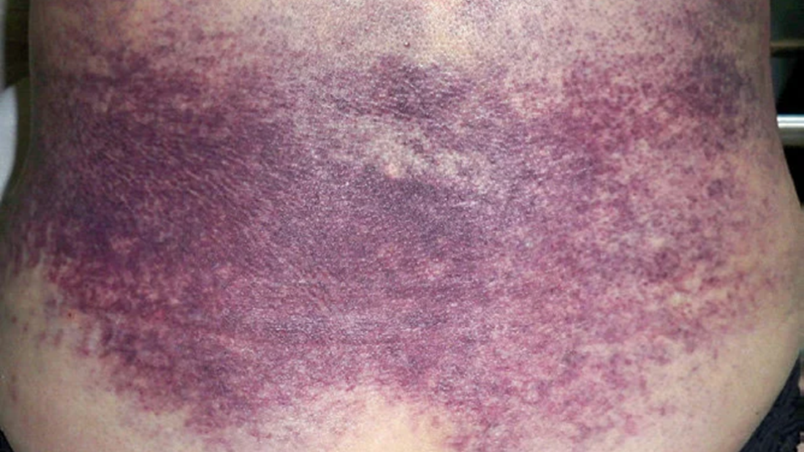

# Síntomas generales y signos de gravedad

Fundamentos del Diagnóstico Clínico, Unidad 3.

| Código | Texto original | Fuente |
|---|---|---|
| GEN | [Sintomas y signos generales](Textos%20originales/Sintomas%20y%20signos%20generales.md) | PPT "Síntomas y signos generales" (Dr. Miguel Yáñez Martínez, 28 de septiembre de 2026). Dolor, hemorragia, fiebre, edema cutáneo, prurito y bochornos. |
| GRAV | [Signos de gravedad](Textos%20originales/Signos%20de%20gravedad.md) | PPT "Signos de gravedad de un enfermo" (8 diapositivas; no indica docente). |
| Goic | *Semiología médica*, caps. 1 y 34 | Página impresa; cap. 1 leído en parte. |
| UCH | Manual de Semiología UCH, temas 03, 05, 07 y 13 | Página impresa. |
| Argente | Argente y Álvarez, caps. 14 (fiebre) y 17 (edema) del archivo entregado | Extractos; sin número de página. |

> **Cómo leer:** [DIG d. 7] indica el PPT (código) y la diapositiva. "Cita:" copia la referencia de la lámina, sin contrastarla. † marca texto oculto o cortado en la lámina. ⚠ remite a la sección final de pendientes. La línea *Falta* indica apartados que los PPT no desarrollan o que no tienen espacio propio. Lo marcado **[Goic, p. N]**, **[UCH, tema, p. N]** o **[Argente, cap.]** es complemento de los libros, resumido con otras palabras.

**Siglas:** SAPU (Servicio de Atención Primaria de Urgencia); EVA (escala visual análoga); PA (presión arterial); FC (frecuencia cardíaca); FR (frecuencia respiratoria); Hb (hemoglobina); IL (interleucina); TNF (factor de necrosis tumoral); OVLT (órgano vascular de la lámina terminal); COX-2 (ciclooxigenasa 2); AMPc (adenosín monofosfato cíclico); ACV (accidente cerebrovascular); TVP (trombosis venosa profunda); VIH (virus de inmunodeficiencia humana); PAS (presión arterial sistólica); O₂ (oxígeno); ECG (electrocardiograma); UCI (unidad de cuidados intensivos).

## Mapa del tema

- **Síntomas y signos:** Dolor; Hemorragia; Fiebre; Edema; Prurito; Bochornos.
- **Síndromes:** Signos de gravedad.

## Parte A. Fundamentos

### Marco común [GEN d. 4; cita: Goic, tablas 1-2 a 1-15; Argente y Álvarez, cap. 8; Bowen 2006]

| Eje | Preguntas |
|---|---|
| Ubicación y extensión | ¿Dónde, localizado o generalizado, irradia? |
| Carácter | ¿Cómo es? |
| Intensidad o cuantía | EVA, volumen, grado del godet |
| Comienzo y evolución | Súbito, brusco o insidioso; agudo o crónico; ritmo |
| Factores que modifican | Desencadena, agrava, alivia; fármacos y remedios caseros |
| Acompañantes | Orientan al sistema |
| Repercusión | Vida diaria y estado general |

**Calificadores semánticos:** agudo/crónico, localizado/generalizado, simétrico/asimétrico, súbito/insidioso, continuo/intermitente, aparente/inaparente. Luego **jerarquizar**.

## Parte B. Síntomas y signos

### Dolor

#### Definición [GEN d. 5]

Experiencia sensorial y emocional desagradable en una parte del cuerpo. Importa cuando es intenso, persistente o recurrente; es personal y subjetiva.

#### Mecanismo [GEN d. 5–6]

**Vía:** estímulo → nociceptor → fibras A-delta (rápidas) y C (lentas) → asta posterior → tálamo y corteza.

- **Referido:** convergencia en el asta posterior. Diafragma: hombro; corazón: epigastrio y brazo izquierdo; apéndice: ombligo; uréter: testículo; cadera: rodilla.

#### Tipos [GEN d. 6; cita: Goic, tabla 1-1; Argente, cuadros 8-1 y 8-2]

| Rasgo | Superficial (somático) | Profundo (visceral) |
|---|---|---|
| Localización | Precisa | Vaga |
| Carácter | Punzante o urente | Sordo, cólico o gravativo |
| Proyección | En el estímulo | Puede referirse |
| Fibras | A-delta, rápidas | C, lentas |
| Acompañantes | Escasos | Náuseas, sudor, palidez |

- **Neuropático:** central (talámico) o periférico (diabético); disestesias, alodinia, ardor. Ej.: posherpética, trigémino.
- **Otros:** vascular (eritromelalgia), simpático (dolor regional complejo).

<!-- GEN d. 7 | tipo: figuras 1-2 y 1-3 de libro | incluir en Word: sí -->

<!-- GEN d. 9 | tipo: figuras 1-4 y 1-5 | incluir en Word: sí -->

<!-- GEN d. 10 | tipo: figuras 1-6 y 1-7 | incluir en Word: sí -->

- [GEN d. 6] Superficial: epicrítico, fibras mielínicas. Profundo: protopático, amielínicas. Neuropático: continuo o episódico, con alfilerazos, entumecimiento, picazón y frialdad. Eritromelalgia: enfermedad de Mitchell.

#### Cómo caracterizarlo

**ALICIA** [GEN d. 8]

| Letra | Eje | Detalle |
|---|---|---|
| A | Aparición | Insidioso (minutos a horas), brusco (segundos a minutos), súbito; agudo menor de 4 semanas |
| L | Localización | Pedir que señale; superficial o profundo |
| I | Irradiación | Radicular o referida |
| C | Carácter | Ver tabla |
| I | Intensidad | EVA 0–10 |
| A | Atenuantes y agravantes | Esfuerzo, ingesta, posición |

Goic agrega actitud, acompañantes y repercusión. Argente usa nombres distintos (p. ej., "lancinante" para pleuritis): citar la fuente.

**Carácter del dolor** [GEN d. 11, tabla 1-3 transcrita de la imagen; GEN d. 8]

| Carácter | Ejemplo |
|---|---|
| Constrictivo | Angina de pecho |
| Pungitivo (punzante) | Dolor pleural |
| Urente | Herpes zóster |
| Fulgurante (corriente) | Tabes dorsal |
| Lancinante (pinchazos) | Neuralgia del trigémino |
| Cólico | Cólico intestinal y uterino |
| Sordo (leve, continuo) | Cáncer |
| Terebrante | Odontalgia |
| Gravativo (pesadez) | Derrames |
| De hambre | Úlcera gastroduodenal |
| Pulsátil | Abscesos |
| Errante | Colon irritable |

<!-- GEN d. 11 | tipo: tabla de libro, ya transcrita | incluir en Word: no -->

- [GEN d. 8] La tabla resumida agrega: cólico por obstrucción de víscera hueca; neuralgia superficial, en accesos y de duración variable.
- Según el tiempo en llegar al máximo: insidioso (minutos a horas), brusco (segundos a minutos) o súbito (desde que aparece). El súbito es vascular o por rotura de víscera hueca mientras no se demuestre lo contrario. **[UCH, tema 03, p. 15]**
- Evolución: agudo (minutos a semanas; continuo, intermitente o paroxístico) o crónico (meses a años; continuo o recurrente). **[UCH, tema 03, p. 15]**
- La nemotecnia ampliada «ALICIA, MI SEDA» suma migración, síntomas acompañantes, evolución, desencadenante y actitud. Anotar también cuando no hay atenuantes, irradiación o migración. **[UCH, tema 03, p. 17]**
- Carácter desgarrante (sensación de rotura): aneurisma disecante; transfixiante: pancreatitis. **[UCH, tema 03, p. 16]**
- Actitud: quietud en dolor musculoesquelético o infarto; inquietud sin postura antiálgica en el cólico renal. **[UCH, tema 03, p. 17]**

#### Diagnóstico diferencial: jerarquizar [GEN d. 13]

| Eje (angina) | Típica | Atípica |
|---|---|---|
| Ubicación | Retroesternal | Mandíbula |
| Irradiación | Hombro y brazo izquierdos | Sin irradiación |
| Carácter | Constrictivo | Impreciso |
| Desencadenante | Esfuerzo | Esfuerzo |
| Alivio | Reposo, minutos | Reposo, minutos |

La relación con esfuerzo y reposo tiene la mayor jerarquía.

- Además del somático, visceral y neuropático, UCH describe el dolor psicógeno, sin base estructural y muy variable; el sufrimiento es igual de real. **[UCH, tema 03, p. 14]**

#### Signos de alarma

- Considerar orgánico todo dolor mientras no se demuestre lo contrario [GEN d. 6].
- Intensidad no es gravedad [GEN d. 5].

**Banderas rojas:** comienzo súbito máximo (rotura o perforación); anginoso prolongado; sudor frío, palidez o lipotimia; despierta o no cede con analgésicos.

**Intensidad no es gravedad:** odontalgia (muy dolorosa, poco grave); cánceres iniciales (graves, poco dolorosos); disección aórtica y pancreatitis necrohemorrágica (ambas).

*Falta: causas (como apartado), examen físico, exámenes de apoyo.*

### Hemorragia

Ver también: [síndrome hemorragíparo](08%20Hematologia.md).

#### Definición y nomenclatura [GEN d. 14]

Salida de sangre de los vasos por rotura accidental o espontánea.

| Origen | Término y claves |
|---|---|
| Piel y mucosas | Púrpura, petequias, víbices, equimosis, hematoma |
| Nariz y encías | Epistaxis, gingivorragia; repetidas: hemopatía |
| Vía aérea | Hemoptisis: roja, aireada, con tos |
| Digestivo alto | Hematemesis (rojo oscuro o "concho de café"), melena |
| Digestivo bajo | Rectorragia o hematoquezia; colorragia |
| Urinario | Hematuria macro o microscópica |
| Ginecológico | Metrorragia |
| Cavidades | Hemotórax, hemoperitoneo, hemopericardio (inaparentes) |

**Púrpura:** término genérico de piel y mucosas. **Hematoma:** colección con aumento de volumen. **Treitz:** límite alto/bajo. Enterorragia (intestino), hemobilia (vía biliar).

- [GEN d. 14] Petequias puntiformes, víbices lineales, equimosis en placa, hematoma con aumento de volumen (casi siempre postraumático: subcutáneo, subdural, perirrenal). Melena: negra, brillante y pegajosa. Metrorragia: sangrado vaginal no menstrual. Cavidades: se demuestran por imágenes o punción.

#### Mecanismo

- La mayoría se debe a rotura de vasos, espontánea (patología del vaso o de los tejidos vecinos) o accidental; una minoría, a hemopatías o coagulopatías con vasos aparentemente indemnes. **[Goic, p. 34]**

#### Causas [GEN d. 31]

| Eje | Tipos |
|---|---|
| Vaso | Capilar, venosa, arterial |
| Salida | Externa, interna |
| Evidencia | Aparente, inaparente |
| Evolución | Aguda, crónica |
| Cuantía | Leve, moderada, masiva |
| Consecuencia | Anemia |

**Causas:** trauma, lesiones destructivas, patología vascular adquirida, enfermedades de la sangre, coagulación.

#### Cómo caracterizarlo: aguda o crónica [GEN d. 32]

- **Aguda:** aparente; gravedad según velocidad, volumen y edad. Hipovolemia: fatiga, sudor frío, mareo, palidez, taquicardia, hipotensión, ortostatismo, yugulares colapsadas; puede llegar a shock.
- **Crónica:** inaparente; anemia ferropriva compensada. Anemia sin causa: buscar en digestivo (sangre oculta), ginecológico y urinario.
- **Hemopatía:** sangrado en varios sitios o desproporcionado.
- Capilar: roja y fácil de controlar; venosa: rojo oscuro, continua y abundante; arterial: rojo brillante, abundante y pulsátil. **[Goic, p. 34–35]**
- En la aguda precisar vía, características de la sangre, repercusión y luego el sitio exacto. **[Goic, p. 36]**

#### Examen físico: imágenes [GEN d. 15–30]

Las fotos no traen rótulo en la lámina (salvo GEN d. 29 y 30); **la identificación es mía** y conviene confirmarla.

<!-- GEN d. 15 | tipo: foto | incluir en Word: sí -->

<!-- GEN d. 16 | tipo: foto | incluir en Word: sí -->

<!-- GEN d. 17 | tipo: foto | incluir en Word: opcional -->

<!-- GEN d. 18 | tipo: foto | incluir en Word: sí -->

<!-- GEN d. 19 | tipo: foto | incluir en Word: opcional -->

<!-- GEN d. 20 | tipo: foto | incluir en Word: opcional -->

<!-- GEN d. 21 | tipo: foto | incluir en Word: opcional -->

<!-- GEN d. 22 | tipo: foto | incluir en Word: opcional -->

<!-- GEN d. 23 | tipo: foto, origen no identificable | incluir en Word: opcional -->

<!-- GEN d. 24 | tipo: endoscopía y foto | incluir en Word: opcional -->

<!-- GEN d. 25 | tipo: foto | incluir en Word: opcional -->

<!-- GEN d. 26 | tipo: endoscopía, origen no identificable | incluir en Word: opcional -->

<!-- GEN d. 27 | tipo: radiografía y foto quirúrgica | incluir en Word: opcional -->

<!-- GEN d. 28 | tipo: piezas anatómicas | incluir en Word: opcional -->

<!-- GEN d. 29 | tipo: fotos rotuladas | incluir en Word: sí -->

<!-- GEN d. 30 | tipo: figuras 1-14 y 1-15: fusiforme, sacular, disecante; su rotura causa hemorragia inaparente | incluir en Word: sí -->

#### Exámenes de apoyo

- Inaparente: sangre oculta en deposiciones, sedimento urinario, examen ginecológico; en cavidades, punción; intracraneana, TC, resonancia o líquido cefalorraquídeo. **[Goic, p. 35]**

#### Diagnóstico diferencial

- Sangre por la boca: separar origen bucofaríngeo, respiratorio (aireada, con picor y tos) y digestivo (oscura o en concho de café, con náuseas). **[Goic, p. 36]**
- Sospechar hemopatía o coagulopatía si son múltiples (piel y mucosas) o aparecen tras traumas leves (sangrado articular, o gingivorragia persistente tras una extracción dental). **[Goic, p. 37]**

#### Signos de alarma [GEN d. 32]

- La gravedad de la hemorragia aguda depende de la velocidad, el volumen y la edad; la hipovolemia puede llegar a shock.
- La hemorragia aguda con compromiso hemodinámico es una emergencia que exige reponer volumen. **[Goic, p. 36]**

### Fiebre

#### Definición y medición [GEN d. 34] ⚠

Signo objetivo, buen indicador de enfermedad orgánica; sirve para gravedad, antipiréticos y seguimiento.

| Fuente | Fiebre |
|---|---|
| Goic | Más de 36,9 °C axilar o 37,2 °C bucal |
| Argente | Más de 37,5 °C bucal (37,2 en la mañana; 37,7 en la tarde) |

Normal bucal 36,8 ± 0,4 °C; axilar cerca de 0,6 °C menos. Escala esquemática: hipotermia, normal, febrícula, fiebre, hiperpirexia (sobre 41 °C).

- UCH: normal axilar 36,5, bucal 36,8 y rectal 37,1 °C (± 0,4); en clínica se usa con frecuencia axilar sobre 38 °C, y 37–38 °C es febrícula. **[UCH, tema 05, p. 25]**
- Confirmar siempre con termómetro: lo referido por el paciente falla en ambos sentidos. **[Goic, p. 37–38]**

#### Mecanismo [GEN d. 35; cita: Argente, cap. 9]

**Fiebre:** pirógenos → IL-1, TNF-alfa, IL-6 → OVLT (COX-2, prostaglandina E2) → sube el punto de ajuste hipotalámico → vasoconstricción y calofríos.

- [GEN d. 35] Pirógenos exógenos: microorganismos, toxinas, necrosis, inflamación, neoplasias; actúan por citocinas de células inmunitarias.

#### Causas

- Las infecciones, sobre todo virales, son lo más frecuente; también neoplasias, enfermedades inmunológicas y del tejido conectivo, hemólisis y trastornos metabólicos agudos. **[UCH, tema 05, p. 26]**
- No infecciosas: infartos, fármacos, crisis tiroidea o addisoniana, gota, porfiria, mixoma auricular y traumatismos. **[Goic, p. 40]**
- Aguda en inmunocompetente (menos de 15 días): sobre todo vía aérea alta, piel, orina y neumonía. **[Argente, cap. 14]**

#### Cómo caracterizarlo

- **Síndrome febril:** calor, calofríos, cefalea, malestar, sed, anorexia, mialgias, sudor; facies, piel caliente, taquicardia (10–15 lpm por °C), polipnea (4–5 rpm por °C), orina escasa.

**Curvas febriles** [GEN d. 36; cita: Goic, tabla 1-10; Argente, cap. 9]

| Curva | Patrón (del gráfico) |
|---|---|
| Continua | Alta con oscilaciones pequeñas |
| Remitente | Oscila sin llegar a lo normal |
| Intermitente | Alterna con valores normales en el día |
| Recurrente | Días febriles separados por días normales |

Los patrones orientan poco; sirven para seguir.

<!-- GEN d. 36 | tipo: gráficos | incluir en Word: sí -->

**Sugieren infección** [GEN d. 36]

**Sugieren infección (dos o más):** comienzo brusco; más de 39 °C; malestar, mialgias, cefalea, fotofobia; leucocitos sobre 12.000 o bajo 5.000/mm³. Pistas de foco: odinofagia, tos, disuria, dolor lumbar, diarrea, rigidez de nuca.

- Comienzo brusco o insidioso; descenso en crisis o en lisis. Una caída brusca sin mejoría sugiere antipiréticos o complicación (pseudocrisis). **[Goic, p. 39]**
- Calofrío intenso y único: neumonía neumocócica; repetidos: infección biliar o urinaria. Sudor nocturno: tuberculosis, brucelosis, Hodgkin. **[Goic, p. 41]**
- Las curvas febriles ya no se utilizan, por los antipiréticos, el mayor conocimiento y la tecnología disponible. **[UCH, tema 05, p. 26]**

#### Examen físico

- Facies febril y piel primero seca y pálida, luego roja y húmeda; puede haber soplo eyectivo, lengua saburral y herpes labial. **[Goic, p. 38–41]**
- En el adulto mayor puede faltar (30–50 % de neumonías, infecciones urinarias y colecistitis) y presentarse como confusión. **[Argente, cap. 14]**

#### Exámenes de apoyo

- Sin foco tras anamnesis y examen: hemograma, VHS o proteína C reactiva, hemocultivos, reacciones de aglutinación, sedimento y urocultivo y radiografía de tórax. **[Goic, p. 42]**

#### Diagnóstico diferencial: fiebre o hipertermia [GEN d. 35]

| Hipertermia | Causas |
|---|---|
| Punto de ajuste normal; falla la disipación | — |
| Más producción | Ejercicio, tirotoxicosis, hipertermia maligna, neuroléptico maligno |
| Menos disipación | Golpe de calor, anticolinérgicos |
| Falla del centro | Lesión hipotalámica |

Antipiréticos inútiles: enfriamiento físico. 42 °C o más sugiere hipertermia.

- **Disociación esfigmotérmica:** el pulso sube poco: tifoidea, facticia, fármacos, *Legionella*.
- **Fiebre de origen desconocido:** al menos 3 semanas, 38,3 °C o más en tres ocasiones y sin diagnóstico tras una semana hospitalizado (se ha propuesto aceptar 3 días o 3 consultas). Infecciones 30–40 %, neoplasias 20–30 %, colagenopatías 10–20 %. **[Argente, cap. 14]**
- Fiebre facticia: sin causa, sin variación diaria o disociada del pulso y del estado general. **[Goic, p. 41]**

#### Signos de alarma [GEN d. 36]

**Banderas rojas:** con cefalea, confusión o rigidez; con petequias; con calofríos e hipotensión; en esplenectomizado o neutropénico; caída brusca con deterioro (seudocrisis).

- Sobre 41 °C mantenida puede dañar el cerebro; sobre 43 °C, coma y muerte. **[Goic, p. 38]**

### Edema

#### Definición y mecanismo [GEN d. 38; cita: Argente, cap. 12; Goic, cap. 1]

Aumento evidente de líquido intersticial; lo confirma el **godet**. Presión hidrostática capilar (35 a 10 mmHg) filtra; oncótica (25 mmHg) retiene; el linfático drena. Aparece con cerca de 4 L retenidos (Goic más de 4 L; Argente 3,5–5 L): **el peso sube antes**.

#### Causas

| Mecanismo | Causas |
|---|---|
| Más presión venosa | IC, trombosis, insuficiencia venosa |
| Menos presión oncótica | Nefrótico, cirrosis, desnutrición |
| Más permeabilidad | Inflamación, angioedema, quemaduras |
| Menos drenaje linfático | Cirugía, radioterapia, neoplasia |

- Localizado o asimétrico: si es agudo, descartar **TVP**; celulitis, erisipela, trauma, linfedema.
- Generalizado: cardíaco, renal, hepático, carencial, venoso, fármacos (calcioantagonistas), cíclico.
- Otras causas generalizadas o por posición: idiopático o cíclico, viajes largos sentado, extremidad paralizada o enyesada, anemia, vejez, embarazo, convalecencia y mesenquimopatías. **[Goic, p. 44]**
- Angioedema: afecta cara, manos y genitales; en la glotis es una emergencia. **[Goic, p. 43]**

#### Cómo caracterizarlo [GEN d. 39; cita: Goic, tabla 1-11; Argente, cuadros 12-3 y 12-4]

Preguntar: ¿localizado o generalizado? ¿simétrico?

- Registrar distribución, simetría, color, temperatura, aspecto, dolor, consistencia, horario, relación con la posición y fármacos. **[UCH, tema 07, p. 32]**

#### Examen físico [GEN d. 39–41]

| Rasgo | Renal | Cardíaco | Cirrótico | Carencial |
|---|---|---|---|---|
| Distribución | Cara y párpados temprano | Declive | Mitad inferior y ascitis | Generalizado |
| Aspecto | Pálido, blando, matinal | Cianótico, duro, vespertino | Tolera decúbito | Poco intenso |
| Claves | Proteinuria | Disnea, ortopnea, yugulares, hepatomegalia | Ictericia, arañas, esplenomegalia | Hipoalbuminemia; sube al realimentar |

<!-- GEN d. 40 | tipo: fotos | incluir en Word: sí -->

<!-- GEN d. 41 | tipo: fotos sin rótulo | incluir en Word: opcional -->

- [GEN d. 39] Cardíaco: tobillos y región sacra, ingurgitación yugular. Mixedema: induración por mucopolisacáridos. Carencial: evidente por escaso tejido graso.
- Fóvea: presionar 10–15 segundos contra hueso; en el que camina, en maléolos; en cama, región sacra. **[UCH, tema 07, p. 31]**

| Grado **[UCH, tema 07, p. 31]** | Depresión | Recuperación |
|---|---|---|
| 1 | Leve, sin deformar el contorno | Casi inmediata |
| 2 | Hasta 4 mm | 15 segundos |
| 3 | Hasta 6 mm | 1 minuto |
| 4 | Hasta 1 cm | 2 a 5 minutos |

- Linfedema avanzado: signo de Stemmer (no se puede pellizcar la piel del dorso del segundo ortejo). **[UCH, tema 07, p. 32]**

#### Exámenes de apoyo

- Al orientar el origen sirven la proteinuria y el sedimento (renal) y la grasa en deposiciones si se sospecha malabsorción. **[Goic, p. 45]**
- Ante sospecha de trombosis venosa profunda, ecografía Doppler; sobre la rodilla el riesgo de embolia es mucho mayor. **[Argente, cap. 17]**

#### Diagnóstico diferencial [GEN d. 39]

**No es edema común:** linfedema (duro, poca fóvea) y mixedema (sin godet).

- Lipedema: bilateral y simétrico sobre una lipodistrofia, con fóvea mínima tras estar de pie. **[Argente, cap. 17]**

#### Signos de alarma [GEN d. 39]

- Edema localizado o asimétrico de comienzo agudo: descartar TVP.

### Prurito

#### Definición [GEN d. 43]

1. **Confirmar:** deseo de rascarse; signos de rascado (excoriaciones lineales, uñas pulidas, liquenificación).

- Sensación cutánea que provoca deseo de rascarse; solo ocurre en piel con epidermis y mucosas de transición. **[Goic, p. 45]**

#### Mecanismo

- Nace en terminaciones libres de la epidermis; se postula liberación de histamina, que no explica todos los casos. **[Goic, p. 45]**

#### Causas [GEN d. 43]

3. **Causas sistémicas:** colestasis (puede preceder a la ictericia), uremia, linfomas y leucemias, diabetes, tiroides, VIH, embarazo, fármacos. Senil y psicógeno: exclusión.

- Las dermatológicas son las más frecuentes; hasta la mitad de las consultas queda sin causa. **[UCH, tema 13, p. 51]**
- Colestasis del embarazo: tercer trimestre, palmoplantar y nocturno. **[UCH, tema 13, p. 52]**
- Vulvovaginal: hongos, tricomonas, atrofia posmenopáusica, diabetes; anal: parásitos, hongos, roce, piel seca. **[Goic, p. 46]**

#### Cómo caracterizarlo [GEN d. 43]

2. **Localizar:** localizado casi siempre dermatológico (sarna, pediculosis, tiña, estasis, anal, vulvovaginal: pensar en diabetes). Generalizado sin lesiones primarias: causa sistémica.

Si despierta, es intenso; empeora con calor y noche, alivia con frío; el rascado lo perpetúa.

- Preguntar extensión, evolución, intensidad, horario, gatillantes, fármacos, acompañantes e ictericia. **[UCH, tema 13, p. 51]**

#### Examen físico

- Distinguir lesiones primarias de las de rascado, que pueden sobreinfectarse. **[UCH, tema 13, p. 51]**

#### Exámenes de apoyo

- Psicógeno y senil son diagnósticos de exclusión: descartar antes enfermedad sistémica con los exámenes pertinentes. **[Goic, p. 47]**

#### Signos de alarma

- Con baja de peso, sudor nocturno o compromiso general, buscar neoplasia hematológica y adenopatías. **[UCH, tema 13, p. 52]**

### Bochornos

#### Definición [GEN d. 44; cita: Goic, tabla 1-15]

Episodios súbitos de calor y rubor en cara, cuello y tórax, con sudor y taquicardia.

#### Causas

| Frecuencia | Causas |
|---|---|
| Frecuentes | Emociones; climaterio femenino (cerca de dos tercios, 1–5 años) |
| Infrecuentes | Climaterio masculino; vasodilatadores, calcioantagonistas, niacina, opiáceos, tamoxifeno, sildenafil |
| Excepcionales | Carcinoide (diarrea, broncoobstrucción), feocromocitoma (hipertensión paroxística), algunos carcinomas |

- [GEN d. 44] El carcinoide cursa con diarrea y obstrucción bronquial. Preguntar también la severidad.
- El rubor emocional es normal. Carcinoide: desencadenado por rabia, ejercicio, alcohol o comidas; el intestinal da el síndrome cuando hay metástasis hepáticas. **[Goic, p. 48–49]**
- Otros fármacos: bromocriptina, colinérgicos, ciclosporina, rifampicina y triamcinolona oral. **[Goic, p. 49]**

#### Cómo caracterizarlo

Preguntar circunstancias, frecuencia, duración, severidad, acompañantes, menstruación y fármacos. Sobre los 50 años, la primera hipótesis es el climaterio [GEN d. 44].

- En el climaterio son breves (segundos a pocos minutos), repetidos de día o de noche, y pueden empezar años antes de la menopausia. **[Goic, p. 48]**

#### Signos de alarma

Bochorno con diarrea, sibilancias o hipertensión paroxística [GEN d. 44].

- Feocromocitoma: crisis con sudor, cefalea y taquicardia en un hipertenso. **[Goic, p. 49]**

*Falta: mecanismo, examen físico, exámenes de apoyo.*

## Parte C. Síndromes

### Signos de gravedad

#### Definición

- Gravedad es el riesgo de muerte; se distingue la actual de la alejada. Grave no es sinónimo de terminal. **[Goic, p. 519]**

#### Clínica y examen físico

**Compromiso de conciencia** [GRAV d. 3]

- Obnubilación, estupor o coma
- Desorientación marcada o agitación psicomotora intensa

**Alteraciones respiratorias** [GRAV d. 4]

- Disnea intensa, uso de músculos accesorios
- Frecuencia respiratoria mayor de 30/min o menor de 10/min
- Cianosis central (labios, lengua)
- Saturación de O₂ menor de 90 % pese a aporte de oxígeno

**Alteraciones circulatorias** [GRAV d. 5]

- Hipotensión arterial persistente (PAS menor de 90 mmHg)
- Taquicardia mayor de 130/min o bradicardia extrema
- Llenado capilar lento (más de 3 segundos)
- Piel fría, sudorosa, moteada

**Signos neurológicos agudos** [GRAV d. 6]

- Convulsiones
- Déficit focal súbito (hemiparesia, afasia)
- Pupilas no reactivas o anisocoria

**Otros signos críticos** [GRAV d. 7]

- Hemorragia activa masiva
- Oliguria o anuria (menos de 0,5 ml/kg/h) ⚠
- Fiebre mayor de 40 °C o hipotermia menor de 35 °C
- Dolor torácico opresivo con cambios en el ECG
- A veces los signos son sutiles: inquietud, disnea y taquicardia bruscas en un cardiópata pueden ser una embolia. **[Goic, p. 519]**
- Goic agrega: temperatura sobre 41 o bajo 35 °C, respiración estertorosa, pulso filiforme, frecuencia cardíaca sobre 180 o bajo 40, diastólica sobre 150 mmHg, signos meníngeos, peritoneales o de hipertensión endocraneana, dolor brusco e intenso, edema pulmonar, sudor profuso, palidez, deshidratación, anasarca y caquexia. **[Goic, p. 519]**

#### Alarma y conducta [GRAV d. 8]

La presencia de uno o más de estos signos obliga a atención inmediata, monitorización y eventual traslado a UCI.

- Ante signos de gravedad hay urgencia diagnóstica y terapéutica, a veces quirúrgica, y hospitalización. **[Goic, p. 520]**

*Falta: fisiopatología, causas, exámenes y criterios, diagnóstico diferencial.*

## Anexo de práctica

### Sra. Rosa, 58 años [GEN d. 2]

"Tengo la pierna hinchada y colorada, me duele harto… y desde anoche ando con calentura y tiritones". ¿Qué preguntar para convertir estas quejas en datos clínicos?

### Objetivos [GEN d. 3]

Definir los seis síntomas; caracterizar con siete ejes; diferenciar cuadros que comparten síntoma; jerarquizar y comunicar la representación del problema con la perspectiva del paciente.

### Sra. Rosa [GEN d. 46]

58 años, rural (Padre Las Casas), hipertensa con nifedipino, menopausia a los 51. Dolor urente continuo en pantorrilla izquierda hace 3 días (EVA 7); calofrío y 38,9 °C; edema bilateral vespertino crónico y prurito; bochornos hace 6 años; usa paños de hierbas y *lawen* de matico. Examen: 38,7 °C, FC 104, FR 20, PA 132/80; placa eritematosa caliente de bordes netos y godet 3+ en pierna izquierda; várices, piel ocre, excoriaciones; edema 1+ derecho; sin yugulares ni ascitis.

**Tareas:** caracterizar; jerarquizar; representar el problema con tres calificadores; explorar su perspectiva y el *lawen*.

- [GEN d. 46] El dolor empeora al caminar y bajar la pierna y alivia al elevarla; las piernas amanecen mejor; el lawen lo indicó una lawentuchefe.

### Respuesta propuesta [GEN d. 47]

Mujer de 58 años, hipertensa con nifedipino, con edema **crónico, bilateral y vespertino** e insuficiencia venosa, con cuadro **agudo** de dolor **urente y continuo**, eritema y edema **asimétrico** izquierdo y fiebre **brusca**.

| Nivel | Problema |
|---|---|
| Prioridad | Erisipela o celulitis; descartar TVP |
| De fondo | Insuficiencia venosa; el nifedipino puede contribuir al edema |
| Incidental | Bochornos: climaterio; nifedipino |

**Alarmas:** hipotensión, confusión, dolor desproporcionado, crepitación o necrosis.

### Tres ideas [GEN d. 48]

Caracterizar con siete ejes y jerarquizar; los síntomas generales gradúan gravedad y alertan; preguntar siempre fármacos y perspectiva.

### Preguntas de clase [GEN]

| N.º | Enunciado resumido | Clave [GEN d. 49] |
|---|---|---|
| 1 [GEN d. 12] | Hombre de 62 años, dolor mandibular al subir cuesta que cede en 3 min. ¿Dato de mayor jerarquía? A) ubicación, B) edad, C) esfuerzo y reposo, D) duración | C |
| 2 [GEN d. 33] | Mujer de 45, cansancio, Hb 7,8 microcítica, estable, niega sangrado. A) crónica inaparente, B) aguda, reponer volumen, C) se descarta sangrado, D) siempre habría taquicardia | A |
| 3 [GEN d. 37] | Temporero, 41,2 °C tras 8 h al sol, confuso, sin foco. A) fiebre, B) origen desconocido, C) hiperpirexia infecciosa, D) hipertermia | D |
| 4 [GEN d. 42] | Mujer de 34, edema matinal y orina espumosa. A) cardíaco, B) nefrótico con proteinuria, C) cirrótico, D) linfedema | B |

**Verdadero o falso [GEN d. 45]:** 1) prurito generalizado sin lesiones orienta a sistémico: V; 2) prurito senil de primera línea: F; 3) mujer de 52 que menstrúa, climaterio primera hipótesis: V; 4) bochornos con hipertensión paroxística no requieren estudio: F.

## Pendientes por verificar

Las diferencias entre láminas salen del PPT; el resto es revisión mía.

| Dónde | Observación |
|---|---|
| GEN d. 34 | Goic y Argente usan umbrales de fiebre distintos; la lámina muestra ambos. Preguntar cuál se evalúa. |
| GEN d. 15–28 | Fotos sin rótulo; confirmar cada identificación. |
| GRAV d. 7 | El umbral de 0,5 ml/kg/h corresponde a oliguria; la anuria suele definirse con un volumen mucho menor. |
| GRAV: Imágenes | Solo hay fotografía decorativa de portada; no se guardó ninguna. |
| Umbral de fiebre | Goic: sobre 36,9 °C axilar; UCH: uso clínico sobre 38 °C axilar. |
| Signos de gravedad: frecuencia cardíaca | El PPT usa taquicardia sobre 130/min; Goic, sobre 180 o bajo 40. |
| Signos de gravedad: temperatura | El PPT usa sobre 40 °C; Goic, sobre 41 °C. |
| Duración mínima de fiebre de origen desconocido | UCH y Argente: 3 semanas y 38,3 °C; Goic admite dos o tres semanas. |
| Curvas febriles | Goic separa remitente y continua en variaciones de 1 °C; UCH, en 0,6 °C. |
| Numeración de Argente | La lámina cita caps. 8, 9 y 12; en el archivo entregado fiebre es el cap. 14 y edema el 17 (otra edición). |
