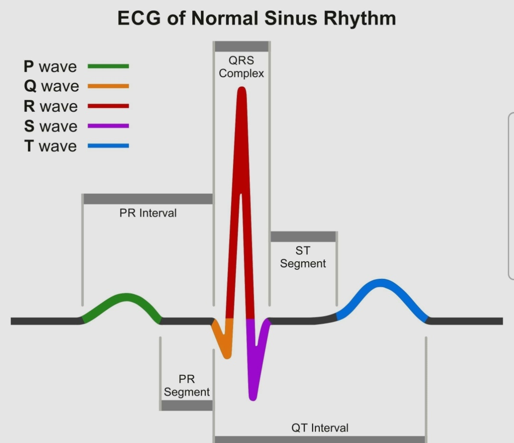
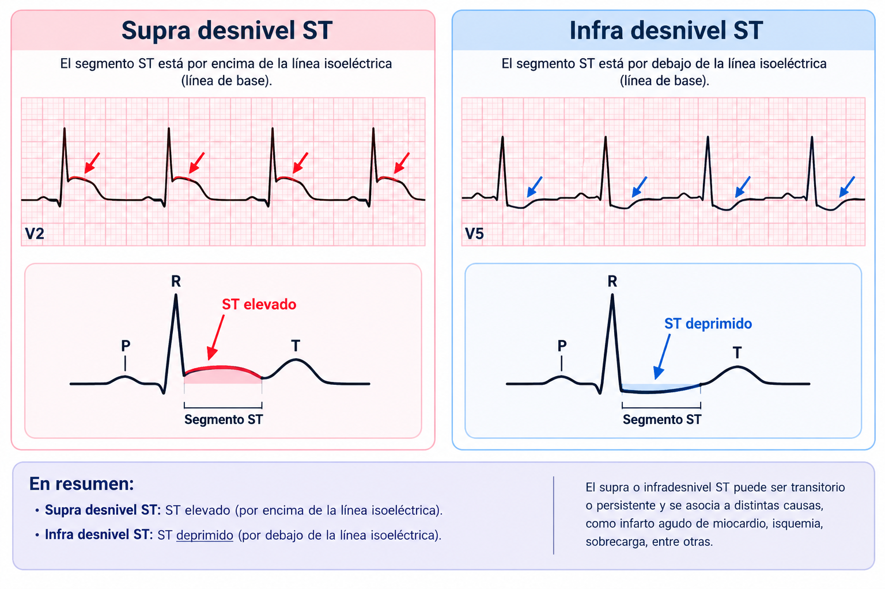

# Cardiovascular

Fundamentos del Diagnóstico Clínico, Unidad 3.

| Código | Texto original | Fuente |
|---|---|---|
| CRESP | [Sintomas cardiorrespiratorios y mediastino](Textos%20originales/Sintomas%20cardiorrespiratorios%20y%20mediastino.md) | PPT "Síntomas cardiorrespiratorios y mediastino" (Dr. Miguel Yáñez Martínez), basado en Goic, *Semiología Médica*, caps. 4 (pp. 106–128) y 5 (pp. 129–132). |
| CARD | [Sindromes cardiovasculares](Textos%20originales/Sindromes%20cardiovasculares.md) | PPT "Síndromes Cardiovasculares" (María Angélica Barría Schulmeyer, Universidad Autónoma de Chile). |
| Goic | *Semiología médica*, caps. 4 y 18 | Página impresa; leídos en parte. |
| UCH | Manual de Semiología UCH, temas 8, 32 y 33 | Página impresa. |
| Argente | Argente y Álvarez, caps. 33 y 36 | Extractos; sin número de página. |

> **Cómo leer:** [DIG d. 7] indica el PPT (código) y la diapositiva. "Cita:" copia la referencia de la lámina, sin contrastarla. † marca texto oculto o cortado en la lámina. ⚠ remite a la sección final de pendientes. La línea *Falta* indica apartados que los PPT no desarrollan o que no tienen espacio propio. Lo marcado **[Goic, p. N]**, **[UCH, tema, p. N]** o **[Argente, cap.]** es complemento de los libros, resumido con otras palabras.

**Siglas:** CMH (miocardiopatía hipertrófica); TEP (tromboembolismo pulmonar); EPOC (enfermedad pulmonar obstructiva crónica); TBC (tuberculosis); Rx (radiografía); TC (tomografía computarizada); DPN (disnea paroxística nocturna); TPSV (taquicardia paroxística supraventricular); FA (fibrilación auricular); ORL (otorrinolaringología); Hb (hemoglobina); IC (insuficiencia cardíaca); V/Q (ventilación/perfusión); HTP (hipertensión pulmonar); CO (monóxido de carbono); PAM (presión arterial media); BAV (bloqueo auriculoventricular); TV (taquicardia ventricular); ECG (electrocardiograma); IV (intravenosa); T4 (cuarta vértebra torácica); SCA (síndrome coronario agudo); HTA (hipertensión arterial); VI (ventrículo izquierdo); C-T (cardiotorácica); S3 (tercer ruido cardíaco); lpm (latidos por minuto); ABCDE (vía aérea, respiración, circulación, déficit neurológico, exposición).

## Mapa del tema

- **Síntomas y signos:** Dolor torácico; Palpitaciones; Cianosis; Síncope.
- **Síndromes:** Síndrome anginoso; Insuficiencia cardíaca; Taponamiento cardíaco; Shock.
- **Solo en la literatura o apenas nombrados (Parte C):** Pericarditis aguda; Derrame pericárdico; Pericarditis constrictiva; Síndrome aórtico agudo; Angina de Prinzmetal y microvascular.

## Parte A. Síntomas y signos

### Dolor torácico

Ver también: [causas respiratorias y mediastínicas](03%20Respiratorio%20y%20mediastino.md) y el Síndrome anginoso.

#### Causas

| Origen | Causas (en negrita: descartar siempre) |
|---|---|
| Cardíaco isquémico | Angina, **infarto**, Prinzmetal |
| Cardiovascular no isquémico | **Disección aórtica**, pericarditis, estenosis aórtica, CMH, prolapso mitral |
| Pleuropulmonar | Neumonía, **TEP**, **neumotórax** |
| Digestivo | Reflujo, acalasia, espasmo esofágico, úlcera, cólico biliar, pancreatitis, **ruptura esofágica** |
| Parietal | Costocondritis, Tietze, neuralgia intercostal, fractura costal |
| Psicógeno | Ansiedad, hiperventilación, depresión |

#### Cómo caracterizarlo

**Nueve atributos** [CRESP d. 5]

| Atributo | Opciones |
|---|---|
| Localización | Esternal, precordial, dorso |
| Evolución | Aguda, crónica |
| Inicio | Insidioso, creciente, súbito |
| Carácter | Opresivo, punzante |
| Intensidad | Leve, moderada, intensa |
| Gravedad | Trivial, grave |
| Acompañantes | Sudoración, síncope, pirosis |
| Agravantes | Esfuerzo, respiración, movimiento |
| Alivio | Reposo, trinitrina, analgésicos |

**Intensidad no es gravedad.** Dos o más causas pueden coexistir.

**Perfil temporal** [CRESP d. 6]

| Cuadro | Perfil |
|---|---|
| Angina | Con el esfuerzo; cede en minutos con reposo o trinitrina |
| Infarto | Rápidamente creciente, intenso y prolongado; no cede con reposo |
| Disección aórtica | Súbito, máximo desde el inicio; irradia a dorso o abdomen; pulsos femorales asimétricos |

<!-- CRESP d. 6 | tipo: gráfico | incluir en Word: sí -->

- Investigar localización, carácter, intensidad, desencadenantes y atenuantes, duración y factores de riesgo; en un joven sin factores es menos probable la isquemia. **[Goic, p. 238–239]**
- Todo dolor entre la mandíbula y el ombligo puede ser coronario; ante sospecha isquémica, siempre electrocardiograma. **[UCH, tema 33, p. 216]**

#### Diagnóstico diferencial

**Descartar lo letal y confirmar lo frecuente** [CRESP d. 7]

| No omitir | Claves |
|---|---|
| Infarto | Opresivo, creciente, prolongado |
| Disección | Súbito y máximo; PA alta, pulsos asimétricos |
| TEP o infarto pulmonar | Dolor pleural brusco, disnea, taquicardia, esputo hemoptoico |
| Neumotórax | Súbito unilateral; timpanismo, murmullo abolido |

| Frecuente | Claves |
|---|---|
| Costocondral | Se reproduce al comprimir 2.ª–3.ª condroesternal |
| Esofágico | Pirosis, regurgitación |
| Pericarditis | Aumenta con tos e inspiración; frote |
| Ansiedad | Punzadas apexianas, parestesias peribucales |

- El espasmo esofágico tras comidas o alcohol puede durar minutos y suele calmar de pie o sentado y con antiácidos; el dolor de segundos habitualmente no es isquémico. **[Goic, p. 239]**
- El dolor isquémico referido al epigastrio no cambia con respiración, posición ni palpación, y no da contractura abdominal. **[Argente, cap. 33-2]**

#### Signos de alarma

- Descartar siempre: infarto, disección aórtica, TEP, neumotórax y ruptura esofágica [CRESP d. 4, 7].

*Falta: definición, mecanismo (ver Síndrome anginoso para el dolor coronario), examen físico, exámenes de apoyo.*

### Palpitaciones

#### Definición

- Latidos del corazón o de los grandes vasos percibidos de forma desagradable; el paciente puede llamarlos latido, vuelco o aleteo. **[Goic, p. 117]**

#### Causas

| Contexto | Patrón | Causa |
|---|---|---|
| Esfuerzo o emoción | Fisiológicas | — |
| Reposo | Aisladas ("vuelco" y pausa) | Extrasístoles |
| Reposo | En serie, regulares | TPSV, flutter 2:1; ansiedad, hipertiroidismo, drogas |
| Reposo | En serie, irregulares | FA paroxística, flutter con bloqueo variable |

#### Cómo caracterizarlo

- **TPSV:** inicio y fin súbitos; las maniobras vagales la cortan.
- **FA:** irregularmente irregular; empeora con el esfuerzo.
- **Extrasístole:** latido anticipado, pausa y latido más fuerte.

<!-- CRESP d. 16 | tipo: algoritmo | incluir en Word: opcional -->

<!-- CRESP d. 17 | tipo: esquema de ritmos | incluir en Word: sí -->

- Preguntar esfuerzo o reposo, rápidas o lentas, regulares, aisladas o en salvas, frecuencia, inicio, duración, acompañantes, fármacos, antecedentes, tabaco y café. **[Goic, p. 117]**
- Con esfuerzo, la fibrilación auricular se hace más irregular y la extrasistolía tiende a regularizarse. **[Goic, p. 118]**
- La taquicardia ventricular, más propia de cardiópatas mayores, tiene peor pronóstico; varía el primer ruido y hay ondas en cañón. **[Goic, p. 118]**

#### Exámenes de apoyo

- Si aparecen con esfuerzo, prueba ergométrica; con compromiso hemodinámico, síncope o muerte súbita reanimada, estudio electrofisiológico. Según sospecha: tiroides, hemograma, glicemia. **[Argente, cap. 33-3]**

*Falta: mecanismo, examen físico, diagnóstico diferencial, signos de alarma.*

### Cianosis

#### Definición

- Coloración azul-violácea de piel y mucosas por hemoglobina reducida sobre 5 g/dL en el lecho capilar; central, periférica o mixta. **[UCH, tema 08, p. 34]**

#### Mecanismo

**Hemoglobina reducida** [CRESP d. 21]

| Territorio | Hb reducida (g/dL) |
|---|---|
| Arterial | 0,75 |
| Capilar (promedio) | 2,62 |
| Venosa | 4,50 |
| Umbral de Lundsgaard | cerca de 5 |

Cuenta la cantidad absoluta, no la saturación. Anemia severa: hipoxemia sin cianosis. Poliglobulia: cianosis con hipoxemia leve.

- Con hemoglobinas anormales el umbral es menor: 1,5 g/dL de metahemoglobina o 0,5 g/dL de sulfahemoglobina. **[Goic, p. 125]**

#### Causas

**Tipos e impostores** [CRESP d. 23]

| Tipo | Mecanismo |
|---|---|
| Central pulmonar | Hipoventilación, V/Q, difusión |
| Central cardíaca | Cortocircuito derecha-izquierda (Fallot, Eisenmenger) |
| Hb anormal | Metahemoglobina, sulfahemoglobina; sin acropaquia |
| Periférica | Mayor extracción: IC, shock, frío, Raynaud |
| Mixta | IC congestiva grave |
| Diferencial | Ductus con HTP: ortejos azules, manos rosadas |

#### Cómo caracterizarlo

**Central o periférica** [CRESP d. 22] ⚠

| Rasgo | Central | Periférica |
|---|---|---|
| Extensión | Generalizada | Distal |
| Temperatura | Caliente | Fría |
| Lengua y conjuntiva | Comprometidas | Respetadas |
| Acropaquia | Sí | No |
| Poliglobulia | Sí | No |
| Oxígeno | Mejora | No cambia |
| Calor o masaje | No cambia | Mejora |

- Precisar localización, temperatura, si es permanente o de esfuerzo, antigüedad y signos acompañantes. **[Goic, p. 125]**

#### Examen físico

- Buscar con luz natural en labios, nariz, orejas, uñas, lengua y conjuntiva; en la central la piel está tibia. **[UCH, tema 08, p. 35]**
- Agua caliente mejora la periférica; oxígeno mejora la central. **[Goic, p. 125]**
- Hipoxia crónica: acrocianosis, hipocratismo digital (ángulo sobre 165°) y poliglobulia. **[UCH, tema 08, p. 35]**

#### Diagnóstico diferencial

- **Impostores:** eritrosis (policitemia vera, alcohol), rojo cereza (CO), argiria (no blanquea).
- Cianosis no es hipoxemia: anemia (hipoxemia sin cianosis), CO y cianuro (hipoxia sin cianosis), periférica (cianosis sin hipoxemia).

- [CRESP d. 23] Argiria: por sales de plata.

*Falta: exámenes de apoyo, signos de alarma.*

### Síncope

#### Definición

Hipoperfusión cerebral global y transitoria, con pérdida súbita y completa de conciencia y recuperación espontánea [CRESP d. 24].

- Pérdida súbita, completa y transitoria de la conciencia por hipoperfusión cerebral global, con recuperación espontánea. La lipotimia con pérdida de conciencia es un síncope. **[Goic, p. 125]** **[Argente, cap. 33-4]**

#### Mecanismo

**Mecanismo** [CRESP d. 24]

Caída de presión o débito → se supera la autorregulación → flujo menor de 30 mL/100 g/min (PAM menor de 30 mmHg o asistolia mayor de 5 s) → pérdida súbita y completa de conciencia → recuperación espontánea.

- **Presíncope:** sensación de pérdida inminente.
- Adultos mayores alcanzan antes el umbral.
- No es síncope: hipoglicemia, hipoxia, hipercapnia.

#### Causas

**Causas** [CRESP d. 25]

| Mecanismo | Claves |
|---|---|
| Vasovagal (70 %) | Pródromo; de pie, emoción, dolor, sangre |
| Postural | Al incorporarse: hipovolemia, hipotensores, tricíclicos, neuropatía diabética |
| Cardiogénico de esfuerzo (obstrucción) | Estenosis aórtica, CMH, HTP, mixoma |
| Cardiogénico de reposo (arritmias) | BAV completo, TV, flutter 1:1, QT largo |
| Otros | Tusígeno, miccional, seno carotídeo, embarazo en supino |

- [CRESP d. 25] Pródromo vasovagal: palidez, náuseas, sudoración.
- Otras: hipotensión por reposo prolongado, simpatectomía o Shy-Drager; obstrucción derecha (estenosis pulmonar, embolia, Fallot) o mitral; neuralgia del glosofaríngeo. **[Goic, p. 126]**

#### Cómo caracterizarlo

- Vasovagal: pródromo de palidez, náuseas, sudor, ruidos de oídos, bostezos y bradicardia; dura segundos o pocos minutos y luego puede haber cefalea y debilidad. **[Goic, p. 125]**

#### Exámenes de apoyo

**Estudio** [CRESP d. 27]

1. Anamnesis y examen (esfuerzo o reposo, pródromos, soplos, pulsos).
2. ECG (infarto, bloqueos, QT largo).
3. Ecocardiograma y Holter.
4. Si recurre: neurológico, test de esfuerzo, electrofisiológico.

- [CRESP d. 27] ECG: bloqueos bi o trifasciculares. Holter de 24–48 h para arritmias paroxísticas.

#### Diagnóstico diferencial

**Imitadores** [CRESP d. 26]

| Rasgo | Lipotimia | Stokes-Adams | Epilepsia | Conversiva | Isquemia transitoria |
|---|---|---|---|---|---|
| Pródromos | Sí | No | Sí | No | No |
| Convulsiones | No | Ocasional | Sí | No | No |
| Recuperación | Rápida | Rápida | Lenta | Lenta | Variable |
| Lesiones por caída | No | No | Sí | No | No |
| Signos focales | No | No | Sí | No | Sí |

**Hipoglicemia:** paulatina, hambre, sudoración; cede con glucosa IV.

- Stokes-Adams puede dar convulsiones y relajación de esfínteres, pero sin aura y con recuperación rápida. La hipoglicemia es paulatina y cede con glucosa. **[Goic, p. 127]**

#### Signos de alarma

- El síncope cardiogénico (de esfuerzo por obstrucción, o de reposo por arritmia) es el que hay que reconocer [CRESP d. 2, 25].

**Conducta** [CRESP d. 27]

Tratar la causa: lipotimia (decúbito), seno carotídeo (evitar compresión), obstrucción (cirugía), BAV completo (marcapaso).

*Falta: examen físico.*

## Parte B. Síndromes

### Síndrome anginoso

#### Definición

**Definición** [CARD d. 4]

Conjunto de signos y síntomas producidos por una isquemia miocárdica transitoria, generalmente por desequilibrio entre el aporte y la demanda de oxígeno del miocardio. El síntoma característico es el dolor torácico de origen coronario.

Puede haber isquemia miocárdica silente, como en diabéticos, hipertensos y ancianos.

- Cardiopatía isquémica: aporte de oxígeno insuficiente; 98 % por ateroesclerosis coronaria. **[UCH, tema 33, p. 216]**

#### Fisiopatología

**Fisiopatología** [CARD d. 5]

La causa más frecuente es la ateroesclerosis coronaria. La reducción del flujo provoca:

1. Hipoxia miocárdica
2. Alteración del metabolismo celular
3. Acumulación de metabolitos (lactato, adenosina)
4. Estimulación de terminaciones nerviosas
5. Dolor anginoso

- Placa estable (más fibrosa): angina estable. Placa inestable (lipídica, con macrófagos) que se rompe y trombosa: síndrome coronario agudo. **[UCH, tema 33, p. 216]**

#### Causas

- Puede haber angina sin lesión coronaria: hipertrofia, anemia, taquiarritmias o angina microvascular. **[Goic, p. 238]**

#### Clínica (anamnesis)

**Dolor anginoso típico** [CARD d. 6–7]

| Característica | Descripción |
|---|---|
| Localización | Retroesternal, precordial |
| Irradiación | Hombro y brazo izquierdos, cuello, mandíbula, espalda, epigastrio |
| Carácter | Opresión, peso, aplastamiento, constricción, ardor |
| Intensidad | Variable; generalmente moderada a intensa |
| Duración | 2 a 20 minutos en la angina estable; más prolongada en los SCA ⚠ |
| Desencadenantes | Ejercicio, estrés emocional, frío, comidas abundantes, actividad sexual |
| Alivio | El alivio rápido con nitroglicerina sublingual ayuda a confirmar el diagnóstico |

El dolor localizado en el ápex generalmente no es de origen miocárdico [CARD d. 6].

**Otros aspectos semiológicos** [CARD d. 8]

- En la angina de esfuerzo la intensidad suele ser baja a mediana.
- En los SCA (angina inestable e infarto) el dolor es más intenso y alcanza su máximo a los 10 a 30 minutos.
- Puede acompañarse de disnea, que a veces es la única manifestación de isquemia.
- En el SCA puede haber activación simpática o parasimpática: sudoración, palidez, palpitaciones, náuseas y vómitos.
- Duración en la angina de esfuerzo: 5–10 minutos (Goic) o 2–5 (UCH) ⚠; en el infarto con supradesnivel puede durar horas. **[Goic, p. 239]** **[UCH, tema 33, p. 217]**
- «Walk through»: la angina aparece al esfuerzo y se atenúa si se sigue ejercitando. **[Goic, p. 239]**
- **Típica:** las 3 características (dolor opresivo característico, por esfuerzo, alivio con reposo o nitratos en 5 min); **atípica:** 2; no anginoso: 1 o ninguna. **[UCH, tema 33, p. 217]**
- Equivalentes (mujeres, mayores, diabéticos): disnea, náuseas, astenia, síncope, opresión. **[UCH, tema 33, p. 217]**

#### Examen físico

**Examen físico** [CARD d. 10]

- Buscar signos asociados a hipercolesterolemia familiar o enfermedad coronaria: xantomas, xantelasmas, arco senil, alopecia precoz y surco diagonal bilateral en el lóbulo de las orejas (signo de Frank).
- Durante la angina puede haber tercer o cuarto ruido, o soplos leves y transitorios de insuficiencia mitral.

#### Exámenes y criterios

**ECG y marcadores** [CARD d. 10–13]

- Marcadores de injuria miocárdica (creatinquinasa, troponina) **negativos:** angina inestable. **Positivos:** infarto, que puede ser con supra o infradesnivel del ST.
- La troponina refleja necrosis, no isquemia: isquemia sin necrosis (angina), troponina normal; necrosis (infarto), troponina elevada.
- "El ECG localiza la lesión; la troponina confirma daño miocárdico".
- Un paciente con dolor torácico e infradesnivel del ST puede tener troponinas inicialmente normales y requiere controles seriados.

<!-- CARD d. 11 | tipo: esquema (captura de pantalla recortada, rótulos en inglés) | incluir en Word: sí -->

<!-- CARD d. 12 | tipo: esquema comparativo | incluir en Word: sí -->

- [CARD d. 12, figura] El supra o infradesnivel del ST puede ser transitorio o persistente: infarto, isquemia, sobrecarga, entre otras causas.
- En la angina estable el ECG en reposo suele ser poco informativo; en la crisis puede verse infradesnivel del ST. Si no sirve la prueba de esfuerzo: ecocardiograma de estrés o perfusión con isótopos; coronariografía o angio-TC. **[Goic, p. 240]**
- Un ECG normal no descarta infarto: pedir troponinas. **[UCH, tema 33, p. 218]**

#### Clasificación

**Clasificación** [CARD d. 9]

**Angina estable**

- Dolor retroesternal opresivo
- Se desencadena con ejercicio, estrés emocional o frío
- Duración breve (menos de 10–15 minutos) ⚠
- Cede con reposo o nitroglicerina
- Estenosis coronaria fija y estable

**SCA: angina inestable** (junto al infarto de miocardio forma los SCA)

- Dolor de aparición reciente
- Con esfuerzos mínimos o en reposo
- Mayor intensidad y duración
- † Frecuencia creciente (angina progresiva)
- † Alto riesgo de evolucionar a infarto

#### Alarma y conducta

- Síndrome coronario agudo: angina de reposo (más de 20 min), reciente (menos de 2 meses), progresiva o posinfarto. **[UCH, tema 33, p. 217]**
- Mayor gravedad: más de 70 años, infarto o insuficiencia cardíaca previos, diabetes, hipotensión, frecuencia sobre 100. **[UCH, tema 33, p. 218]**

*Falta: diagnóstico diferencial (ver ficha Dolor torácico).*

### Insuficiencia cardíaca

#### Definición

**Definición** [CARD d. 15]

Incapacidad del corazón para bombear sangre suficiente para las necesidades metabólicas del organismo, o hacerlo solo con presiones de llenado elevadas.

- Disfunción sistólica (la más frecuente: baja eyección, cardiomegalia) o diastólica con fracción de eyección preservada (sobre 50 %), sin cardiomegalia habitual. **[Goic, p. 241]** **[UCH, tema 32, p. 211]**

| Estadio **[UCH, tema 32, p. 211]** | Descripción |
|---|---|
| A | Riesgo, sin cardiopatía estructural ni síntomas |
| B | Cardiopatía estructural sin síntomas |
| C | Cardiopatía con síntomas previos o actuales |
| D | Refractaria |

| NYHA **[UCH, tema 32, p. 211]** | Limitación |
|---|---|
| I | Sin limitación |
| II | Leve: síntomas con actividad habitual |
| III | Marcada: síntomas con esfuerzos menores |
| IV | En reposo |

#### Fisiopatología

**Fisiopatología** [CARD d. 16]

Daño cardíaco → disminución del gasto cardíaco → mecanismos compensatorios:

| Mecanismo | Efectos |
|---|---|
| Activación simpática | Taquicardia, vasoconstricción periférica |
| Activación del sistema renina-angiotensina-aldosterona | Retención de sodio y agua, aumento de la volemia |
| Remodelado cardíaco | Hipertrofia, dilatación ventricular |

Al inicio compensan, pero a largo plazo empeoran la IC.

#### Causas

**Causas principales** [CARD d. 17]

- **Cardíacas:** cardiopatía isquémica, HTA, miocardiopatías, valvulopatías, arritmias.
- **Otras:** anemia grave, hipertiroidismo, enfermedad renal crónica, alcoholismo.

**Causas de descompensación: FAILURE** [CARD d. 22]

| Letra | Causa |
|---|---|
| F | *Forgot medications*: olvido del tratamiento |
| A | *Arrhythmias*: arritmias |
| I | *Ischemia/Infarction*: isquemia o infarto |
| L | *Lifestyle*: exceso de sal o líquidos |
| U | *Upregulation of hypertension*: HTA |
| R | *Renal failure*: insuficiencia renal |
| E | *Embolism, Endocarditis, Infection*: embolia, endocarditis, infección |

- En Chile: isquémica y luego hipertensiva. **[UCH, tema 32, p. 210]**
- Sobrecarga de volumen (insuficiencias valvulares) o de presión (estenosis aórtica, hipertensión); restricción del llene. Distinguir de la congestión por retención renal o exceso de líquidos. **[Goic, p. 241]**
- Descompensan: sal o líquidos, mala adherencia, fibrilación auricular, isquemia, infecciones, anemia, falla renal, tirotoxicosis, embarazo. **[UCH, tema 32, p. 210]**

#### Clínica (anamnesis)

**IC izquierda** [CARD d. 18–19]

- **Síntomas:** disnea de esfuerzo, ortopnea, disnea paroxística nocturna, nicturia, tos, fatiga, intolerancia al ejercicio.

**IC derecha** [CARD d. 20–21]

- **Síntomas:** fatigabilidad, decaimiento, malestar abdominal, anorexia, nicturia.
- La disnea es el primer síntoma; tos de esfuerzo o de decúbito como equivalente. En el cardiópata alivia sentándose; en el respiratorio, al eliminar secreciones. **[Goic, p. 242]**
- Formas de consulta: síndrome edematoso (vespertino, en declive, frío; descartar fármacos como amlodipino o nifedipino) e intolerancia al ejercicio. **[UCH, tema 32, p. 213–214]**
- En el adulto mayor puede presentarse como fatiga, anorexia, delirio o deterioro cognitivo. **[Argente, cap. 36-2]**

#### Examen físico

**IC izquierda** [CARD d. 18–19]

- **Signos:** piel fría y sudorosa, taquipnea, taquicardia, respiración de Cheyne-Stokes, pulso alternante, ápex desplazado a la izquierda, galope por tercer ruido, derrame pleural derecho, congestión pulmonar.

**IC derecha** [CARD d. 20–21]

- **Signos:** piel fría con cianosis distal, distensión venosa yugular, ventrículo derecho palpable, acentuación del segundo ruido, insuficiencia tricuspídea, derrame pleural, hepatomegalia, ictericia leve, ascitis, esplenomegalia congestiva.

#### Exámenes y criterios

**Criterios de Framingham** [CARD d. 23] ⚠

| Mayores | Menores |
|---|---|
| Disnea paroxística nocturna | Edema de piernas |
| Ingurgitación yugular | Tos nocturna |
| Crepitaciones pulmonares | Disnea de esfuerzo |
| Cardiomegalia | Hepatomegalia |
| Edema agudo pulmonar | Derrame pleural |
| Tercer ruido (S3) | Taquicardia (más de 120 lpm) |
| Reflujo hepatoyugular | |

**Pilares del diagnóstico** [CARD d. 24]

- **Anamnesis:** disnea de esfuerzo, síndrome edematoso, soplo cardíaco.
- **Criterios de Framingham.**
- **Radiografía de tórax:** relación C-T mayor de 0,5, congestión venosa, derrame pleural.
- **ECG:** hipertrofia del VI, agrandamiento de cavidades, arritmias.
- **Ecocardiograma:** diagnóstico y seguimiento.
- **Péptidos natriuréticos.**
- Framingham: 2 mayores, o 1 mayor y 2 menores. **[UCH, tema 32, p. 211]**
- Un péptido natriurético normal sin tratamiento hace muy improbable la insuficiencia cardíaca. **[Goic, p. 245]**

#### Alarma y conducta

- La aguda (infarto, miocarditis, endocarditis) evoluciona en minutos u horas y puede llegar a edema pulmonar o shock cardiogénico. **[Goic, p. 241]** **[UCH, tema 32, p. 210]**

*Falta: diagnóstico diferencial.*

### Taponamiento cardíaco

#### Definición

**Definición** [CARD d. 26]

Compresión del corazón por acumulación de líquido, sangre o gas en el saco pericárdico, que eleva la presión intrapericárdica e impide el llenado diastólico. Consecuencia final: caída del volumen sistólico y del gasto cardíaco, y shock obstructivo.

#### Fisiopatología

**Fisiopatología** [CARD d. 27]

Líquido en el pericardio → aumento de la presión intrapericárdica → compresión de aurículas y ventrículo derecho → menor retorno venoso y llenado ventricular → menor gasto cardíaco → hipotensión y shock.

- Normal hasta 50 mL: con acumulación rápida bastan poco más de 200 mL; lenta puede tolerar más de 1,5 L. **[Goic, p. 245]**

#### Causas

**Causas** [CARD d. 28]

| Grupo | Causas |
|---|---|
| Hemopericardio | Disección aórtica, rotura postinfarto, trauma torácico, complicaciones de procedimientos invasivos |
| Derrame pericárdico | Neoplasias, tuberculosis, uremia, pericarditis viral, hipotiroidismo |
| Otras | Pericarditis purulenta, enfermedades autoinmunes |

#### Clínica (anamnesis)

[CARD d. 29–30]

- **Síntomas:** disnea, ortopnea, sudoración, ansiedad e inquietud, confusión, dolor interescapular, dolor abdominal, oliguria.
- Agudo: angustia, piel fría, pulso filiforme, hipotensión. Subagudo: parece insuficiencia cardíaca. **[Goic, p. 245]**

#### Examen físico

[CARD d. 29–30]

**Tríada de Beck** (hallazgo clásico):

1. Hipotensión arterial, por bajo gasto cardíaco
2. Ingurgitación yugular, por aumento de la presión venosa central
3. Ruidos cardíacos apagados

- **Signos:** piel fría y viscosa, taquipnea, taquicardia, ingurgitación yugular, hipotensión, presión diferencial disminuida, latido apexiano y tonos cardíacos disminuidos, hepatomegalia congestiva, área de matidez cardíaca aumentada.
- Yugulares que aumentan al inspirar (Kussmaul) y pulso paradójico (caída sistólica sobre 10 mmHg al inspirar); en el derrame lento aumenta la matidez, incluida la del quinto espacio intercostal derecho (signo de Rotch). **[Goic, p. 245]** **[UCH, tema 33, p. 221]**
- El pulso paradójico no es patognomónico: obstrucción de vía aérea, embolia masiva, obesidad extrema. **[Goic, p. 247]**

#### Exámenes y criterios

- **Apoyo diagnóstico principal:** ecocardiograma.
- Ecocardiograma: colapso de cavidades derechas; la clínica decide. ECG con bajo voltaje y alternancia eléctrica. La radiografía puede ser normal en el agudo. **[Goic, p. 245–246]**

#### Diagnóstico diferencial

- Sospecharlo ante insuficiencia cardíaca de rápida instalación con yugulares distendidas tras cirugía, retiro de marcapaso o procedimientos percutáneos. **[Goic, p. 246–247]**

#### Alarma y conducta

**Tratamiento** [CARD d. 31]

- **Definitivo y salvador:** pericardiocentesis urgente (punción y drenaje).
- Vía subxifoidea hacia la izquierda, con anestesia local y asepsia rigurosa.
- Se puede dejar un catéter para vaciar al máximo; tomar muestras bacteriológicas, virales, de células neoplásicas y otras.

### Shock

#### Definición

**Definición** [CARD d. 33]

Insuficiencia circulatoria aguda con perfusión tisular inadecuada para las necesidades celulares.

Hipoxia tisular → metabolismo anaerobio → lactato → disfunción orgánica → falla multiorgánica.

- Insuficiente oxigenación tisular: puede haber shock con presión normal si compensa. **[Goic, p. 247]**

#### Fisiopatología

- Falla el contenido (hipovolémico), el continente (distributivo), la bomba (cardiogénico) o hay obstrucción. **[Argente, cap. 36-11]**

#### Causas y tipos

**Shock hipovolémico** [CARD d. 35]

- **Mecanismo:** disminución del volumen circulante efectivo.
- **Causas hemorrágicas:** hemorragia digestiva, trauma con sangrado, rotura de aneurisma aórtico, hemorragia posparto o quirúrgica.
- **No hemorrágicas:** vómitos intensos, diarrea severa, deshidratación grave, quemaduras extensas, pancreatitis aguda, tercer espacio (ascitis, obstrucción intestinal).
- **Clínica característica:** yugulares colapsadas, piel fría, taquicardia.

**Shock cardiogénico** [CARD d. 36]

- **Problema:** falla la bomba cardíaca.
- **Causas:** infarto agudo de miocardio, miocardiopatías, arritmias graves, miocarditis.
- **Hallazgos:** hipotensión, ingurgitación yugular, edema pulmonar, crepitantes, extremidades frías.

**Shock obstructivo** [CARD d. 37]

- **Problema:** obstrucción mecánica al llenado o vaciamiento cardíaco.
- **Causas:** taponamiento cardíaco, TEP masivo, neumotórax a tensión.
- **Hallazgos:** hipotensión, ingurgitación yugular, bajo gasto, pulmones generalmente limpios (excepto en TEP).

**Shock distributivo** [CARD d. 38]

Vasodilatación periférica masiva. Tipos: séptico (el más frecuente), anafiláctico y neurogénico.

**Shock séptico** [CARD d. 39]

El más importante en medicina interna.

- **Definición:** sepsis con hipotensión persistente que requiere vasopresores y lactato elevado pese a una adecuada reposición de volumen.
- **Etapa inicial ("shock caliente"):** piel caliente, vasodilatación, taquicardia, pulsos amplios.
- **Después:** hipotensión, extremidades frías, falla multiorgánica.
- Cardiogénico: infarto con pérdida de más de 40 % del ventrículo, valvulopatía aguda, arritmias. **[Goic, p. 248]**
- **Anafiláctico:** en minutos tras el alérgeno (alimentos, fármacos, contraste); más riesgo con asma y eccema; edema de vía aérea, disfonía, estridor. **[Goic, p. 249]**

#### Clínica (anamnesis)

**Manifestaciones generales, sea cual sea la causa** [CARD d. 34]

| Sistema | Manifestaciones |
|---|---|
| Neurológico | Agitación, confusión, somnolencia |
| Cardiovascular | Hipotensión, taquicardia, pulso rápido y débil |
| Renal | Oliguria (menos de 0,5 mL/kg/h) |
| Cutáneo | Piel fría y húmeda, llenado capilar lento, labios y uñas cianóticos |
| Respiratorio | † Respiración rápida y superficial |

- Cardiogénico: sistólica menor de 80, yugulares ingurgitadas, oliguria, compromiso de conciencia. Séptico: fiebre o hipotermia, taquicardia, taquipnea y falla multiorgánica. **[Goic, p. 248]**

#### Exámenes y criterios

- Índice de shock (frecuencia/sistólica): normal 0,5–0,7; sobre 1 es de mal pronóstico. SOFA y qSOFA en el séptico. **[Argente, cap. 36-11]**

#### Diagnóstico diferencial

**Algoritmo de urgencia** [CARD d. 40]

| Hallazgos | Orientación |
|---|---|
| Hipotensión + yugulares planas | Hipovolémico |
| Hipotensión + yugulares ingurgitadas + edema pulmonar | Cardiogénico |
| Hipotensión + yugulares ingurgitadas + pulmones limpios | Obstructivo |
| Hipotensión + piel caliente | Séptico hasta demostrar lo contrario |

#### Alarma y conducta

**Manejo inicial** [CARD d. 41]

Sigue el enfoque ABCDE: restaurar la perfusión mientras se identifica y corrige la causa.

1. Oxígeno
2. Monitorización
3. Dos vías venosas
4. Cristaloides
5. Lactato y exámenes
6. Noradrenalina si la PAM es menor de 65 mmHg
7. Corregir la causa específica

**Enfrentamiento rápido** [CARD d. 42]

Tres preguntas permiten clasificar el shock y dirigir el tratamiento:

1. ¿Tiene volumen suficiente?
2. ¿El corazón bombea adecuadamente?
3. ¿Hay una obstrucción o una vasodilatación extrema?

*Falta: examen físico y exámenes como apartados propios.*

## Parte C. Síndromes y diagnósticos de la literatura

> Cuadros y temas que los PPT **no tratan** o **solo nombran**. Van resumidos y separados para no confundirlos con la materia de clase.

### Pericarditis aguda *(los PPT no la desarrollan)*

- Dolor precordial que aumenta al inspirar y alivia en posición genupectoral, con fiebre y compromiso general; frote en el 90 %. **[UCH, tema 33, p. 220–221]**
- ECG: supradesnivel difuso cóncavo y descenso del PR. Recurre en 20–30 %. **[UCH, tema 33, p. 220]**

### Derrame pericárdico *(los PPT solo lo tratan como causa de taponamiento)*

- Más líquido que lo normal (50 mL); suele ser asintomático salvo cuantía importante. Masivo: neoplasia, uremia, hemopericardio, tuberculosis. **[UCH, tema 33, p. 220]**

### Pericarditis constrictiva *(no está en los PPT)*

- Engrosamiento que limita el llene; cuadro de insuficiencia derecha, ascitis y «knock» pericárdico. Causas: tuberculosis, autoinmunes, neoplasia, uremia. **[UCH, tema 33, p. 221]**

### Síndrome aórtico agudo *(los PPT solo nombran la disección)*

- Disección (80 %), hematoma intramural (15 %) y úlcera penetrante (5 %); mortalidad 20 % en 24 h sin tratar. Hipertensos, sobre todo hombres cerca de 60 años. **[UCH, tema 33, p. 218]**
- Dolor súbito, transfixiante, retroesternal o interescapular; asimetría de pulsos, déficit neurológico, compresiones, insuficiencia aórtica o taponamiento. Examen de elección: angio-TC. **[UCH, tema 33, p. 218–219]**

### Angina de Prinzmetal y microvascular *(los PPT solo nombran Prinzmetal)*

- **Prinzmetal:** en reposo, a veces de madrugada, con supradesnivel transitorio; espasmo; responde a nitratos y calcioantagonistas. **[Goic, p. 240]**
- **Microvascular:** sobre todo mujeres, coronariografía normal. **[Goic, p. 240]**

## Anexo de práctica

### Objetivos [CRESP d. 2]

Caracterizar cada síntoma; separar dolor torácico grave del banal; clasificar tos, esputo y disnea según origen; distinguir hemoptisis de hematemesis y epistaxis; diferenciar cianosis central de periférica; reconocer el síncope cardiogénico y sus imitadores; ubicar un signo mediastínico en su compartimento.

## Pendientes por verificar

Las diferencias entre láminas salen del PPT; el resto es revisión mía.

| Dónde | Observación |
|---|---|
| CRESP d. 22 | En la cianosis central por cortocircuito derecha-izquierda el oxígeno corrige poco o nada. |
| CARD d. 7 y 9 | Duración de la angina estable: "2 a 20 minutos" frente a "menos de 10–15 minutos". Confirmar cuál se evaluará. |
| CARD d. 23 | La lámina no dice cómo usar los criterios. Habitualmente se exigen 2 mayores, o 1 mayor y 2 menores; la versión original incluye además otros criterios. |
| CARD d. 31 | La técnica de pericardiocentesis suele hacerse hoy guiada por ecografía; el PPT no lo menciona. |
| CARD d. 11 | La figura es una captura de pantalla de un buscador, sin fuente identificada. |
| Angina: duración | Goic 5–10 min; UCH 2–5; el PPT usa 2–20 y menos de 10–15. |
| Taponamiento: volumen | Goic: poco más de 200 mL si es rápido; UCH define derrame desde 150–200 mL. |

- CARD: Corregí erratas evidentes en CARD d. 8 ("suele se baja", "el 10 a 30 minutos"), CARD d. 29 ("abdomonal") y CARD d. 31 ("haci", "deajr").
