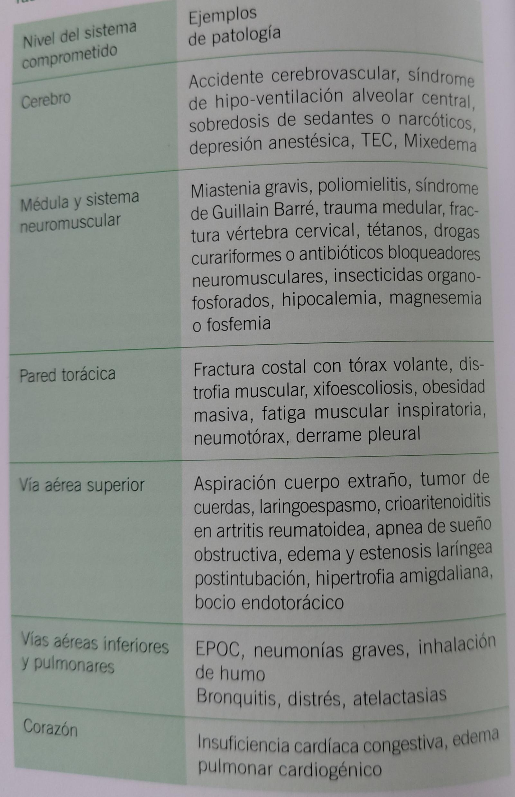
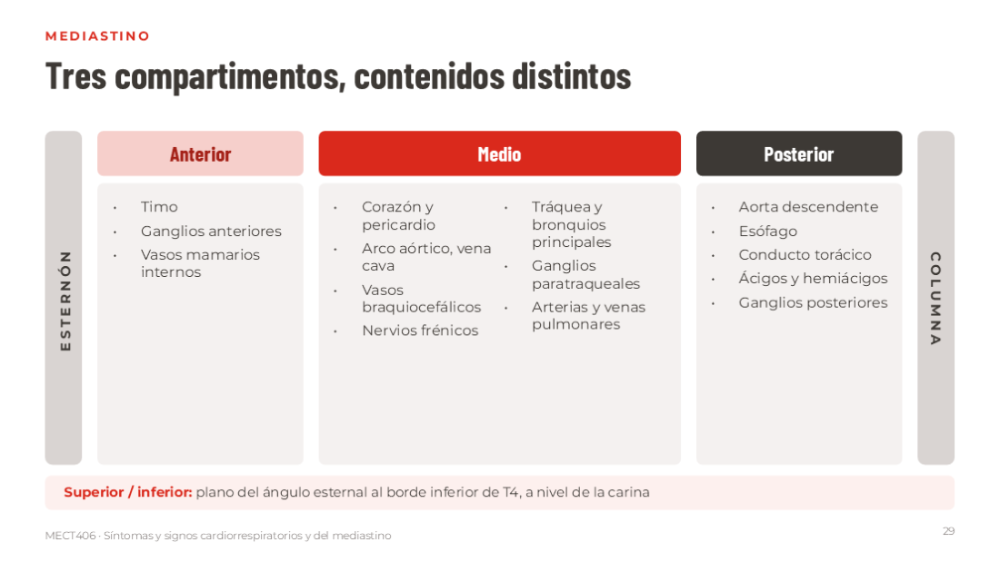

# Respiratorio y mediastino

Fundamentos del Diagnóstico Clínico, Unidad 3.

| Código | Texto original | Fuente |
|---|---|---|
| CRESP | [Sintomas cardiorrespiratorios y mediastino](Textos%20originales/Sintomas%20cardiorrespiratorios%20y%20mediastino.md) | PPT "Síntomas cardiorrespiratorios y mediastino" (Dr. Miguel Yáñez Martínez), basado en Goic, *Semiología Médica*, caps. 4 (pp. 106–128) y 5 (pp. 129–132). |
| RESP | [Sindromes respiratorios](Textos%20originales/Sindromes%20respiratorios.md) | PPT "Síndromes Respiratorios" (María Angélica Barría Schulmeyer, Universidad Autónoma de Chile). |
| Goic | *Semiología médica*, caps. 4, 21 y 22 | Página impresa; leídos en parte. |
| UCH | Manual de Semiología UCH, temas 9, 10 y 27 | Página impresa. |
| Argente | Argente y Álvarez, caps. 42-3, 42-4 y 42-5 | Extractos; sin número de página. |

> **Cómo leer:** [DIG d. 7] indica el PPT (código) y la diapositiva. "Cita:" copia la referencia de la lámina, sin contrastarla. † marca texto oculto o cortado en la lámina. ⚠ remite a la sección final de pendientes. La línea *Falta* indica apartados que los PPT no desarrollan o que no tienen espacio propio. Lo marcado **[Goic, p. N]**, **[UCH, tema, p. N]** o **[Argente, cap.]** es complemento de los libros, resumido con otras palabras.

**Siglas:** CMH (miocardiopatía hipertrófica); TEP (tromboembolismo pulmonar); EPOC (enfermedad pulmonar obstructiva crónica); TBC (tuberculosis); Rx (radiografía); TC (tomografía computarizada); DPN (disnea paroxística nocturna); TPSV (taquicardia paroxística supraventricular); FA (fibrilación auricular); ORL (otorrinolaringología); Hb (hemoglobina); IC (insuficiencia cardíaca); V/Q (ventilación/perfusión); HTP (hipertensión pulmonar); CO (monóxido de carbono); PAM (presión arterial media); BAV (bloqueo auriculoventricular); TV (taquicardia ventricular); ECG (electrocardiograma); IV (intravenosa); T4 (cuarta vértebra torácica); SDRA (síndrome de distrés respiratorio del adulto); EP (embolismo pulmonar); TVP (trombosis venosa profunda); PaO₂ y PaCO₂ (presión arterial de oxígeno y de dióxido de carbono); PCP (presión capilar pulmonar); BNP (péptido natriurético tipo B); NT-proBNP (fragmento N-terminal del proBNP); PA/FI (presión arterial de oxígeno dividida por la fracción inspirada de oxígeno); ALI (injuria pulmonar aguda, del inglés *acute lung injury*); TAC (tomografía axial computarizada); PET-CT (tomografía por emisión de positrones fusionada con tomografía computarizada); Rxg (radiografía); TEC (traumatismo encefalocraneano); mMRC (escala de disnea modificada del Medical Research Council); LDH (lactato deshidrogenasa); FiO₂ (fracción inspirada de oxígeno).

## Mapa del tema

- **Síntomas y signos:** Tos y expectoración; Disnea; Hemoptisis; Epistaxis.
- **Síndromes:** Síndromes pleuropulmonares; Insuficiencia respiratoria; Síndrome de distrés respiratorio del adulto (SDRA); Embolismo pulmonar; Síndromes mediastínicos.
- **Solo en la literatura o apenas nombrados (Parte C):** Neumonía adquirida en la comunidad; Enfermedad pulmonar obstructiva crónica (EPOC); Neumotórax: formas y causas; Síndrome de vena cava inferior.

## Parte A. Síntomas y signos

### Tos y expectoración

#### Definición

- Tos: espiración explosiva con la glotis cerrada, generalmente refleja, que busca expulsar secreciones, sangre o cuerpos extraños y mantener permeable la vía aérea. **[Goic, p. 110]**
- Expectoración o esputo: contenido del árbol respiratorio expulsado con la tos; un adulto sano secreta cerca de 100 mL de mucus al día, que deglute sin notarlo. **[Goic, p. 113]**

#### Mecanismo

| Vía aferente | Territorio |
|---|---|
| Trigémino | Nariz y senos |
| Glosofaríngeo | Faringe posterior |
| Vago | Tráquea, bronquios, pleura, oído |
| Frénico | Pericardio, diafragma |

- **Centro:** bulbo. **Eferentes:** vago (laringe), frénico (diafragma), espinales (pared abdominal).
- **Fases:** inspiración, compresión (glotis cerrada), expulsión.

<!-- CRESP d. 8 | tipo: esquema | incluir en Word: opcional -->

- Estímulos tusígenos: inflamatorios, mecánicos, químicos, térmicos y psicológicos. **[Goic, p. 111]**

#### Causas

| Duración | Respiratoria (productiva) | Extrarrespiratoria (seca) |
|---|---|---|
| Aguda (menos de 3 semanas) | Resfrío, influenza, bronquitis aguda, neumonía | Alergia, irritantes, IC (tos de decúbito) |
| Crónica (3 semanas o más) | Bronquitis crónica y EPOC, bronquiectasias, TBC | IC, tumores broncopulmonares, mediastino, reflujo |

- [CRESP d. 9] La bronquitis crónica y EPOC se asocian a tabaco.
- UCH separa tos aguda (hasta 3 semanas), subaguda (3 a 8) y crónica (más de 8). Con radiografía normal, las tres causas principales de tos crónica son descarga posterior, asma variante tos y reflujo gastroesofágico. **[UCH, tema 10, p. 43]**
- Agregar como causas: inhibidores de la enzima convertidora de angiotensina, estenosis mitral y pericarditis. **[UCH, tema 10, p. 43]**
- Otras causas de vómica: empiema abierto a los bronquios y supuraciones bajo el diafragma. **[Goic, p. 113]**

#### Cómo caracterizarlo

**Sonido de la tos** [CRESP d. 10]

| Tipo | Descripción | Orienta a |
|---|---|---|
| Quintosa | Accesos de cerca de 5 golpes con reprise; nocturna | Coqueluche |
| Coqueluchoide | Accesos breves sin gallito, no productiva | Irritación vagal mediastínica |
| Perruna | Ronca, como ladrido | Laringitis, traqueolaringitis |
| Afónica | Baja intensidad | Lesión destructiva de cuerdas |
| Bitonal | Dos tonos: cuerda paralizada | Aneurisma del cayado, tumor mediastínico |
| Emetizante | Termina en vómito | Coqueluche |

**Esputo** [CRESP d. 11]

| Esputo | Aspecto | Causa |
|---|---|---|
| Mucoso | Blanquecino, como clara de huevo | Infecciones comunes |
| Purulento | Amarillo o verdoso | Piógena, TBC |
| Seroso | Líquido, espumoso, asalmonado | Edema pulmonar agudo |
| Herrumbroso | Adherente, con burbujas | Neumonía neumocócica |
| Hemoptisis | Sangre pura, roja, espumosa | TBC, bronquiectasias, cáncer, estenosis mitral |
| Hemoptoico | Sangre mezclada, oscura | Infarto pulmonar |
| Compota de ciruela | Sanguinolento oscuro | Cáncer broncogénico |
| Achocolatado | Color chocolate | Absceso hepático amebiano |

**Broncorrea** [CRESP d. 12]

- En vaso cónico: capas espumosa, filante, serosa y purulenta (sedimento).
- Causas: bronquiectasias, supuraciones crónicas, TBC; aguda en edema pulmonar.
- **Vómica:** expulsión brusca de pus o líquido hidatídico.
- Olor: "cacho quemado" (*Klebsiella*); fétido (anaerobios, absceso).

- [CRESP d. 12] Capas: espumosa como clara de huevo, filante como estalactitas, serosa transparente y sedimento purulento.
- Sobre la tos: tiempo de evolución, sonido, si es aislada o en accesos, seca o húmeda, origen respiratorio o no, desencadenantes y acompañantes. La respiratoria suele ser fácil y húmeda; la extrarrespiratoria, difícil y seca. **[Goic, p. 111–112]**
- La tos seca es propia del comienzo de los procesos inflamatorios o congestivos y puede mantenerse seca en los limitados a la pleura. Niños y mujeres a veces degluten la expectoración. **[Goic, p. 111]**
- Muchos fumadores niegan la tos; la delatan los convivientes o se comprueba haciéndolos toser. **[Goic, p. 111–112]**
- Del esputo: cantidad, consistencia, viscosidad, color y olor; observarlo en un recipiente limpio y seco o sobre fondo blanco. Las estrías de sangre aisladas tienen poco valor. **[Goic, p. 113–114]**
- Broncorrea: más de 60 mL en 24 horas; crónica sugiere bronquiectasias y en uno o dos episodios, absceso. La vómica hidatídica trae restos como hollejos de uva. **[UCH, tema 10, p. 44]**

#### Exámenes de apoyo

- Tos crónica: Rx y laboratorio; TC o broncoscopía según el caso.

**Conducta** [CRESP d. 9]

- Codeína solo en tos seca; en la productiva retiene secreciones.
- La infección respiratoria alta no requiere exámenes ni antibióticos. En la tos crónica, sobre todo con fiebre, sangre o compromiso general: laboratorio y radiografía; eventualmente TC, broncoscopía y pruebas funcionales. **[Goic, p. 113]**
- En el esputo: Gram, cultivo y, en casos, citología. **[Goic, p. 115]**
- Tos crónica: revisar tabaco e inhibidores de la enzima convertidora; pedir radiografía y baciloscopías. **[UCH, tema 10, p. 43]**

#### Signos de alarma

- Complicaciones de la tos intensa: vómitos, síncope, neumotórax y fracturas costales (en hueso enfermo, como mieloma o metástasis). **[Goic, p. 112]**

*Falta: examen físico, diagnóstico diferencial como apartado (ver tabla de esputo).*

### Disnea

Ver también: Insuficiencia respiratoria e [insuficiencia cardíaca](02%20Cardiovascular.md).

#### Definición

- Respiración dificultosa percibida como mayor esfuerzo o sofocación; es un síntoma, de modo que un paciente inconsciente puede respirar mal sin tener disnea. **[Goic, p. 115]**
- No confundir con fatigabilidad, ni con hiperpnea (más profundidad según demanda), hiperventilación (por sobre la demanda), taquipnea (más frecuencia) o polipnea (rápida y superficial). **[Goic, p. 115]**

#### Mecanismo

**Cheyne-Stokes** [CRESP d. 14]

Apnea → crescendo → jadeo → decrescendo → apnea.

- Mayores de 50 años con IC izquierda; de noche, relatan vigilia y ahogo.
- Otras: daño cerebral, opiáceos; fisiológica en lactantes, ancianos y altura.

<!-- CRESP d. 14 | tipo: gráfico | incluir en Word: sí -->

#### Causas

- **Cardíaca:** insuficiencia cardíaca izquierda [CRESP d. 13–14].
- **Respiratoria:** obstrucción alta o baja (tabla), TEP, enfermedad infiltrativa difusa, ansiedad [CRESP d. 15].

- [CRESP d. 15] La EPOC incluye bronquitis crónica y enfisema.
- Menos frecuentes que las cardíacas, respiratorias y ansiosas: anemia acentuada, baja presión de oxígeno, obesidad e intoxicaciones. **[Goic, p. 115]**
- También deformidades de la pared (cifoescoliosis) y compromiso de los músculos respiratorios, de peor pronóstico. **[Goic, p. 117]**
- Agudas que se presentan en reposo: edema pulmonar, embolia y neumotórax. **[UCH, tema 09, p. 40]**

#### Cómo caracterizarlo

**Disnea cardíaca** [CRESP d. 13]

| Escalón | Claves |
|---|---|
| De esfuerzo | Cuadras o pisos hasta el ahogo |
| De reposo | IC avanzada |
| Ortopnea | Número de almohadas indica intensidad |
| DPN | Despierta y se sienta; 10–20 min |
| Edema pulmonar agudo | Sofocación, esputo asalmonado |

- Error frecuente: el ortopneico que se desliza en la cama y alivia al sentarse no tiene DPN.
- Tos de decúbito equivale a ortopnea. **Trepopnea:** disnea en decúbito lateral.

**Disnea respiratoria** [CRESP d. 15]

| Rasgo | Obstrucción alta (laringe, tráquea) | Obstrucción baja (bronquiolos) |
|---|---|---|
| Fase | Inspiratoria | Espiratoria |
| Signos | Cornaje, tiraje | Sibilancias, tos |
| Aguda | Cuerpo extraño, edema de glotis (emergencia) | Crisis asmática |
| Crónica | Tumores, postintubación | EPOC |

- **TEP recidivante:** brusca, inexplicada, con taquicardia.
- **Infiltrativa difusa:** progresiva e invalidante.
- **Ansiedad:** suspirosa; hiperventilación con parestesias y mareo.
- La ortopnea orienta a falla izquierda pero no es exclusiva: aparece en asma y derrame pericárdico. La disnea paroxística nocturna puede ser la primera manifestación de insuficiencia cardíaca. **[Goic, p. 115–116]**
- La disnea de esfuerzo suele indicar causa orgánica; la que aparece en reposo y no con el ejercicio orienta a causa funcional. **[UCH, tema 09, p. 40]**
- Platipnea: disnea que aparece al estar de pie o sentado. **[UCH, tema 09, p. 41]**

| Grado mMRC (usado en EPOC) **[UCH, tema 09, p. 40]** | Disnea que aparece |
|---|---|
| 0 | Solo con ejercicio intenso |
| 1 | Al andar rápido o subir una pendiente suave |
| 2 | No puede caminar al mismo paso que personas de su edad |
| 3 | Se detiene antes de unos 100 metros |
| 4 | Impide salir de casa o aparece al vestirse |

#### Examen físico

- Buscar palidez, fiebre y edema; el edema de una sola pierna sugiere trombosis y embolia. **[UCH, tema 09, p. 41]**
- Tercer ruido: insuficiencia cardíaca; sibilancias: asma o EPOC; crepitaciones: falla izquierda; crepitaciones tipo velcro: fibrosis; matidez: derrame o atelectasia; hipersonoridad: neumotórax. **[UCH, tema 09, p. 42]**
- Sibilancia o estridor localizados: cuerpo extraño. Debilidad de las cuatro extremidades sin reflejos: pensar en Guillain-Barré. **[UCH, tema 09, p. 42]**

#### Signos de alarma

- La obstrucción alta aguda (cuerpo extraño, edema de glotis) es una emergencia. **[Goic, p. 116]**

*Falta: exámenes de apoyo.*

### Hemoptisis

#### Definición y diagnóstico diferencial [CRESP d. 18]

| Rasgo | Hemoptisis | Hematemesis |
|---|---|---|
| Antes | Hervor traqueal, tos | Náuseas, arcadas, lipotimia |
| Color | Rojo escarlata | Rojo oscuro |
| Aspecto | Líquida, espumosa | Coagulada, con alimentos |
| Cantidad | Menor de 100 mL | 0,5–1 L |
| Después | Esputos cada vez menos teñidos | Melena, anemia |

Descartar epistaxis posterior deglutida y hemosialemesis (saliva con sangre, sin tos).

- Expulsión con la tos de sangre originada bajo la glotis. **[UCH, tema 10, p. 44]**
- Se reserva «hemoptisis» para sangre pura y espumosa; la hemoptoica (mezclada con exudado) y la herrumbrosa se nombran aparte. **[Goic, p. 114]**

#### Mecanismo

- En general una lesión destructiva rompe un vaso; en la estenosis mitral se debe al aumento de presión venosa pulmonar, y tiende a desaparecer al avanzar la valvulopatía. **[Goic, p. 121]**

#### Causas según edad [CRESP d. 19]

| Grupo | Causa | Estudio |
|---|---|---|
| Joven | TBC | Rx, baciloscopía |
| Joven | Estenosis mitral (fiebre reumática) | Ecocardiograma |
| Sobre la edad media | Cáncer broncogénico | TC, broncoscopía, citología |
| Sobre la edad media | Bronquiectasias (tos crónica, panal de abejas) | TC |

El 10 % queda sin causa; volumen habitual menor de 100 mL, rara vez anemia.

- Agregar: hemorragia alveolar (vasculitis), metástasis, adenoma bronquial, trauma torácico, tromboembolismo, hipertensión pulmonar y rotura vascular hacia la vía aérea. **[UCH, tema 10, p. 45]**
- También quiste hidatídico, síndrome de Eisenmenger, fístulas arteriovenosas, diátesis hemorrágica y anticoagulantes. **[Goic, p. 120–121]**

#### Cómo caracterizarlo

- Preguntar edad, tabaquismo y volumen. **[UCH, tema 10, p. 44]**

#### Examen físico

- Revisar nariz y boca para descartar sangrado de otro origen. **[UCH, tema 10, p. 44]**

#### Exámenes de apoyo

- Todo paciente se observa y estudia: radiografía de tórax, TC y/o broncoscopía. **[UCH, tema 10, p. 45]**

#### Signos de alarma

- Masiva: más de 150–200 mL al día; puede ser fatal. **[UCH, tema 10, p. 44]**

### Epistaxis

#### Definición

- Hemorragia de las fosas nasales, de sangre roja brillante; cerca del 60 % de las personas la tiene alguna vez y alrededor del 6 % requiere atención. **[Goic, p. 121]**

#### Mecanismo

- Irrigación por las carótidas interna y externa, muy rica en el tabique anterior; los sangrados posteriores son más abundantes porque domina la arteria esfenopalatina. **[Goic, p. 121–122]**

#### Causas [CRESP d. 20]

- **Anterior (95 %):** plexo de Kiesselbach, causa local.
- **Posterior (menos de 5 %):** etmoidales o esfenopalatina; más grave, sangre tras la úvula.

- Bilateral o con petequias: buscar hemopatía, anticoagulantes, Rendu-Osler.
- La local suele ser unilateral y la general, bilateral. Locales: trauma, hurgarse, sequedad, rinitis, sinusitis, tabique desviado, tumores. **[Goic, p. 122]**
- Generales: infecciones, déficit de factores, hemopatías, cirrosis, anticoagulantes, cocaína y telangiectasia hereditaria; es discutible que la hipertensión sola la cause. **[Goic, p. 122]**
- Preescolar con secreción hemopurulenta fétida de un lado: cuerpo extraño. **[Goic, p. 122]**

#### Examen físico

- Antecedentes personales, familiares y fármacos; buscar petequias y equimosis. El punto sangrante se ve con espéculo nasal; en la posterior puede no verse. **[Goic, p. 121–122]**

#### Diagnóstico diferencial

- La sangre posterior deglutida puede vomitarse y simular hematemesis. **[Goic, p. 122]**

#### Alarma y conducta [CRESP d. 20]

- **Manejo:** comprimir ala nasal 5 min y taponamiento anterior → si dura más de 15 min, recidiva o cae a faringe: otorrino (cauterización) → posterior: taponamiento posterior o procedimiento.

- [CRESP d. 20] Se deriva si escurre a la faringe; el otorrino usa cauterización y vasoconstrictores.
- Grave: abundante, persistente, generalmente bilateral y posterior, con palidez, inquietud o compromiso hemodinámico; se hospitaliza. Las repetidas también pueden descompensar. **[Goic, p. 122]**

*Falta: exámenes de apoyo.*

## Parte B. Síndromes

### Síndromes pleuropulmonares

Cada síndrome mantiene juntos su ejemplo, fisiopatología, clínica y examen físico.

#### Comparación del examen físico [RESP d. 3–8]

| Síndrome | Vibraciones vocales | Percusión | Auscultación |
|---|---|---|---|
| Condensación | Aumentadas | Matidez | Soplo tubárico, crepitaciones |
| Derrame pleural | Disminuidas | Matidez marcada | Murmullo disminuido o abolido |
| Neumotórax | Disminuidas | Hipersonoridad | Murmullo ausente |
| Ocupación alveolar difusa | No se menciona | No se menciona | Crepitaciones bilaterales |
| Obstrucción bronquial | No se menciona | No se menciona | Sibilancias difusas |
| Atelectasia | Disminuidas | Matidez | Murmullo disminuido |

#### Condensación pulmonar [RESP d. 3]

- **Ejemplo típico:** neumonía.
- **Fisiopatología:** los alvéolos se llenan de exudado, pus o líquido inflamatorio.
- **Clínica:** fiebre, tos, expectoración, disnea, dolor pleurítico.
- **Examen físico:** vibraciones vocales aumentadas, matidez a la percusión, soplo tubárico, crepitaciones.

#### Derrame pleural [RESP d. 4]

- **Fisiopatología:** acumulación de líquido en el espacio pleural.
- **Clínica:** disnea, tos seca, dolor pleurítico.
- **Examen físico:** vibraciones vocales disminuidas, matidez marcada, murmullo pulmonar disminuido o abolido.

#### Neumotórax [RESP d. 5]

- **Fisiopatología:** entrada de aire al espacio pleural.
- **Clínica:** disnea brusca, dolor torácico súbito.
- **Examen físico:** hipersonoridad, vibraciones vocales disminuidas, ausencia de murmullo pulmonar.

#### Ocupación alveolar difusa [RESP d. 6]

- **Ejemplos:** edema agudo de pulmón, SDRA.
- **Clínica:** disnea intensa, hipoxemia, taquipnea.
- **Auscultación:** crepitaciones bilaterales.

#### Obstrucción bronquial [RESP d. 7]

- **Ejemplos:** asma, EPOC.
- **Fisiopatología:** disminución del flujo aéreo.
- **Clínica:** disnea, tos, sibilancias, espiración prolongada.
- **Examen físico:** sibilancias difusas, tórax hiperinsuflado (EPOC).

#### Atelectasia [RESP d. 8]

- **Fisiopatología:** colapso parcial o total del pulmón.
- **Clínica:** disnea variable.
- **Examen físico:** vibraciones vocales disminuidas, matidez, murmullo pulmonar disminuido.

#### Causas

- **Condensación:** exudado (neumonía, la principal), sangre (infarto), líquido (edema, aspiración) o células neoplásicas. **[UCH, tema 27, p. 176]**
- **Derrame:** trasudado (insuficiencia cardíaca, nefrótico, cirrosis) o exudado (infección, tumor); las más frecuentes son insuficiencia cardíaca y derrame paraneumónico. El líquido puede ser sangre, linfa o pus. **[UCH, tema 27, p. 177]**
- **Neumotórax:** iatrogénico, traumático o espontáneo; primario en hombres jóvenes, altos y delgados o con Marfan; secundario a enfermedad pulmonar (sobre todo EPOC), más grave. **[UCH, tema 27, p. 178]**
- **Atelectasia:** lo que impida expandir el pulmón u obstruya un bronquio (derrame, neumotórax, tumor); frecuente tras cirugía mayor de tórax o abdomen. **[UCH, tema 27, p. 179]**

#### Examen físico

- Condensación: menor expansión; a veces broncofonía, pectoriloquia áfona, egofonía o frotes. **[UCH, tema 27, p. 176]**
- Derrame: abombamiento si es grande, tráquea al lado contrario, soplo pleurítico en el borde superior; se necesitan 300 mL para detectarlo por clínica. **[UCH, tema 27, p. 177]**
- Atelectasia: retracción del hemitórax y tráquea hacia el mismo lado. **[UCH, tema 27, p. 179]**

#### Exámenes y criterios

- **Derrame:** curva de Damoiseau; se ve desde 200–300 mL en proyección frontal, 50–100 mL en lateral y 50 mL o más con ecografía o TC. **[UCH, tema 27, p. 178]**
- Toracocentesis para estudio bioquímico, citológico y microbiológico; los criterios de Light (proteínas y LDH) separan exudado de trasudado. **[UCH, tema 27, p. 178]**
- **Neumotórax:** radiolucidez sin trama vascular y pulmón colapsado junto al hilio. **[UCH, tema 27, p. 178–179]**
- **Atelectasia:** opacidad con tráquea desviada hacia el mismo lado; el diafragma puede elevarse. **[UCH, tema 27, p. 179]**

#### Alarma y conducta

- Neumotórax a tensión: el aire entra y no sale, comprime el mediastino y reduce el retorno venoso; urgencia vital que evoluciona a shock. **[UCH, tema 27, p. 178]**

*Falta: diagnóstico diferencial.*

### Insuficiencia respiratoria

#### Definición [RESP d. 9]

Síndrome de inadecuado intercambio gaseoso debido al mal funcionamiento de uno o más de los componentes esenciales del sistema respiratorio: pared torácica, vía aérea, unidades alveolocapilares, circulación pulmonar, nervios o sistema nervioso central.

Se produce cuando:

- Los pulmones no son capaces de oxigenar adecuadamente la sangre arterial, o
- No pueden evitar la retención de CO₂.

#### Fisiopatología [RESP d. 11]

- **Mecanismos de alteración del intercambio gaseoso:**
    - Hipoventilación alveolar
    - Cortocircuito
    - Alteración de la distribución
    - Alteración de la difusión

- Tipo I, hipoxémica (CO₂ normal); tipo II, hipercápnica o global. Puede ser aguda, crónica o crónica reagudizada; algunos agregan III (perioperatoria, por atelectasia) y IV (shock). **[Goic, p. 261]**
- La hipercapnia puede ocurrir con pulmón sano (falla de la bomba, gradiente alvéolo-arterial normal) o enfermo (EPOC descompensada). **[Goic, p. 261]**

#### Causas [RESP d. 10; tabla fotografiada, citada como Goic 2018, p. 262]

| Nivel del sistema comprometido | Ejemplos de patología |
|---|---|
| Cerebro | Accidente cerebrovascular, síndrome de hipoventilación alveolar central, sobredosis de sedantes o narcóticos, depresión anestésica, TEC, mixedema |
| Médula y sistema neuromuscular | Miastenia gravis, poliomielitis, síndrome de Guillain-Barré, trauma medular, fractura de vértebra cervical, tétanos, drogas curariformes o antibióticos bloqueadores neuromusculares, insecticidas organofosforados, hipocalemia, magnesemia o fosfemia ⚠ |
| Pared torácica | Fractura costal con tórax volante, distrofia muscular, xifoescoliosis, obesidad masiva, fatiga muscular inspiratoria, neumotórax, derrame pleural |
| Vía aérea superior | Aspiración de cuerpo extraño, tumor de cuerdas, laringoespasmo, crioaritenoiditis ⚠ en artritis reumatoidea, apnea de sueño obstructiva, edema y estenosis laríngea postintubación, hipertrofia amigdaliana, bocio endotorácico |
| Vías aéreas inferiores y pulmonares | EPOC, neumonías graves, inhalación de humo, bronquitis, distrés, atelectasias |
| Corazón | Insuficiencia cardíaca congestiva, edema pulmonar cardiogénico |

<!-- RESP d. 10 | tipo: tabla fotografiada | ya transcrita arriba | incluir en Word: opcional -->

#### Clínica (anamnesis)

- Orientan sepsis, trauma, aspiración o transfusiones; y fármacos, compromiso de conciencia, debilidad o inhalaciones. **[Goic, p. 262]**
- Hipoxemia: incoordinación, mal juicio, inquietud. Hipercapnia: cefalea, cambios de ánimo, somnolencia hasta coma. **[Goic, p. 263]**

#### Examen físico

- Buscar hipotensión, crepitaciones u obstrucción, estridor, presión venosa yugular y arritmias. **[Goic, p. 263]**
- Hipoxemia: bajo 55 mmHg taquicardia y alza leve de presión; bajo 30, bradicardia. La cianosis es tardía. **[Goic, p. 263]**
- Hipercapnia: asterixis, temblor, piel rubicunda, sudoración, miosis y edema de papila. **[Goic, p. 263]**

#### Exámenes y criterios [RESP d. 11]

- **Criterio:** PaO₂ menor de 60 mmHg y, generalmente, CO₂ superior a 50 mmHg. ⚠

#### Alarma y conducta

- En algunos pacientes con EPOC el oxígeno en alta concentración suprime el estímulo hipóxico y agrava la retención de CO₂. **[Goic, p. 262]**
- Primero permeabilizar la vía aérea, oxigenar (indicado con PaO₂ menor de 60 mmHg o saturación menor de 90 %) y asegurar ventilación; con hipercapnia crónica, oxígeno en concentraciones bajas. **[Argente, cap. 42-5]**

*Falta: diagnóstico diferencial.*

### Síndrome de distrés respiratorio del adulto (SDRA)

#### Definición

**Definición** [RESP d. 12]

Insuficiencia respiratoria aguda grave producida por una lesión inflamatoria difusa de la membrana alveolocapilar, que provoca aumento de la permeabilidad vascular, edema pulmonar no cardiogénico e hipoxemia severa.

#### Causas

**Causas frecuentes** [RESP d. 12]

| Directas (pulmonares) | Indirectas (extrapulmonares) |
|---|---|
| Neumonía grave | Sepsis (la causa más frecuente) |
| Aspiración de contenido gástrico | Pancreatitis aguda |
| Contusión pulmonar | Politraumatismos |
| Inhalación de humo o gases tóxicos | Grandes transfusiones |
| Toxicidad por O₂ | Shock |

- Otras: ahogamiento, hemorragia alveolar, reperfusión, sobredosis (opiáceos, salicilatos) y postrasplante; el alcoholismo y factores genéticos predisponen. **[Goic, p. 264]**

#### Clínica (anamnesis) [RESP d. 15]

- **Síntomas:** disnea intensa de inicio agudo que progresa en horas o pocos días; taquipnea (frecuencia respiratoria mayor de 20–30 rpm); sensación creciente de falta de aire; tos seca (variable); ansiedad y agitación como consecuencia de la hipoxemia.

#### Examen físico [RESP d. 15]

- **Signos físicos:** hipoxemia importante, saturación de O₂ disminuida, taquicardia, uso de musculatura accesoria, retracción intercostal, aleteo nasal, cianosis.
- † En casos avanzados: crepitantes bilaterales difusos. Simulan edema pulmonar.

#### Exámenes y criterios

**Criterios diagnósticos** [RESP d. 13] ⚠

- **Tiempo:** agudo; 50 % antes de 12 horas y 90 % antes de 3 días.
- **Imágenes:** infiltrados difusos bilaterales.
- **Presión de enclavamiento:** menor de 18 mmHg o sin insuficiencia cardíaca clínica.
- **PA/FI:** menor de 200, SDRA; menor de 300, ALI.

**Apoyo diagnóstico** [RESP d. 15]

- **Gasometría arterial:** PaO₂ disminuida (hipoxemia); inicialmente PaCO₂ disminuida por hiperventilación; después puede aumentar si hay fatiga respiratoria.
- † **Radiografía de tórax:** hallazgo clásico de infiltrados alveolares bilaterales difusos, descritos como "pulmón blanco" o "tormenta de nieve".
- Definición de Berlín (2012): inicio dentro de una semana, infiltrados bilaterales no explicados por otra causa, edema no explicado del todo por falla cardíaca o sobrecarga, y PaO₂/FiO₂ con presión positiva de al menos 5 cm H₂O: leve 300 o menos, moderado 200 o menos, grave 100 o menos. **[Argente, cap. 42-5]**
- La radiografía puede atrasarse 12 a 24 horas. Hipoxemia refractaria: PaO₂ menor de 60 mmHg con FiO₂ de 50 %. **[Goic, p. 264]**

#### Diagnóstico diferencial

**Diagnóstico diferencial** [RESP d. 14]

| Característica | SDRA | Edema cardiogénico |
|---|---|---|
| Causa | Lesión alveolocapilar inflamatoria | Insuficiencia cardíaca izquierda |
| PCP | Normal | Elevada |
| Cardiomegalia | Generalmente ausente | Frecuente |
| BNP | Normal o poco elevado | Elevado |
| Ecocardiograma | Función cardíaca conservada | Disfunción ventricular |
| Respuesta a diuréticos | Limitada | Buena |

El BNP es un biomarcador de estrés y distensión ventricular usado para el diagnóstico y seguimiento de la insuficiencia cardíaca. Es una hormona producida principalmente por los ventrículos cuando se distienden por aumento de presión o volumen.

- Descartar insuficiencia cardíaca; una presión de enclavamiento alta no excluye el distrés. Otros «pulmones blancos»: falla izquierda, sobrecarga de volumen, estenosis mitral, linfangitis carcinomatosa y neumonías intersticiales. **[Goic, p. 264]**

#### Alarma y conducta

- Mortalidad de 25 a 40 %. **[Goic, p. 264]**

*Falta: fisiopatología más allá de la definición.*

### Embolismo pulmonar

#### Definición

**Definición** [RESP d. 16]

Obstrucción de una o más arterias pulmonares por un émbolo, generalmente un trombo procedente de una TVP de las extremidades inferiores o la pelvis.

**Secuencia clásica:** TVP → desprendimiento del trombo → circulación venosa → corazón derecho → arteria pulmonar → EP.

#### Fisiopatología

**Fisiopatología** [RESP d. 17]

La obstrucción provoca:

- Disminución de la perfusión pulmonar
- Alteración de la relación V/Q
- Hipoxemia
- Aumento de la resistencia vascular pulmonar
- Sobrecarga aguda del ventrículo derecho
- En los casos graves, shock obstructivo

#### Causas

**Factores de riesgo: tríada de Virchow** [RESP d. 18]

| Componente | Factores |
|---|---|
| Estasis venosa | Inmovilización prolongada, reposo en cama, viajes largos, insuficiencia cardíaca |
| Lesión endotelial | Cirugía, traumatismos, catéteres venosos |
| Hipercoagulabilidad | Cáncer, embarazo y puerperio, anticonceptivos, trombofilias, síndrome antifosfolípido |

- Otros factores: edad, aterosclerosis, EPOC, infección, inflamación, enfermedad renal crónica, hormonas, dispositivos, obesidad, tabaco y diabetes. **[Goic, p. 266]**

#### Clínica (anamnesis)

**Sospecha clínica** [RESP d. 19]

Debe sospecharse un EP **hasta demostrar lo contrario** ante un paciente con:

- Disnea de inicio brusco, taquicardia inexplicada, dolor pleurítico
- Factores de riesgo trombótico (cirugía reciente, inmovilización, cáncer, antecedente de TVP)

Mnemotecnia del cuadro típico: "dolor + falta de aire + taquicardia". † Es la combinación clínica más característica del EP en urgencias.

- La disnea es el síntoma más frecuente. Masiva: disnea súbita, síncope y cianosis, a menudo sin dolor; el dolor pleurítico indica embolia periférica. **[Goic, p. 266]**

#### Examen físico

- La taquipnea es el signo más frecuente. **[Goic, p. 266]**

#### Exámenes y criterios

**Criterios de Wells** [RESP d. 20]

| Criterio | Puntos |
|---|---|
| Signos clínicos de TVP (edema, dolor a la palpación profunda de una pierna) | 3 |
| Diagnóstico alternativo menos probable que EP | 3 |
| Frecuencia cardíaca mayor de 100 lpm | 1,5 |
| Inmovilización de 3 días o más, o cirugía en las últimas 4 semanas | 1,5 |
| Antecedente de TVP o EP | 1,5 |
| Hemoptisis | 1 |
| Cáncer activo o tratado en los últimos 6 meses | 1 |

Puntaje máximo: 12,5. Probabilidad **baja**: menos de 2; **intermedia**: 2 a 6; **alta**: más de 6.

**Métodos de apoyo diagnóstico** [RESP d. 21–23]

- **Dímero D:** producto de degradación de la fibrina; muy sensible y poco específico.
    - Normal: ayuda a descartar EP en pacientes con baja probabilidad clínica.
    - Elevado: no confirma EP. También sube con infecciones, cáncer, cirugía reciente, embarazo y edad avanzada.
- **Ecocardiograma:** para excluir síndrome coronario agudo. ⚠
- **Radiografía de tórax:** para descartar neumonía, neumotórax u otros. Una radiografía normal en un paciente muy disneico sugiere EP.
- **AngioTAC:** examen de elección. Cuando está contraindicado, la cintigrafía puede ser útil. ⚠

- **Troponinas:** pueden elevarse por sobrecarga del ventrículo derecho.
- **BNP o NT-proBNP:** pueden aumentar si hay disfunción ventricular derecha. Los biomarcadores cardíacos sirven más para estratificar el riesgo.
- **Gasometría arterial:** puede mostrar hipoxemia, hipocapnia y alcalosis respiratoria. Una gasometría normal **no** descarta EP.
- Otra forma de usar Wells: más de 4 puntos, probabilidad alta; 4 o menos, no alta. **[Goic, p. 266]**
- Radiografía: signo de Westermark (zona con menos vasos) y joroba de Hampton; ecografía venosa de las piernas como apoyo. **[Goic, p. 267–268]**
- Sin alta probabilidad se pide dímero D: si es normal, la embolia es muy improbable. **[Goic, p. 268]**

#### Diagnóstico diferencial

Todo dolor torácico que aumenta claramente con la inspiración profunda debe hacer pensar primero en una causa pleuropulmonar (pleuritis, neumonía, neumotórax o embolia pulmonar) antes que en un síndrome coronario agudo.

- Ansiedad, derrame, costocondritis, neumonía, bronquitis, síndrome coronario, pericarditis, insuficiencia cardíaca, disección aórtica e hipertensión pulmonar. **[Goic, p. 267]**

#### Alarma y conducta [RESP d. 19, 23]

- Sospechar hasta demostrar lo contrario ante disnea brusca, taquicardia inexplicada y dolor pleurítico con factores de riesgo [RESP d. 19].

- **Conducta:** si tras la evaluación inicial se estima alta probabilidad, se inicia anticoagulación y se prepara o deriva al paciente para angioTAC de arterias pulmonares.
- Estratificar: masiva, submasiva (sobrecarga derecha, troponina o BNP altos), de bajo riesgo e infarto pulmonar (dolor pleurítico, esputo hemoptoico, febrícula, leucocitosis). **[Goic, p. 267]**

### Síndromes mediastínicos

#### Definición [RESP d. 24; CRESP d. 28]

Espacio situado entre ambos pulmones. Contiene corazón, grandes vasos (aorta, vena cava superior), tráquea, bronquios principales, esófago, ganglios linfáticos y nervios (frénico, vago, recurrente).

Los síntomas dependen más de la ubicación y volumen de la lesión que de su naturaleza [CRESP d. 28].

**Compartimentos** [CRESP d. 29]

| Anterior | Medio | Posterior |
|---|---|---|
| Timo, ganglios anteriores, vasos mamarios internos | Corazón y pericardio, arco aórtico, vena cava, vasos braquiocefálicos, frénicos, tráquea y bronquios, ganglios paratraqueales, vasos pulmonares | Aorta descendente, esófago, conducto torácico, ácigos y hemiácigos, ganglios posteriores |

Límite superior/inferior: plano del ángulo esternal a T4 (carina).

<!-- CRESP d. 29 | tipo: esquema | incluir en Word: sí -->

#### Fisiopatología

- Los síntomas son más intensos mientras más rápida es la obstrucción, porque no alcanza a formarse circulación colateral. Sobre la desembocadura de la ácigos el cuadro es más leve; bajo ella, más grave. **[Goic, p. 270]**

#### Causas

**Tumores primarios** [RESP d. 25]

| Compartimento | Lesiones |
|---|---|
| Anterior | Tiroides endotorácico, timomas, teratomas y tumores germinales, linfoma |
| Medio | Quistes embrionarios, pericárdicos y broncogénicos, linfomas |
| Posterior | Tumores neurogénicos, quistes enterógenos, tumores esofágicos, aneurisma de la aorta descendente, linfoma |

- En el adulto predominan los tumores primarios (sobre todo anteriores: «4 T») y luego la mediastinitis; en niños, los posteriores. **[Goic, p. 269]**
- Vena cava superior: agregar timoma, marcapasos y mediastinitis fibrosa. **[Goic, p. 269]**

#### Clínica (anamnesis)

**Del signo al compartimento** [CRESP d. 30]

| Signo | Estructura o causa |
|---|---|
| Miastenia gravis (debilidad fluctuante, ptosis, diplopía) | Timo (anterior) |
| Edema en esclavina | Vena cava superior (medio) |
| Voz o tos bitonal | Nervio recurrente, cayado |
| Hemidiafragma elevado | Nervio frénico |
| Disfagia lógica | Esófago (posterior) |
| Quilotórax | Conducto torácico |
| Hiperhidrosis o dolor neurítico | Tumor neurogénico |
| Horner | Cadena simpática en el vértice (Pancoast) |
| Fiebre, sudor nocturno, baja de peso | Linfoma, TBC |
| Acropaquia | Cáncer pulmonar |
| Ginecomastia | Coriocarcinoma |

- [CRESP d. 30] En la miastenia el timo puede tener hiperplasia o timoma.

**Síndrome de la vena cava superior** [RESP d. 26]

- **Causas frecuentes:** cáncer de pulmón, linfomas, metástasis mediastínicas, trombosis asociada a catéteres.
- **Clínica:** edema facial, plétora facial (cara rojiza y congestionada), edema cervical, ingurgitación yugular, circulación venosa colateral en el tórax, disnea, tos, cefalea.
- **Motivo de consulta típico:** "amanece con la cara hinchada y roja".
- Vena cava superior: además ronquera, dolor torácico, disfagia, taquipnea y edema de brazos. **[Goic, p. 269]**

**Compresión traqueobronquial** [RESP d. 27]

Por compresión de la tráquea o los bronquios principales. Se manifiesta con disnea, estridor inspiratorio, tos persistente, sibilancias localizadas e infecciones respiratorias recurrentes.

- Compresión traqueobronquial: el tumor dentro del bronquio da sibilancias, atelectasia y neumonías; la compresión externa, disnea inspiratoria, tiraje y cornaje. **[Goic, p. 270]**

**Compresiones nerviosas** [RESP d. 28]

| Estructura comprometida | Manifestaciones |
|---|---|
| Nervio laríngeo recurrente | Disfonía, voz bitonal, parálisis de cuerda vocal |
| Nervio frénico | Elevación del hemidiafragma, disnea |
| Simpático cervical | Síndrome de Claude Bernard-Horner: ptosis palpebral, miosis, anhidrosis facial |

**Compresión arterial** [RESP d. 29]

Poco frecuente; indica una enfermedad tumoral avanzada.

- **Arteria pulmonar:** frémito y soplo sistólico pulmonar.
- **Aorta:** soplo sistólico aórtico, frémito irradiado a los vasos del cuello y alteraciones periféricas del pulso.

**Mediastinitis** [CRESP d. 31]

- **Sospechar mediastinitis tras:** trauma penetrante, cirugía torácica o esofágica, vómitos violentos (Boerhaave), endoscopía alta, absceso oral.
- Dolor retroesternal irradiado al cuello y fiebre; Rx: ensanchamiento, neumomediastino, signo de la V de Naclerio.

**Disfagia** [CRESP d. 31] (ver también [Digestivo](05%20Digestivo.md))

| Disfagia | Patrón | Causas |
|---|---|---|
| Lógica (progresiva) | Sólidos → pastosos → líquidos | Carcinoma, estenosis péptica, compresión |
| Ilógica (intermitente) | Sólidos y líquidos desde el inicio | Acalasia, espasmo difuso, esclerodermia, Chagas |

- [CRESP d. 31] El absceso oral puede causar mediastinitis necrotizante descendente. La disfagia ilógica es de causa motora.

#### Exámenes y criterios [RESP d. 30–31]

- **Radiografía de tórax:** puede mostrar ensanchamiento mediastínico, masa, desviación de la tráquea o elevación diafragmática por compromiso frénico. No permite caracterizar la lesión.
- **TAC de tórax con contraste (examen de elección):** evalúa localización, tamaño, bordes, invasión local, compresión vascular y adenopatías.
- **Orientación por TAC:** masa grasa, teratoma; masa sólida lobulada, timoma; adenopatías múltiples, linfoma.
- **PET-CT:** examen de medicina nuclear que permite una evaluación funcional de los tumores del mediastino.
- **Diagnóstico definitivo:** histopatología de la biopsia obtenida por mediastinoscopía, mediastinostomía anterior, videotoracoscopía o punción aspirativa con aguja fina.
- Resonancia para tumores posteriores o sospecha de invasión de pared o grandes vasos; cintigrama si se sospecha tiroides o paratiroides; ecografía testicular ante posible tumor germinal. **[Argente, cap. 42-4]**

*Falta: examen físico, alarma y conducta (ver Mediastinitis).*

## Parte C. Síndromes y diagnósticos de la literatura

> Cuadros y temas que los PPT **no tratan** o **solo nombran**. Van resumidos y separados para no confundirlos con la materia de clase.

### Neumonía adquirida en la comunidad *(los PPT solo la usan como ejemplo de condensación)*

- Infección del parénquima, por bacterias o virus; adquirida en la comunidad o en el hospital. En Chile es la primera causa de muerte infecciosa; cerca de 80 % se trata ambulatoriamente. **[UCH, tema 27, p. 176]**
- Inicio agudo (menos de 2 semanas) con tos, fiebre, disnea, escalofrío y a veces puntada de costado. En el anciano puede faltar la fiebre y presentarse como confusión o descompensación; vigilar frecuencia cardíaca y respiratoria. **[UCH, tema 27, p. 176]**
- Diagnóstico clínico-radiológico (radiografía frontal y lateral). Causa más común: neumococo. Retrasar el antibiótico más de 4 horas aumenta la mortalidad. **[UCH, tema 27, p. 177]**
- Diferencial: bronquitis aguda, influenza, asma o EPOC descompensadas, embolia e insuficiencia cardíaca. **[UCH, tema 27, p. 176]**

### Enfermedad pulmonar obstructiva crónica (EPOC) *(los PPT solo la nombran)*

- Obstrucción crónica del flujo aéreo, prevenible; su causa principal es el tabaco. Bronquitis crónica (tos productiva 3 meses al año por 2 años) y enfisema suelen coexistir. El déficit de alfa-1 antitripsina es causa rara: pensar en él en menores de 45 años con antecedentes familiares de EPOC. **[UCH, tema 27, p. 179]**

### Neumotórax: formas y causas *(los PPT no las clasifican)*

- Primario: dolor lateral súbito que aumenta al respirar en joven delgado fumador; la TC muestra bulas en la mayoría. Secundario: EPOC, fibrosis quística, estado asmático, tuberculosis, neumonías, intersticiales, colagenopatías, catamenial. **[Argente, cap. 42-3]**
- Traumático abierto: herida mayor de 2/3 del diámetro traqueal, que iguala presiones e impide ventilar. **[UCH, tema 27, p. 178]**

### Síndrome de vena cava inferior *(no está en los PPT)*

- Por tumor o fibrosis mediastínica, o por trombosis ascendida desde las piernas: edema de ambas piernas, circulación colateral abdominal, ascitis y a veces hepatomegalia. **[Goic, p. 270]**

## Anexo de práctica

Los objetivos de la clase de síntomas cardiorrespiratorios están en [Cardiovascular](02%20Cardiovascular.md).

## Pendientes por verificar

Las diferencias entre láminas salen del PPT; el resto es revisión mía.

| Dónde | Observación |
|---|---|
| CRESP d. 9 | Muchas guías definen tos aguda (menos de 3 semanas), subaguda (3–8) y crónica (más de 8). Usar el criterio de la clase solo si así se evalúa. |
| RESP d. 10 | La foto dice "hipocalemia, magnesemia o fosfemia" y "crioaritenoiditis". Probablemente corresponde a alteraciones del magnesio y fósforo (hipo) y a "cricoaritenoiditis". Revisar el libro. |
| RESP d. 11 | El CO₂ elevado no es requisito: en la insuficiencia respiratoria hipoxémica puede estar normal o bajo. |
| RESP d. 13 | Los criterios parecen anteriores a la definición de Berlín (2012), que usa un plazo de hasta 1 semana, PA/FI de 300 o menos con tres grados, presión positiva al final de la espiración y elimina el término ALI y la presión de enclavamiento. Preguntar cuál se evaluará. |
| RESP d. 13, 15 | Hay texto no visible en el archivo. En RESP d. 13 aparece un fragmento suelto ("< 333") que omití; en RESP d. 15 lo incluido va marcado con †. |
| RESP d. 22 | "Ecocardiograma para excluir síndrome coronario agudo": podría ser un error por "electrocardiograma". |
| RESP d. 22 | La redacción sobre angioTAC y cintigrafía es ambigua; la interpreté como angioTAC de elección y cintigrafía si este está contraindicado. |
| Criterios de Wells: cortes | El PPT usa tres niveles (menos de 2, 2–6, más de 6); Goic usa dos (más de 4 o no). |
| Líquido pleural normal | UCH indica 7–16 mL; Argente, hasta 25 mL. |
| Duración de la tos | El PPT y Goic llaman crónica desde las 3 semanas; UCH, sobre 8, con una categoría subaguda. |
| Definición de Berlín | Argente confirma la definición de 2012, distinta de los criterios de RESP d. 13. |

- RESP: Corregí erratas evidentes: "Virshow" (Virchow), "esfágicos" (esofágicos), "pulmona ag" (pulmonar aguda), "atelactasias" (atelectasias).
