# Vascular periférico

Fundamentos del Diagnóstico Clínico, Unidad 3.

| Código | Texto original | Fuente |
|---|---|---|
| VPER | [Sindromes vasculares perifericos](Textos%20originales/Sindromes%20vasculares%20perifericos.md) | PPT "Síndromes vasculares periféricos" (Dr. Miguel Yáñez, FDC 2026). |
| VOO | [Vascular oftalmologico y otologico](Textos%20originales/Vascular%20oftalmologico%20y%20otologico.md) | PPT "Semiología vascular, oftalmológica y otológica" (Dr. Miguel Yáñez Martínez, primavera 2026). Bibliografía que declara: Goic A, Chamorro G, Reyes H. *Semiología Médica*, 4.ª ed., Mediterráneo, 2018, caps. 10, 11 y 12. |
| Goic | *Semiología médica*, caps. 10, 19 y 20 | Página impresa. |
| UCH | Manual de Semiología UCH, tema 34 | Página impresa. |
| Argente | Argente y Álvarez, cap. 36-12 | Extracto; sin número de página. |

> **Cómo leer:** [DIG d. 7] indica el PPT (código) y la diapositiva. "Cita:" copia la referencia de la lámina, sin contrastarla. † marca texto oculto o cortado en la lámina. ⚠ remite a la sección final de pendientes. La línea *Falta* indica apartados que los PPT no desarrollan o que no tienen espacio propio. Lo marcado **[Goic, p. N]**, **[UCH, tema, p. N]** o **[Argente, cap.]** es complemento de los libros, resumido con otras palabras.

**Siglas:** FA (fibrilación auricular); ITB (índice tobillo-brazo); PAS (presión arterial sistólica); TVP (trombosis venosa profunda); ANCA (anticuerpos anticitoplasma de neutrófilos); IgA (inmunoglobulina A); EEII (extremidades inferiores); HTA (hipertensión arterial); LES (lupus eritematoso sistémico); D (dioptría); PRK (queratectomía fotorrefractiva); LASIK (queratomileusis in situ asistida con láser); LIO (lente intraocular); AV (agudeza visual); ATM (articulación temporomandibular); LCR (líquido cefalorraquídeo).

## Mapa del tema

- **Síntomas y signos:** Várices; Úlceras de extremidades inferiores.
- **Síndromes:** Insuficiencia arterial; Insuficiencia venosa; Vasculitis.
- **Solo en la literatura o apenas nombrados (Parte D):** Síndrome de Leriche; Isquemia crítica; Tromboflebitis superficial; Pie diabético; Síndrome riñón-pulmón.

## Parte A. Fundamentos

### Principios circulatorios [VPER d. 2]

<!-- VPER d. 2 y 10 | tipo: infografías | incluir en Word: opcional -->

| Territorio [VPER d. 2, figura] | Reposo (5 L/min) | Ejercicio (25 L/min) |
|---|---|---|
| Esplácnico | 20–25 % | 3–5 % |
| Coronario | 4–5 % | 4–5 % |
| Renal | 20 % | 2–4 % |
| Hueso | 3–5 % | 0,5–1 % |
| Cerebro | 15 % | 3–4 % |
| Piel | 5 % | Variable |
| Músculo activo | 15–20 % | 80–85 % |

- [VPER d. 2] Principios: el flujo se regula según la necesidad de cada tejido; el gasto cardíaco es la suma de los flujos locales; la presión arterial se regula en general de forma independiente. Sangre: circulación sistémica 84 % (venas 64 %, arterias 13 %, arteriolas y capilares 7 %), pulmonar 9 %, corazón 7 %.

### Retorno venoso [VPER d. 13]

Profundo 90 %; superficial 10 %.

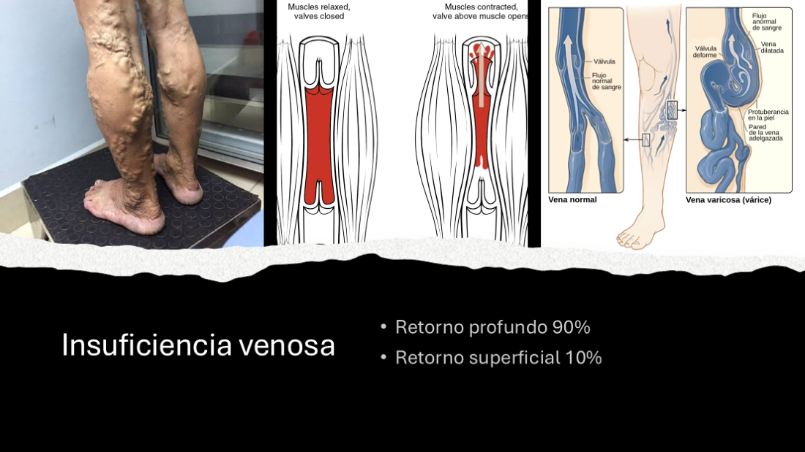
<!-- VPER d. 13 | tipo: foto y esquemas | incluir en Word: sí -->

## Parte B. Síntomas y signos

### Várices

#### Definición

Dilatación y elongación tortuosa de venas superficiales, visibles bajo la piel o mucosa.

#### Causas [VOO d. 4–5]

- **Predisponentes:** familia, trabajo de pie, obesidad, embarazo, comunicaciones arteriovenosas.

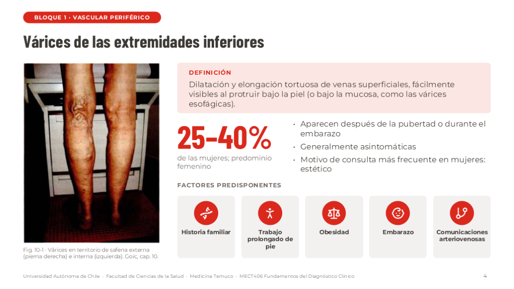
<!-- VOO d. 4 | tipo: foto (fig. 10-1) | incluir en Word: sí -->

| Primarias | Secundarias |
|---|---|
| Falla de las válvulas de la safena interna o externa | Insuficiencia u obstrucción del sistema profundo |
| El reflujo transmite presión a las tributarias | Sobrecarga vía comunicantes |
| Distribución estereotipada | Distribución caprichosa |

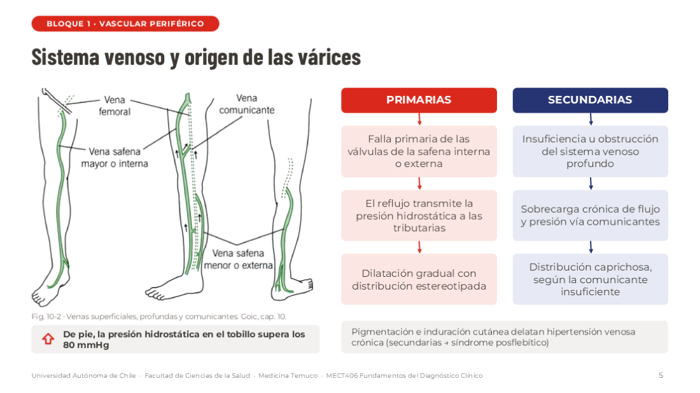
<!-- VOO d. 5 | tipo: esquema (fig. 10-2) | incluir en Word: sí -->

- Primarias: familia, edad, obesidad, sexo femenino, multiparidad, bipedestación, anticonceptivos. Secundarias: trombosis venosa previa (lo más importante), tromboflebitis, trombofilia, fístulas, comunicantes incompetentes, May-Thurner. **[UCH, tema 34, p. 223]**

#### Mecanismo [VOO d. 5]

De pie, la presión hidrostática del tobillo supera 80 mmHg. Pigmentación e induración indican hipertensión venosa crónica (síndrome posflebítico).

- Primarias: falla de las válvulas de la safena (UCH agrega alteración del colágeno de la pared). La presión se transmite a las tributarias. **[Goic, p. 171]** **[UCH, tema 34, p. 222]**

#### Cómo caracterizarlo

- Frecuentes en mujeres (25–40 %); aparecen tras la pubertad o en el embarazo.
- Generalmente asintomáticas; en mujeres se consulta por estética.

**Síntomas** [VOO d. 6]

Pesadez, edema vespertino leve, prurito, cansancio, calambres nocturnos. Acumulativos, vespertinos, peores con calor; alivian al elevar y con compresión. No atribuir todo dolor a las várices: buscar causas ortopédicas.

- [VOO d. 6] Empeoran en días calurosos y húmedos; alivian con soporte elástico graduado. Causas ortopédicas a buscar: pie plano y genu valgum.

#### Examen físico [VOO d. 7]

- Inspección **siempre de pie**. Safena interna: cara interna de pierna y muslo; externa: cara posterior.
- **Trendelenburg y Perthes:** decúbito con pierna elevada → ligadura bajo la ingle (Trendelenburg) o escalonada (Perthes) → ponerse de pie.

| Relleno | Significa |
|---|---|
| Rápido, desde arriba | Reflujo safeno |
| Lento, desde abajo | Comunicantes insuficientes |

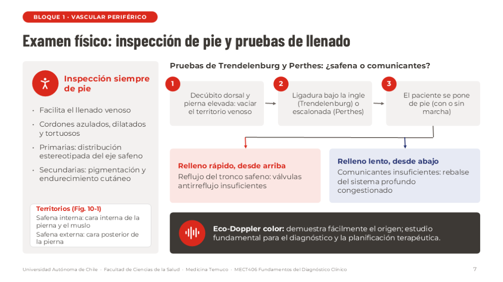
<!-- VOO d. 7 | tipo: algoritmo | incluir en Word: opcional -->

- [VOO d. 7] Cordones azulados, dilatados y tortuosos. En las secundarias, pigmentación y endurecimiento. El relleno lento es rebalse desde el sistema profundo congestionado.
- Buscar arañas venosas, várices pequeñas y edema vespertino. **[Argente, cap. 36-12]**
- Brodie-Trendelenburg: lazo en el muslo y elevar 45° un minuto; el vaciamiento lento sugiere insuficiencia profunda. Argente señala que estas pruebas perdieron vigencia ante exámenes más precisos. **[Argente, cap. 36-12]**

#### Exámenes de apoyo

- El eco-Doppler color demuestra el origen y planifica el tratamiento.
- Eco-Doppler color venoso: anatomía, flujo y trombos; el más usado. Venografía solo en casos dudosos. **[Argente, cap. 36-12]**

*Falta: diagnóstico diferencial (más allá de descartar causas ortopédicas del dolor), signos de alarma.*

### Úlceras de extremidades inferiores

#### Definición [VOO d. 8–9]

Pérdida de tejido sin tendencia a cicatrizar a las dos semanas.

- Úlcera cutánea crónica: compromete epidermis y dermis, cicatriza mal y lleva más de 6 semanas ⚠ (Goic usa 2 semanas); 90 % en las piernas. **[UCH, tema 34, p. 227]** **[Goic, p. 171]**

#### Mecanismo y causas [VOO d. 8–9]

| Origen | Mecanismo |
|---|---|
| Arterial | Isquemia |
| Venosa | Mayor presión venosa |
| Neurotrófica | Trauma repetido sin dolor |
| Otras | Neoplásicas, hematológicas, metabólicas, endocrinas, dermatológicas |

**Otras úlceras arteriales** [VOO d. 11]

| Tipo | Claves |
|---|---|
| Hipertensiva | Tercio distal, cara externa o posterior; infarto cutáneo con halo purpúrico, satélites y livedo; muy dolorosa |
| Ateroembolia de colesterol | Dedo azul, livedo; pulsos pueden ser normales |
| Vasculitis y vasoespasmo | Esclerodermia, periarteritis nodosa, LES; Buerger (necrosis de ortejos); Raynaud (paraungueales) |

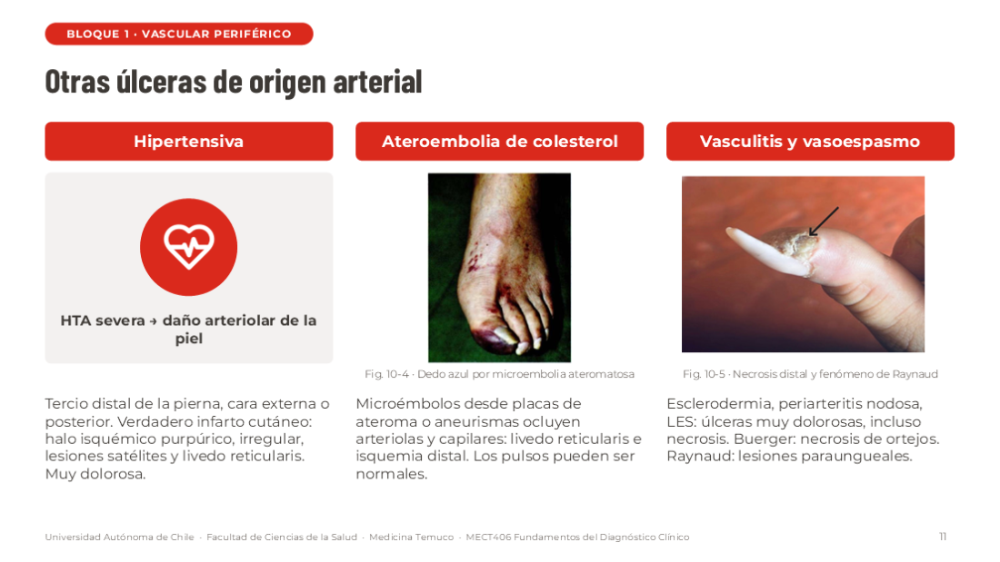
<!-- VOO d. 11 | tipo: fotos (figs. 10-4 y 10-5) | incluir en Word: opcional -->

- [VOO d. 11] Ateroembolia: microémbolos desde placas de ateroma o aneurismas.

#### Causas

- Principales: venosa, arterial, pie diabético y por presión. **[UCH, tema 34, p. 227]**

#### Cómo caracterizarlo

**Siete elementos (tabla 10-2):** forma, ubicación, bordes, entorno cutáneo, fondo, tejidos profundos, contexto (diabetes, HTA, tabaco, vasculitis).

**Úlcera arterial** [VOO d. 10]

- Ortejos, pulpejos, talón, cabezas metatarsianas; por roce o decúbito.
- Bordes algo irregulares, negruzca.
- Dolor intenso que **empeora al elevar el pie**.
- Pulsos ausentes, llene capilar lento.

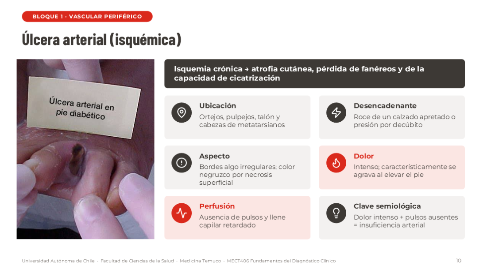
<!-- VOO d. 10 | tipo: foto | incluir en Word: sí -->

**Úlcera venosa** [VOO d. 13] ⚠

- Perimaleolar, sobre todo interna; bordes netos; fondo rosado o fibrinoso.
- Piel pigmentada, indurada, dermatoesclerosis.
- Indolora salvo infección; prurito que alivia en decúbito.
- **Varicosa:** sobre un paquete varicoso, superficial. **Por hipertensión profunda:** sobre el maléolo interno, perforantes, única.

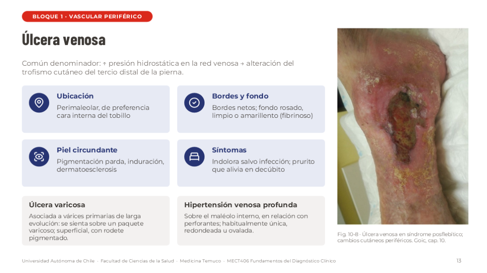
<!-- VOO d. 13 | tipo: foto (fig. 10-8) | incluir en Word: sí -->

- [VOO d. 13] Fondo limpio o amarillento; la varicosa tiene rodete pigmentado.

**Úlcera neurotrófica y pie diabético** [VOO d. 12]

- Indolora, en apoyos de un pie deformado, con **pulsos presentes**.
- **Gangrena seca:** momificación. **Húmeda:** infección (anaerobios), exudado fétido, gas, ampollas.

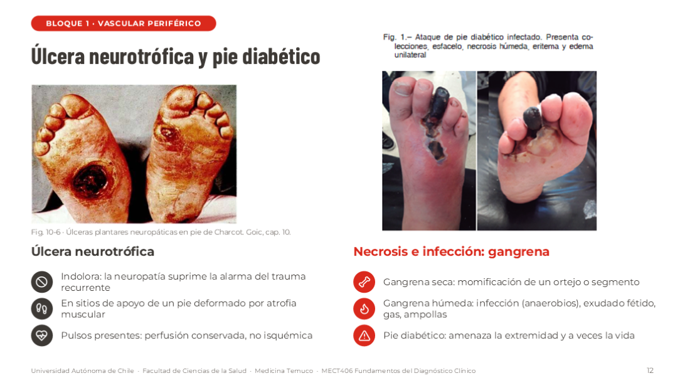
<!-- VOO d. 12 | tipo: fotos (fig. 10-6) | incluir en Word: sí -->

- [VOO d. 12] Imagen de referencia: úlceras plantares en pie de Charcot.

Ver además dolor en reposo y claudicación en la ficha Insuficiencia arterial [VPER d. 11–12].

| Rasgo **[UCH, tema 34, p. 229]** | Venosa | Arterial | Neuropática |
|---|---|---|---|
| Localización | Maléolo medial | Prominencias óseas, ortejos, maléolo lateral | Planta |
| Bordes | Sobreelevados, mal definidos ⚠ | Lisos, bien definidos ⚠ | — |
| Fondo | Rojo | Pálido o necrótico | Rojo |
| Dolor | Variable | Intenso | Ausente |
| Piel | Hiperpigmentada | Pálida, delgada, brillante | Hiperqueratosis |
| ITB y pulsos | Cercano a 1, presentes | Menor de 0,9, ausentes | Variable |

#### Exámenes de apoyo

- En el pie diabético explorar la profundidad con estilete; el ITB puede estar falsamente alto por calcificación. **[UCH, tema 34, p. 227]**

#### Diagnóstico diferencial [VOO d. 14]

| Rasgo | Arterial | Venosa | Neurotrófica |
|---|---|---|---|
| Ubicación | Ortejos, talón, metatarso | Maléolo interno | Zonas de apoyo |
| Bordes | Algo irregulares | Netos | Callosos, en sacabocado |
| Fondo | Necrótico | Rosado o fibrinoso | Profundo |
| Piel | Atrófica, sin fanéreos | Pigmentada, indurada | Callosa, seca |
| Dolor | Intenso | Ausente (salvo infección) | Ausente |
| Pulsos | Ausentes | Presentes | Presentes |
| Postura | Empeora al elevar | Alivia al elevar | Sin relación |

- **Por presión:** prominencias óseas (sacro en decúbito, isquion en silla de ruedas), con inmovilidad, humedad o desnutrición; prevenir cambiando de posición cada 1–2 horas; riesgo con escala de Braden. **[UCH, tema 34, p. 227]**

#### Signos de alarma

- El pie diabético amenaza la extremidad y la vida.

*Falta: examen físico como apartado (ver los siete elementos).*

## Parte C. Síndromes

### Insuficiencia arterial

#### Definición

- Interrupción parcial o total, gradual o súbita, del flujo arterial, con isquemia. **[Goic, p. 251]**
- Enfermedad arterial periférica: signos y síntomas por menor flujo a las piernas por estenosis de la aorta infrarrenal y sus ramas. **[UCH, tema 34, p. 225]**

#### Fisiopatología [VPER d. 7]

- La obstrucción interrumpe el aporte de oxígeno.
- Sin colaterales competentes, evoluciona en minutos a horas.
- Avanza de distal a proximal hasta alterar sensibilidad y motilidad.

#### Causas

**Obstrucción arterial** [VPER d. 3–9]

| Causa | Detalle |
|---|---|
| Embolia | Migración de un trombo |
| Trombosis | Obstrucción aguda por trombo formado en el lugar |
| Traumatismo | — |
| Disección | — |
| Ateroma | — |

**Fuentes de embolia [VPER d. 8]:** valvulopatía mitral o aórtica con FA, prótesis valvulares, endocarditis bacteriana, tumores intracardíacos, trombo de la pared aórtica, trombo venoso con defecto del tabique.

**Datos [VPER d. 9]:** la mayoría de los cuadros son embolias; 50 % en extremidades inferiores y menos de 15 % en superiores. Las notas mencionan el déficit de antitrombina III.

**Mecanismos ilustrados [VPER d. 6]:**

| Mecanismo | Descripción |
|---|---|
| Ateroma | Lesión focal de la íntima, parte de la ateroesclerosis |
| Embolismo | El émbolo viaja y obstruye un vaso menor |
| Compresión | Presión externa que limita el flujo |
| Vasculitis | Inflamación; riesgo de isquemia, necrosis y hemorragia |
| Espasmo | Contracción brusca, estrechamiento temporal |
| Trombosis | Coágulo dentro del vaso |

<!-- VPER d. 3 | tipo: foto de pieza | incluir en Word: opcional -->

<!-- VPER d. 4 | tipo: fotos clínicas | incluir en Word: opcional -->

<!-- VPER d. 5 | tipo: esquemas | incluir en Word: sí -->

<!-- VPER d. 6 | tipo: infografía | incluir en Word: sí -->

<!-- VPER d. 8 | tipo: imágenes | incluir en Word: opcional -->

<!-- VPER d. 9 | tipo: foto clínica | incluir en Word: opcional -->

**Clasificación de la disección, transcrita de la figura [VPER d. 5]:**

| Sistema | Tipo | Compromiso |
|---|---|---|
| Stanford | A | Aorta ascendente, sin importar el origen |
| Stanford | B | No compromete la aorta ascendente |
| DeBakey | I | Ascendente, cayado y descendente |
| DeBakey | II | Solo ascendente |
| DeBakey | IIIa | Origen distal a la subclavia izquierda, se extiende a la aorta descendente |
| DeBakey | IIIb | Origen distal a la subclavia izquierda, según la figura limitada a la descendente ⚠ |

La figura de daño de la pared muestra aneurisma fusiforme, aneurisma sacular, disección y seudoaneurisma.

- **Embolia:** trombo formado a distancia (cavidades izquierdas, aorta, paradójica); 80 % de origen cardíaco según UCH. **[Goic, p. 251–252]** **[UCH, tema 34, p. 226]**
- **Trombosis:** sobre pared dañada (ateroesclerosis, colágeno, mieloproliferativos, disproteinemias) o por trombofilia. **[Goic, p. 252]**
- **Crónica:** ateroesclerosis; tabaco, colesterol, diabetes e hipertensión. Buerger es raro, en hombres jóvenes fumadores. **[Goic, p. 253]**

#### Clínica (anamnesis)

**Aguda** [VPER d. 7]

**Las 6 P:** dolor (*pain*), palidez, pérdida de pulsos, parestesias, paresia y poiquilotermia (frialdad).

**Crónica** [VPER d. 10–12]

**Claudicación [VPER d. 11]:** dolor referido como pesadez o calambre, gradual y progresivo hasta la impotencia funcional; desaparece en reposo y reaparece con el mismo esfuerzo.

**Dolor en reposo [VPER d. 12]:** en zonas distales o de apoyo (ortejos, maléolos, talón).

<!-- VPER d. 11 | tipo: esquema y angiografías | incluir en Word: opcional -->

<!-- VPER d. 12 | tipo: fotos clínicas | incluir en Word: sí -->

- La claudicación es el síntoma cardinal; hasta la mitad de los pacientes es asintomática. **[UCH, tema 34, p. 225]**
- Se localiza bajo la obstrucción: planta (arterias distales), pantorrilla (femoral superficial), nalgas y muslos con impotencia (aortoilíaca, Leriche). **[Goic, p. 253]**
- La distancia de claudicación indica gravedad; empeora con frío, subidas o anemia y mejora con ejercicio periódico por colaterales. **[Goic, p. 253]**
- Dolor de reposo: 1–2 h tras acostarse, en ortejos y apoyos; alivia colgando la pierna. Indica isquemia crítica. **[Goic, p. 253]**
- Embolia: inicio más brusco y severo; trombosis: más lenta, con claudicación previa. **[UCH, tema 34, p. 226]**

#### Examen físico

- Piel delgada y brillante, uñas y vello de crecimiento lento, llene capilar lento, frialdad, palidez al elevar y rubor frío al bajar, pulsos disminuidos. **[Goic, p. 253]**
- **Buerger:** elevar la pierna 45° un minuto y medir en cuánto palidece y recupera color. **Samuels:** piernas a 30° con dorsiflexiones hasta palidez o dolor. **[Argente, cap. 36-12]**

#### Exámenes y criterios

**Índice tobillo-brazo** [VPER d. 10, figura] ⚠

- Doppler continuo de 5–10 MHz; sonda a 45–90° contra el flujo.
- Insuflar 20 mmHg sobre la desaparición del latido; la PAS es el valor al reaparecer.
- Brazo: medir ambos y usar el mayor. Pierna: medir pedia y tibial posterior y usar la mayor.
- **ITB** = PAS máxima del tobillo / PAS máxima del brazo; se informa el menor de ambas piernas.

| ITB | Interpretación |
|---|---|
| Mayor de 0,9 | Normal |
| 0,71–0,9 | Obstrucción leve |
| 0,41–0,7 | Moderada |
| Menor de 0,40 | Grave |

<!-- VPER d. 10 | tipo: infografía (enfermeriacreativa.com) | incluir en Word: sí -->

- Eco-Doppler arterial de primera elección según Argente; Goic lo considera menos costo-efectivo que índice tobillo-brazo y pletismografía. **[Argente, cap. 36-12]** **[Goic, p. 251]**
- Luego angio-TC o angiorresonancia; la arteriografía es la más precisa y es invasiva. **[Argente, cap. 36-12]**
- Presiones segmentarias: caída mayor de 30 mmHg entre segmentos localiza la oclusión. Pletismografía: nivel de obstrucción. **[UCH, tema 34, p. 225]**
- ITB: normal 1,0; menor de 0,9 es enfermedad; menor de 0,5, alto riesgo (Argente). Mayor de 1,4 indica calcificación (UCH) ⚠. **[Argente, cap. 36-12]** **[UCH, tema 34, p. 225]**

#### Alarma y conducta

- La obstrucción aguda es una urgencia quirúrgica por riesgo de perder la extremidad. Alertan dolor de reposo, impotencia funcional, palidez extrema, cianosis y frialdad. **[UCH, tema 34, p. 226]** **[Argente, cap. 36-12]**

*Falta: diagnóstico diferencial.*

### Insuficiencia venosa

Ver también la ficha Várices y la úlcera venosa.

#### Definición

- Alteraciones por disfunción venosa: insuficiencia valvular, cambios de microcirculación e hipertensión venosa. **[UCH, tema 34, p. 222]**

#### Fisiopatología

- El retorno se impide por trombosis, falla valvular o compresión externa; aumenta la presión, con dilatación y edema. **[Goic, p. 253]**

#### Causas

- Trombosis venosa profunda, tríada de Virchow: edad sobre 40, cáncer, obesidad, reposo, trombosis previa, cirugía (sobre todo traumatológica), embarazo y anticonceptivos. **[UCH, tema 34, p. 223]**

#### Clínica (anamnesis)

**Trombosis venosa aguda** [VPER d. 14]

- Dolor por congestión y tensión muscular
- Aumento de volumen
- Red venosa visible
- Coloración cianótica
- Signo de Homans

**Síndrome postflebítico** [VPER d. 16]

- Edema
- Várices secundarias
- Cambios tróficos venosos
- Dermatitis hipostática: eccema, pigmentación, atrofia cutánea, úlcera

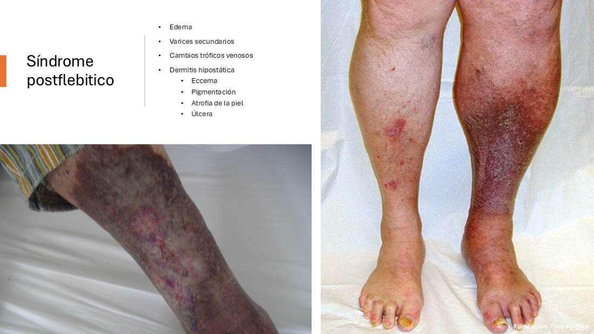
<!-- VPER d. 16 | tipo: fotos clínicas | incluir en Word: sí -->

- Crónica: pesadez (lo principal), prurito, edema vespertino y calambres; peor de pie y mejor al elevar. **[UCH, tema 34, p. 222]**
- Argente: dolor de reposo tipo tensión que empeora de pie o sentado y mejora al caminar o elevar las piernas. **[Argente, cap. 36-12]**
- Trombosis superficial: cordón rojo, doloroso e indurado; por punción, enfermedad (cáncer, trombofilia, Buerger) o sobre várices (varicoflebitis). **[Goic, p. 253–254]**

#### Examen físico y sospecha de TVP [VPER d. 14–15]

**De la figura:** sospechar TVP ante edema inexplicado, dolor, calor local, eritema o cianosis, venas superficiales dilatadas y signos de Homans, Lisker, Bancroft (Moses). La figura les atribuye sensibilidad de 13–48 % y especificidad de 39–84 %.

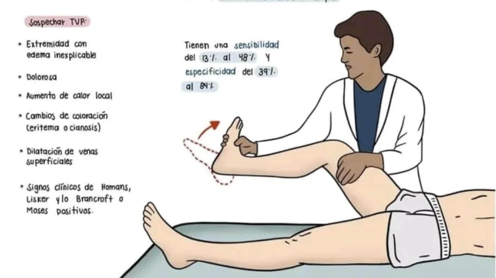
<!-- VPER d. 14 | tipo: ilustración | incluir en Word: sí -->

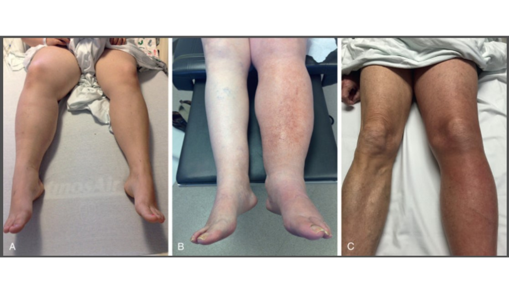
<!-- VPER d. 15 | tipo: fotos clínicas (archivo rotulado phlegmasia cerulea dolens) | incluir en Word: opcional -->

- Diferencia de más de 3 cm entre pantorrillas sugiere trombosis; comparar siempre ambas. Homans tiene baja sensibilidad. **[UCH, tema 34, p. 223]**
- Crónica: hiperpigmentación, atrofia blanca, eccema, lipodermatoesclerosis. **[UCH, tema 34, p. 222]**

#### Exámenes y criterios

- Eco-Doppler: el método más costo-efectivo para confirmar o descartar. **[Goic, p. 254]**
- Dímero D sensible y poco específico; negativo con baja probabilidad ayuda a descartar (UCH usa menos de 500). **[Argente, cap. 36-12]** **[UCH, tema 34, p. 224]**
- Wells ⚠: UCH pide dímero D con 1 punto o menos y eco-Doppler con 2 o más; Argente (simplificado) clasifica 3 o más alta, 1–2 moderada, 0 o menos baja. **[UCH, tema 34, p. 224]** **[Argente, cap. 36-12]**

#### Alarma y conducta

- Principal riesgo: tromboembolismo pulmonar, mayor mientras más proximal; cerca de la mitad tendrá síndrome postrombótico. **[UCH, tema 34, p. 224]**
- Trombosis proximal masiva: oliguria y shock; flegmasia alba y cerúlea, con posible gangrena. **[Goic, p. 254]**

*Falta: diagnóstico diferencial.*

### Vasculitis

#### Definición [VPER d. 18]

Inflamación y necrosis de la pared vascular, en vasos de distintos tamaños y regiones. Primarias y secundarias.

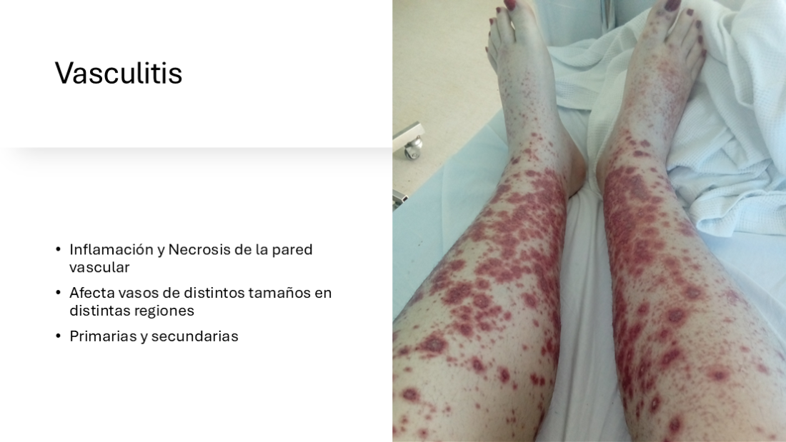
<!-- VPER d. 18 | tipo: foto clínica | incluir en Word: opcional -->

- Pueden ser primarias o parte de otra enfermedad (secundarias: infecciones, tejido conectivo, fármacos, crioglobulinas, neoplasias, trasplante). **[Goic, p. 255]**

#### Clínica (anamnesis) [VPER d. 19]

| Manifestación | Detalle |
|---|---|
| Constitucionales | 90 % con fiebre inicial, baja de peso y postración |
| Poliartralgias y polimialgias | Sobre todo al inicio |
| Piel | De púrpura palpable a necrosis extensa |
| Dolor abdominal | Más en vaso pequeño y mediano; a veces necrosis intestinal |
| Pulmón | Broncoespasmo, infiltrado, hemorragia, necrosis con cavitación |
| Riñón | Hematuria, cilindruria, albuminuria |
| Neurológico | Mononeuritis múltiple; poliarteritis nodosa y vasculitis aisladas |

- Compromiso pulmonar desde broncoespasmo (Churg-Strauss) hasta hemorragia o cavitación (Wegener). **[Goic, p. 256]**
- Renal: sobre todo en vasos pequeños; hematuria, cilindros, albuminuria, a veces rápidamente progresivo. **[Goic, p. 256]**

#### Tipos según tamaño del vaso

**Vaso pequeño y mediano** [VPER d. 20–22]

| Entidad | Vaso | Claves |
|---|---|---|
| Leucocitoclástica o por hipersensibilidad [VPER d. 20] | Pequeño | Piel y extremidades inferiores; púrpura palpable; infiltrado polimorfonuclear; puede haber dolor cólico y compromiso renal |
| Poliarteritis nodosa [VPER d. 21] | Mediano | Necrosis segmentaria en bifurcaciones; infiltrado polimorfonuclear y luego mononuclear; piel, HTA, mononeuritis múltiple, testículo, dolor abdominal; pulmón infrecuente; posible rol del virus de hepatitis B |
| De la artritis reumatoide [VPER d. 22] | — | Histología similar a poliarteritis nodosa; necrosis cutánea y mononeuritis múltiple |

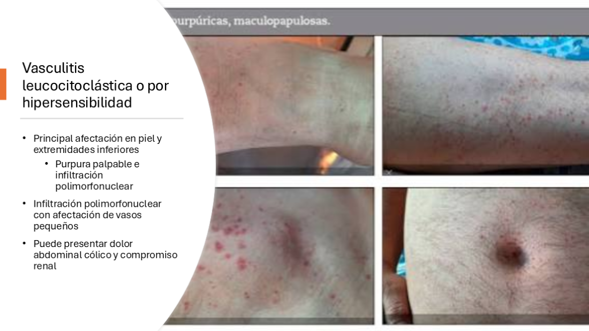
<!-- VPER d. 20 | tipo: fotos | incluir en Word: opcional -->

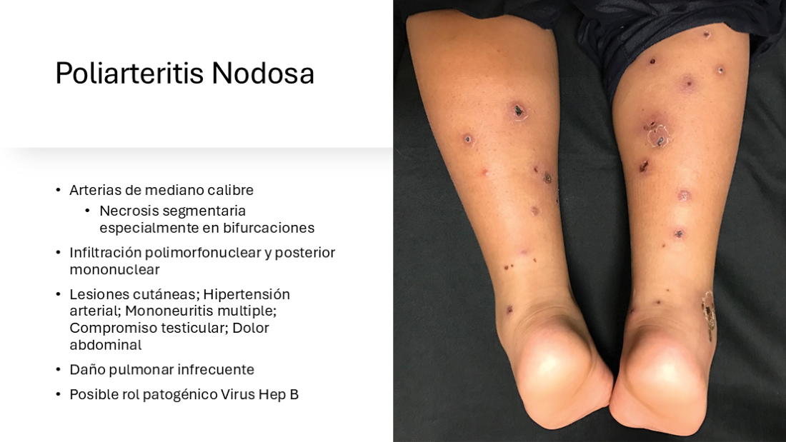
<!-- VPER d. 21 | tipo: foto | incluir en Word: opcional -->

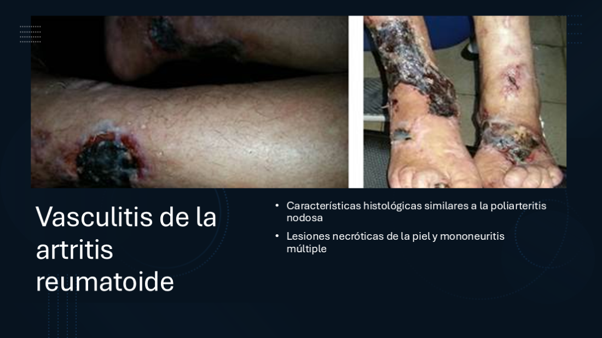
<!-- VPER d. 22 | tipo: fotos | incluir en Word: opcional -->

**Enfermedades granulomatosas** [VPER d. 23–25]

| Entidad | Claves |
|---|---|
| Wegener (vaso pequeño) | Vía respiratoria alta y baja, glomerulonefritis, piel, ojos, oídos, sistema nervioso; vasculitis necrotizante granulomatosa y glomerulonefritis necrótica; ANCA C (+) |
| Granulomatosis linfomatoide | Linfoproliferación de linfocitos B angiocéntrica y angiodestructiva; virus de Epstein-Barr; pulmón con cavitaciones; menos piel, riñón y sistema nervioso central |
| Eosinofílica (Churg-Strauss) | Vaso pequeño; asma de inicio reciente, rinitis, eosinofilia, mononeuritis múltiple, lesiones cutáneas |

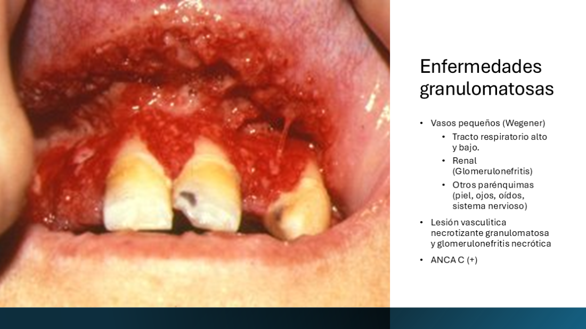
<!-- VPER d. 23 | tipo: foto | incluir en Word: opcional -->

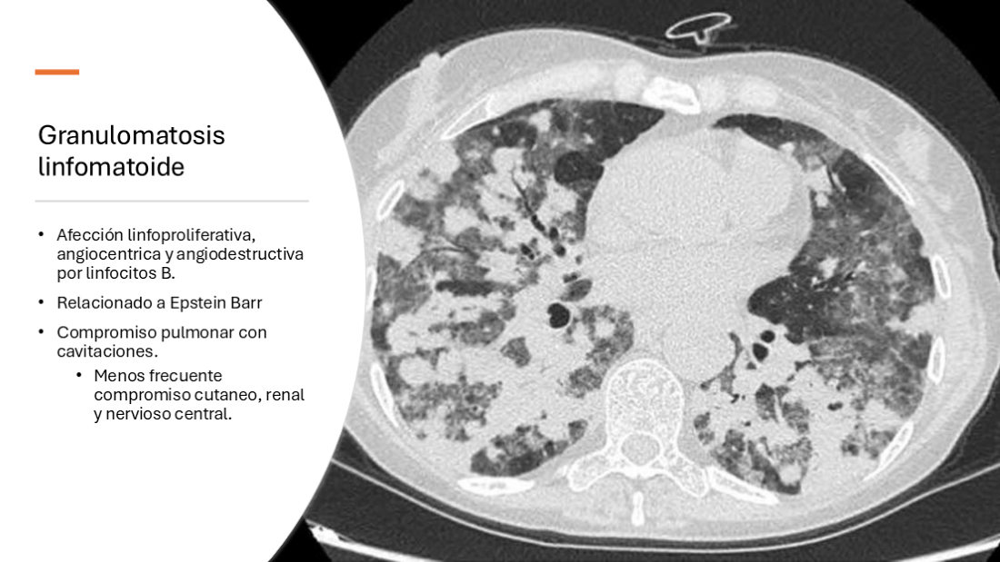
<!-- VPER d. 24 | tipo: tomografía | incluir en Word: opcional -->

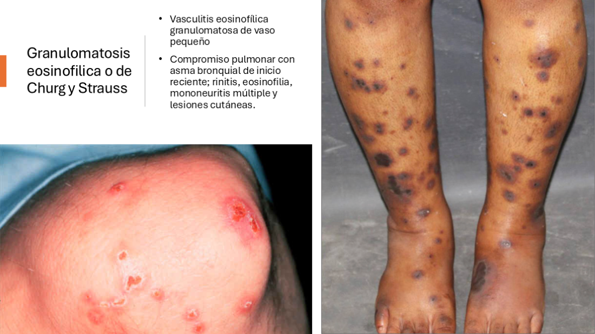
<!-- VPER d. 25 | tipo: fotos | incluir en Word: opcional -->

**Grandes vasos** [VPER d. 26–27]

Panarteritis con infiltrado mononuclear y células gigantes.

| Entidad | Claves |
|---|---|
| Takayasu | Mujeres jóvenes; arco aórtico y ramas; el compromiso del tronco braquiocefálico causa ausencia de pulsos |
| Arteritis de la temporal | Mayores de 60 años ⚠; cefalea temporal, claudicación mandibular, amaurosis unilateral; polimialgia reumática con rigidez matinal proximal |

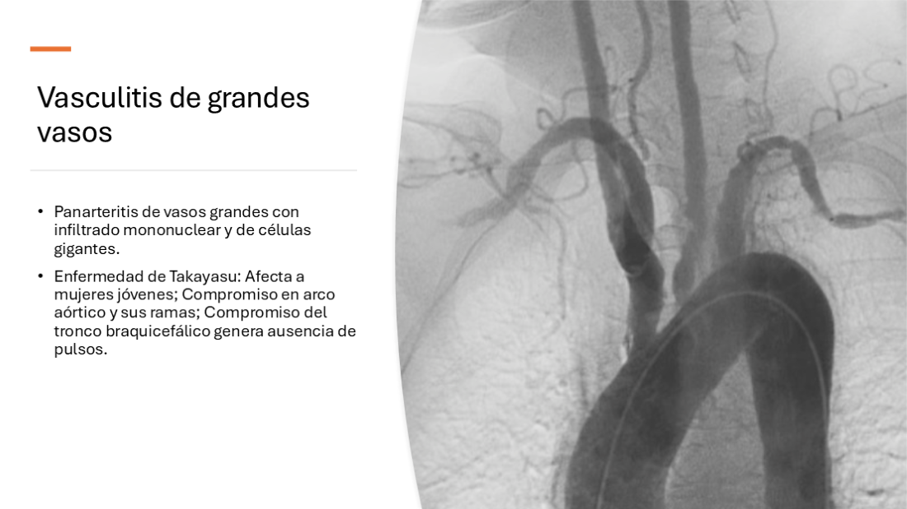
<!-- VPER d. 26 | tipo: angiografía | incluir en Word: opcional -->

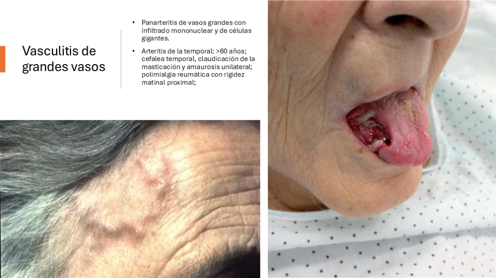
<!-- VPER d. 27 | tipo: fotos | incluir en Word: opcional -->

**Por complejos inmunes** [VPER d. 28] ⚠

- Depósito de inmunoglobulinas y complemento en la pared.
- Afecta vasos pequeños de piel, pulmón, riñón y sistema nervioso.
- **Goodpasture:** depósito en la membrana basal glomerular; glomerulonefritis rápidamente progresiva y hemorragia pulmonar.
- **Schönlein-Henoch:** depósito de IgA1 en piel, tubo digestivo y riñón; gonartralgia, púrpura palpable, dolor abdominal, glomerulitis.

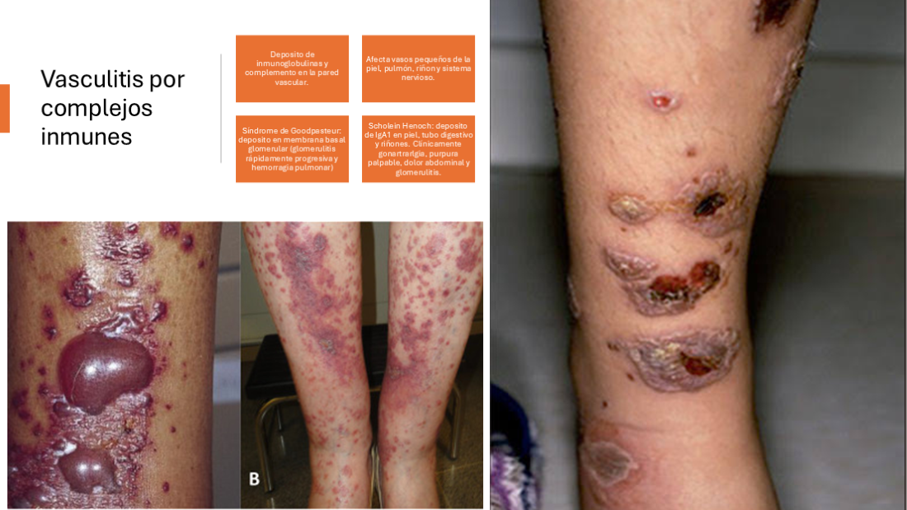
<!-- VPER d. 28 | tipo: texto en recuadros y fotos | incluir en Word: opcional -->

**Misceláneas, de cualquier tamaño de vaso** [VPER d. 29]

| Entidad | Claves |
|---|---|
| Behçet | Úlceras orales y genitales, uveítis, piel, poliartritis, compromiso pulmonar y neurológico; vasculitis necrotizante con grave daño ocular |
| Kawasaki | Lactantes y niños: fiebre súbita, irritabilidad, adenopatías cervicales, mucositis, conjuntivitis, exantema, edema de manos, descamación palmar |
| Cogan | Hipoacusia, disfunción vestibular, queratitis, uveítis, epiescleritis; a veces aortitis, aneurismas y valvulitis mitral |

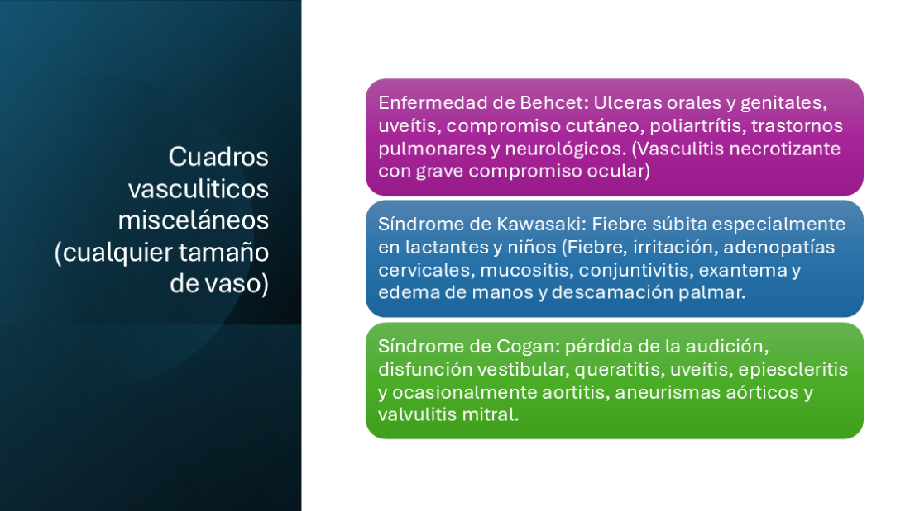
<!-- VPER d. 29 | tipo: texto en recuadros, ya transcrito | incluir en Word: no -->

*Falta: fisiopatología general, causas, examen físico, exámenes y criterios, diagnóstico diferencial, alarma y conducta.*

## Parte D. Síndromes y diagnósticos de la literatura

> Cuadros y temas que los PPT **no tratan** o **solo nombran**. Van resumidos y separados para no confundirlos con la materia de clase.

### Síndrome de Leriche *(no está en los PPT)*

- Obstrucción aortoilíaca: claudicación de nalgas, muslos y pantorrillas con disfunción sexual. **[Goic, p. 253]** **[UCH, tema 34, p. 225]**

### Isquemia crítica *(los PPT no la nombran así)*

- Etapa avanzada en que el flujo no cubre las necesidades en reposo: dolor en decúbito, úlceras, necrosis o gangrena. **[UCH, tema 34, p. 225]**

### Tromboflebitis superficial *(no está en los PPT)*

- Trombosis de una vena superficial (safenas, brazos, mamas), con cordón palpable, doloroso y piel inflamada; comparte factores de riesgo con la profunda. **[UCH, tema 34, p. 224]**

### Pie diabético *(los PPT apenas lo nombran en este documento)*

- Resulta de neuropatía (en guante y calcetín), arteriopatía y alteración inmune; riesgo con más de 10 años de diabetes, mal control, nefropatía, retinopatía, sexo masculino y tabaco. **[UCH, tema 34, p. 226]**

| Wagner **[UCH, tema 34, p. 227]** | Descripción |
|---|---|
| 0 | Pie sin lesión, con factores de riesgo |
| 1 | Úlcera superficial |
| 2 | Úlcera profunda sin hueso |
| 3 | Profunda con compromiso óseo |
| 4 | Gangrena localizada |
| 5 | Gangrena de todo el pie |

### Síndrome riñón-pulmón *(no está en los PPT)*

- Daño renal y pulmonar asociados: lupus, granulomatosis con poliangeítis, poliarteritis microscópica, Goodpasture. **[Goic, p. 256]**

## Anexo de práctica

Los resultados de aprendizaje y la síntesis de la clase vascular, oftalmológica y otológica están en [Oftalmología y otorrinolaringología](11%20Oftalmologia%20y%20otorrinolaringologia.md).

## Pendientes por verificar

Las diferencias entre láminas salen del PPT; el resto es revisión mía.

| Dónde | Observación |
|---|---|
| VPER d. 5 | En la clasificación de DeBakey, IIIa suele limitarse a la aorta torácica descendente y IIIb extenderse bajo el diafragma. El texto de la figura parece invertido; confirmar. |
| VPER d. 10 | Un ITB mayor de 1,3 suele indicar arterias no compresibles, no normalidad. |
| VPER d. 27 | Aquí la arteritis temporal es de mayores de 60 años; en el documento neuropsiquiátrico, mayores de 55. |
| VPER d. 28 | Goodpasture se explica por anticuerpos antimembrana basal; el documento nefrourológico lo separa de los complejos inmunes. |
| VPER d. 19 | La frase sobre compromiso neurológico es ambigua. |
| VOO d. 13–14 | La úlcera venosa figura como indolora salvo infección; en la práctica suele describirse dolor leve a moderado. Estudiar según la clase. |
| Úlcera: plazo | Goic define úlcera sin cicatrización a las 2 semanas; UCH, úlcera crónica con más de 6. |
| Úlceras: bordes y dolor | UCH: venosa de bordes mal definidos; Goic y el PPT: netos. Dolor venoso: ausente (Goic, Argente) o variable (UCH). |
| ITB | El PPT usa mayor de 0,9 normal; Argente da normal 1,0 y alto riesgo bajo 0,5; UCH marca calcificación sobre 1,4. |
| Wells TVP | Los cortes de UCH y de Argente corresponden a versiones distintas. |

- VPER: Corregí erratas: "Dalo renal" (daño), "Scholein Henoch", "Brancroft".
