# Digestivo

Fundamentos del Diagnóstico Clínico, Unidad 3.

| Código | Texto original | Fuente |
|---|---|---|
| DIG | [Digestivo sintomas y sindromes](Textos%20originales/Digestivo%20sintomas%20y%20sindromes.md) | PPT "Digestivo" (portada: María Angélica Barría Schulmeyer). |
| SDG | [Sindromes digestivos](Textos%20originales/Sindromes%20digestivos.md) | PPT "Síndromes digestivos UA" (Dr. Miguel Yáñez Martínez), basado en Goic, Chamorro y Reyes, *Semiología Médica*, 4.ª ed. (2018), cap. 17. |
| Goic | Goic A, Chamorro G, Reyes H. *Semiología médica*, caps. 3 y 17 | Página impresa. |
| UCH | Manual de Semiología UCH, temas 11, 40–45 y 47 | Página impresa. |
| Argente | Argente y Álvarez, caps. 45 y 48 (extractos) | El archivo no trae número de página. |

> **Cómo leer:** [DIG d. 7] indica el PPT (código) y la diapositiva. ⚠ remite a la sección final de pendientes. Lo marcado **[Goic, p. N]**, **[UCH, tema, p. N]** o **[Argente, cap.]** es complemento de los libros, resumido con otras palabras salvo lo que va entre « »; el resto viene de los PPT. La **Parte E** reúne lo que los PPT no tratan. La línea *Falta* indica apartados aún sin contenido.

**Siglas:** ERGE (enfermedad por reflujo gastroesofágico); EEI (esfínter esofágico inferior); ID (intestino delgado); IG (intestino grueso); ACV (accidente cerebrovascular); ELA (esclerosis lateral amiotrófica); IgA (inmunoglobulina A); SIDA (síndrome de inmunodeficiencia adquirida); EPI (enfermedad pélvica inflamatoria); SRG (síndrome de retención gástrica); TBC (tuberculosis); TC (tomografía computarizada); RM (resonancia magnética); Rx (radiografía); Na (sodio).

## Mapa del tema

- **Síntomas y signos:** Dolor abdominal; Pirosis; Sialorrea; Halitosis; Disfagia; Náuseas y vómitos; Constipación; Diarrea; Hemorragia digestiva.
- **Síndromes:** Ulceroso; Retención gástrica; Reflujo gastroesofágico; Disentérico; Malabsorción; Obstrucción intestinal; Insuficiencia hepática; Abdomen agudo.
- **Solo en la literatura o apenas nombrados (Parte E):** Síndrome esofágico; Síndrome de Plummer-Vinson; Dispepsia; Síndrome de intestino irritable; Intolerancia a la lactosa; Apendicitis aguda; Peritonitis; Colelitiasis y cólico biliar; Colecistitis aguda; Síndrome colestásico; Ictericia: origen de la bilirrubina; Ascitis; Hepatitis viral aguda; Hipertensión portal; Pancreatitis aguda y crónica; Lesiones rectoanales.

## Parte A. Fundamentos

### Síndrome

- Conjunto de síntomas y signos que suelen presentarse juntos y comparten un mecanismo [DIG d. 2; SDG d. 2–3].
- Sus causas pueden ser múltiples: genéticas, infecciosas, metabólicas o psicológicas [DIG d. 2].
- Es una categoría diagnóstica provisional: orienta estudios y tratamiento, pero no es diagnóstico etiológico [DIG d. 2; SDG d. 2–3].

| Territorio [SDG d. 2–3] | Síndromes |
|---|---|
| Estómago y duodeno | Ulceroso, retención gástrica |
| Intestino y colon | Disentérico, malabsorción, obstrucción |
| Hígado | Insuficiencia hepática |
| Peritoneo | Abdomen agudo |

### Glosario de síntomas [DIG d. 3, 9, 51]

| Término | Definición o ubicación |
|---|---|
| Pirosis | Ardor retroesternal. Ver ficha |
| Pujo rectal | Sensación imperiosa de defecar (DIG); esfuerzo expulsivo doloroso (SDG d. 11–12) ⚠ |
| Tenesmo rectal | Sensación de evacuación incompleta; deseo persistente (SDG d. 11–12) |
| Sialorrea, halitosis, disfagia, náuseas y vómitos | Ver fichas |
| Diarrea, constipación | Ver fichas |
| Disentería, lientería, dispepsia | Ver ficha Diarrea, "Cuadros relacionados" |
| Meteorismo, borborigmo | El PPT los nombra sin definirlos |
| Ictericia, acolia, coluria | Nombrados entre los síntomas; ictericia en Insuficiencia hepática |

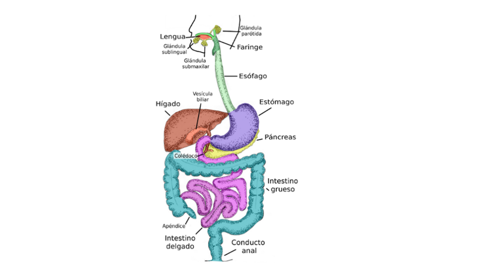
<!-- DIG d. 5 | tipo: esquema | incluir en Word: opcional -->

## Parte B. Síntomas y signos

### Dolor abdominal

#### Mecanismo

- Estímulos: distensión, contracción o estiramiento de víscera hueca; distensión de la cápsula de órganos sólidos; inflamación del peritoneo parietal; tracción del mesenterio; isquemia; compromiso de nervios. **[Goic, p. 70]**
- **Visceral verdadero:** vago, en la zona media, sin defensa muscular. **Referido víscero-sensitivo:** bien localizado y lateral, puede tener defensa. **Víscero-cutáneo:** por peritonitis localizada, con rigidez constante en el sitio exacto. **[Goic, p. 70–71]**
- La apendicitis recorre las tres etapas: dolor periumbilical, migración a fosa ilíaca derecha y luego rigidez local. **[Goic, p. 71]**
- El **dolor somático** nace del peritoneo parietal: localizado, intenso, brusco, aumenta con movimiento, tos y respiración, con espasmo muscular. **[Argente, cap. 45-4]**

#### Causas

| Origen del dolor agudo **[Argente, cap. 45-4]** | Causas |
|---|---|
| Intraperitoneal inflamatorio | Peritonitis, apendicitis, colecistitis, diverticulitis, úlcera perforada, pancreatitis, adenitis mesentérica, inflamación pélvica |
| Mecánico | Obstrucción intestinal o biliar, hígado congestivo |
| Hemoperitoneo e isquemia | Aneurisma roto, ectópico roto, rotura de bazo; isquemia mesentérica, hernia estrangulada, vasculitis |
| Torácico | Neumonía, embolia pulmonar, infarto, pericarditis, insuficiencia cardíaca |
| Urinario, metabólico, neurogénico | Pielonefritis, cólico renal; cetoacidosis, porfiria, insuficiencia suprarrenal, uremia; herpes zóster, raíces |

#### Cómo caracterizarlo

**Ubicación e irradiación** [DIG d. 4, 6]

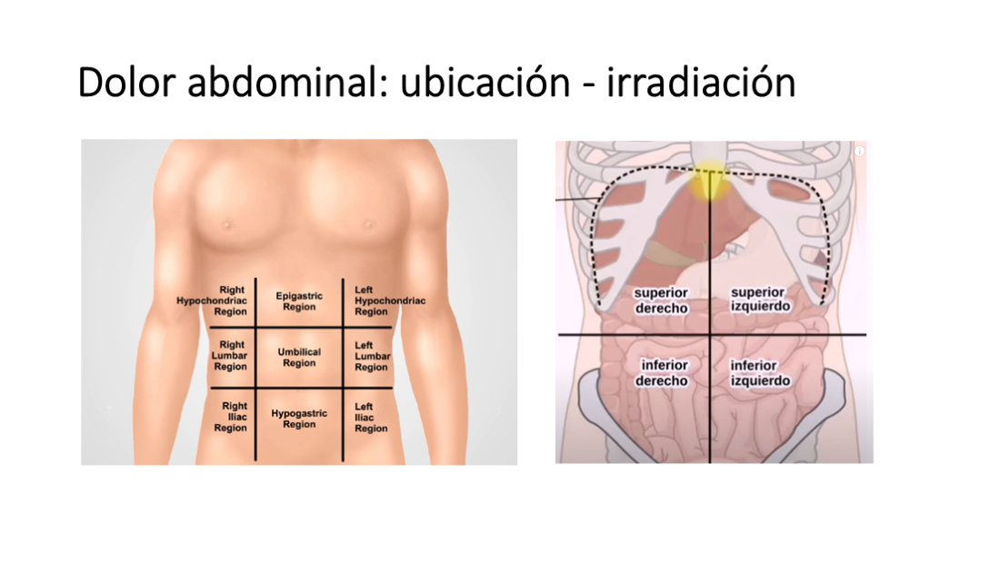
<!-- DIG d. 6 | tipo: esquemas (nueve regiones, rotuladas en inglés, y cuatro cuadrantes) | incluir en Word: sí -->

**Duración** [DIG d. 7]

| Tipo | Característica |
|---|---|
| Agudo | Enfermedades que amenazan la vida; a menudo cirugía urgente (ver Abdomen agudo) |
| Recurrente | Periódico, espontáneo o desencadenado; orgánico o funcional |
| Crónico | Dura o recurre más de 3 meses |

**Ritmo y periodicidad** [DIG d. 8]. Ver su desarrollo en el Síndrome ulceroso.

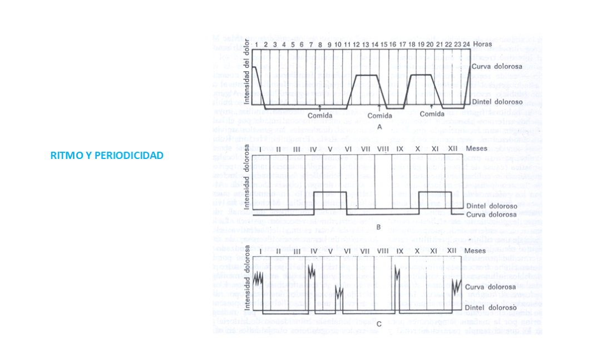
<!-- DIG d. 8 | tipo: gráfico de libro: A ritmo diario con las comidas; B y C periodicidad anual | incluir en Word: sí -->

- Precisar ubicación (localizado, generalizado, migratorio), comienzo, carácter, intensidad, irradiación, evolución, recurrencia, alivio y agravantes. **[Goic, p. 71]**
- Irradiación típica: biliar a hipocondrio derecho y dorso; pancreatitis a hipocondrio izquierdo y dorso. Infarto y cólico renal también duelen en el abdomen. **[Goic, p. 71]**
- Argente llama agudo al que dura menos de 7 días; el crónico suele ser funcional (dispepsia, intestino irritable). **[Argente, cap. 45-4]**
- Alivia al vomitar en la úlcera péptica; en la apendicitis el dolor precede al vómito. **[Argente, cap. 45-3]**

#### Examen físico

- Paciente en decúbito supino, vejiga vacía; orden: inspección, auscultación, percusión y palpación, dejando para el final el sitio doloroso. **[UCH, tema 47, p. 310]**
- Palpar superficial y luego profundo. La rigidez es espasmo involuntario por irritación peritoneal; difusa: «abdomen en tabla». **[UCH, tema 47, p. 314]**

#### Signos de alarma

- El dolor agudo es de alarma [DIG d. 7].

*Falta: definición, exámenes de apoyo, diagnóstico diferencial.*

### Pirosis

#### Definición

Dolor urente (ardor) retroesternal [DIG d. 3, 10–12].

#### Mecanismo

Regurgitación de jugo gástrico [DIG d. 10–12].

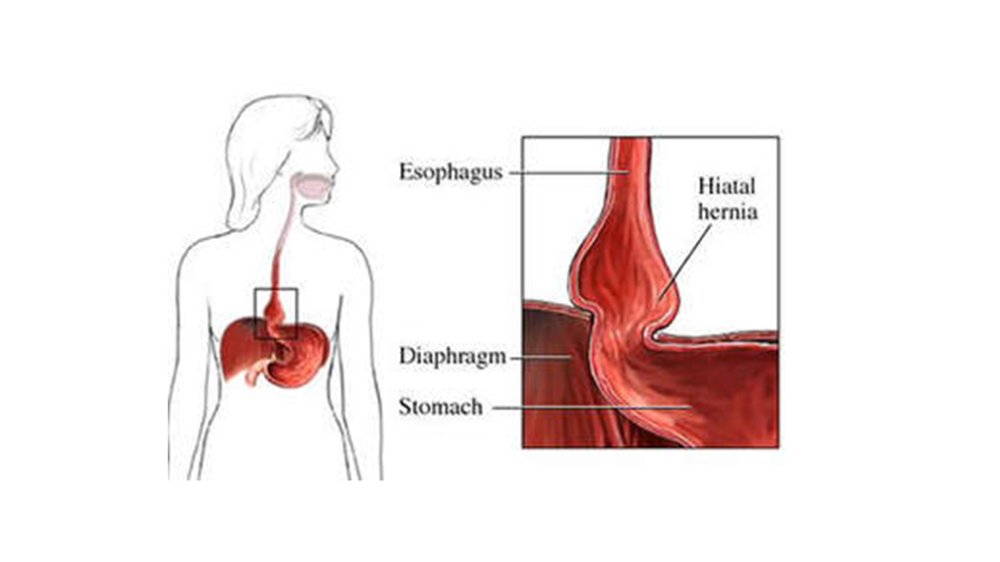
<!-- DIG d. 11–12 | tipo: esquema | incluir en Word: opcional -->

#### Cómo caracterizarlo

- Irradia a cuello, faringe o ángulo mandibular [DIG d. 10–12].
- Es causa de tos crónica [DIG d. 10–12].
- Aparece sobre todo tras comidas copiosas o con el decúbito. **[UCH, tema 40, p. 269]**
- Puede acompañarse de sabor amargo y sialorrea. **[Argente, cap. 48-1]**

#### Diagnóstico diferencial

- Puede confundirse con asma [DIG d. 10–12].
- No forma parte del síndrome ulceroso [SDG d. 6].

Ver también el Síndrome de reflujo gastroesofágico.

#### Signos de alarma

- Con reflujo: disfagia progresiva, odinofagia, baja de peso involuntaria, hematemesis, melena, anemia, vómitos persistentes, saciedad precoz, masa epigástrica o astenia orgánica. **[UCH, tema 40, p. 269]**

*Falta: causas, examen físico, exámenes de apoyo.*

### Sialorrea

#### Definición

Exceso de saliva en la boca [DIG d. 13–14].

#### Causas

[DIG d. 13–14]

- Dificultad para tragar o eliminar la saliva; boca que no cierra.
- Infecciones de senos paranasales, garganta o periamigdalinas; rabia o tuberculosis.
- Prótesis dental, úlceras o dolor oral, mala higiene.
- Fractura o luxación mandibular.

#### Cómo caracterizarlo

- Favorece infecciones y problemas psicosociales [DIG d. 13–14].

*Falta: mecanismo, examen físico, exámenes de apoyo, diagnóstico diferencial, signos de alarma.*

### Halitosis

#### Mecanismo

[DIG d. 15–17]

- Bacterias que liberan compuestos sulfurados (placa y sarro); anaerobios en bolsas periodontales.
- Secreción purulenta sinusal y detritos en las criptas amigdalinas; esputo maloliente.
- Paso de contenido gástrico a la boca (ERGE); alimentos retenidos (estenosis o divertículo).

#### Causas

| Orales [DIG d. 15–17] | Extraorales |
|---|---|
| Placa y sarro | Sinusitis crónica |
| Gingivitis, periodontitis | Amigdalitis crónica |
| Lengua saburral (capa blanquecina en el dorso) | Infecciones respiratorias |
| Caries | ERGE; estenosis o divertículo de Zenker |

- También es síntoma esofágico; el divertículo de Zenker la produce junto a regurgitación de comida no digerida. **[Argente, cap. 48-1]** **[UCH, tema 40, p. 268]**

*Falta: definición, cómo caracterizarlo, examen físico, exámenes de apoyo, diagnóstico diferencial, signos de alarma.*

### Disfagia

#### Definición

- Goic: «La disfagia se define como la dificultad o malestar para deglutir». **[Goic, p. 93]**
- Argente la define como dificultad inmediata para llevar el alimento de la boca al estómago, e incluye la sensación de detención; nunca debe ignorarse. **[Argente, cap. 45-1]**
- Dolor al deglutir es **odinofagia**. Disfagia, regurgitación y sialorrea forman el **síndrome esofágico**. **[Goic, p. 93]**

#### Mecanismo

- Deglución en tres fases: oral (voluntaria), faríngea y esofágica (involuntarias). La disfagia puede ser mecánica (estrechez) o motora. **[Goic, p. 93]** **[Argente, cap. 45-1]**

#### Causas

| Tipo [DIG d. 18–24] | Causas |
|---|---|
| Orofaríngea (problema para iniciar la deglución) | Neurológicas (ACV, Parkinson, ELA, demencia); musculares (miastenia, distrofias); estructurales (tumores de orofaringe, hipertrofia amigdalina, abscesos) |
| Esofágica | Estenosis (tumor, inflamación), acalasia, espasmo difuso, cuerpo extraño, esclerodermia |

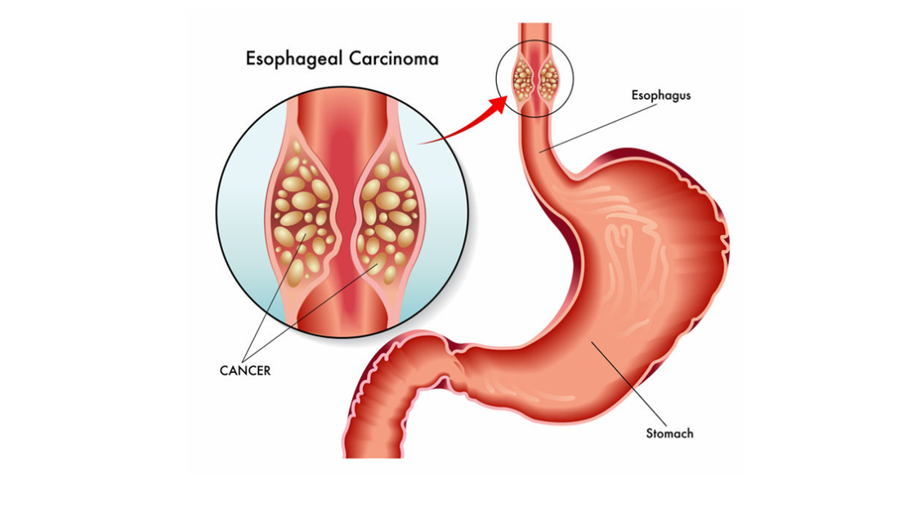
<!-- DIG d. 20 | tipo: esquema en inglés | incluir en Word: opcional -->

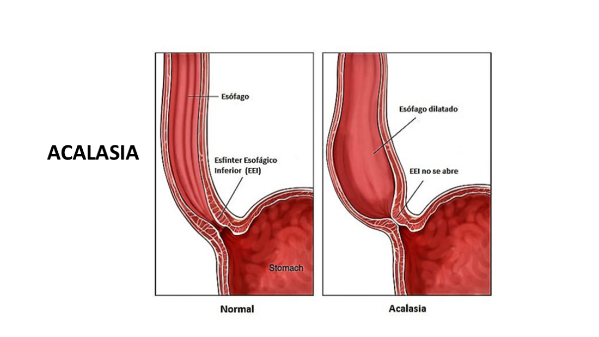
<!-- DIG d. 21 | tipo: esquema | incluir en Word: sí -->

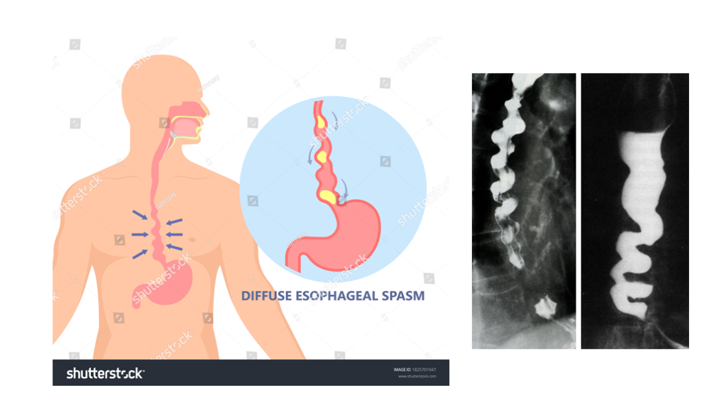
<!-- DIG d. 22 | tipo: ilustración con marca de agua y esofagogramas | incluir en Word: opcional -->

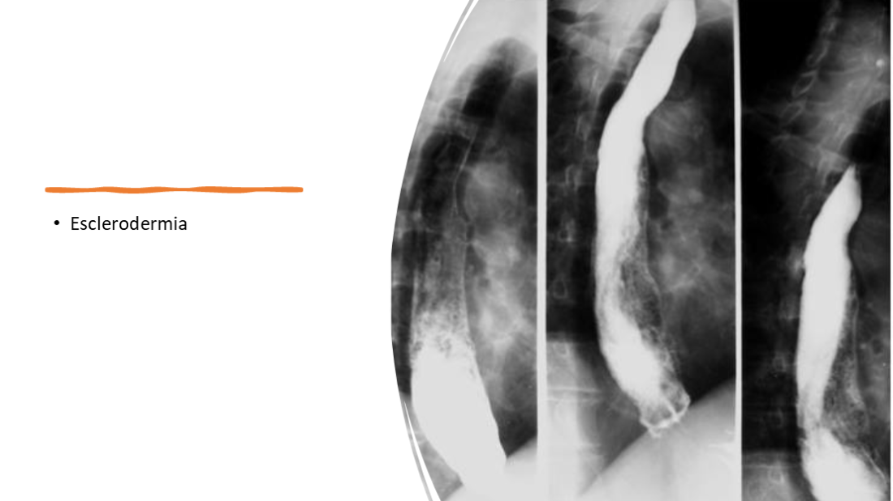
<!-- DIG d. 23 | tipo: radiografía | incluir en Word: opcional -->

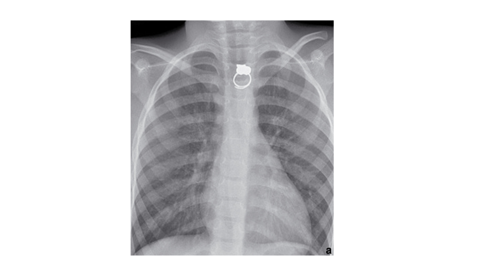
<!-- DIG d. 24 | tipo: radiografía | incluir en Word: opcional -->

- Más del 75 % de las disfagias orofaríngeas son neuromusculares; el ACV es la causa más frecuente, sobre todo en adultos mayores. **[Argente, cap. 45-1]**
- También: infecciones bucofaríngeas, abscesos, miopatías, tumores de cabeza y cuello, cirugías. **[Goic, p. 94]** **[UCH, tema 40, p. 265]**
- Esofágica: en jóvenes predominan esofagitis, acalasia y tumores benignos; a partir de la cuarta década, cáncer y esofagitis péptica. **[Goic, p. 94]**
- Otras causas: estenosis péptica, anillo de Schatzki, compresión extrínseca (mediastino, aurícula izquierda), cáusticos, esofagitis eosinofílica, Chagas. **[Argente, cap. 45-1]** **[UCH, tema 40, p. 265]**

#### Cómo caracterizarlo

[DIG d. 18–24]

- **Lógica:** primero a sólidos y luego a líquidos.
- **Ilógica:** alterna líquidos y sólidos sin patrón.
- **Orofaríngea:** cuesta iniciar la deglución, se siente en el cuello en los primeros 1–2 s; babeo, regurgitación nasal, tos, cambios de voz, neumonías. **[UCH, tema 40, p. 265–266]** **[Argente, cap. 45-1]**
- **Esofágica:** referida al tórax o cuello, 6–8 s después de deglutir; regurgitación tardía, dolor torácico. **[UCH, tema 40, p. 265–266]**
- Mecánica: primero sólidos, predecible y progresiva. Motora: sólidos y líquidos, episódica o de lenta progresión. **[Argente, cap. 45-1]**
- Goic sugiere preferir «progresiva» e «intermitente» a lógica e ilógica. **[Goic, p. 93]**
- La altura referida orienta a la lesión, pero cerca de un tercio de las lesiones distales se siente en el esternón alto. **[Goic, p. 94]**

| Disfagia esofágica baja **[UCH, tema 40, p. 265]** | Funcional | Orgánica benigna | Orgánica maligna |
|---|---|---|---|
| Alimento | Sólidos o líquidos | Primero sólidos | Primero sólidos |
| Presentación | Intermitente | Constante | Constante |
| Progresión | Muy lenta | Media | Rápida |
| Repercusión | Nula o escasa | Escasa | Importante |
| Ejemplo | Acalasia | Estenosis péptica | Carcinoma |

#### Examen físico

- Hidratación, nutrición y examen respiratorio (neumonía). Pistas: ptosis (miastenia), temblor y rigidez (Parkinson), masa cervical que al comprimirla regurgita (Zenker), signos de esclerodermia. **[UCH, tema 40, p. 267]**
- En la orofaríngea, examinar boca y faringe; a veces faringolaringoscopía. **[Goic, p. 93]**

#### Exámenes de apoyo

- Endoscopía alta (lo más usado, permite biopsia y tratar); esofagograma baritado; manometría si es funcional; videofluoroscopía para deglución y aspiración; radiografía y TC si se sospecha tumor. **[UCH, tema 40, p. 267]**
- Riesgo de aspiración en el adulto mayor: prueba del agua (10 mL): deglución fraccionada, tos o babeo. **[Argente, cap. 45-1]**

#### Diagnóstico diferencial

- Odinofagia, sensación de globo (no relacionada con deglutir) y disfagia funcional. **[Argente, cap. 45-1]**
- El bolo histérico y la sensación de peso epigástrico por ansiedad no son disfagia. **[Goic, p. 93]**

#### Signos de alarma

- Compromiso general, baja de peso, hemorragia digestiva, anemia sin causa, vómitos de retención, saciedad precoz. **[UCH, tema 40, p. 266]**
- Disfagia reciente y progresiva en una persona mayor: pensar en cáncer de esófago. **[Goic, p. 94]**

### Náuseas y vómitos

#### Definición

- Vómito: expulsión enérgica del contenido gástrico, habitualmente con náuseas y arcadas. **Náusea:** deseo de vomitar. **Arcada:** contracción sin expulsión. **Regurgitación:** retorno sin esfuerzo ni náusea. **[UCH, tema 11, p. 46]**

#### Mecanismo

- Centro del vómito en la formación reticular del tronco: recibe aferencias de corteza, zona gatillo quimiorreceptora, tubo digestivo, vías vagales, corazón y faringe; coordina diafragma y pared abdominal, con glotis cerrada. **[UCH, tema 11, p. 46]**
- La zona quimiorreceptora (área postrema, sin barrera hematoencefálica) se activa por fármacos, alteraciones metabólicas, toxinas y radiación, y estimula al centro del vómito. **[Argente, cap. 45-3]**

#### Causas

- **Digestivas:** patología biliar y pancreática, gastritis, intoxicación alimentaria, apendicitis, peritonitis, hepatitis, obstrucción, úlcera. **[UCH, tema 11, p. 47]**
- **Extradigestivas:** neumonía, pielonefritis, meningitis; infarto, insuficiencia cardíaca; cetoacidosis, hipercalcemia, uremia; tumor cerebral, ACV, hidrocefalia; vértigo; embarazo y fármacos. **[UCH, tema 11, p. 47]**

#### Cómo caracterizarlo

| Atributo [DIG d. 25] | Opciones |
|---|---|
| Causa | Digestiva o extradigestiva |
| Relación con comidas | Precoz o tardío |
| Esfuerzo | Fácil, difícil, explosivo |
| Contenido | Alimentario, mucoso, ácido, bilioso, porráceo, hemático, de retención, fecaloideo |

- **En proyectil:** brusco y sin náuseas; orienta a hipertensión endocraneana. **De retención:** alimentos de 8 h o más (síndrome pilórico o gastroparesia). **[UCH, tema 11, p. 46]**
- Otros: jugo gástrico abundante y nocturno (úlcera duodenal, Zollinger-Ellison); mucoso matutino; bilioso (estómago sin alimento); purulento; en «concho de café». **[UCH, tema 11, p. 46]**
- Preguntar inicio, náuseas previas, número y cuantía, contenido, horario, evolución, gatillantes, tolerancia oral, contactos y fármacos. **[UCH, tema 11, p. 47]**
- Alimentos sin digerir: patología esofágica; parcialmente digeridos horas después: gastroparesia u obstrucción pilórica. La bilis excluye obstrucción proximal a la ampolla de Vater. **[Argente, cap. 45-3]**
- Matutinos: embarazo, uremia, alcohol, hipertensión endocraneana (no siempre «en chorro»). Gastroparesia: cerca de 1 h tras comer; obstrucción pilórica: varias horas. **[Argente, cap. 45-3]**
- Acompañantes: vértigo y acúfenos (laberinto); cefalea, conciencia, rigidez de nuca (sistema nervioso); fiebre y diarrea (infección). Baja de peso: cáncer o úlcera obstructiva. **[Argente, cap. 45-3]**

#### Exámenes de apoyo

- Los episodios ocasionales con causa evidente (fármacos, transgresión, embarazo) no suelen requerir estudio. **[Goic, p. 80]**

#### Diagnóstico diferencial

- Regurgitación (sin náusea ni esfuerzo) y rumiación (regurgitar y volver a masticar). Una historia larga sin baja de peso sugiere causa psicógena. **[Argente, cap. 45-3]**

#### Signos de alarma

- Vómitos intensos, repetidos o persistentes, o con dolor marcado, ictericia, fiebre o cefalea; riesgo de deshidratación. **[Goic, p. 80]**
- Más de 1.500 mL en 24 h indica causa orgánica. Complicaciones: Mallory-Weiss, rotura esofágica (Boerhaave) y aspiración si hay compromiso de conciencia. **[Argente, cap. 45-3]**

*Falta: examen físico.*

### Constipación

#### Definición

Menor frecuencia defecatoria (más de 3 días), mayor consistencia o evacuación incompleta [DIG d. 3, 26].

- Retención anormal de heces o retardo en evacuarlas, habitualmente duras y difíciles; convencionalmente cada 3 o más días con dificultad, o necesidad de laxantes o enemas. El hábito normal varía entre personas. **[Goic, p. 84]**
- Estreñimiento funcional (Roma IV), por más de 3 meses en los últimos 6: dos o más de esfuerzo, heces Bristol 1–2, evacuación incompleta, sensación de bloqueo o maniobras manuales (en 25 % o más de las veces), o menos de 3 evacuaciones espontáneas por semana; sin criterios de intestino irritable. **[Argente, cap. 45-6]**

#### Mecanismo

- Alteración de la consistencia de las heces, de la motilidad o calibre del colon, o de la evacuación rectal. La funcional puede ser de tránsito normal (la más común), lento (normal: 18–72 h) o por disfunción del piso pélvico. **[Argente, cap. 45-6]**

#### Causas

Asociada a poca fibra, poco líquido y sedentarismo [DIG d. 26].

- Lo más común es el estreñimiento habitual; luego el colon irritable espástico. Otras digestivas: cáncer de colon, megacolon (Hirschsprung, Chagas), lesiones anorrectales, ascitis, fecaloma. **[Goic, p. 85]**
- Agudas: casi siempre benignas, por cambio de dieta o fármacos. Secundarias: poca fibra, enfermedades sistémicas, medicamentos. **[Argente, cap. 45-6]**

#### Cómo caracterizarlo

- Tiempo y tipo de evolución, dieta, líquidos, fármacos, laxantes, forma de las deposiciones, dolor, sangre, pujo, tenesmo, baja de peso. **[Goic, p. 84]**
- Deposiciones acintadas: estrechez o tumor rectal, aunque más a menudo colon irritable, como las caprinas. **[Goic, p. 84–85]**

#### Diagnóstico diferencial

- Evacuar con dolor, sangre o pus indica patología anorrectal. Pujo y tenesmo con constipación: rectitis por fecaloma, que puede dar seudodiarrea. **[Goic, p. 84–85]**
- Puede acompañar transitoriamente un cuadro abdominal agudo. **[Goic, p. 84]**

#### Signos de alarma

- Estreñimiento de aparición reciente, sobre todo en personas mayores: descartar cáncer de colon. **[Goic, p. 85]**

*Falta: examen físico, exámenes de apoyo.*

### Diarrea

#### Definición

Heces de menor consistencia, 3 o más veces al día o más de 200 mL/día; Bristol 6–7 [DIG d. 3, 27–30].

| Duración [DIG d. 27–30] | Clasificación |
|---|---|
| 1–14 días | Aguda |
| 15–30 días | Persistente |
| Más de 30 días | Crónica ⚠ |

| Criterio [DIG d. 31] | Tipos |
|---|---|
| Clínica | Aguda; crónica (osmótica, secretora, inflamatoria, motora, facticia) |
| Origen | Intestino delgado o grueso |
| Lesión | Funcional u orgánica |

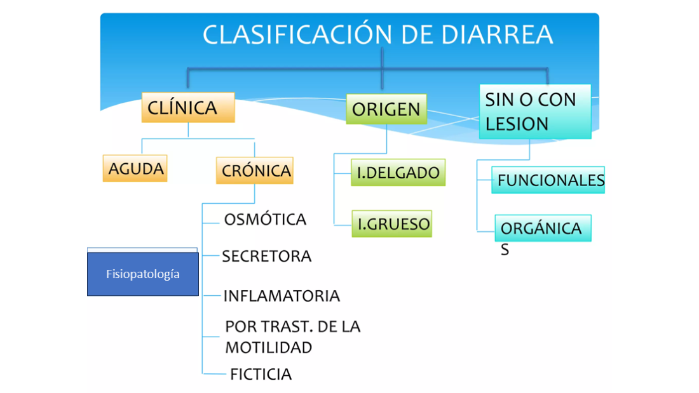
<!-- DIG d. 31 | tipo: esquema | incluir en Word: opcional -->

- Deposiciones de consistencia disminuida y casi siempre más frecuentes. **[Goic, p. 80]**
- Criterios: líquida, más de 3 en 24 h y más de 200 g (en la práctica bastan los dos primeros). **Polidefecación:** más frecuencia con consistencia normal. **[UCH, tema 42, p. 281]**
- Temporalidad según cada fuente ⚠: aguda menor de 1 mes y crónica sobre 1 mes continua o 3 intermitente (Goic, p. 80); aguda hasta 14 días, 2–4 semanas en prolongación y crónica sobre 4 semanas (UCH; Argente la llama persistente). **[Goic, p. 80]** **[UCH, tema 42, p. 282–283]** **[Argente, cap. 45-5]**

#### Mecanismo

En la diarrea crónica: secretora, osmótica, esteatorrea, inflamatoria, tránsito acelerado o facticia [DIG d. 38–40].

- Desequilibrio entre absorción y secreción intestinal. **[Argente, cap. 45-5]**

| Tipo **[UCH, tema 42, p. 281–282]** | Claves | Ejemplos |
|---|---|---|
| Osmótica | Posprandial, ácida, con meteorismo; cede con ayuno | Lactosa, laxantes, sorbitol |
| Secretora | Acuosa, abundante, diurna y nocturna; no cede con ayuno | Enterotoxinas; vipoma, carcinoide, Zollinger-Ellison |
| Inflamatoria | Moco, pus, sangre, tenesmo, nocturna | Infecciones invasoras, enfermedad inflamatoria |
| Motora | Diurna, sin alarma | Intestino irritable |
| Malabsortiva | Esteatorrea, baja de peso, carencias | Celíaca, insuficiencia pancreática |

#### Causas

**Aguda** [DIG d. 32–37]

- Transmisión fecal-oral o de persona a persona.
- Infecciones o toxinas bacterianas: más del 90 %.
- Otras: medicamentos; toxinas (hongos, organofosforados, alcohol); hipersensibilidad alimentaria; colitis isquémica, diverticulitis.

| Grupo de riesgo | Agentes o situación |
|---|---|
| Viajeros | *E. coli*, *Campylobacter*, *Shigella*, *Salmonella* |
| Pollo | *Salmonella*, *Campylobacter*, *Shigella* |
| Hamburguesa poco cocida | *E. coli* O157:H7 |
| Arroz frito | *Bacillus cereus* |
| Mayonesa | *S. aureus*, *Salmonella* |
| Inmunodeficiencia | Déficit de IgA, hipogammaglobulinemia, ancianos, SIDA |
| Residencias y hospital | *Clostridium difficile* (el más frecuente) |

**Crónica** [DIG d. 38–40]: rara vez infecciosa; más del 90 % por enfermedad inflamatoria, cáncer de colon o intestino irritable.

- Aguda: la causa más frecuente es infecciosa, probablemente viral (norovirus en brotes); también toxinas y fármacos (antibióticos, laxantes, sorbitol). **[Argente, cap. 45-5]**
- Otras agudas: metformina, colitis isquémica, enteritis actínica, debut de una diarrea crónica. **[UCH, tema 42, p. 282]**
- Crónica: sobre todo no infecciosa (excepciones: parásitos, VIH, TBC). Frecuentes: intestino irritable, celíaca, intolerancia a la lactosa, enfermedad inflamatoria. **[UCH, tema 42, p. 283–285]**

#### Cómo caracterizarlo

- **Aguda:** náuseas, vómitos, dolor, fiebre [DIG d. 32–37].
- **Crónica:** heces líquidas, más de 3 en 24 h, por más de 4 semanas y más de 225 g [DIG d. 38–40] ⚠.
- Preguntar consistencia, número, volumen (mayor o menor de 1 L), sangre, moco, pus y esteatorrea [DIG d. 44–46].
- Delgado: gran volumen. Grueso: poco volumen con tenesmo [DIG d. 44–46].
- Sangre sugiere inflamación; moco sin sangre, colon irritable [DIG d. 44–46].

| Bristol [DIG d. 28–29] | Descripción |
|---|---|
| 1 | Trozos duros separados |
| 2 | Salchicha de fragmentos |
| 3 | Con grietas |
| 4 | Lisa y blanda |
| 5 | Trozos pastosos de bordes definidos |
| 6 | Pedazos blandos de bordes irregulares |
| 7 | Líquida |

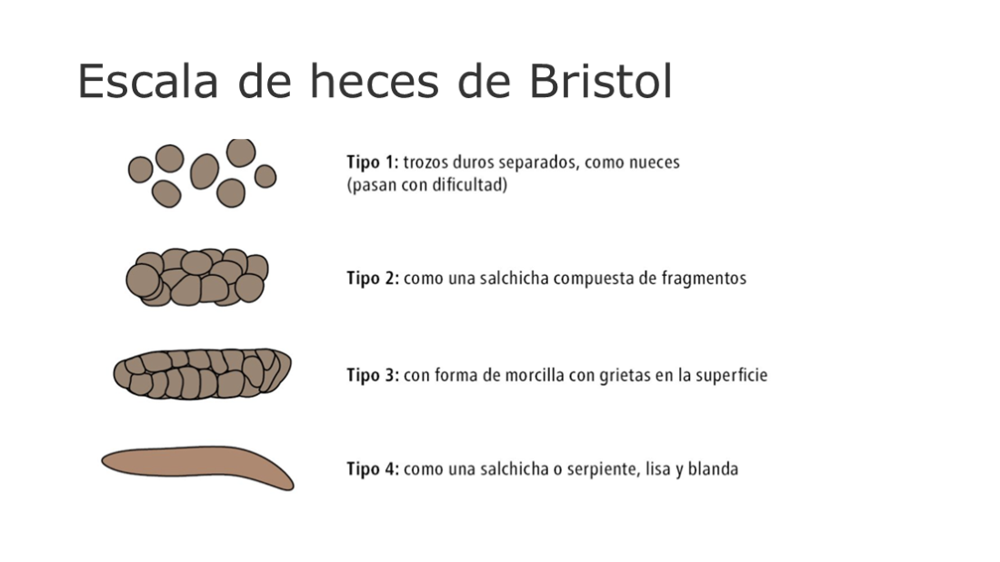
<!-- DIG d. 28 | tipo: escala | incluir en Word: sí -->

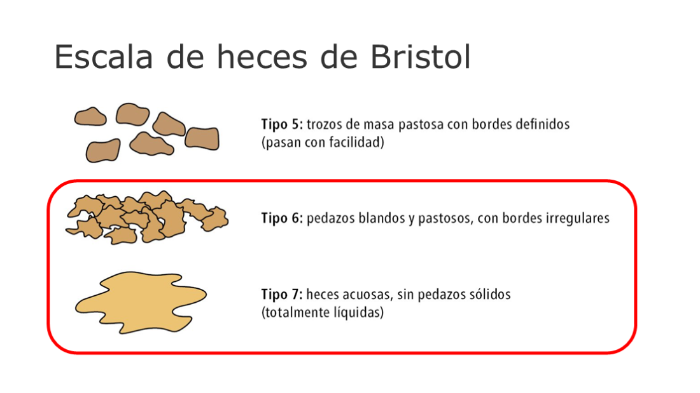
<!-- DIG d. 29 | tipo: escala | incluir en Word: sí -->

- Investigar evolución, comienzo, circunstancias (comidas, viajes, otros afectados, estrés), consistencia, color, mucus, sangre, pus, número, horario y acompañantes. **[Goic, p. 80–81]**
- Dolor: periumbilical o fosa ilíaca derecha en delgado o colon proximal; abdomen bajo que alivia al evacuar en colon; con tenesmo en rectosigmoides. **[Goic, p. 81]**
- Color: negro (melena), blanquecino (colestasis u obstrucción biliar), amarillo flotante (esteatorrea). Hierro, bismuto, carbón o espinaca oscurecen las heces. **[Goic, p. 81]**
- Tras ingerir un alimento: menos de 4 h con vómitos, toxina preformada; 6–8 h sin fiebre, *E. coli* enterotoxigénica o *C. perfringens*; con fiebre, *Shigella* o *Salmonella*. **[UCH, tema 42, p. 282]**
- Viajero: durante el viaje y hasta 14 días después. **[UCH, tema 42, p. 282]**

#### Examen físico

Hidratación y nutrición; palpación (dolor, distensión, masas); tacto rectal [DIG d. 44–46].

- Hidratación: piel, mucosas, yugulares, pulso y presión (hipotensión ortostática). **[UCH, tema 42, p. 282]**

#### Exámenes de apoyo

- Aguda: por lo general autolimitada; lo central es hidratar y rara vez se necesitan antibióticos. **[Goic, p. 84]**
- Crónica: estudio exhaustivo: tacto rectal, endoscopía baja con biopsia, parasitológico, hemorragias ocultas, hemograma, VHS, glicemia, función renal; según el caso grasa fecal, pruebas de absorción, biopsia intestinal y tiroides. **[Goic, p. 84]**

#### Diagnóstico diferencial

**Seudodiarrea (descartar):** pequeñas cantidades líquidas con incontinencia, por fecaloma o estenosis colónica (incluidas neoplasias), sobre todo del sigmoides [DIG d. 32–37].

**Alta o baja** [DIG d. 41–42] ⚠

| Rasgo | Alta (delgado) | Baja (grueso) |
|---|---|---|
| Dolor | Leve, infrecuente, central | Cólico periférico |
| Pujo y tenesmo | Solo en diarreas ácidas | Presentes |
| Deposiciones | Pocas | Múltiples |
| Volumen | Abundante | Escaso |
| Color | Amarillento | Marrón |
| Consistencia | Pastosa | Acuosa |
| Esteatorrea | Frecuente | Ausente |
| Restos de alimentos | Posible | Ausente |
| Mucus | No | Sí |
| Sangre | No | Posible |

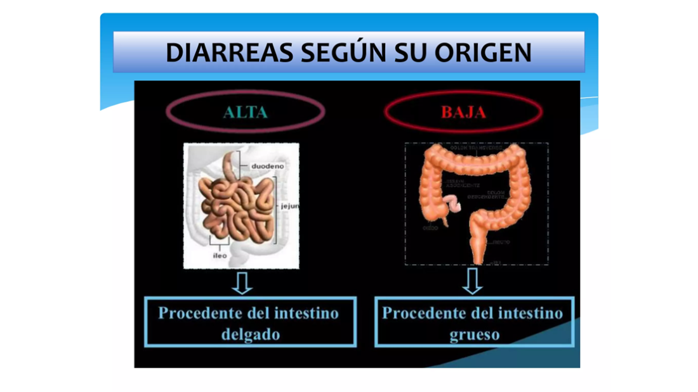
<!-- DIG d. 41 | tipo: esquema | incluir en Word: opcional -->

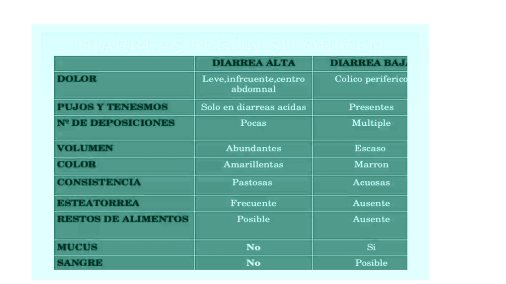
<!-- DIG d. 42 | tipo: tabla en imagen, ya transcrita | incluir en Word: no -->

**Funcional u orgánica** [DIG d. 43]

| Rasgo | Funcional | Orgánica |
|---|---|---|
| Evolución | Larga, alterna con estreñimiento | Más corta |
| Sistémicos | No | Artritis, fiebre |
| Peso | Conservado | Suele bajar |
| Sangre y pus | No | Frecuentes |
| Estado general | Bueno | Afectado |
| Laboratorio | Normal | Anemia, hipoproteinemia |
| Nocturna | No | Frecuente |

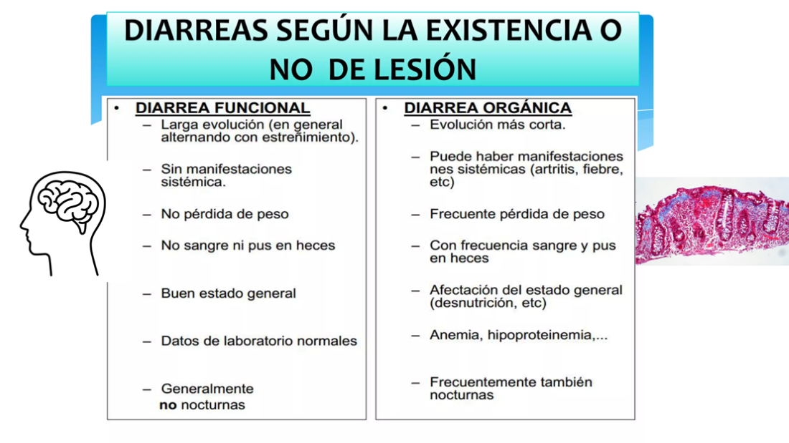
<!-- DIG d. 43 | tipo: cuadro en imagen, ya transcrito | incluir en Word: no -->

**Cuadros relacionados** [DIG d. 47–50]

- **Del viajero:** infección por agua o alimentos contaminados; también por cambio de dieta o estrés.
- **Disentería:** sangre, pus o mucus, poco volumen, tenesmo, fiebre y dolor; invasión colónica por bacterias, parásitos o amebas. Ver Síndrome disentérico.
- **Lientería:** alimentos sin digerir; tránsito acelerado.
- **Dispepsia:** malestar o dolor abdominal alto (plenitud, ardor, náuseas), durante o después de comer; funcional o estructural.
- «Gastroenteritis» puede ocultar cetoacidosis, uremia o Addison. Alternar con constipación sugiere colon irritable o abuso de laxantes. **[Goic, p. 81]**

| Rasgo **[UCH, tema 42, p. 285]** | Enfermedad de Crohn | Colitis ulcerosa |
|---|---|---|
| Distribución | Segmentaria, cualquier parte; sobre todo íleon terminal | Continua, solo colon, siempre el recto |
| Profundidad | Transmural: fístulas, abscesos | Mucosa |
| Periné y masas | Pueden estar | Ausentes |
| Tabaco | Factor de riesgo | Protector |

#### Signos de alarma

- Grave si hay más de 6 deposiciones [DIG d. 44–46].
- Sugieren organicidad: menos de 3 meses de evolución, diarrea nocturna, continua, comienzo súbito, baja de más de 5 kg [DIG d. 44–46] ⚠.
- Intolerancia oral o deshidratación, fiebre sobre 38 °C por más de 48 h, sangre, más de 6 al día, persistencia, dolor en mayores de 50, adulto mayor, comorbilidad o inmunodeficiencia. **[UCH, tema 42, p. 282–283]**
- El enflaquecimiento orienta a causa orgánica y, en personas mayores, a neoplasia. **[Goic, p. 81]**

### Hemorragia digestiva

#### Definición

- Sangrado de lesiones en cualquier nivel, del esófago al ano; aguda o crónica, aparente u oculta. **[Goic, p. 90]**
- **Alta:** sobre el ángulo de Treitz (esófago, estómago, duodeno). **Baja:** distal a él. UCH distingue además la intermedia (yeyuno-íleon, cerca de 5 %). **[Goic, p. 90]** **[UCH, tema 41, p. 273]**
- Frecuencia de la alta ⚠: 75–85 % según UCH; 90 % según Argente. **[UCH, tema 41, p. 273]** **[Argente, cap. 48-9]**

#### Mecanismo

- La melena es sangre degradada: Goic la atribuye al ácido (hematina); Argente, a las bacterias colónicas; UCH, a ambos. **[Goic, p. 91]** **[Argente, cap. 48-9]** **[UCH, tema 41, p. 275]**
- Se necesitan unas 8 h en el tubo y, según la fuente, 60 mL (Goic, UCH) o 50 mL (Argente) ⚠. **[Goic, p. 91]** **[UCH, tema 41, p. 273]** **[Argente, cap. 48-9]**

#### Causas

| Tracto superior [DIG d. 53–54] | Tracto inferior |
|---|---|
| Úlcera péptica (la más común) | Diverticulosis |
| Várices esofágicas (asociadas a cirrosis) | Enfermedad inflamatoria intestinal (Crohn, colitis ulcerosa) |
| Esofagitis, gastritis, Mallory-Weiss | Pólipos y cáncer colorrectal |
| | Hemorroides, fisuras anales |

La figura agrega hemorragia de intestino delgado (Crohn, tumores, divertículo de Meckel).

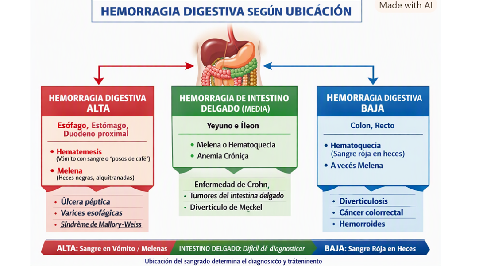
<!-- DIG d. 54 | tipo: infografía generada con inteligencia artificial, con erratas | incluir en Word: no sin corregir -->

- **Alta, en Chile:** várices, úlcera y gastritis erosiva serían el 90 % o más. **[Goic, p. 91]**
- La úlcera es la más frecuente (más del 60 % según Argente) y las várices, las más ominosas. **[Argente, cap. 48-9]** **[UCH, tema 41, p. 274]**
- Otras altas: duodenitis, Mallory-Weiss, neoplasias, esofagitis, telangiectasia hereditaria, hemopatías, aneurisma aórtico roto, úlceras de estrés, uremia. **[Goic, p. 91–92]**

| Hemorragia baja según edad **[UCH, tema 41, p. 276]** | Causas orientadoras |
|---|---|
| Niños | Meckel, pólipos, enfermedad inflamatoria, malformaciones vasculares |
| Jóvenes | Fisura o hemorroides, pólipos, enfermedad inflamatoria, malformaciones |
| Mayores | Divertículos, angiodisplasia, colitis isquémica, pólipos, cáncer |

#### Cómo caracterizarlo

| Altura [DIG d. 52] | Forma | Descripción | Origen |
|---|---|---|---|
| Alta | Hematemesis | Vómito de sangre oscura con restos y coágulos | Tracto superior |
| Alta | Melena | Negra, como alquitrán, pastosa, fétida | Tracto superior |
| Baja | Hematoquezia | Violácea | Intestino delgado o colon ascendente, transverso o descendente |
| Baja | Rectorragia | Roja clara | Rectosigmoides o ano |

- La relación entre altura y aspecto no es exacta: una hemorragia alta masiva o con tránsito rápido da rectorragia; una de intestino delgado o colon derecho con tránsito lento, melena. **[Goic, p. 90–91]**
- Hematoquecia de origen alto: 10–15 % de los casos; requiere sangrado importante (cerca de 1.000 mL) o tránsito rápido y es de mal pronóstico. **[Argente, cap. 48-9]** **[UCH, tema 41, p. 278]**
- La hematemesis suele indicar mayor pérdida (más de 500 mL) que la melena sola. **[Goic, p. 91]**
- Preguntar úlcera previa, pirosis, vómitos repetidos (Mallory-Weiss), alcohol, tabaco, hepatopatía, hemostasia, y AINE, aspirina, corticoides, anticoagulantes, antiagregantes e inhibidores de recaptación de serotonina. **[UCH, tema 41, p. 275]** **[Argente, cap. 48-9]**
- En la baja: dolor (enfermedad inflamatoria, isquemia) o ausencia de él (angiodisplasia, divertículos); sangre en el papel (patología anal); radioterapia o polipectomía previas. **[Argente, cap. 48-9]** **[UCH, tema 41, p. 277]**

#### Examen físico

- **Tilt test:** presión y pulso en decúbito y luego sentado; positivo si baja la presión y sube el pulso [DIG d. 55] ⚠.
- Primero la hemodinamia: presión, frecuencia, ortostatismo, llene capilar, diuresis, conciencia. Buscar hipertensión portal y masas; el tacto rectal es imprescindible. **[UCH, tema 41, p. 275–278]**
- Ortostatismo: acostado al menos 2 minutos, medir; ponerse de pie y repetir a los 1, 3 y 5 minutos. **[Argente, cap. 48-9]**
- Hipotensión ortostática de 10 mmHg o más indica pérdida de 20 % o más; con 40 % hay shock. **[Goic, p. 91]**

| Hallazgo **[Argente, cap. 48-9]** ⚠ | Volemia perdida |
|---|---|
| Signos vitales normales | 0–15 % |
| Caída ortostática de la sistólica (más de 10 mmHg) | 15–20 % |
| Taquicardia en reposo | 20–25 % |
| Sistólica bajo 100 mmHg | Más de 30 % |
| Shock | Más de 40 % |

#### Exámenes de apoyo

- Hemograma, función renal y hepática, coagulación. El hematocrito inicial no refleja la pérdida: baja desde las 8 h y se equilibra en 24–48 h. **[UCH, tema 41, p. 277]** **[Argente, cap. 48-9]**
- Endoscopía alta o colonoscopía: diagnóstico y tratamiento. Sin origen: repetir, angio-TC o estudiar intestino delgado. **[UCH, tema 41, p. 277]**
- Solo ver la lesión sangrante da certeza, porque puede haber más de una. Para sangre oculta: pruebas químicas o inmunoquímicas. **[Goic, p. 93]**

#### Diagnóstico diferencial

- **Hemoptisis:** precedida de tos, roja, espumosa; la hematemesis sigue a náuseas, es oscura y con alimentos. **[UCH, tema 41, p. 273]**
- Simulan melena el hierro, bismuto y regaliz (heces formadas, sin el olor típico); simulan rectorragia la betarraga y la bromosulftaleína. **[Goic, p. 91]**

#### Signos de alarma

Persistencia o recurrencia del sangrado [DIG d. 55]:

- Inquietud, borborigmos, urgencia por defecar.
- Palidez, mareo, síncope; taquicardia, hipotensión, sudor frío; fatiga o anemia.
- Hemoglobina que cae pese a la reposición; transfusiones repetidas.
- Una hemorragia moderada (menos de 500 mL) no suele dar síntomas, salvo en personas mayores o anémicas; taquicardia, hipotensión, palidez, sudor, sed, mareo o lipotimia indican más. **[Goic, p. 91]**
- Origen variceal: peor pronóstico. **[Argente, cap. 48-9]**
- Constipación de instalación aguda y persistente, baja de peso o hematoquecia alertan de neoplasia. **[Argente, cap. 45-6]**

## Parte C. Síndromes

### Síndrome ulceroso

#### Definición

Dolor abdominal crónico, generalmente epigástrico, con **periodicidad y ritmicidad**; casi siempre por úlcera gástrica o duodenal [SDG d. 4].

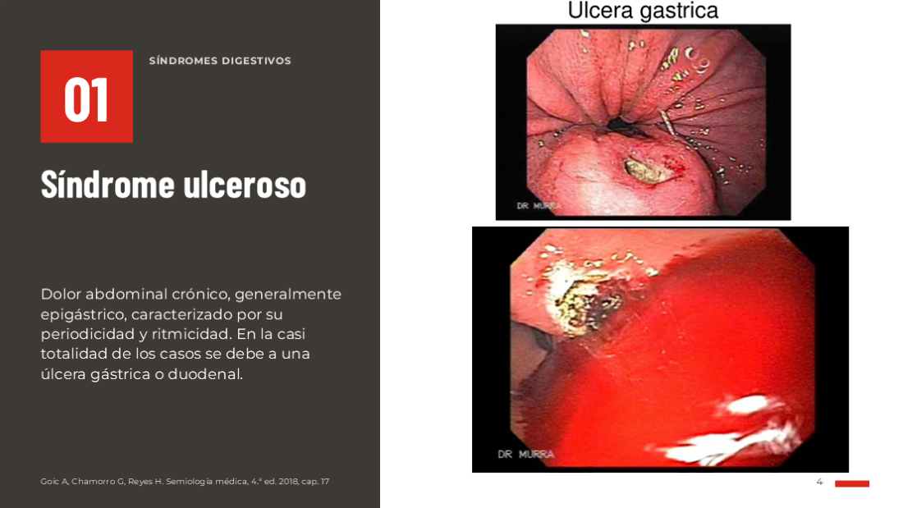
<!-- SDG d. 4 | tipo: endoscopías | incluir en Word: opcional -->

- La periodicidad describe la evolución del dolor a lo largo del tiempo; la ritmicidad, su evolución durante el día. **[Goic, p. 221]**
- Úlcera péptica: solución de continuidad que llega a la submucosa en zonas expuestas a ácido y pepsina; lo más frecuente es bulbo duodenal y estómago. **[UCH, tema 40, p. 270]**

#### Fisiopatología

- *H. pylori* produce ureasa. La gastritis de predominio antral baja la somatostatina, sube gastrina y ácido, y favorece la úlcera duodenal. Los AINE dañan al inhibir las prostaglandinas protectoras. **[UCH, tema 40, p. 270]**

#### Causas

Úlcera péptica, gástrica o duodenal [SDG d. 4, 6].

- Casi exclusivamente úlcera péptica; es excepcional que otra patología simule un cuadro típico. *Helicobacter pylori* se relaciona con la patogenia de la úlcera gastroduodenal. **[Goic, p. 221–222]**
- Una proporción importante de las úlceras no duele y se descubre por hemorragia, dolor atípico o exámenes de rutina. **[Goic, p. 221]**
- *H. pylori*: cerca del 80 % de los casos; AINE: cerca del 15 %, con más riesgo en dosis altas, combinados, con anticoagulantes o corticoides, antecedente ulceroso o más de 65 años. **[UCH, tema 40, p. 270]**
- Otras: estrés grave (quemados, sepsis), estados hipersecretores, cáncer gástrico, Crohn, bifosfonatos y otros fármacos. **[UCH, tema 40, p. 271]**

#### Clínica (anamnesis)

- **Dolor:** epigástrico sin irradiación ni carácter definido; ardor, sensación de vacío, malestar o "hambre dolorosa"; intensidad moderada [DIG d. 56; SDG d. 6]. El malestar puede ser vago; si hay otros síntomas, pensar en una enfermedad concomitante [SDG d. 6].
- **Periodicidad (meses a años):** períodos de dolor de semanas o meses alternan con períodos sin síntomas; puede ser estacional [DIG d. 56; SDG d. 5].
- **Ritmicidad (día):** comida → alivio → dolor que reaparece 1–3 h después. Dolor de madrugada (1–3 a. m.), que puede despertar; raro antes del desayuno [DIG d. 56; SDG d. 5].
- **Agravan:** ayuno, pensar en comida. **Alivian:** comida, líquidos, antiácidos, vómitos [DIG d. 56; SDG d. 5].
- El tipo de dolor vale mucho menos que su ritmo [SDG d. 5].
- Náuseas y vómitos son excepcionales [SDG d. 6].

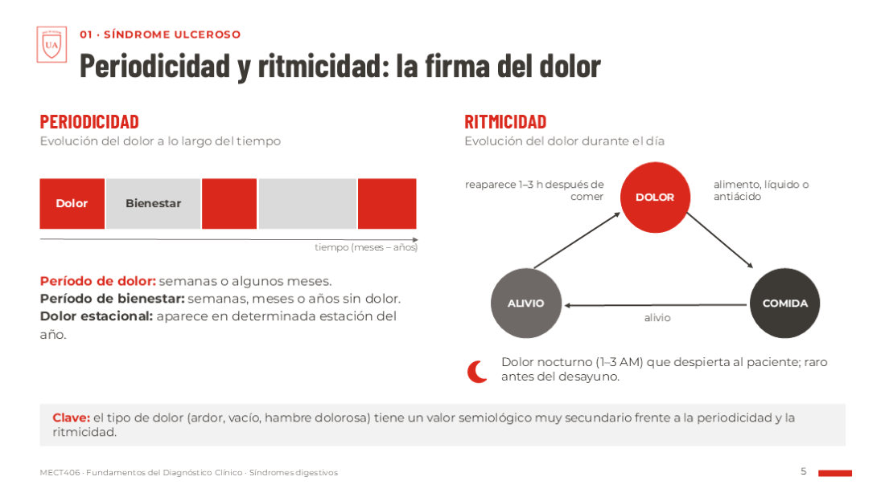
<!-- SDG d. 5 | tipo: esquema | incluir en Word: sí -->

- En úlceras de muchos años el dolor puede perder la periodicidad y la ritmicidad: preguntar cómo era al comienzo. **[Goic, p. 221]**
- En la úlcera pilórica o con retención gástrica puede haber vómitos precoces que alivian el dolor. **[Goic, p. 221]**

#### Examen físico

No aporta en la úlcera no complicada [SDG d. 6].

#### Exámenes y criterios

Endoscopía alta, con biopsia y estudio de *Helicobacter pylori* [SDG d. 7].

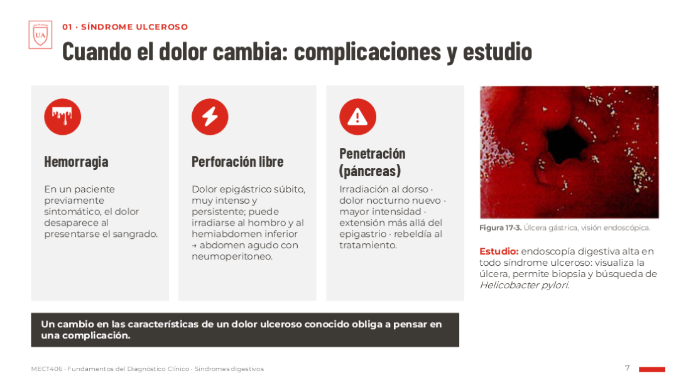
<!-- SDG d. 7 | tipo: figura de libro | incluir en Word: opcional -->

- La endoscopía supera a la radiología, sobre todo en la úlcera duodenal: ve la lesión y permite biopsia y búsqueda de *H. pylori*. **[Goic, p. 222]**

#### Diagnóstico diferencial

No forman parte del síndrome: anorexia, baja de peso, pirosis ni dispepsia [SDG d. 6].

- Síndrome ulceroso atípico: patología digestiva que lo imita, sin periodicidad y ritmicidad claras. **[Goic, p. 221]**
- Colecistopatía calculosa crónica o un trastorno funcional concomitantes pueden enmascarar el cuadro. **[Goic, p. 222]**

#### Alarma y conducta

Todo cambio del dolor obliga a pensar en complicación [SDG d. 7].

| Complicación [SDG d. 7] | Cambio clínico |
|---|---|
| Hemorragia | El dolor desaparece al sangrar |
| Perforación libre | Dolor súbito, intenso, persistente; hombro y hemiabdomen inferior; neumoperitoneo |
| Penetración al páncreas | Se extiende más allá del epigastrio: irradiación dorsal, dolor nocturno nuevo, más intenso y rebelde |

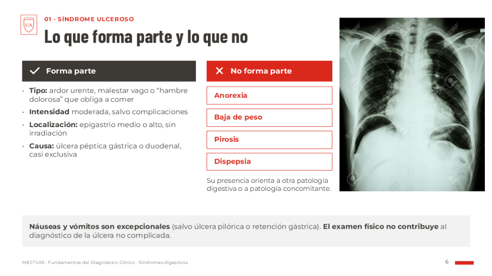
<!-- SDG d. 6 | tipo: radiografía incluida en la lámina | incluir en Word: opcional -->

- La perforación libre da un cuadro de abdomen agudo con neumoperitoneo. La penetración además hace rebelde el dolor al tratamiento que antes lo aliviaba. **[Goic, p. 222]**

### Síndrome de retención gástrica

#### Definición

Alimentos retenidos en el estómago más de lo normal: 8–10 h después de comer (DIG d. 56) o tras 8–12 h de ayuno (SDG d. 8) ⚠. Se debe a obstrucción piloroduodenal o a falla motora [SDG d. 8].

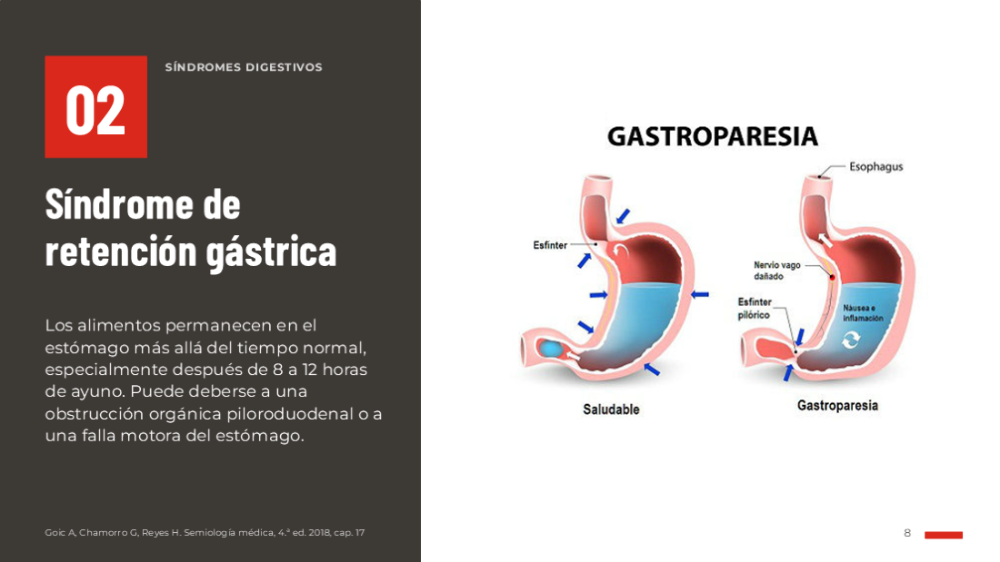
<!-- SDG d. 8 | tipo: esquema | incluir en Word: opcional -->

- Normalmente no quedan alimentos 4 h después de comer. El *síndrome pilórico* es la forma por obstrucción mecánica, parcial o total, que no va más allá del bulbo duodenal. **[Goic, p. 222–223]**

#### Fisiopatología

- El vaciamiento depende de la consistencia, las calorías y la calidad del alimento: los líquidos salen rápido, los sólidos tardan 2 h o más y las grasas más que carbohidratos y proteínas. **[Goic, p. 222]**
- Se produce por obstrucción piloroduodenal o por falla de la propulsión, de origen metabólico, neurológico (autonómico) o medicamentoso. **[Goic, p. 223–224]**

#### Causas

| Obstrucción mecánica (síndrome pilórico) [DIG d. 56; SDG d. 9] | Falla motora, sin obstrucción |
|---|---|
| Úlcera péptica activa o cicatriz | Diabetes (gastroparesia por neuropatía autonómica) |
| Cáncer antral o pilórico (hoy primera causa), linfoma | Inmovilización prolongada, traumatismos abdominales |
| Inflamación vecina al píloro, Crohn | Atropina y anticolinérgicos, antidepresivos |
| Cáusticos, malformaciones, trauma | Alteraciones metabólicas e hidroelectrolíticas (hipopotasemia) |

(Tablas 17-1 y 17-2 de Goic, según la lámina.)

- Otras: linfoma, traumatismos y malformaciones; en niños, sobre todo hipertrofia muscular del píloro. Atropina y anticolinérgicos retienen en especial a personas mayores y en dosis altas o repetidas. **[Goic, p. 223–224]**

#### Clínica (anamnesis)

[SDG d. 10]

- Vómito abundante con alimentos de horas previas, **sin bilis** (con bilis: obstrucción en la segunda porción duodenal o distal).
- Dolor ulceroso que alivia al vomitar, o progresivo si es neoplásico.
- Anorexia, saciedad precoz, distensión alta, sitofobia.

- El vómito de retención es el síntoma cardinal: abundante, con náuseas o autoprovocado para aliviarse. **[Goic, p. 223]**
- El dolor neoplásico es persistente y progresivo y no cede al vomitar. Puede haber constipación o, rara vez, diarrea, incluso antes de los vómitos. **[Goic, p. 223]**
- La retención sin obstrucción a menudo se descubre por hallazgo en sondeo, radiología o endoscopía. **[Goic, p. 224]**

#### Examen físico

Desnutrición, distensión, peristalsis visible y **bazuqueo** (hallazgo principal) [SDG d. 10].

#### Exámenes y criterios

- **Criterio:** más de 300 mL residuales 4 h después de comer, o más de 100 mL en ayunas [SDG d. 9].
- Endoscopía, después de vaciar con sonda [SDG d. 10, 33].

#### Diagnóstico diferencial

- **Obstrucción en la segunda porción del duodeno o distal:** vómito con bilis; no se llama síndrome pilórico. **[Goic, p. 223]**
- **Falla motora:** vómitos menos frecuentes, con gran dilatación previa; puede aparecer bilis tras vómitos repetidos. **[Goic, p. 223–224]**

#### Alarma y conducta

Ayuno → sonda nasogástrica gruesa → hidratación y electrolitos → endoscopía [SDG d. 10].

- Es obligatorio llegar al diagnóstico etiológico. La sonda permite además observar sangre, bilis y pH, y comprobar si la obstrucción cedió. **[Goic, p. 224]**
- Obstrucción persistente: cirugía si es maligna o irreversible; en estenosis por úlcera puede intentarse dilatación endoscópica con balón. **[Goic, p. 224]**

### Síndrome de reflujo gastroesofágico

#### Definición

- El reflujo breve y escaso es fisiológico; es enfermedad (ERGE) cuando causa síntomas molestos o complicaciones, con o sin esofagitis. **[UCH, tema 40, p. 269]**

#### Fisiopatología

- Desbalance entre los factores defensivos y los agresivos sobre la mucosa esofágica. **[UCH, tema 40, p. 269]**

#### Causas

Principal: incompetencia del EEI [DIG d. 57].

#### Clínica (anamnesis)

Pirosis, regurgitación, dolor retroesternal, disfagia [DIG d. 57]. Ver la ficha Pirosis.

- Pirosis y regurgitación son típicas y bastan para el diagnóstico clínico. Extraesofágicos: tos crónica, laringitis, disfonía, asma, erosiones dentales. **[UCH, tema 40, p. 269]**

#### Exámenes y criterios

- No suelen requerirse; se usa prueba terapéutica con inhibidor de la bomba de protones. **[UCH, tema 40, p. 269]**
- Con duda o alarma: endoscopía (primera elección, baja sensibilidad), pH-metría de 24 h, esofagograma, manometría. **[UCH, tema 40, p. 270]**

#### Alarma y conducta

- Alarma: ver la ficha Pirosis. Complicaciones: úlcera y estenosis esofágica, hemorragia, esófago de Barrett (riesgo de adenocarcinoma 40–50 veces) y adenocarcinoma. **[UCH, tema 40, p. 269–270]**
- Medidas: comidas moderadas, bajar de peso, evitar grasas, chocolate, café, alcohol y tabaco, no acostarse 1–2 h tras comer, cabecera elevada. **[UCH, tema 40, p. 270]**

*Falta: examen físico, diagnóstico diferencial.*

### Síndrome disentérico

#### Definición

Trastorno inflamatorio, sobre todo colónico: diarrea con sangre, mucus o pus, con pujo y tenesmo [DIG d. 57; SDG d. 11–12].

- También se llama diarrea disenteriforme o disentería. **[Goic, p. 224]**

#### Fisiopatología

Invasión del colon por bacterias, parásitos o amebas [DIG d. 47–50].

- En la mayoría hay inflamación de la mucosa rectosigmoidea por enfermedad propia; excepcionalmente por inflamación vecina. **[Goic, p. 225]**

#### Causas

| Grupo [SDG d. 12] | Causas |
|---|---|
| Parasitarias | Amebiasis (*E. histolytica*), balantidiasis |
| Bacterianas | *Shigella*, *E. coli* invasora, *Salmonella* no typhi, *Yersinia* |
| Granulomatosas | Colitis ulcerosa, ileítis regional |
| Misceláneas | Rectitis actínica, tumores rectosigmoideos, abscesos perirrectales |

La otra clase resume: enfermedad inflamatoria intestinal (colitis ulcerosa, Crohn), enterocolitis por bacterias enteroinvasoras (*Shigella*, *Salmonella*) o por *E. histolytica*, y rectitis actínica por radioterapia [DIG d. 57].

- En Chile, según el libro, predominan la disentería bacilar, la amebiana, la balantidiasis y la colitis ulcerosa; menos frecuentes rectitis actínica, enteritis regional, tumores e inflamación perirrectal. **[Goic, p. 225]**

#### Clínica (anamnesis)

[DIG d. 47–50, 57; SDG d. 11–12]

- Muchas evacuaciones con poca materia fecal; rectorragia, mucus, pus.
- **Pujo:** esfuerzo expulsivo doloroso ⚠. **Tenesmo:** deseo persistente con evacuación incompleta.
- Dolor cólico y fiebre variable.
- Agudo: infección. Recurrente: enfermedad inflamatoria intestinal.

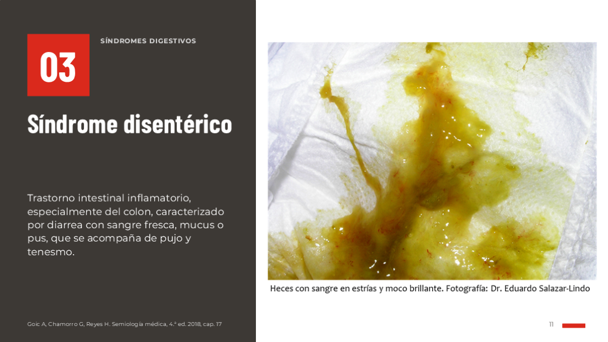
<!-- SDG d. 11 | tipo: foto | incluir en Word: opcional -->

#### Exámenes y criterios

Rectosigmoidoscopía con muestra y biopsia, coprocultivo, parasitológico [SDG d. 13].

- A todo paciente: rectosigmoidoscopía o colonoscopía corta, con coprocultivo y parasitológico. **[Goic, p. 225]**
- Según el caso: enema baritado o colonoscopía larga para ver extensión y tomar biopsias, y serología de amebiasis. Si se sospecha enfermedad inflamatoria, estudiar también el intestino delgado. **[Goic, p. 225]**

#### Diagnóstico diferencial

| Rasgo [SDG d. 13] | Bacilar | Amebiana |
|---|---|---|
| Fiebre | 38–40 °C | Menor |
| Evacuaciones | 10–20 al día | Menos |
| Estado general | Más comprometido | Menos |
| Mucosa | Roja, edematosa; úlceras que confluyen en grandes defectos de base sucia | Úlceras pequeñas con mucosa sana |
| Exudado | Polimorfonucleares degenerados y glóbulos rojos | Mononucleares |
| Certeza | Coprocultivo | Trofozoítos |

Colitis ulcerosa: hiperemia difusa y fragilidad de la mucosa [SDG d. 13].

- Lesiones anorrectales (fístulas, abscesos) o inflamación del ano con diarrea pueden simularlo. **[Goic, p. 225]**
- A veces solo la evolución y la respuesta al tratamiento aclaran la causa. **[Goic, p. 225]**

#### Alarma y conducta

- Un episodio agudo orienta a infección o parásitos, y uno recurrente a enfermedad granulomatosa; pero el primer episodio agudo puede ser el debut de una enfermedad crónica. **[Goic, p. 224–225]**

*Falta: examen físico.*

### Síndrome de malabsorción

#### Definición

Digestión o absorción alterada de alimentos, minerales y vitaminas; destaca la **esteatorrea** [SDG d. 14].

- Maldigestión es la falla de hidrólisis y malabsorción la de transporte; en la práctica «malabsorción» nombra ambas. No equivale exactamente a esteatorrea, porque rara vez no es demostrable. **[Goic, p. 226]**

#### Fisiopatología

| Nivel [SDG d. 15] | Falla | Ejemplos |
|---|---|---|
| Lumen (hidrólisis) | Maldigestión | Enzimas pancreáticas (lipólisis), ácidos biliares conjugados (micelas) |
| Mucosa (transporte) | Malabsorción | Enfermedad de la mucosa, resección |

Resultado: esteatorrea, diarrea y déficit de vitaminas liposolubles [SDG d. 15].

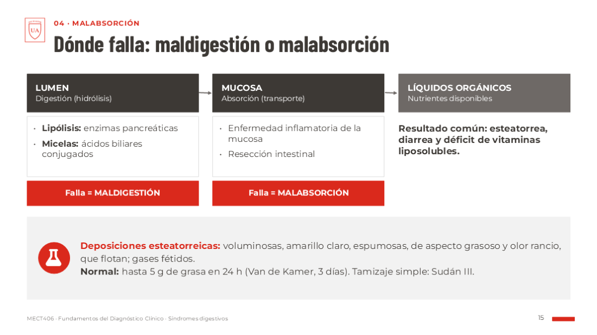
<!-- SDG d. 15 | tipo: esquema | incluir en Word: sí -->

#### Causas

| Origen [SDG d. 17] | Causas |
|---|---|
| Intestinal primaria | Enfermedad celíaca, esprúe tropical |
| Intestinal secundaria | Linfoma, amiloidosis, esclerodermia, Crohn, enteritis actínica, Whipple |
| Pancreática | Pancreatitis crónica, fibrosis quística, diabetes |
| Quirúrgica | Gastrectomía subtotal, asa ciega, intestino corto, fístula gastrocólica |
| Otras | Lambliasis masiva, colestasis, Zollinger-Ellison, endocrinopatías, insuficiencia cardíaca severa |

En adultos, las más frecuentes son la enfermedad celíaca y la pancreatitis crónica.

- En insuficiencia cardíaca, colestasis, hipertiroidismo o mesenquimopatías puede ser un fenómeno secundario sin importancia clínica propia. Preguntar cirugías previas y antecedentes familiares (celíaca, Crohn). **[Goic, p. 226]**
- **Celíaca:** autoinmune, gatillada por gluten; atrofia reversible al suspenderlo; se asocia a tiroidopatías, diabetes y otras autoinmunes. **[UCH, tema 42, p. 284]**

#### Clínica (anamnesis)

- Diarrea crónica; deposiciones voluminosas, claras (amarillo claro), espumosas, grasosas, rancias, que flotan; gases fétidos [DIG d. 58; SDG d. 15].

| Déficit [SDG d. 16] | Signo |
|---|---|
| Proteínas | Edema (anasarca), pérdida muscular |
| Hierro, folato, B12 | Anemia |
| Vitamina K | Hemorragias (hipoprotrombinemia) |
| Calcio y magnesio | Parestesias, tetania, calambres, espasmo carpopedal |
| Vitamina D | Osteomalacia; con déficit de proteínas y calcio, osteoporosis |
| Riboflavina y hierro | Glositis, queilosis (queilitis) |
| Zinc | Adelgazamiento del cabello |

- **Generales:** enflaquecimiento, astenia, distensión, hipocratismo digital [SDG d. 16].
- **Otros:** fiebre y artritis (Whipple), hiperpigmentación, piel seca y escamosa, retardo del crecimiento en niños y adolescentes [SDG d. 16].
- La otra clase agrega trastornos hidroelectrolíticos en los casos severos y signos secundarios en la piel [DIG d. 58].

- Las formas leves dan pocas señales: heces blandas y frecuentes, molestia abdominal, baja de peso, anemia o edema inexplicados. **[Goic, p. 226]**
- Celíaca: solo cerca del 40 % tiene la clínica clásica. En adultos: diarrea, anemia, osteoporosis, aftas, defectos del esmalte, glositis, dermatitis herpetiforme, infertilidad, o nada. **[UCH, tema 42, p. 284]**

#### Exámenes y criterios

1. **Sospechar:** diarrea esteatorreica, edema o anemia inexplicados, signos carenciales [SDG d. 17].
2. **Certificar la esteatorrea:** observar las deposiciones, tinción Sudán III (tamizaje), Van de Kamer (normal hasta 5 g de grasa en 24 h; se mide en 3 días) [SDG d. 15, 17].
3. **Intestinal o pancreática** [SDG d. 17]:
   - Intestinal: Rx de intestino delgado, d-xilosa, biopsia, antiendomisio y antitransglutaminasa.
   - Pancreática: ecografía, TC, RM, pancreatografía.

- Según el libro, el método de Van de Kamer no está siempre disponible; la espectrometría infrarroja es una alternativa. **[Goic, p. 227]**
- Otras pruebas: Schilling (vitamina B12), hidrógeno espirado (sobrecrecimiento bacteriano), alfa-1 antitripsina (pérdida de proteínas), angiografía (isquemia). **[Goic, p. 227]**
- Celíaca: la biopsia de intestino delgado es lo más decisivo; pedir serología ante síntomas, condiciones asociadas o familiares de primer grado. **[Goic, p. 227]**
- *Giardia*: la detección de antígenos (ELISA) rinde más que el parasitológico. **[Goic, p. 227]**
- El enfoque actual busca la enfermedad de base según la sospecha, más que acumular pruebas. **[Goic, p. 228]**

#### Diagnóstico diferencial

- Sensibilidad al gluten no celíaca: anticuerpos negativos y biopsia normal o casi normal; falta demostrar que sea una entidad. **[Goic, p. 227]**

*Falta: examen físico, alarma y conducta.*

### Obstrucción intestinal

#### Definición

Obstáculo mecánico, parcial o total, al tránsito en el intestino delgado o grueso. Puede hablarse de obstrucción mecánica o funcional: en el **íleo paralítico** el tránsito se detiene por parálisis muscular [DIG d. 58; SDG d. 18].

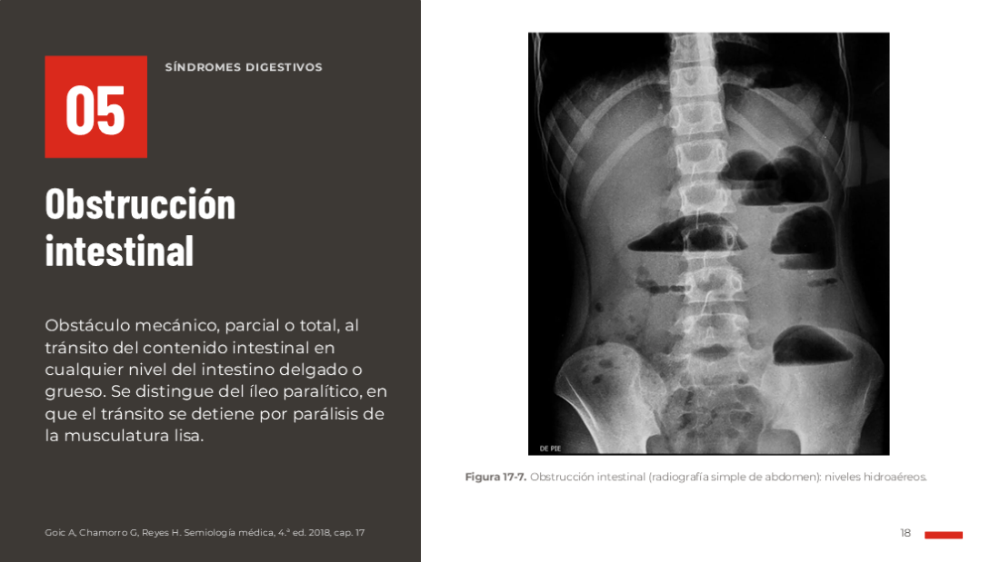
<!-- SDG d. 18 | tipo: radiografía (fig. 17-7) | incluir en Word: sí -->

- Goic reserva «obstrucción intestinal» para la mecánica e «íleo» para la parálisis; la obstrucción piloroduodenal se estudia como retención gástrica. **[Goic, p. 228]**

#### Fisiopatología

- El dolor cólico refleja la peristalsis que intenta vencer el obstáculo; si dura mucho puede desaparecer por parálisis. **[Goic, p. 228]**
- La deshidratación se debe a vómitos y al paso de líquido al lumen, al peritoneo y a la pared; con estrangulación puede haber shock. **[Goic, p. 229]**
- El vómito fecaloideo no contiene heces: es estasis con proliferación bacteriana. **[Goic, p. 228]**

#### Causas

- Cerca del 80 %: bridas (adherencias tras cirugía abdominal) [DIG d. 58]; SDG atribuye ese porcentaje a bridas y hernias estranguladas [SDG d. 21–22] ⚠.
- Funcional (íleo): trastornos hidroelectrolíticos, medicamentos o cuadros de dolor severo [DIG d. 58].
- En colon, la causa principal es el cáncer [SDG d. 21–22].

| Extraluminales [SDG d. 21–22] | Luminales |
|---|---|
| Hernias, bridas, masas, vólvulo, intususcepción | Tumores, inflamación (Crohn, TBC, diverticulitis), cálculo, vermes, impacto fecal, estenosis de anastomosis |

**Íleo biliar:** tríada de Rigler (aire en la vía biliar, asas dilatadas, cálculo) [SDG d. 21–22].

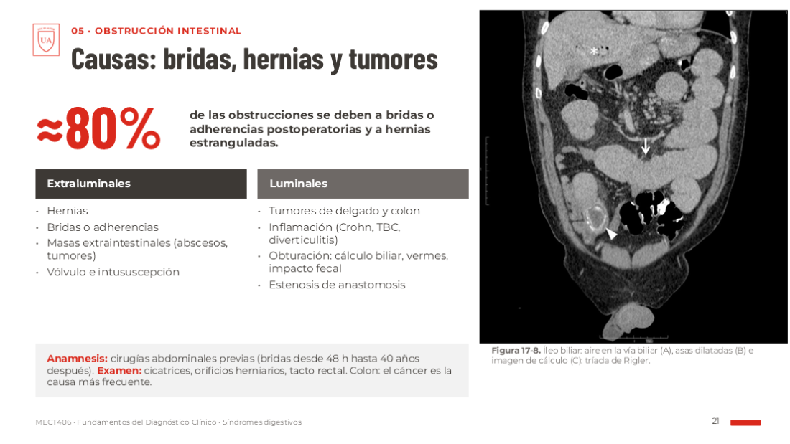
<!-- SDG d. 21 | tipo: tomografía (fig. 17-8) | incluir en Word: opcional -->

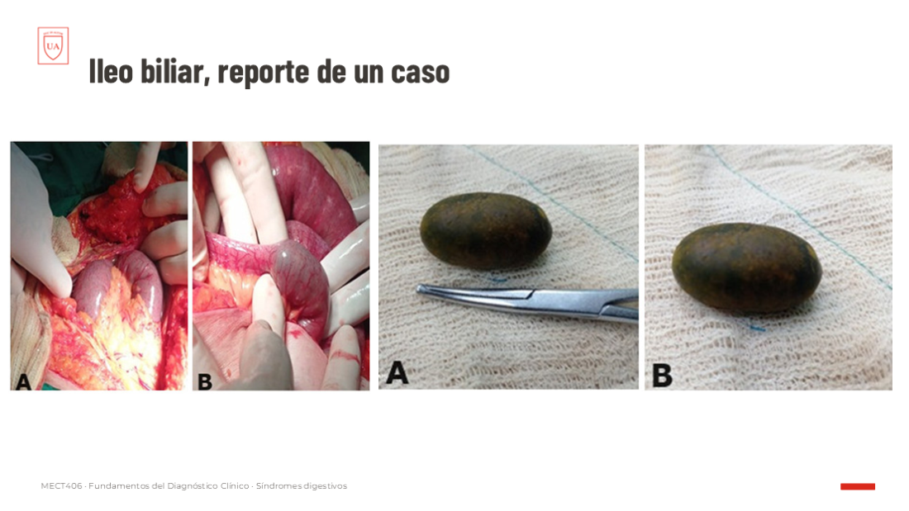
<!-- SDG d. 22 | tipo: fotos | incluir en Word: opcional -->

- Otras: malformaciones, páncreas anular, compresión por vasos mesentéricos. **[Goic, p. 229]**
- Cambio reciente del hábito intestinal, hemorragia baja o baja de peso apuntan a cáncer de colon; cólicos biliares previos, a íleo biliar (cálculo de 2,5 cm o más por una fístula colecistoduodenal). **[Goic, p. 229]**
- **Íleo paralítico:** posoperatorio, peritonitis; neumonía, tifoidea, sepsis, uremia; hipopotasemia; anticolinérgicos y gangliopléjicos; fracturas, hematoma retroperitoneal, plumbismo, lesión medular; trombosis o embolia mesentérica. **[Goic, p. 230]**
- **Mecánica:** extrínseca (bridas, hernias, vólvulo, abscesos, carcinomatosis), intrínseca (cáncer, estenosis) o por contenido (cálculo, bezoar, cuerpo extraño, helmintos). **[UCH, tema 43, p. 289]**
- El manual considera el íleo paralítico la causa más frecuente: fármacos (opioides, hierro, antidiarreicos, antidepresivos, relajantes) y enfermedades médicas. **[UCH, tema 43, p. 289]**

| Obstrucción **[UCH, tema 43, p. 290]** | Causas más frecuentes |
|---|---|
| Alta (sobre la válvula ileocecal), más en jóvenes | Bridas 60 %, hernias 20 %; tumores, Crohn, íleo biliar |
| Baja (colon), más en mayores | Cáncer colorrectal 40 %, vólvulo 30 %; enfermedad diverticular, fecaloma |

#### Clínica (anamnesis)

- **Síntomas:** dolor cólico, vómitos, sin gases ni deposiciones [DIG d. 58; SDG d. 19].
- Depende de la causa, el nivel, el grado (completa o suboclusión) y el compromiso vascular (simple o estrangulada) [SDG d. 19].
- Buscar cirugías previas (bridas desde 48 h hasta 40 años después) [SDG d. 21–22].

| Rasgo [SDG d. 20] | Delgado alto | Delgado medio o bajo | Colon |
|---|---|---|---|
| Dolor | Abdomen alto o medio | Alto o medio | Bajo, menos intenso |
| Vómitos | Precoces, alimenticios o biliosos | Porráceos (verde oscuro) o "fecaloideos" (café, nauseabundos) | Tardíos |
| Distensión | Poca al inicio | Mayor | Acentuada; desproporcionada en el vólvulo de sigmoides |
| Medio interno | Alcalosis metabólica | Deshidratación | Pérdida equilibrada de electrolitos |

Orientan sin ser absolutos. Los vómitos son más tardíos si la válvula ileocecal es competente. El vómito "fecaloideo" se debe a estasis bacteriana [SDG d. 20].

- Al inicio puede evacuarse lo que quedaba distal al obstáculo. En la suboclusión hay cólicos con ruidos, y puede eliminar gases, deposiciones o tener diarrea. **[Goic, p. 229]**
- En la estrangulación el dolor puede ser localizado, intenso y continuo, sin carácter cólico. **[Goic, p. 228]**
- Vólvulo (sobre todo de sigmoides): dolor brusco y distensión timpánica desproporcionada. **[Goic, p. 229–230]**
- Dolor y vómitos predominantes sugieren obstrucción alta; falta de gases y distensión, baja. Dolor cólico orienta a mecánica y continuo a paralítica. **[UCH, tema 43, p. 290]**

#### Examen físico

- Distensión, ruidos alterados, deshidratación [SDG d. 19].
- Buscar cicatrices, orificios herniarios y hacer tacto rectal [SDG d. 21–22].

- Ruidos de tono alto y metálicos junto al cólico; a veces ondas peristálticas visibles. El silencio tardío no descarta obstrucción. **[Goic, p. 229]**
- Deshidratación: mucosas y piel secas, ojos hundidos, taquicardia, hipotensión ortostática. Tacto rectal: tumor, sangre, deposiciones. **[Goic, p. 229]**
- Fiebre: sospechar absceso o gangrena. **[UCH, tema 43, p. 290]**
- Ruidos normales: 5–30 por minuto; para afirmar ausencia, escuchar al menos 2 minutos. El manual advierte que el valor de la auscultación está discutido. **[UCH, tema 47, p. 311–312]**

#### Exámenes y criterios

Rx de abdomen de pie y acostado: el examen de mayor jerarquía; no omitirla. No dar contraste oral, porque puede completar una obstrucción parcial [SDG d. 23].

- Si no puede pararse, placa en decúbito lateral; si hay duda, repetirla en pocas horas. **[Goic, p. 231]**
- Sospecha en colon: enema baritado y eventualmente endoscopía baja. TC en situaciones excepcionales, para buscar la causa. **[Goic, p. 231]**
- Sangre: hemoconcentración, nitrógeno ureico alto, leucocitosis y amilasa alta en la estrangulación; electrolitos y CO₂ para el manejo. **[Goic, p. 231]**
- Radiografía: asas dilatadas, niveles, sin gas distal; «grano de café» en vólvulo, «pila de monedas» en la alta. **[UCH, tema 43, p. 290]**
- La TC es el examen de mayor utilidad: confirma, localiza, muestra causa y compromiso vascular. ⚠ Goic la reserva para casos excepcionales y da el primer lugar a la radiografía. **[UCH, tema 43, p. 290]**

#### Diagnóstico diferencial

| Rasgo [SDG d. 23] | Obstrucción mecánica | Íleo paralítico |
|---|---|---|
| Dolor | Cólico, episódico | Sin cólico |
| Ruidos | Tono alto, timbre metálico; silencio tardío | Silencio desde el inicio |
| Contexto | Bridas, hernias, tumores, vólvulo | Postoperatorio (el más frecuente), peritonitis, sepsis, hipopotasemia, fármacos, fracturas, isquemia mesentérica |
| Rx | Niveles hidroaéreos | Asas distendidas en todo el abdomen; aire hasta el recto |

- Pancreatitis aguda severa, úlcera perforada y peritonitis de cualquier causa. **[Goic, p. 230]**

#### Alarma y conducta

- **Estrangulación:** signos de intoxicación, fiebre, leucocitosis con desviación a izquierda, disminución de los ruidos, sensibilidad de rebote (Blumberg), masa palpable [SDG d. 23].
- Lleva a necrosis, peritonitis y perforación [SDG d. 19].
- **Suponerla en toda obstrucción** [SDG d. 23].

- La ausencia de signos no excluye estrangulación. **[Goic, p. 230]**

### Insuficiencia hepática

#### Definición

Incapacidad del hígado para cumplir sus funciones por daño difuso, agudo o crónico; es un concepto funcional [SDG d. 24]. Se hace evidente al perder el 80 % de la función [DIG d. 59].

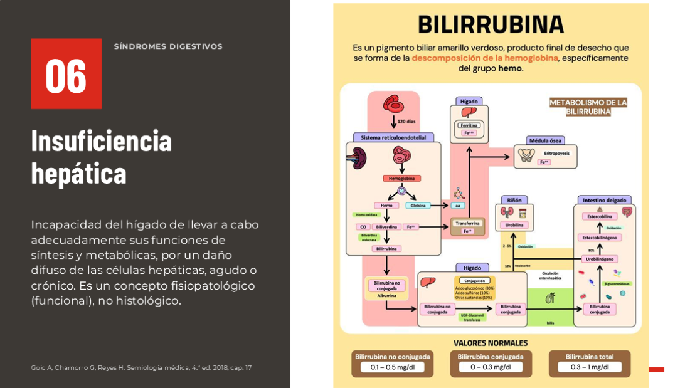
<!-- SDG d. 24 | tipo: infografía | incluir en Word: opcional -->

- La reserva hepática es grande: se necesita daño difuso e importante. No hay una prueba que mida la función global. **[Goic, p. 231]**
- **Daño hepático crónico:** alteración progresiva y prolongada de estructura y función, al inicio asintomática; cirrosis es su etapa final y un diagnóstico histológico. **[UCH, tema 45, p. 299]**
- **Insuficiencia hepática aguda:** alteración grave de todas las funciones, con mortalidad de 40–80 % pese al manejo. La fulminante se definió como encefalopatía dentro de las 8 semanas en una persona antes sana; hay otras definiciones según el plazo desde la ictericia. **[Argente, cap. 48-14]**

#### Fisiopatología

| Función que falla [SDG d. 25] | Signo |
|---|---|
| Síntesis de albúmina | Edema, ascitis |
| Factores I, II, V, VII, IX, X | Hemorragias, protrombina prolongada |
| Paso de amonio a urea | Encefalopatía, asterixis |
| Manejo de la bilirrubina | Ictericia |
| Depuración de mercaptanos (derivados de la metionina) | Fetor hepaticus |
| Depuración de estrógenos | Arañas, eritema palmar, ginecomastia, atrofia testicular |

- El edema se debe a hipoalbuminemia y menor presión oncótica [DIG d. 59].
- **Encefalopatía:** falla la detoxificación; sustancias derivadas de la acción bacteriana sobre las proteínas de la dieta ocupan neurotransmisores excitatorios, con predominio depresor cerebral [DIG d. 60].

- La encefalopatía se atribuye a tóxicos derivados del metabolismo alterado del amonio. **[Goic, p. 232]**
- El hiperestrogenismo explica las arañas vasculares y probablemente el eritema palmar; ninguno es exclusivo (embarazo, sanos). **[Goic, p. 233]**
- En la cirrosis, la hipertensión portal explica ascitis, várices, esplenomegalia y colaterales; la disfunción, ictericia, coagulopatía e hipoalbuminemia; la encefalopatía, ambas. **[UCH, tema 45, p. 299]**

#### Causas

| Aguda, potencialmente reversible [SDG d. 28] | Crónica, irreversible |
|---|---|
| Hepatitis viral, tóxica, alcohólica o por drogas (paracetamol, isoniazida) | Cirrosis alcohólica, hepatitis crónica activa |
| Hígado graso del embarazo, shock, sepsis | Hemocromatosis, Wilson, cirrosis biliar, congestión |

- Aguda: necrosis masiva. Crónica: fibrosis y nódulos, con remisiones y agudizaciones; puede agregarse una falla aguda [SDG d. 28].
- Puede instalarse en forma rápidamente progresiva (fulminante) o lenta, como cirrosis [DIG d. 59].
- **Precipitantes:** hemorragia digestiva, infecciones, cirugía, fármacos y diuréticos, malnutrición, paracentesis, alcohol, hiponatremia o hipopotasemia [SDG d. 28].

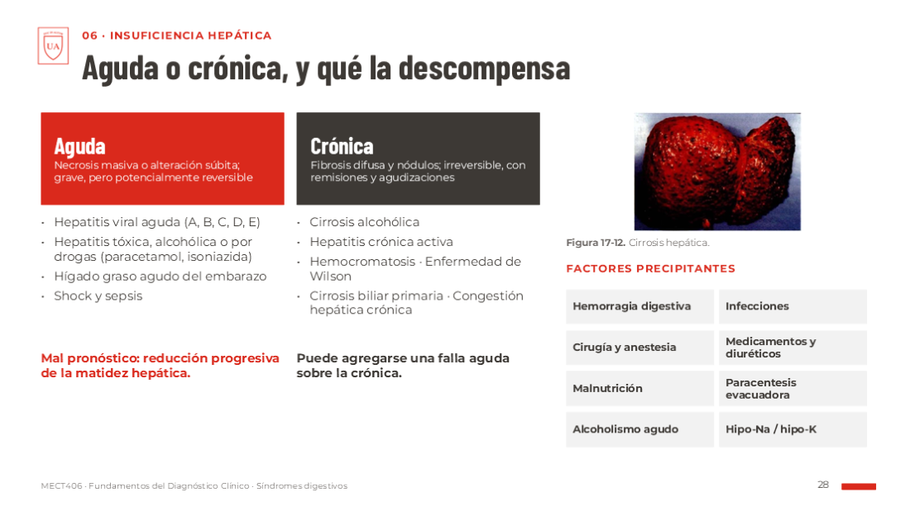
<!-- SDG d. 28 | tipo: figura 17-12 | incluir en Word: opcional -->

- En Chile, según el libro: hepatitis agudas y crónicas y cirrosis, sobre todo alcohólica. Otros precipitantes: anestesia general. **[Goic, p. 234]**
- Crónica: virus B y C, alcohol y fármacos, colestasis, autoinmunes, congestión venosa, esteatohepatitis no alcohólica, hemocromatosis, Wilson, déficit de alfa-1 antitripsina. **[UCH, tema 45, p. 300]**
- Riesgo por alcohol: 30–60 g diarios en hombres y 20–40 g en mujeres por más de 10 años; solo 10–15 % de ellos desarrolla daño crónico. **[UCH, tema 45, p. 300]**
- Aguda: virus (A, B, C, E y otros), paracetamol, *Amanita phalloides*, fósforo, tetracloruro de carbono, reacciones idiosincrásicas (halotano, isoniazida, valproato, AINE), Wilson. **[Argente, cap. 48-14]**

#### Clínica (anamnesis)

- **Tétrada** [SDG d. 26]:
  - Ictericia: su intensidad marca la gravedad.
  - Encefalopatía portal: desde cambios de personalidad y del sueño hasta coma.
  - Fetor hepaticus: ominoso; puede preceder al coma.
  - Coagulopatía: petequias, equimosis, epistaxis, gingivorragia.
- Compromiso del estado general; ictericia; alteraciones de la coagulación; manifestaciones neuropsiquiátricas (encefalopatía); ascitis de cuantía variable; edema; falla renal (oliguria, creatinina alta); hiperestrogenismo [DIG d. 59–60].

- Puede haber insuficiencia hepática sin ictericia (algunas hepatitis agudas, rara vez fulminantes). **[Goic, p. 231–232]**
- La encefalopatía puede ser la primera manifestación de una cirrosis y es frecuente tras derivación portocava. **[Goic, p. 232]**
- Ascitis sin causa local en una hepatopatía difusa indica insuficiencia e hipertensión portal. Hay baja de peso, atrofia muscular, anorexia y fatiga. **[Goic, p. 233]**
- Compensada: baja de peso, decaimiento, anorexia, febrícula, dolor en hipocondrio derecho. Descompensada: ictericia, ascitis, encefalopatía, hemorragia digestiva. **[UCH, tema 45, p. 300]**
- En la aguda: ictericia precoz, hígado que se achica, transaminasas que suben y luego caen, falla multiorgánica. **[Argente, cap. 48-14]**

#### Examen físico

**Asterixis (flapping):** con la mano en hiperflexión dorsal y los dedos separados aparecen movimientos irregulares de flexoextensión. No es patognomónica (uremia, anoxia) [SDG d. 26].

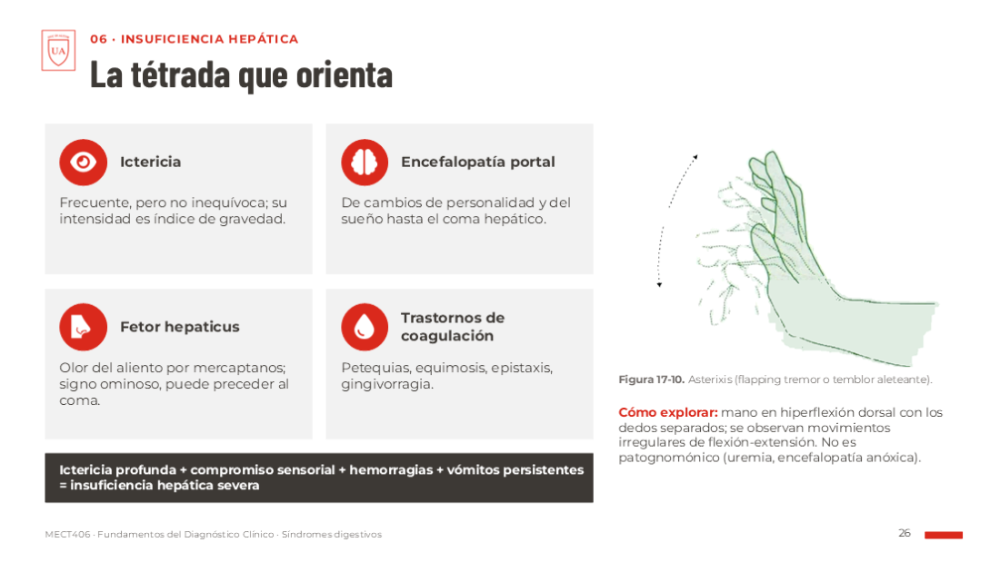
<!-- SDG d. 26 | tipo: figura 17-10 | incluir en Word: sí -->

| Estigmas crónicos [SDG d. 27] | Hallazgos |
|---|---|
| Piel | Arañas, telangiectasias, eritema palmar, uñas opacas o en vidrio de reloj, menos vello axilar y pubiano, parótidas grandes, Dupuytren |
| Endocrino | Ginecomastia, atrofia testicular, menor libido, amenorrea |
| Circulación | Hiperquinesia: manos calientes, taquicardia, pulso saltón, hipotensión; a veces cianosis |
| Nutrición | Baja de peso, atrofia muscular, astenia |
| Renal | Síndrome hepatorrenal: oliguria con Na urinario menor de 10 mEq/L, sin lesión anatómica |

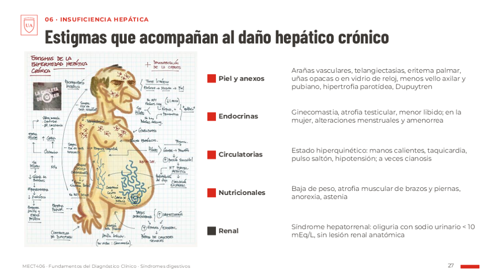
<!-- SDG d. 27 | tipo: dibujo con anotaciones manuscritas | incluir en Word: opcional -->

- Además del flapping (también en pies y lengua), disgrafía y apraxia de construcción: pedir copiar una figura o firmar. **[Goic, p. 232]**
- Además: desnutrición, hiperpigmentación, xantomas según la causa. **[UCH, tema 45, p. 300]**
- Proyección hepática normal 9–12 cm; disminuye en la falla aguda (también con neumoperitoneo o distensión del colon). **[UCH, tema 47, p. 313]**
- Circulación colateral que irradia del ombligo (cabeza de medusa) en la hipertensión portal. **[UCH, tema 47, p. 311]**

#### Exámenes y criterios

Pruebas hepáticas y protrombina [SDG d. 33].

- Protrombina prolongada (y a veces tromboplastina parcial); hipoalbuminemia. Un daño leve puede no alterar las pruebas. **[Goic, p. 231–233]**

#### Diagnóstico diferencial

- La ictericia sola no basta: hay ictericias hemolíticas, obstructivas e infecciosas. **[Goic, p. 232]**
- En un hepatópata en coma, descartar otra causa (por ejemplo, hematoma subdural). **[Goic, p. 232]**

#### Alarma y conducta

- **Grave:** ictericia profunda, compromiso sensorial, hemorragias y vómitos persistentes [SDG d. 26].
- Mal pronóstico en la aguda: matidez hepática que se reduce [SDG d. 28].
- La cirrosis descompensada reduce la sobrevida a cerca de 2 años (compensada: menos de 10). **[UCH, tema 45, p. 300]**
- En la falla aguda, el trasplante es la única opción si no hay recuperación espontánea. **[Argente, cap. 48-14]**

### Abdomen agudo

#### Definición

Dolor abdominal intenso con signos de irritación peritoneal, localizados o generalizados, que a menudo requiere cirugía urgente [DIG d. 61; SDG d. 29].

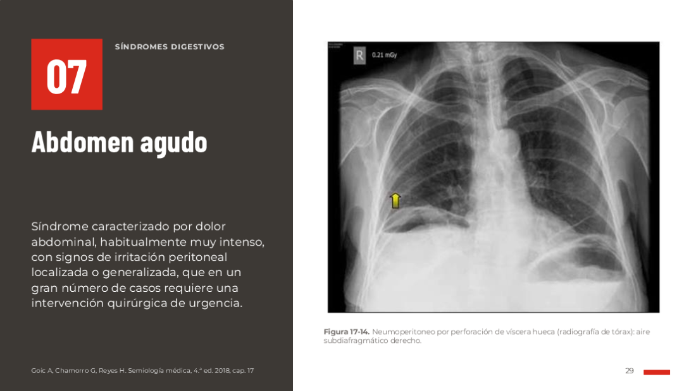
<!-- SDG d. 29 | tipo: figura 17-14 | incluir en Word: sí -->

- Diagnóstico de trabajo: dolor intenso y reciente por una patología potencialmente mortal que podría requerir cirugía urgente. Es cerca del 5 % de las consultas de urgencia, y pocos terminan operados. **[UCH, tema 43, p. 286]**

#### Fisiopatología

- Con irritación peritoneal el abdomen deja de moverse al respirar y la respiración se hace torácica. **[Goic, p. 235]**

#### Causas

Clasificación de Bockus, unida desde SDG d. 31 (grupos I, II, III) y DIG d. 62–64 (grupos A, B, C) ⚠:

| Grupo | En ambos PPT | Solo SDG d. 31 | Solo DIG d. 62–64 |
|---|---|---|---|
| I o A: cirugía urgente o inmediata | Apendicitis (DIG: complicada, con absceso o perforación), obstrucción (DIG: con estrangulación), perforación de víscera hueca (DIG: úlcera péptica, divertículo, íleon, ciego o sigmoides), colecistitis (DIG: complicada, piocolecisto o enfisematosa), ectópico roto, torsión (DIG: quiste ovárico o testículo) | — | Rotura o disección de aneurisma de aorta abdominal, isquemia o trombosis mesentérica, pancreatitis necrohemorrágica |
| II o B: habitualmente sin cirugía urgente | EPI (DIG: no complicada), dolor ovulatorio (*mittelschmerz*), ileítis | Pancreatitis, diverticulitis, linfadenitis | Enfermedad ácido-péptica no complicada, hepatitis aguda, absceso hepático, gastroenteritis, intoxicación alimentaria, cólico renal, infección urinaria, peritonitis primaria espontánea (cirróticos), hemorragia intramural intestinal por anticoagulantes; poco frecuentes: porfiria, fiebre mediterránea, saturnismo, epilepsia abdominal |
| III o C: extraabdominales o simuladores | Infarto, pericarditis, neumonía (basal en DIG; sobre todo en niños según SDG), cetoacidosis diabética, insuficiencia suprarrenal, Schönlein-Henoch | Aneurisma disecante, embolias, infarto pulmonar, neumotórax, pleuresía, porfiria, aracnoidismo, plumbismo | Congestión hepática por insuficiencia cardíaca derecha, anemia falciforme |

- Goic incluye además íleo biliar (grupo I) y, entre los simuladores, hígado cardíaco, embolias, mediastinitis y crisis gástrica tabética. **[Goic, p. 235–236]**
- Se ordenan por cuadrante, por ubicación (intra o extraperitoneal) o por manejo (quirúrgico o no). Extraperitoneales: torácicas, urinarias, herpes zóster, metabólicas. **[UCH, tema 43, p. 286–287]**

#### Clínica (anamnesis)

[SDG d. 30]

- **Dolor:** síntoma cardinal; constante en la peritonitis, cólico en la obstrucción. Irradiado al hombro: origen subdiafragmático.
- Vómitos intensos en la obstrucción alta.
- Diarrea, escalofríos y fiebre alta orientan a otra causa; pensar en neumonía o infección urinaria.

- La localización suele señalar el órgano; en las causas médicas el dolor es generalizado. Puede ser muy intenso sin ser quirúrgico (pancreatitis, porfiria, aracnoidismo). **[Goic, p. 235]**
- La diarrea es muy infrecuente, pero puede verse en apendicitis complicada, cetoacidosis e ileítis. **[Goic, p. 235]**

#### Examen físico

[SDG d. 30]

- **Inspección:** inmóvil con las piernas flectadas (inquieto en el hemoperitoneo); inversión de la movilidad respiratoria.
- **Auscultación:** el silencio sugiere peritonitis.
- **Palpación:** rigidez, "abdomen en tabla", Blumberg.
- Siempre orificios herniarios y tacto rectal; examen ginecológico si corresponde.
- En ancianos puede faltar la rigidez.

- La rigidez verdadera, que no cede a presión constante, casi siempre indica peritonitis. **[Goic, p. 235]**
- Tacto rectal: dolor o masa a derecha en apendicitis o absceso, a izquierda en algunas diverticulitis. El íleo posoperatorio es la excepción al valor del silencio. **[Goic, p. 235]**

#### Exámenes y criterios

| Examen [SDG d. 32] | Busca |
|---|---|
| Rx de tórax | Ver figura de neumoperitoneo |
| Rx de abdomen (nunca omitirla) | Neumoperitoneo, obstrucción, cálculos, megacolon tóxico |
| Sangre y orina dirigidos | Cetoacidosis, amilasa, porfirinas |
| Ecografía y TC | Abscesos, masas, pancreatitis, colelitiasis |

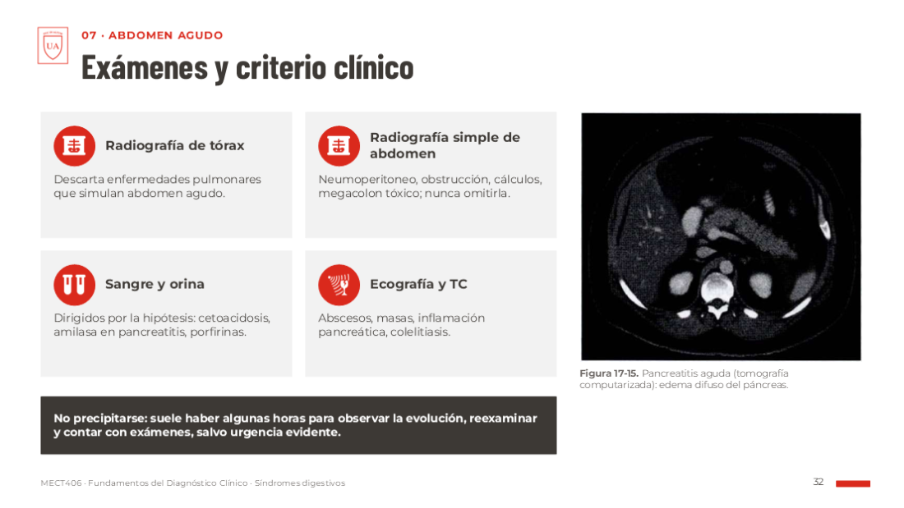
<!-- SDG d. 32 | tipo: figura 17-15 | incluir en Word: opcional -->

- La radiografía de tórax descarta causas pulmonares que lo simulan. **[Goic, p. 237]**
- Cetoacidosis: glicemia y cetonas; pancreatitis: amilasa; porfiria: porfobilinógeno y ALA urinarios. En la apendicitis el diagnóstico es sobre todo clínico. **[Goic, p. 237]**
- Hemograma, PCR, pruebas hepáticas, amilasa y lipasa; ecografía para vesícula; la TC con contraste es la de mayor rendimiento (hasta 90 % de sensibilidad para la causa). **[UCH, tema 43, p. 287]**

#### Diagnóstico diferencial

- Separar causas quirúrgicas, intraabdominales no quirúrgicas y extraabdominales (tabla de Bockus). **[Goic, p. 235–236]**

#### Alarma y conducta

No precipitarse salvo urgencia evidente: suele haber horas para reexaminar [SDG d. 32].

- Aun siendo urgente, suele haber horas para reexaminar y consultar; en la urgencia extrema (rotura de bazo, shock) el cuadro deja pocas dudas. **[Goic, p. 237]**

## Parte D. Integración

### Síntesis [SDG d. 33]

| Síndrome | Clave | Término | Primer examen |
|---|---|---|---|
| Ulceroso | Dolor periódico y rítmico | Ritmicidad | Endoscopía |
| Retención | Vómito de alimentos previos sin bilis | Bazuqueo | Sonda y endoscopía |
| Disentérico | Diarrea con sangre | Tenesmo | Rectosigmoidoscopía, cultivos |
| Malabsorción | Esteatorrea y carencias | Esteatorrea | Grasa fecal |
| Obstrucción | Cólico, vómitos, sin gases | Ruidos metálicos | Rx de abdomen |
| Hepática | Ictericia, encefalopatía | Asterixis | Pruebas hepáticas, protrombina |
| Abdomen agudo | Irritación peritoneal | Blumberg | Rx de tórax y abdomen |

## Parte E. Síndromes y diagnósticos de la literatura

> Cuadros que los PPT **no tratan** o **solo nombran**. Van resumidos y separados para no confundirlos con la materia de clase.

### Síndrome esofágico *(no está en los PPT)*

- Disfagia, pirosis, dolor torácico, regurgitación y odinofagia, solos o asociados. **[Argente, cap. 48-1]**
- Goic lo define como disfagia, regurgitación y sialorrea. **[Goic, p. 93]**

### Síndrome de Plummer-Vinson *(no está en los PPT)*

- Anemia ferropriva, glositis, atrofia mucosa, membrana en el esófago cervical, disfagia y esplenomegalia. **[Goic, p. 94]** **[UCH, tema 40, p. 268]**

### Dispepsia *(los PPT solo la definen)*

- Dolor o malestar del abdomen superior, crónico o recurrente, de más de 1 mes, a menudo con la comida; incluye saciedad precoz, distensión, eructos, ardor y náuseas. **[Argente, cap. 45-2]**
- Cerca de 25 % tiene causa orgánica (úlcera, reflujo, cáncer) ⚠; el resto es funcional: distrés posprandial o dolor epigástrico (Roma IV). **[Argente, cap. 45-2]**
- Goic prefiere considerar el dolor abdominal aparte de los síntomas dispépticos. **[Goic, p. 74]**
- Edad, baja de peso o falta de respuesta justifican endoscopía. **[Argente, cap. 45-2]**

### Síndrome de intestino irritable *(los PPT solo lo nombran)*

- Dolor abdominal crónico o recurrente con cambios del hábito evacuatorio; trastorno funcional que no aumenta la mortalidad. **[Argente, cap. 48-7]**
- Roma IV: dolor al menos 1 día por semana en 3 meses con 2 o más: relación con defecar, cambio de frecuencia o de forma. **[UCH, tema 42, p. 283]**
- Más frecuente en mujeres; hasta la mitad tiene comorbilidad psiquiátrica. La distensión es motivo habitual de consulta. **[UCH, tema 42, p. 283]**

### Intolerancia a la lactosa *(no está en los PPT)*

- Primaria (la más frecuente, desde la adolescencia), secundaria a daño de la mucosa o congénita. **[UCH, tema 42, p. 284]**
- Flatulencias, cólico, distensión y diarrea tras lácteos. Prueba de suspensión; se confirma con tolerancia a lactosa o test del aliento. **[UCH, tema 42, p. 284]**

### Apendicitis aguda *(los PPT solo la nombran)*

- Primera causa de abdomen agudo quirúrgico. Obstrucción por fecalito, folículos linfoides, cuerpo extraño, parásitos o tumor. **[UCH, tema 43, p. 287]**
- Dolor epigástrico o periumbilical que migra a fosa ilíaca derecha y aumenta con el movimiento; anorexia y vómitos posteriores. Cambia con la posición del apéndice y en el embarazo. **[UCH, tema 43, p. 287–288]**
- Signos: Blumberg, Rovsing, psoas (retrocecal), obturador (pélvica). Diagnóstico clínico, con apoyo de laboratorio e imágenes. **[UCH, tema 43, p. 288]**

| Escala de Alvarado **[UCH, tema 43, p. 288]** | Puntos |
|---|---|
| Migración del dolor; anorexia; náuseas o vómitos | 1 cada uno |
| Dolor en cuadrante inferior derecho | 2 |
| Blumberg; temperatura oral sobre 37,2 °C | 1 cada uno |
| Leucocitosis sobre 10.000 | 2 |
| Desviación a izquierda (neutrófilos sobre 75 %) | 1 |

0–4 negativo, 5–6 posible, 7–8 probable, 9–10 apendicitis. Para decidir TC: 0–3 no se justifica, 4–6 se hace, 7–10 cirugía. **[UCH, tema 43, p. 288]**

### Peritonitis *(los PPT solo la nombran)*

- **Primaria:** espontánea, casi solo en cirróticos con ascitis; un solo germen. Fiebre, dolor, encefalopatía o falla renal; paracentesis con más de 250 polimorfonucleares/mm³. **[Argente, cap. 45-4]**
- **Secundaria:** perforación de víscera hueca; polimicrobiana, con rebote, rigidez y sin ruidos. **Terciaria:** persiste tras cirugía en pacientes graves y da pocos signos. **[Argente, cap. 45-4]**

### Colelitiasis y cólico biliar *(no está en los PPT como cuadro)*

- Factores: edad, sexo femenino, multiparidad, obesidad, diabetes, anticonceptivos, baja rápida de peso. La colelitiasis es el principal factor de riesgo de cáncer de vesícula, muy frecuente en Chile. **[UCH, tema 44, p. 292]**
- Cólico simple: dolor en hipocondrio derecho o epigastrio, irradiado a dorso u hombro, tras grasas, de 30 min a 6 h, sin fiebre ni ictericia. Ecografía. **[UCH, tema 44, p. 293]**

### Colecistitis aguda *(los PPT solo la nombran)*

- Obstrucción persistente del cístico, 95 % por cálculo. Dolor de más de 6 h con fiebre, vómitos y **signo de Murphy**; cerca de 25 % con ictericia. **[UCH, tema 44, p. 293–294]**
- PCR alta y leucocitosis; ecografía con pared sobre 4 mm y líquido perivesicular. Irritación peritoneal: sospechar perforación. **[UCH, tema 44, p. 294]**

### Síndrome colestásico *(no está en los PPT)*

- Obstrucción del flujo biliar intrahepática (embarazo, cirrosis biliar, hepatitis, fármacos) o extrahepática (coledocolitiasis, colangitis, cáncer). **[UCH, tema 44, p. 293]**
- Fosfatasa alcalina y GGT altas (clásicamente más de 3 veces) y bilirrubina directa. Ecografía inicial; colangiorresonancia para la vía biliar. **[UCH, tema 44, p. 293]**

### Ictericia: origen de la bilirrubina *(los PPT la tratan como signo)*

- 80–90 % proviene de la hemoglobina; viaja unida a albúmina, se conjuga en el hígado y en el intestino forma estercobilinógeno; una fracción mínima sale por la orina. **[Goic, p. 96]**

### Ascitis *(los PPT solo la nombran)*

- Acumulación de líquido peritoneal (normal cerca de 100 mL). **[Goic, p. 100]**
- Transudado frente a exudado: densidad menor o mayor de 1,015, proteínas menores o mayores de 25 g/L y gradiente de albúmina suero-ascitis mayor o menor de 1,1. **[Goic, p. 100]**
- Examen: matidez desplazable (muy sensible) y signo de la ola (muy específico). **[UCH, tema 47, p. 312]**

### Hepatitis viral aguda *(los PPT solo la nombran)*

- Lo más frecuente es que sea asintomática; puede llegar a fulminante. Cuadro seudogripal, náuseas, aversión a comidas y cigarrillo, hepatomegalia dolorosa; coluria y acolia 1–5 días antes de la ictericia. **[Argente, cap. 48-12]**
- La clínica no identifica el virus: se necesita serología. **[Argente, cap. 48-12]**

### Hipertensión portal *(los PPT no la desarrollan)*

- Várices gastroesofágicas, ascitis, esplenomegalia con hiperesplenismo y encefalopatía. **[Argente, cap. 48-13]**
- Várices en cerca de 30 % de las cirrosis compensadas y 60 % de las descompensadas; la hemorragia variceal mata cerca de 20 %. **[Argente, cap. 48-13]**

### Pancreatitis aguda y crónica *(los PPT solo la nombran)*

- **Aguda:** activación de enzimas dentro de la glándula; causas más frecuentes biliar (45 %) y alcohólica (35 %). Edematosa (70–80 %) o necrohemorrágica. **[Argente, cap. 48-15]**
- **Crónica:** enfermedad fibroinflamatoria progresiva con insuficiencia exocrina y endocrina; calcificante (alcohol, tabaco), obstructiva o autoinmune. **[Argente, cap. 48-15]**

### Lesiones rectoanales *(los PPT solo las nombran)*

- Masas: condilomas, abscesos, pólipos, prolapso, hemorroides, cáncer. **[Argente, cap. 48-8]**
- Hemorroides: más de la mitad sobre los 50 años; las internas sangran sin dolor; la trombosis externa da una masa azulada, dolorosa e irreductible. **[Argente, cap. 48-8]**

## Anexo de práctica

### Objetivos [SDG d. 2–3]

Explicar los siete síndromes, aplicar sus términos (periodicidad, bazuqueo, tenesmo, esteatorrea, asterixis, Blumberg), construir diagnósticos sindromáticos y exponerlos oralmente.

### Casos clínicos [SDG d. 34–35]

| Caso | Relato | Respuesta del PPT |
|---|---|---|
| A. Mujer, 34 | 6 meses de deposiciones claras que flotan, baja 8 kg, glositis, equimosis, hermana celíaca | Malabsorción; serología y biopsia |
| B. Hombre, 68 | Colecistectomía previa; cólico 24 h, vómito verde, sin gases, ruidos metálicos | Obstrucción de delgado bajo por bridas |
| C. Hombre, 57 | Alcohol; tras hemorragia, somnoliento, ictericia, arañas, asterixis | Insuficiencia hepática crónica descompensada |
| D. Mujer, 24 | 15 deposiciones con sangre, pujo, 39,5 °C | Disentérico agudo, probablemente bacilar |

## Pendientes por verificar

Las diferencias entre láminas salen del PPT; el resto es revisión mía.

| Dónde | Observación |
|---|---|
| DIG d. 9 y SDG d. 11–12 | Pujo: "deseo imperioso" en un PPT; "esfuerzo expulsivo doloroso" en el otro. |
| DIG d. 56 y SDG d. 8–9 | Retención gástrica: 8–10 h frente a 8–12 h; solo SDG da volúmenes residuales. Goic (pp. 222–224) coincide con SDG: 8–12 h de ayuno y los mismos volúmenes. |
| DIG d. 62–64 y SDG d. 31 | Bockus difiere en ejemplos y en el grupo B ("no" frente a "habitualmente no"). Porfiria y saturnismo (plumbismo) están en el grupo B en DIG y entre los simuladores en SDG. Goic (pp. 235–236) coincide con SDG. |
| DIG d. 58 y SDG d. 21 | El 80 % de las obstrucciones se atribuye a bridas en un PPT y a bridas más hernias estranguladas en el otro. Goic (p. 229) coincide con SDG: bridas y hernias estranguladas. |
| DIG d. 42 | La tabla pone heces pastosas en la diarrea alta y acuosas en la baja; suele describirse al revés (delgado acuosa). |
| DIG d. 46 | "Orgánico y funcional" parece errata: los criterios listados orientan a orgánico. |
| DIG d. 27 y 38 | Umbrales distintos: más de 200 mL y más de 225 g; crónica sobre 30 días o 4 semanas. |
| DIG d. 55 | El test ortostático suele hacerse de decúbito a posición de pie. |
| SDG d. 6 | La radiografía muestra aire bajo el diafragma, que corresponde a una complicación (perforación), no a la úlcera no complicada; la ubiqué en Alarma. Goic (p. 222) describe el neumoperitoneo en la perforación. |
| Diarrea: temporalidad | Goic (p. 80) separa aguda y crónica en 1 mes; UCH y Argente en 2 y 4 semanas; el PPT DIG usa 14 y 30 días (d. 27) y 4 semanas (d. 38). |
| Melena: volumen mínimo | 60 mL (Goic, UCH) frente a 50 mL (Argente). |
| Hemorragia alta: frecuencia | 75–85 % (UCH) frente a 90 % (Argente). |
| Pérdida de volemia | La tabla de Argente se leyó de un texto escaneado desordenado; confirmarla en el libro. |
| TC en obstrucción | UCH la considera el examen más útil; Goic la usa en casos excepcionales. |
| Dispepsia: causa orgánica | Argente da cerca de 25 % en la definición y cerca de 40 % en el enfoque diagnóstico. |
