# Nefrourológico y medio interno

Fundamentos del Diagnóstico Clínico, Unidad 3.

| Código | Texto original | Fuente |
|---|---|---|
| NEF | [Sindromes nefrourologicos](Textos%20originales/Sindromes%20nefrourologicos.md) | PPT "Síndromes nefrourológicos" (Dr. Miguel Yáñez Martínez, Medicina, sede Temuco, primavera 2026). |
| HID | [Metabolismo hidrosalino](Textos%20originales/Metabolismo%20hidrosalino.md) | PPT "Metabolismo Hidrosalino" (María Angélica Barría Schulmeyer, Universidad Autónoma de Chile). |
| URO | [Urologia y ginecologia](Textos%20originales/Urologia%20y%20ginecologia.md) | PPT "Urología - Ginecología" (María Angélica Barría Schulmeyer). Ver también "Sindromes nefrourologicos". |
| Goic | *Semiología médica*, caps. 6, 13, 23 y 26 | Página impresa; caps. 23 y 26 leídos en parte. |
| UCH | Manual de Semiología UCH, temas 48 a 51 | Página impresa. |
| Argente | Argente y Álvarez, caps. 54-7 y 56-1 | Extractos; sin número de página. |

> **Cómo leer:** [DIG d. 7] indica el PPT (código) y la diapositiva. "Cita:" copia la referencia de la lámina, sin contrastarla. † marca texto oculto o cortado en la lámina. ⚠ remite a la sección final de pendientes. La línea *Falta* indica apartados que los PPT no desarrollan o que no tienen espacio propio. Lo marcado **[Goic, p. N]**, **[UCH, tema, p. N]** o **[Argente, cap.]** es complemento de los libros, resumido con otras palabras.

**Siglas:** PA (presión arterial); HTA (hipertensión arterial); VFG (velocidad de filtración glomerular); IRA (injuria renal aguda); IRRP (insuficiencia renal rápidamente progresiva); ERC (enfermedad renal crónica); IRC (insuficiencia renal crónica); NTA (necrosis tubular aguda); NIA (nefritis intersticial aguda); GN (glomerulonefritis); VEC (volumen extracelular); SRAA (sistema renina-angiotensina-aldosterona); FENa (fracción excretada de sodio); U/P (relación orina/plasma); BUN (nitrógeno ureico en sangre); PTH (hormona paratiroidea); ASO (antiestreptolisina O); C3 (fracción 3 del complemento); ANA (anticuerpos antinucleares); ADNn (ácido desoxirribonucleico nativo); ANCA (anticuerpos anticitoplasma de neutrófilos); AINE (antiinflamatorios no esteroidales); IECA (inhibidores de la enzima convertidora de angiotensina); ARA-II (antagonistas del receptor de angiotensina II); IC (insuficiencia cardíaca); LUTS (síntomas del tracto urinario inferior); HPB (hiperplasia prostática benigna); ITU (infección del tracto urinario); APE (antígeno prostático específico); IPSS / AUA-SI (puntaje internacional de síntomas prostáticos / índice de síntomas de la Asociación Americana de Urología); Qmáx (flujo urinario máximo); TVP (trombosis venosa profunda); R3 (tercer ruido); LEC (líquido extracelular); LIC (líquido intracelular); LCR (líquido cefalorraquídeo); ADH (hormona antidiurética); ANP (péptido natriurético auricular); BNP (péptido natriurético cerebral o ventricular); GC (gasto cardíaco); SIADH (síndrome de secreción inadecuada de ADH); LUTS o STUI (síntomas del tracto urinario inferior); IVU (infección de vías urinarias); TAC (tomografía axial computarizada); ISRS (inhibidores selectivos de la recaptación de serotonina); OMS (Organización Mundial de la Salud); GnRH (hormona liberadora de gonadotropinas); FSH y LH (hormonas folículo estimulante y luteinizante); SOP (síndrome de ovario poliquístico); SUA (sangrado uterino anormal); DIU (dispositivo intrauterino); FUR (fecha de última regla).

## Mapa del tema

- **Síntomas y signos:** Síntomas urinarios; Hematuria; Color de la orina; Alteraciones del volumen urinario; Alteraciones sexuales; Dolor y aumento de volumen escrotal.
- **Síndromes:** Deshidratación y sobrehidratación; Síndrome nefrítico agudo; Síndrome nefrótico; Injuria renal aguda; Insuficiencia renal rápidamente progresiva; Enfermedad renal crónica; Síndrome urémico; Descarga uretral; Uropatía obstructiva baja e hiperplasia prostática benigna; Calidad seminal alterada.
- **Solo en la literatura o apenas nombrados (Parte E):** Dolor nefrourológico; Cólico renal y litiasis; Infección urinaria: cistitis, pielonefritis y prostatitis; Proteinuria; Examen de orina; Trastornos ácido-base.

## Parte A. Fundamentos

### Herramientas semiológicas

**Cuatro preguntas** [NEF d. 5]

| Pregunta | Claves |
|---|---|
| ¿Cuánta orina? | Anuria: menos de 100 mL/24 h (total: 0 mL). Oliguria: menos de 400 mL/24 h. Poliuria: más de 3 L/24 h. Nicturia: despertar a orinar |
| ¿Cómo es? | Color rojo o "Coca-Cola"; espuma (proteinuria); sedimento (hematíes dismórficos, cilindros, lípidos) |
| ¿Desde cuándo? | Horas a días: agudo. Menos de 3 meses: rápidamente progresivo. Más de 3 meses: crónico |
| ¿Repercusión sistémica? | Volumen (edema, HTA, congestión); medio interno (K⁺, acidosis, urea); vía urinaria (globo vesical, dolor) |

**El reloj define el síndrome** [NEF d. 6]

| Tiempo | Síndrome | Definición |
|---|---|---|
| Horas a días | IRA | Creatinina sube 0,3 mg/dL o más en 48 h, o diuresis menor de 0,5 mL/kg/h por 6 h |
| Días | Nefrítico agudo | Hematuria, oliguria, edema e HTA bruscos |
| Menos de 3 meses | IRRP | VFG cae 50 % o más en un riñón previamente sano |
| Más de 3 meses | ERC o IRC | Daño renal o VFG menor de 60 mL/min |
| Etapa terminal | Urémico | Expresión multisistémica de falla avanzada |

El síndrome nefrótico y la uropatía obstructiva pueden presentarse en cualquiera de estos tiempos.

**El sedimento localiza la lesión** [NEF d. 8]

| Hallazgo | Traduce | Orienta a |
|---|---|---|
| Cilindros hemáticos, dismórficos (más de 50 %), acantocitos (más de 5 %) | Inflamación glomerular | Nefrítico, IRRP ("sedimento nefrítico") |
| Cuerpos ovales grasos, cilindros grasos, gotas de grasa (cruz de Malta) | Lipiduria | Nefrótico |
| Cilindros granulosos "pardo-barrosos", células tubulares | Necrosis epitelial tubular | IRA renal por NTA ("sedimento sucio") |
| Cilindros leucocitarios, eosinofiluria | Inflamación intersticial | Nefritis intersticial, pielonefritis |
| Cilindros céreos y anchos | Túbulos dilatados y atróficos | ERC avanzada |
| "Limpio" | Túbulos indemnes | IRA prerrenal o posrenal |

**Pregunta:** paciente oligúrico con cilindros "pardo-barrosos": ¿dónde está el daño?

### Medio interno: concepto y compartimentos

**Concepto** [HID d. 3]

Conjunto de mecanismos que mantienen el equilibrio entre el agua corporal y los electrolitos (principalmente sodio, potasio, cloro, calcio y magnesio).

Su objetivo es conservar:

- El volumen sanguíneo adecuado
- La presión arterial
- La osmolaridad plasmática
- El funcionamiento celular normal

**Agua corporal total según la edad** [HID d. 4]

| Edad | Agua corporal total (% del peso) |
|---|---|
| Recién nacido | 75–80 % |
| Lactante | 70–75 % |
| Niño | 65 % |
| Adulto joven | 60 % |
| Mujer adulta | 50–55 % |
| Adulto mayor | 45–50 % |

**Compartimentos** [HID d. 5, 8]

- **Espacio extracelular:** volumen plasmático, líquido intersticial y linfa, agua del tejido conectivo (hueso y cartílago), agua transcelular.
- **Espacio intracelular:** agua y solutos contenidos en todas las células del organismo. Varía de un tejido a otro.

Pequeña fracción del LEC contenida en espacios especializados, separados funcionalmente del resto de los compartimentos:

- LCR
- Líquido sinovial
- Humor acuoso y vítreo
- Líquido pleural, pericárdico y peritoneal
- Secreciones digestivas dentro del tubo digestivo

**Composición iónica** [HID d. 9–10]

- **Cationes:** sodio (principal), calcio, magnesio (en menor cantidad), potasio (en baja concentración).
- **Aniones:** cloro (principal), bicarbonato, proteínas plasmáticas (especialmente en el plasma), fosfatos (pocos).

| Ion | LEC | LIC |
|---|---|---|
| Na⁺ | 142 | 10–14 |
| K⁺ | 4 | 140–150 |
| Ca | 2,7 | menor de 1 |
| Mg²⁺ | 2–3 | 20–40 |
| Cl⁻ | 102 | 3–5 |
| HCO₃⁻ | 24–28 | 7–8 |
| Fosfatos | 2–4 | 75–100 |
| Proteínas⁻ | 16 | 40–60 |

### Sistema linfático [HID d. 6–7]

Red de vasos, ganglios y órganos que recoge el exceso de líquido de los tejidos, lo devuelve a la circulación y participa en la defensa inmunitaria.

1. **Equilibrio de líquidos:** parte del líquido que sale de los capilares no regresa directamente a la sangre. El sistema linfático recoge ese exceso de líquido intersticial, lo transforma en linfa y lo devuelve al sistema venoso. Sin este mecanismo habría edemas masivos.
2. **Defensa inmunológica:** los ganglios actúan como filtros que retienen microorganismos, activan linfocitos y generan respuestas inmunes.
3. **Absorción de grasas:** los vasos quilíferos del intestino delgado absorben las grasas de la dieta y las vitaminas liposolubles (A, D, E y K).

| Componente | Características |
|---|---|
| Linfa | Líquido transparente con agua, proteínas, linfocitos y grasas absorbidas del intestino |
| Vasos linfáticos | Recogen la linfa desde los tejidos y la llevan a la circulación venosa |
| Ganglios linfáticos | Estructuras pequeñas que filtran la linfa; principalmente en cuello, axilas, mediastino, abdomen e ingle |
| Órganos linfoides primarios | Médula ósea, timo |
| Órganos linfoides secundarios | Bazo, ganglios linfáticos, amígdalas, tejido linfoide intestinal |

### Intercambio entre compartimentos

**Plasma e intersticio: fuerzas de Starling** [HID d. 11]

Determinan el movimiento de líquido a través de la pared capilar.

| Fuerza | Acción | Favorece |
|---|---|---|
| Presión hidrostática capilar | Empuja líquido del capilar al intersticio | Filtración |
| Presión oncótica plasmática (principalmente albúmina) | Atrae líquido del intersticio al capilar | Reabsorción |

**LIC y LEC: ósmosis** [HID d. 12]

El agua atraviesa libremente la membrana celular desde donde hay menor concentración de solutos hacia donde hay mayor.

- **Aumenta la osmolaridad extracelular** (ej. hipernatremia): el agua sale de las células, que se deshidratan y achican.
- **Disminuye la osmolaridad extracelular** (ej. hiponatremia): el agua entra a las células, que aumentan de tamaño. En el cerebro puede producir edema cerebral.

**Importancia clínica** [HID d. 13]

- **Hipovolemia:** disminuye el volumen intravascular.
- **Edema:** acumulación excesiva de líquido en el intersticio.
- **Hiponatremia o hipernatremia:** mueven agua hacia dentro o fuera de las células.
- **Insuficiencia cardíaca, cirrosis o síndrome nefrótico:** alteran el intercambio entre plasma e intersticio y favorecen el edema.

El paso entre plasma e intersticio depende de las fuerzas de Starling; el paso entre intersticio y célula depende principalmente de gradientes osmóticos.

### Balance hídrico [HID d. 14–15]

Relación entre ingresos y pérdidas de agua en un período, habitualmente 24 horas [HID d. 14].

**Ingresos** [HID d. 14]

- Líquidos por vía oral
- Sueros intravenosos
- Medicamentos diluidos
- Nutrición enteral o parenteral
- Agua del metabolismo celular (aproximadamente 300 mL/día)

**Egresos** [HID d. 15]

- **Pérdidas medibles:** orina, vómitos, deposiciones líquidas, drenajes, aspiración gástrica.
- **Pérdidas insensibles:** piel (sudoración no perceptible) y respiración. Aproximadamente 600–800 mL/día; aumentan con fiebre, hiperventilación o quemaduras.

### Regulación del sodio y del agua

- **Sistema osmorregulador:** ADH, sed y concentración y dilución de la orina [HID d. 16].
- Son las respuestas compensatorias para mantener la perfusión tisular y la PA ante una alteración hemodinámica (insuficiencia cardíaca, shock, hipovolemia) [HID d. 16] ⚠.

| Mecanismo [HID d. 17] | Estímulo | Efecto principal |
|---|---|---|
| Sistema simpático | Disminución de PA o GC | Taquicardia y vasoconstricción |
| SRAA | Disminución de la perfusión renal | Retención de sodio y agua |
| ADH | Hipovolemia e hipotensión | Retención de agua |
| BNP | Distensión ventricular | Diuresis y vasodilatación |

**SRAA** [HID d. 18]

Es el mecanismo más importante para conservar sodio. La aldosterona se produce en la corteza suprarrenal y:

- Aumenta la reabsorción de sodio en el túbulo distal y colector
- Favorece la retención de agua
- Aumenta la excreción de potasio

**Resultado:** aumento del volumen extracelular y de la PA.

**Sistema nervioso simpático** [HID d. 19]

Cuando disminuye la PA o el volumen circulante produce vasoconstricción renal, estimula la liberación de renina y favorece la reabsorción renal de sodio. **Resultado:** retención de sodio y agua.

**Péptidos natriuréticos, ANP y BNP** [HID d. 20]

Se liberan cuando aumenta el volumen intravascular y se distienden las cavidades cardíacas. Inhiben aldosterona y renina y disminuyen la reabsorción tubular de sodio. **Resultado:** natriuresis y disminución de la volemia.

**ADH** [HID d. 21]

Actúa más sobre el agua que sobre el sodio: reabsorbe agua libre en el túbulo colector. Puede diluir el sodio plasmático y, cuando está aumentada, favorece la hiponatremia.

**Filtrado glomerular** [HID d. 22]

La cantidad de sodio filtrada depende del filtrado glomerular. Si disminuye el flujo renal, se retiene sodio; si aumenta, se elimina más.

### Osmolaridad y natremia [HID d. 23]

| Parámetro | Valor normal | Qué mide |
|---|---|---|
| Natremia | 135–145 mEq/L | Concentración de sodio plasmático |
| Osmolaridad plasmática | 275–295 mOsm/kg | Concentración total de partículas osmóticamente activas |

El sodio es el principal determinante de la osmolaridad plasmática: si sube la natremia sube la osmolaridad, y viceversa. Hay excepciones, como la hiponatremia isotónica o la hipertónica (por ejemplo, en la hiperglucemia).

### Fisiología miccional [URO d. 13]

Interacción de vejiga, esfínter y piso pélvico.

| Fase | Detrusor | Esfínter |
|---|---|---|
| Llenado (la mayor parte) | Relajado | Contraído |
| Vaciado | Contraído | Relajado |

Capacidad cerca de 400 mL; primer deseo con la mitad; intenso con 350 mL.

## Parte B. Síntomas y signos

### Síntomas urinarios

#### Definiciones

**Síntomas urológicos** [URO d. 3–9]

| Síntoma | Definición |
|---|---|
| Polaquiuria | Más micciones en 24 h (habitualmente más de 8 en el día), de poco volumen; por menor capacidad vesical o mayor residuo |
| Nicturia | Despertar para orinar una o más veces |
| Urgencia | Deseo imperioso, súbito e impostergable |
| Tenesmo | Deseo constante, o necesidad de seguir orinando al terminar |
| Enuresis | Pérdida involuntaria durante el sueño |
| Incontinencia | Pérdida involuntaria con problema social e higiénico; uretral (vejiga o esfínter) o extrauretral (fístula) |
| Pujo vesical | Contracción espástica dolorosa del detrusor; insatisfacción al vaciar, asociada a obstrucción |
| Disuria | Dolor o molestia al orinar |

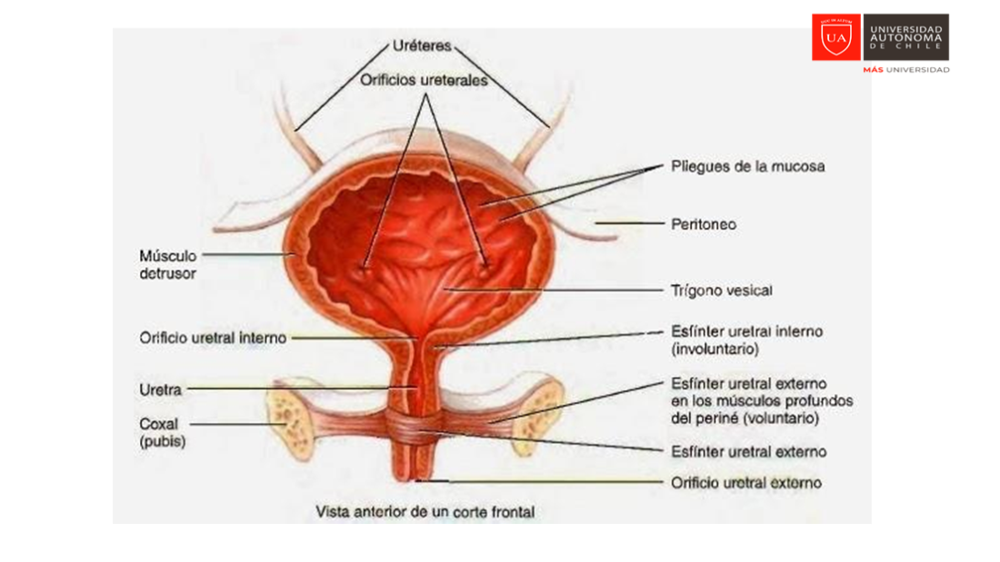
<!-- URO d. 9 | tipo: esquema de libro | incluir en Word: sí -->

- Disuria: Goic la usa para cualquier molestia miccional y nombra aparte el dolor; en el uso clínico UCH la hace sinónimo de ardor al orinar. **[Goic, p. 134]** **[UCH, tema 48, p. 318]**
- Latencia: demora en iniciar; micción intermitente y chorro débil completan los síntomas obstructivos. Neumaturia y fecaluria (gas o heces en la orina) indican fístula colovesical, casi siempre por diverticulitis. **[UCH, tema 48, p. 318–320]**

#### Mecanismo [URO d. 14; NEF d. 36]

| Fase | Requiere |
|---|---|
| Llenado | Detrusor estable, acomodación, esfínter cerrado |
| Vaciado | Contracción del detrusor y apertura de la salida |

#### Causas

**Enfermedades de las vías urinarias** [URO d. 10–12]

| Grupo | Causas |
|---|---|
| Infecciosas (las más comunes) | Infección baja; cistitis (mujeres); uretritis (*E. coli*, *Klebsiella*, *Proteus*); de transmisión sexual (*Chlamydia*, gonococo, *Mycoplasma genitalium*); prostatitis; vaginitis (candida, vaginosis, tricomonas) |
| Inflamatorias no infecciosas | Uretritis por trauma o sonda; cistitis intersticial; alergia o irritantes |
| Obstructivas | HPB, estenosis uretral, litiasis |
| Irritativas | Instrumentación, lesiones, radioterapia pélvica |

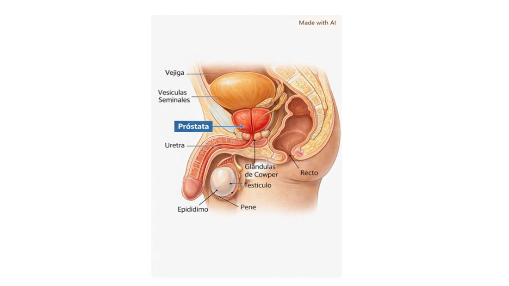
<!-- URO d. 12 | tipo: ilustración generada con inteligencia artificial | incluir en Word: verificar antes -->

- [URO d. 11] Irritantes: productos de higiene y espermicidas; trauma por cateterismo.
- La causa más frecuente es la infección de vejiga o uretra; en la mujer, cistitis, vaginitis y uretritis por *Chlamydia* o gonococo. Otras: cistitis actínica, tuberculosis, tumores, cálculos, cuerpos extraños y compresión vesical. **[Goic, p. 134–135]**
- Nicturia: renal (sobre todo enfermedad renal crónica) o extrarrenal (insuficiencia cardíaca). **[UCH, tema 48, p. 320]**
- Nicturia con volumen alto: riñón que no concentra, reabsorción nocturna de edemas o poliuria; con volumen normal y micciones pequeñas: vejiga de poca capacidad o residuo. **[Goic, p. 135–136]**

#### Cómo caracterizarlo

**Síntomas por fase** [URO d. 14–17; NEF d. 36]

| Fase | Según URO d. 14–17 | Según NEF d. 36 |
|---|---|---|
| Llenado | Frecuencia, urgencia, nicturia, incontinencia, tenesmo, poliuria global o nocturna, enuresis | Polaquiuria, nocturia, urgencia, incontinencia de urgencia |
| Vaciado | Chorro débil, delgado, en regadera o intermitente, interrupción súbita, vacilación, retardo, esfuerzo, goteo terminal, retención (globo), disuria | Chorro débil, latencia, pujo, intermitencia, goteo terminal, retención |
| Posmiccionales | Goteo, vaciado incompleto | Vaciado incompleto, goteo |

- Incontinencia: de urgencia, con la tos o la risa, y por rebalse [URO d. 14].

**Vejiga hiperactiva [URO d. 15]:** urgencia, incontinencia de urgencia, polaquiuria (umbral habitual de 8 o más al día) y nicturia.

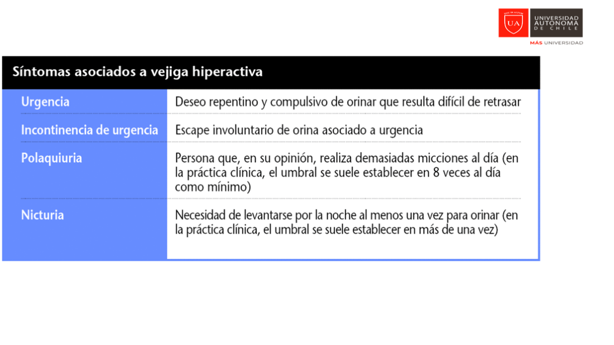
<!-- URO d. 15 | tipo: tabla en imagen, ya resumida | incluir en Word: opcional -->

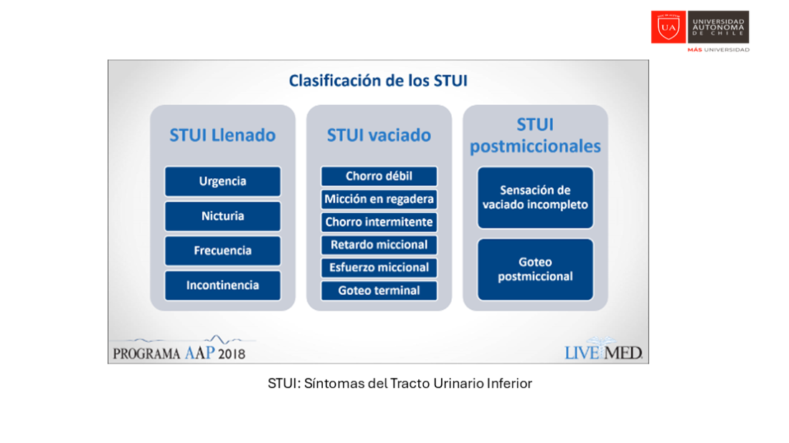
<!-- URO d. 16 | tipo: esquema | incluir en Word: sí -->

- Son inespecíficos: HPB, estrechez uretral, detrusor hipoactivo o vejiga hiperactiva. Evitar el término "prostatismo".
- Molestias solo en vigilia, que desaparecen al dormir, sugieren causa psicológica. **[Goic, p. 135]**
- Incontinencia verdadera (sin deseo; fístula, esfínter, neurológica), de esfuerzo (no ocurre acostado), por urgencia (detrusor hiperactivo) y paradojal o por rebalse (globo vesical). **[Goic, p. 187]**

#### Diagnóstico diferencial

- La poliuria nocturna (IC, diabetes, exceso de líquidos) simula nocturia; la cartilla miccional las distingue.

Ver también: Uropatía obstructiva baja e [incontinencia en la mujer](07%20Ginecologia.md).

| Disuria en la mujer **[Goic, p. 135]** | Orienta a |
|---|---|
| Piuria y cultivo positivo | Infección urinaria |
| Piuria y cultivo negativo | Contaminación, cultivo tomado con antimicrobianos en las últimas 48 h, vaginitis (hongos, tricomonas), tuberculosis |
| Sin piuria y cultivo negativo | Falta de estrógenos, *Mycoplasma hominis*, *Ureaplasma*, anaerobios, bacterias exigentes |

*Falta: examen físico, exámenes de apoyo (ver Uropatía obstructiva baja), signos de alarma.*

### Hematuria

#### Definición [URO d. 26, 30]

**Es dato de enfermedad genitourinaria grave mientras no se demuestre lo contrario** [URO d. 30]. Visible con 1 mL de sangre en 250 mL [URO d. 26].

- UCH la define con 5 o más hematíes por campo; Goic acepta como normal 1–2 en el hombre y hasta 5 en la mujer. Sobre 100 por campo es macroscópica. **[UCH, tema 48, p. 319]** **[Goic, p. 136]**
- La Asociación Americana de Urología define la microscópica como 3 o más hematíes por campo; el color macroscópico depende del pH (rojo si es alcalino, té o café si es ácido). **[Argente, cap. 56-1]**

#### Causas [URO d. 28–29]

| Urológicas | No urológicas |
|---|---|
| Infección, litiasis, tumores, HPB, trauma, TBC, litotripsia, cuerpo extraño, infarto renal | Hematológicas, glomerular, lupus, vasculitis, síndrome hemolítico urémico, endocarditis, tóxicos (benceno, aminas), antibióticos y anticoagulantes, betarraga (pigmento) |

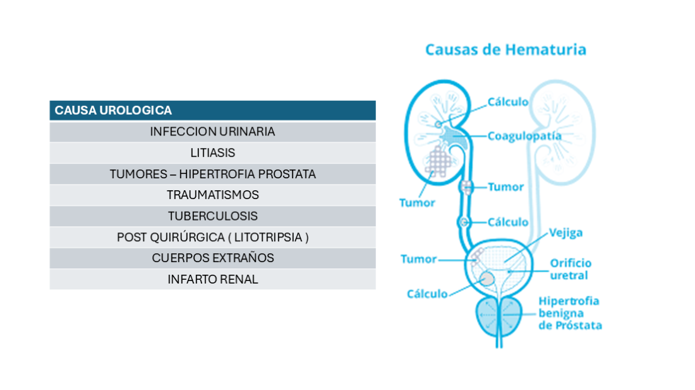
<!-- URO d. 28 | tipo: esquema | incluir en Word: opcional -->

- Las más frecuentes: glomerulopatías, cálculos, tumores, infecciones, coagulopatías y anticoagulantes. **[Goic, p. 137]**

#### Cómo caracterizarlo

**Momento** [URO d. 25–27] ⚠

| Momento | Origen según el PPT |
|---|---|
| Inicial | Uretra posterior y próstata |
| Total | Renal o más alto (tumor renal) |
| Terminal | Vesical (p. ej., cáncer de vejiga) |

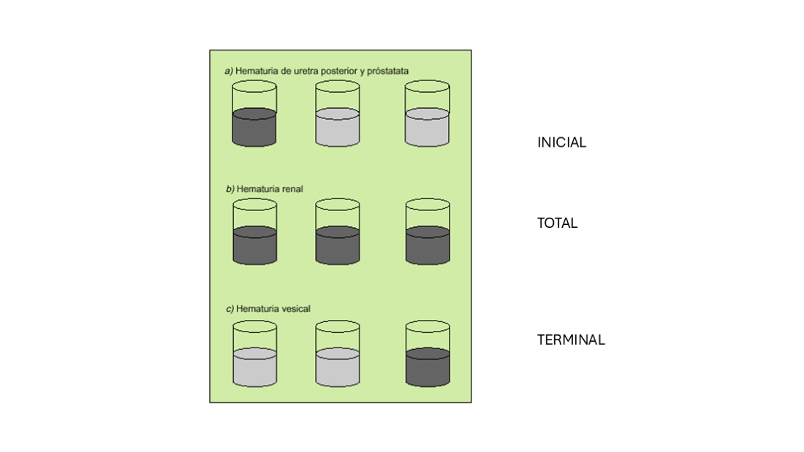
<!-- URO d. 25 y 27 | tipo: esquema | incluir en Word: sí -->

- Según síntomas: la asintomática suele asociarse a neoplasia. En la historia anotar color, momento, dolor y coágulos. **[UCH, tema 48, p. 320]**
- La urológica puede sangrar lo suficiente para causar anemia; la glomerular, no. **[Goic, p. 136]**
- Sobre 80 % de hematíes dismórficos se clasifica como glomerular y sobre 80 % isomórficos como no glomerular; los coágulos indican siempre origen urológico. **[Argente, cap. 56-1]**
- Preguntar inicio, recurrencia, momento de la micción, espuma, coagulación, síntomas urinarios, fiebre, artritis, dolor lumbar y fármacos (analgésicos, anticonceptivos). **[Argente, cap. 56-1]**

#### Exámenes de apoyo

- Descartado el origen glomerular: ecografía, pielografía, TC, arteriografía, cistoscopía o citología urinaria. **[Goic, p. 137]**
- La tira reactiva es muy sensible pero da falsos positivos (mioglobina, hemoglobina, menstruación): confirmar con sedimento. **[UCH, tema 51, p. 334]**

#### Diagnóstico diferencial: glomérulo o vía urinaria [NEF d. 7; URO d. 31]

| Rasgo | Glomerular | Urológica |
|---|---|---|
| Color | Oscuro: "Coca-Cola", café, "lavado de carne" | Rojo, rojo brillante |
| Momento | Total | Inicial, terminal o total |
| Dolor y asociados | Indolora; HTA, edema, insuficiencia renal | Puede doler; cólico, disuria, polaquiuria |
| Coágulos | Ausentes | Frecuentes |
| Hematíes | Dismórficos, acantocitos | Eumórficos o isomórficos, de aspecto "fresco" |
| Cilindros hemáticos | Presentes (patognomónicos) | Ausentes |
| Proteinuria | Frecuente, significativa | Mínima, escasa o ausente |
| Causas | Glomerulonefritis, IgA, lupus | Litiasis, tumores, infección, HPB |

- **Cilindro hemático:** hematíes moldeados en el túbulo sobre la proteína de Tamm-Horsfall; específico de origen glomerular.
- Una causa urológica puede imitar casi todo, excepto dismórficos, acantocitos y cilindros hemáticos.
- **Pregunta:** hombre de 65 años, fumador, orina roja con coágulos e indolora. ¿Glomerular o urológica? ¿Qué temes?
- Hemoglobinuria (hemólisis) y mioglobinuria tiñen la orina, pero sin hematíes; la hemoglobinuria deja la orina transparente. **[Goic, p. 137–138]**

#### Signos de alarma [URO d. 30]

- Toda hematuria es dato de enfermedad genitourinaria grave mientras no se demuestre lo contrario.

*Falta: mecanismo (ver cilindro hemático).*

### Color de la orina

#### Causas [URO d. 24]

| Color | Causa | Ejemplos |
|---|---|---|
| Rojo o rosado | Hematuria | Infección, cálculos, glomerulonefritis, tumores |
| Rojo intenso | Fármacos o alimentos | Rifampicina, betarraga |
| Naranja | Fármacos, deshidratación | Fenazopiridina, vitamina B |
| Amarillo intenso | Urobilina concentrada | Deshidratación, fiebre |
| Verde | Fármacos, infección | Propofol, *Pseudomonas* |
| Azul | Metabólico, fármacos | Pañal azul, azul de metileno |
| Marrón oscuro | Bilirrubina, fármacos | Hepatitis, cirrosis, metronidazol |
| Negro | Pigmentos | Alcaptonuria, melanoma |
| Blanco o turbio | Piuria, cristales | Infección, fosfaturia, quiluria |

- [URO d. 24] Alcaptonuria: ácido homogentísico. Pañal azul: hipercalcemia idiopática.

#### Cómo caracterizarlo

- Coluria (bilirrubina conjugada): color té que tiñe la espuma. Porfiria: rojiza que con la luz solar se vuelve color vino. **[Goic, p. 138]**
- Orina turbia: cristales (fosfatos se aclaran al acidificar; uratos, al calentar) o pus, que no cambia. **[Goic, p. 138]**

*Falta: mecanismo, examen físico, exámenes de apoyo, diagnóstico diferencial, signos de alarma.*

### Alteraciones del volumen urinario

#### Definiciones

| Alteración | URO d. 32 ⚠ | NEF d. 5 | NEF d. 25 ⚠ |
|---|---|---|---|
| Poliuria | Más de 3 L/día (distinta de polaquiuria) | Más de 3 L/24 h | 2 mg/kg/h o más |
| Oliguria | Menos de 500 mL/24 h o 0,5 mL/kg/h | Menos de 400 mL/24 h | 0,2 a 0,5 mL/kg/h |
| Anuria | Ausencia o menos de 50 mL/24 h | Menos de 100 mL/24 h (total: 0 mL) | Menor de 0,2 mg/kg/h |

NEF d. 25 define además la diuresis normal: 0,5 a 2 mg/kg/h. NEF d. 5: nicturia es despertar a orinar.

- Goic: volumen habitual 1.000–1.500 mL al día; oliguria menos de 400, anuria menos de 100 y anuria total cero. **[Goic, p. 135]**
- UCH: oliguria menos de 500 mL y anuria menos de 100 mL en 24 horas. **[UCH, tema 48, p. 319]**

#### Mecanismo

- El límite de oliguria nace del volumen mínimo para excretar los solutos diarios (cerca de 500 mL con máxima concentración). **[Goic, p. 135]**

#### Causas [URO d. 32–35]

| Cuadro | Causas |
|---|---|
| Poliuria fisiológica | Exceso de agua |
| Poliuria renal | Fase poliúrica de falla aguda, ERC, posobstructiva, diabetes insípida nefrogénica |
| Poliuria extrarrenal | Diabetes insípida neurogénica, diabetes mellitus, volumen, hipercalcemia |
| Oliguria prerrenal | Hipovolemia, insuficiencia cardíaca, shock |
| Oliguria renal | Falla aguda, ERC |
| Oliguria posrenal | Obstrucción ureteral, vesical, uretral |
| Anuria renal | Necrosis cortical bilateral, trombosis de venas renales |
| Anuria posrenal | Obstrucción ureteral bilateral |

- Poliuria acuosa (osmolaridad urinaria menor de 150): potomanía, diabetes insípida, hipercalcemia, hipopotasemia, litio. Osmótica (mayor de 250): diabetes mellitus, urea tras desobstrucción, diuréticos, suero salino. **[Goic, p. 135–137]**

#### Exámenes de apoyo

- La osmolaridad urinaria separa poliuria acuosa de osmótica; la prueba de deprivación de agua y la hormona antidiurética separan potomanía y diabetes insípida. **[Goic, p. 135]**

*Falta: cómo caracterizarlo, examen físico, diagnóstico diferencial, signos de alarma.*

### Alteraciones sexuales

#### Definiciones y tipos [URO d. 36–40]

La sexualidad integra lo biológico, psicológico y social.

| Fase | Alteraciones |
|---|---|
| Deseo | Hiposexualidad, asexualidad (no necesariamente patológica), hipersexualidad, aversión |
| Excitación | Disfunción eréctil (orgánica, farmacológica, psicógena, mixta), priapismo, trastorno de excitación femenina |
| Orgasmo | Anorgasmia, eyaculación precoz o retardada |
| Conducta | Parafilias, conducta compulsiva; identidad de género (hoy abordada desde diversidad y salud integral) |

| Término [URO d. 37–40] | Definición |
|---|---|
| Hiposexualidad | Disminución o ausencia de interés sexual |
| Asexualidad | Ausencia persistente de atracción sexual |
| Hipersexualidad | Deseo excesivo con conductas compulsivas |
| Aversión sexual | Rechazo o temor a la actividad sexual |
| Disfunción eréctil | Incapacidad persistente de lograr o mantener la erección |
| Excitación femenina | Dificultad para lubricar o sentir excitación |
| Anorgasmia | Ausencia de orgasmo pese a estimulación adecuada |
| Eyaculación precoz | Orgasmo antes de lo deseado |
| Eyaculación retardada | Dificultad o imposibilidad de alcanzar el orgasmo |
| Parafilias | Excitación hacia objetos, situaciones o personas no convencionales (voyeurismo, exhibicionismo, frotteurismo) |
| Conducta compulsiva | Repetición excesiva e incontrolable de actos sexuales |

- Priapismo: erección prolongada y dolorosa sin deseo; es urgencia urológica. Aneyaculación, eyaculación retrógrada (cirugía prostática o antiadrenérgicos) y hemospermia. **[UCH, tema 48, p. 319]**

#### Cómo caracterizarlo

- El varón suele somatizar en los genitales y a veces consulta por síntomas urinarios esperando que el médico descubra el problema sexual: preguntar dirigidamente. **[Goic, p. 187–188]**

*Falta: mecanismo, examen físico, exámenes de apoyo, diagnóstico diferencial, signos de alarma.*

### Dolor y aumento de volumen escrotal

#### Definición

- Dolor originado en testículo, epidídimo o cordón; puede irradiar a ingle, flanco o ángulo costovertebral. **[Goic, p. 186]**

#### Causas y caracterización [URO d. 49]

- **Dolor agudo:** torsión, orquiepididimitis. **Crónico** (3–6 meses): 15–50 años, síntomas urinarios o sexuales.
- **Aumento de volumen:** tumor (el cáncer testicular es la neoplasia más frecuente entre 15 y 35 años), varicocele (90 % izquierdo), hidrocele.

- [URO d. 49] El dolor crónico puede ser uni o bilateral, persistente o recurrente, y afecta la calidad de vida.
- Hidrocele, varicocele, espermatocele y tumor suelen doler poco o nada (el tumor da peso). La causa principal de dolor del epidídimo es la infección, con aumento de volumen. **[Goic, p. 186–187]**

#### Examen físico

- Torsión: comienzo brusco y preciso, testículo ascendido y horizontal, duele más al elevarlo; puede irradiar a fosa ilíaca derecha (palpar testículos ante una apendicitis). **[Goic, p. 186]**

#### Signos de alarma

- El dolor testicular intenso de comienzo brusco obliga a pensar en torsión. **[Goic, p. 186]**

*Falta: mecanismo, exámenes de apoyo.*

## Parte C. Síndromes

### Deshidratación y sobrehidratación

#### Deshidratación (balance negativo) [HID d. 24–25]

Las pérdidas de agua superan a los ingresos.

- **Causas:** vómitos y diarrea, fiebre y sudoración excesiva, diabetes mellitus descompensada, diabetes insípida, diuréticos, menor ingesta de líquidos.
- **Clínica:** sed intensa, mucosas secas, menor elasticidad de la piel, oliguria, taquicardia, hipotensión; en casos graves, confusión o compromiso de conciencia.
- **Laboratorio:** hemoconcentración, sodio plasmático aumentado (en algunos casos), osmolaridad sérica aumentada.

#### Sobrehidratación o hiperhidratación [HID d. 26–27]

El ingreso de agua supera a su eliminación.

- **Causas:** insuficiencia cardíaca congestiva, insuficiencia renal, cirrosis hepática, síndrome nefrótico, SIADH, exceso de líquidos intravenosos.
- **Síntomas:** pesadez, disnea, fatiga, cefalea (si hay hiponatremia).
- **Signos:** aumento rápido de peso, edema de extremidades inferiores, facial o palpebral, ingurgitación yugular, hipertensión, crepitantes pulmonares; ascitis en casos avanzados.

| Parámetro [HID d. 27] | Alteración |
|---|---|
| Hematocrito | Disminuido (hemodilución) |
| Hemoglobina | Disminuida |
| Sodio plasmático | Normal o disminuido |
| Osmolaridad plasmática | Disminuida en la hiperhidratación hipotónica |

#### Fisiopatología

- La natremia refleja el agua libre y el edema, el sodio total. Osmolaridad estimada: 2 × Na + 10 (sumar 5,5 por cada 100 mg/dL extra de glucosa). **[Goic, p. 316]**
- Una caída brusca del hematocrito sin sangrado indica expansión del volumen extracelular. **[Goic, p. 316]**
- Los síntomas del trastorno osmolar son neurológicos y dependen de magnitud, rapidez y duración. **[Goic, p. 317]**
- El balance de sodio fija el volumen extracelular y se evalúa clínicamente (edema si sube; pliegue e hipotensión si baja); el balance de agua fija la osmolaridad y se evalúa con la natremia. **[Argente, cap. 54-7]**

#### Diagnóstico diferencial

- Ante una natremia alterada responder dos preguntas: cómo está la osmolaridad y cómo la volemia. **[Goic, p. 317]**
- Hiponatremia: casi siempre exceso de agua libre (secreción inadecuada de ADH, fármacos, hipovolemia, insuficiencia cardíaca, cirrosis, nefrótico, falla renal). Hipernatremia: déficit de agua (falta de ingesta, diabetes insípida, pérdidas). **[Goic, p. 317–318]**

*Falta: alarma y conducta.*

### Síndrome nefrítico agudo

#### Definición [NEF d. 10–11]

Hematuria + proteinuria + caída aguda de la VFG, con oliguria, edema e HTA.

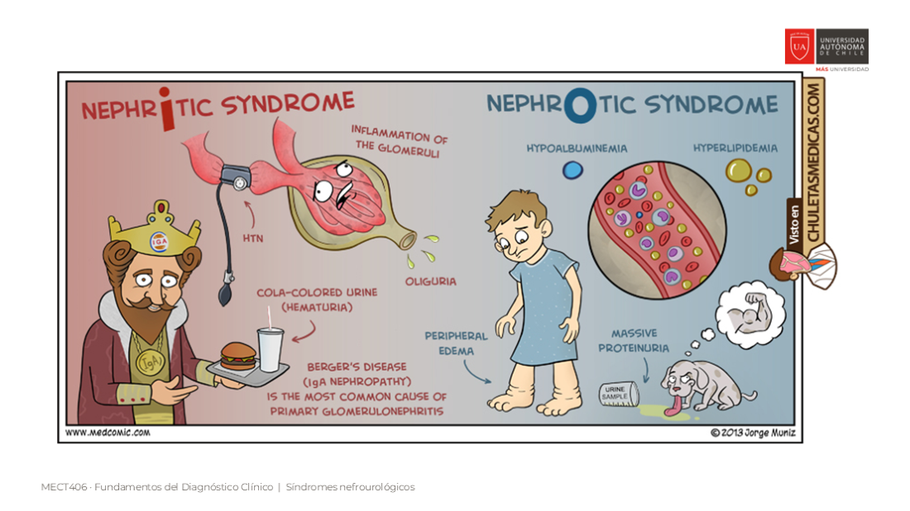
<!-- NEF d. 10 y 21 | tipo: caricatura en inglés (medcomic) | incluir en Word: opcional -->

#### Fisiopatología [NEF d. 11–12]

| Rama de la inflamación glomerular aguda | Consecuencia |
|---|---|
| Rotura de la membrana basal, mayor permeabilidad | Hematuria glomerular y proteinuria menor de 3,5 g/24 h |
| Oclusión capilar, caída brusca de la VFG | Retención de Na⁺ y agua (túbulo indemne) → mayor VEC (edema, HTA, congestión) y oliguria con azotemia discreta |

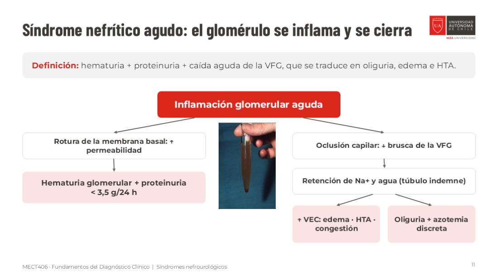
<!-- NEF d. 11 | tipo: esquema con foto de orina | incluir en Word: sí -->

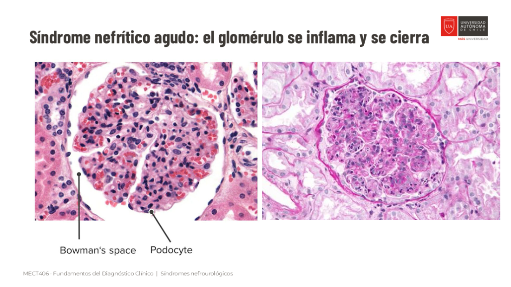
<!-- NEF d. 12 | tipo: microfotografías | incluir en Word: opcional -->

#### Causas

**Anamnesis y etiología** [NEF d. 14]

| Pista | Orienta a |
|---|---|
| Faringitis 1–3 semanas o piodermitis 3–6 semanas antes | Postestreptocócica |
| Hematuria simultánea a infección respiratoria | Nefropatía IgA |
| Artralgias, exantema, púrpura, fiebre, hemoptisis | Lupus, Schönlein-Henoch, vasculitis |
| Fiebre prolongada y soplo nuevo | Endocarditis bacteriana |

| Edad | Causas más frecuentes |
|---|---|
| Menos de 15 años | GN postestreptocócica, Schönlein-Henoch |
| 15–50 años | IgA, membranoproliferativa, lúpica (mujer), postinfecciosa |
| Más de 50 años | Vasculitis ANCA: poliangeítis granulomatosa, microscópica o eosinofílica |

**Tamizaje:** ASO, C3, ANA y anti-ADNn, ANCA.

- Postestreptocócica: 2–3 semanas tras faringitis o infección de piel; IgA: coincide con la infección respiratoria. **[UCH, tema 49, p. 328]**

#### Clínica (anamnesis) [NEF d. 13] ⚠

| Hallazgo | Detalle |
|---|---|
| Hematuria | Glomerular; macroscópica cerca del 75 %; la microhematuria persiste meses |
| Oliguria | Na urinario menor de 10 mEq/L y FENa menor de 1 % |
| Edema | Más del 90 %; facial y palpebral, luego generalizado |
| HTA | Dependiente de volumen, renina suprimida; riesgo de encefalopatía hipertensiva |
| Azotemia | Discreta (creatinina 1,5–2 mg/dL); solo cerca de 1 % de las postinfecciosas hace IRA |

- **Pista hemodinámica:** congestión (ingurgitación yugular, crépitos) + HTA + bradicardia sugieren nefrítico aunque no se haya visto hematuria.
- **Adulto mayor:** un edema pulmonar agudo sin cardiopatía conocida puede ser la primera manifestación; mirar el sedimento.
- Hematuria macroscópica en 30–50 % (UCH; el PPT indica cerca de 75 %). La complicación grave es el edema pulmonar agudo. **[UCH, tema 49, p. 327]**

#### Exámenes y criterios [NEF d. 14]

**Evolución de la GN postestreptocócica:** cerca de 7 días cede la oliguria → se normaliza la PA y el edema → antes de 6 meses desaparece la proteinuria → la microhematuria puede persistir de 6 meses a 2 años.

Tamizaje: ver Anamnesis y etiología.

#### Cuadro pediátrico [NEF d. 15, láminas y notas del orador]

- Aparece 3 a 33 días (habitualmente 1–2 semanas) después de infección amigdalina o cutánea por *Streptococcus pyogenes*; clásico entre 6 y 8 años. Puertas cutáneas: piodermitis, escarlatina, abscesos dentales, varicela sobreinfectada.
- Edema, HTA (90 %), oliguria de duración e intensidad variables, hematuria, proteinuria leve (2–4 % en rango nefrótico), palidez o anemia, aletargamiento, signos de IC. Pronóstico favorable; rara vez daño crónico.
- Principal causa pediátrica en Chile tradicionalmente, con incidencia en descenso.
- Inflamación por inmunidad celular y humoral con depósito de complejos inmunes. Las notas atribuyen oliguria e HTA a activación del SRAA ⚠.
- **Hematuria:** glóbulos rojos en el sedimento; macroscópica (cambia el color) o microscópica (más de 5 por campo o por mm³, repetir 2–3 exámenes en 2–4 semanas).
- **Exámenes:** hematocrito, creatininemia, BUN, ASO, C3; otros: radiografía de tórax, ECG, biopsia renal.

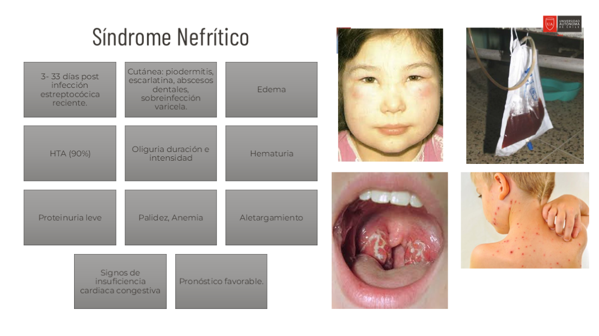
<!-- NEF d. 15 | tipo: lámina con fotos clínicas | incluir en Word: sí -->

*Falta: examen físico como apartado, diagnóstico diferencial (ver Integración), alarma y conducta.*

### Síndrome nefrótico

#### Definición [NEF d. 16]

Proteinuria de 3,5 g/24 h/1,73 m² o más + hipoalbuminemia (menor de 3 g/dL) + edema + hiperlipidemia + lipiduria.

#### Fisiopatología [NEF d. 16]

- Proteinuria masiva → hipoalbuminemia → menor presión oncótica → **edema**.
- Hipoalbuminemia → mayor síntesis hepática de lipoproteínas → hiperlipidemia y lipiduria.
- Menor volemia efectiva → SRAA → retención de Na⁺ y agua → refuerza el edema.
- La proteinuria masiva es el hecho más específico. En algunos pacientes el evento primario es la retención de Na⁺, con volemia expandida.

#### Causas [NEF d. 17]

**Nefrótico impuro:** se agrega hematuria glomerular, HTA o insuficiencia renal (membranoproliferativa, IgA, lúpica).

- Por edad: menores de 15 años, cambios mínimos (cerca de 90 % de las primarias); 15–40, membranoproliferativa, focal y segmentaria, membranosa; sobre 40, membranosa, diabética y amiloidosis. La secundaria más importante es la diabética. **[UCH, tema 49, p. 326]**

#### Clínica (anamnesis)

- Orina espumosa. Hipertensión y hematuria no son propias del nefrótico puro; sugieren enfermedad sistémica. **[UCH, tema 49, p. 325]**
- Más infecciones por gérmenes encapsulados (pérdida de IgG y complemento) y trombosis (pérdida de antitrombina y proteína S). **[UCH, tema 49, p. 325]**

#### Examen físico [NEF d. 17–19, 22]

- **Edema:** blando, frío, con fóvea; matinal en párpados, luego en declive, sacro y genitales; derrames hasta anasarca. Predomina en zonas de menor resistencia tisular.
- Facies abotagada; orina "espumosa".
- PA normal o baja en el nefrótico puro.
- Uñas: líneas de Muehrcke (bandas blancas transversales) por hipoalbuminemia.
- Piel: xantomas y xantelasmas por dislipidemia.
- Ascitis; edema genital y periorbitario [NEF d. 22].

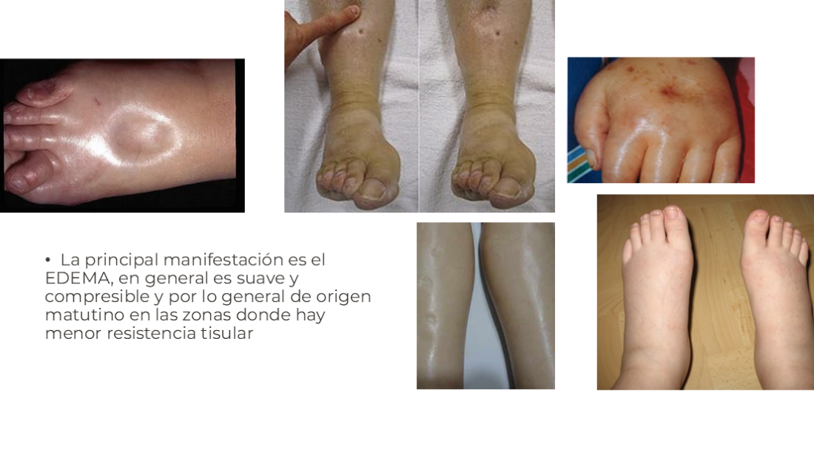
<!-- NEF d. 18 | tipo: fotos clínicas | incluir en Word: sí -->

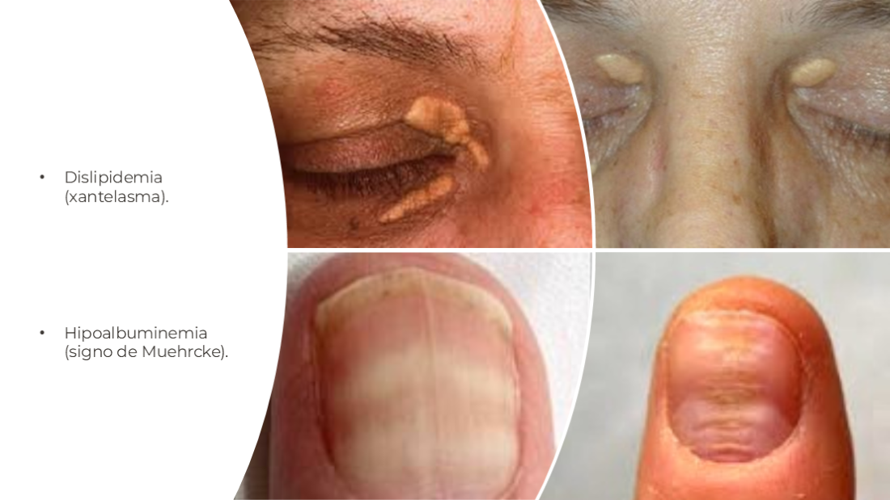
<!-- NEF d. 19 | tipo: fotos clínicas | incluir en Word: sí -->

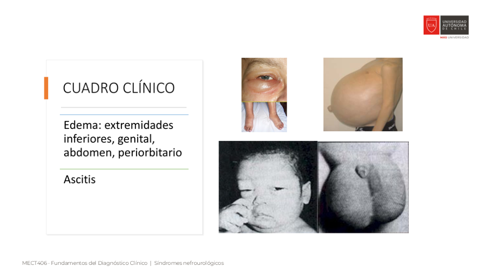
<!-- NEF d. 22 | tipo: fotos clínicas | incluir en Word: opcional -->

#### Exámenes y criterios

- UCH: proteinuria sobre 3,5 g/24 h e hipoalbuminemia (menor de 3 g/dL; en otra tabla, menor de 2); sedimento con cuerpos ovales grasos y cilindros grasos. **[UCH, tema 49, p. 324–325]**

#### Alarma y conducta

**Complicaciones** [NEF d. 17]

| Complicación | Mecanismo o expresión |
|---|---|
| Trombosis | Pérdida de antitrombina III; vena renal (dolor en flanco, hematuria), TVP |
| Infecciones | IgG baja: peritonitis neumocócica, celulitis |
| Endocrinas | Vitamina D baja; T4 total baja sin hipotiroidismo |
| Renales | IRA por hipovolemia o diuréticos; progresión del daño |

*Falta: diagnóstico diferencial (ver Integración).*

### Injuria renal aguda

#### Definición y criterios [NEF d. 24]

- Creatinina sube 0,3 mg/dL o más en 48 horas.
- Creatinina sube 50 % o más (1,5 veces el basal) en 7 días.
- Diuresis menor de 0,5 mL/kg/h por 6 horas.

El volumen no siempre cae: **oligúrica** (menos de 400 mL/24 h) o **no oligúrica** (hasta cerca de 30 %, p. ej. aminoglicósidos). **Anuria total:** obstrucción hasta demostrar lo contrario; rara vez GN muy intensa o necrosis cortical.

Frecuencia: prerrenal 55 %, renal 40 %, posrenal 5 %.

Los umbrales de diuresis están comparados en Alteraciones del volumen urinario.

#### Causas, anamnesis y examen físico [NEF d. 26]

| Aspecto | Prerrenal | Renal | Posrenal |
|---|---|---|---|
| Mecanismo | Hipoperfusión, túbulos indemnes; revierte al reperfundir | Daño del parénquima: NTA (cerca de 80 %), intersticial, glomerular o vascular | Obstrucción bilateral o de riñón único |
| Anamnesis | Vómitos, diarrea, hemorragia, diuréticos; IC o cirrosis; AINE, IECA, ARA-II | Hipoperfusión prolongada, sepsis, aminoglicósidos, contraste yodado, rabdomiólisis; fármaco + fiebre + exantema (NIA) | Cólico renal, LUTS, cáncer de próstata, vejiga o cuello uterino; anuria total o alternancia anuria-poliuria |
| Examen | Mucosas secas, pliegue (+), taquicardia, hipotensión ortostática, yugulares planas (o signos de IC o cirrosis) | Signos de la causa; si es oligúrica, edema, crépitos, ingurgitación yugular, R3 | Globo vesical, tacto rectal, masa pélvica; sondeo con más de 100 mL; hidronefrosis |

- En nuestro medio la más frecuente es el daño tubular por hipoperfusión (hipovolemia, sepsis) y nefrotóxicos. **[Goic, p. 282–283]**
- Además: obstrucción de arteria renal, hipertensión maligna y cristales o paraproteínas dentro de los túbulos. **[Goic, p. 283]**

#### Clínica (anamnesis)

- Al comienzo solo hay síntomas de la causa y quizá oliguria; en la forma no oligúrica se detecta por creatinina. Luego síndrome urémico agudo: anorexia, vómitos, letargo, convulsiones. **[Goic, p. 285]** **[UCH, tema 50, p. 330]**

#### Exámenes y criterios

- La ecografía muestra dilatación en la posrenal; la TC precisa sitio y causa. **[Goic, p. 285]**
- Con bicarbonaturia usar cloro urinario en vez de sodio. Cilindros pigmentados: hemólisis o rabdomiólisis; hemáticos: glomerulitis. **[Goic, p. 284]**

#### Diagnóstico diferencial: prerrenal o NTA [NEF d. 27; cita: Goic, tabla 23-15; Argente, cuadro 48-4-6]

| Parámetro | Prerrenal | NTA |
|---|---|---|
| Diuresis 24 h | 500 mL o menos | Variable |
| Osmolaridad urinaria (mOsm/kg) | 500 o más | 350 o menos |
| Na urinario (mEq/L) | Menor de 20 | Mayor de 40 |
| FENa (%) | Menor de 1 | Mayor de 1 (ver nota) |
| U/P creatinina | Mayor de 40 | Menor de 20 |
| U/P nitrógeno ureico | Mayor de 8 | Menor de 3 |
| Sedimento | "Limpio" | "Sucio": granulosos, células tubulares |

- **Nota de la lámina:** Goic usa 3 % o más y Argente más de 1 %; entre 1 y 3 % hay zona gris.
- **FENa** = (Na urinario × creatinina plasmática) / (Na plasmático × creatinina urinaria) × 100.
- En la prerrenal el túbulo concentra y ahorra sodio; en la NTA pierde ambas capacidades.
- Los índices pierden validez con diuréticos, glucosuria o ERC previa.

#### Alarma y conducta

**Lo que mata en la IRA no tratada** [NEF d. 28]

| Complicación | Buscar |
|---|---|
| Edema pulmonar agudo | Disnea, ortopnea, crépitos, ingurgitación yugular |
| Hiperpotasemia | Debilidad; ECG con T picudas y QRS ancho; riesgo de paro |
| Acidosis metabólica grave | Respiración de Kussmaul |
| Hiponatremia | Cefalea, confusión, convulsiones |
| Uremia (BUN mayor de 100 mg/dL) | Náuseas, asterixis, frote pericárdico, sangrado |

Ritmo sin diálisis: BUN sube 15 mg/dL/día o más; creatinina más de 0,5 mg/dL/día; K⁺ más de 0,5 mEq/L/día.

### Insuficiencia renal rápidamente progresiva

#### Definición y fisiopatología [NEF d. 29]

VFG cae 50 % o más (la creatinina se duplica) en menos de 3 meses en un riñón sano. Sustrato: GN con semilunas en más del 50 % de los glomérulos.

#### Causas

| Mecanismo | Ejemplos |
|---|---|
| I. Anti-membrana basal | Goodpasture (con hemorragia pulmonar) |
| II. Complejos inmunes | Lupus, postinfecciosa, IgA, membranoproliferativa |
| III. Pauciinmune (ANCA) | Poliangeítis granulomatosa, microscópica o eosinofílica |

#### Clínica: pistas extrarrenales

| Pista extrarrenal | Sugiere |
|---|---|
| Hemoptisis | Goodpasture, vasculitis |
| Sinusitis rebelde, epistaxis, otitis | Poliangeítis granulomatosa |
| Uveítis anterior, ojo rojo | Vasculitis |
| Púrpura palpable, livedo | Vasculitis, Schönlein-Henoch |
| Fiebre, artralgias, baja de peso | Estado inflamatorio sistémico |
| Mononeuritis, parestesias | Vasculitis |

#### Alarma y conducta

**Urgencia:** orina activa + riñones normales + creatinina que sube en semanas = biopsia renal.

*Falta: examen físico, exámenes y criterios (solo orina activa y biopsia), diagnóstico diferencial.*

### Enfermedad renal crónica

#### Definición [NEF d. 30]

- **ERC:** daño estructural o marcadores (orina, sangre, imágenes, histología), o VFG menor de 60 mL/min/1,73 m² por más de 3 meses.
- **IRC:** repercusión funcional; operativamente VFG menor de 60 por 3 meses o más.
- **Uremia:** síntomas y signos de las etapas avanzadas.

| Etapa | VFG (mL/min/1,73 m²) | Descripción |
|---|---|---|
| G1 | 90 o más | Daño renal con VFG normal o alta |
| G2 | 60–89 | Descenso leve |
| G3a | 45–59 | Leve a moderado |
| G3b | 30–44 | Moderado a severo |
| G4 | 15–29 | Severo |
| G5 | Menor de 15 o diálisis | Falla terminal |

Desde G3a hacia abajo es IRC. Albuminuria (mg/g): A1 menor de 30; A2 de 30 a 300; A3 mayor de 300.

#### Causas [NEF d. 30]

- **Chile (adultos en hemodiálisis):** nefropatía diabética (36 %), nefroesclerosis hipertensiva y GN crónica.
- En Chile la primera causa en hemodiálisis es la diabetes (32 % según UCH; el PPT dice 36 %). La hipertensión es el factor de riesgo de asociación más fuerte. **[UCH, tema 50, p. 331]**

#### Fisiopatología y exámenes: la creatinina engaña al comienzo [NEF d. 31]

- Perder la mitad de la VFG (120 a 60) solo lleva la creatinina de 0,75 a cerca de 1,4 mg/dL.
- K⁺ y Na⁺ se mantienen hasta etapas avanzadas por adaptación tubular.
- Orden de aparición: sube PTH → (VFG 40–20) sube fósforo, bajan calcio y calcitriol, anemia, acidosis leve → (VFG 15–10) sube K⁺, sobrecarga de volumen, acidosis severa.

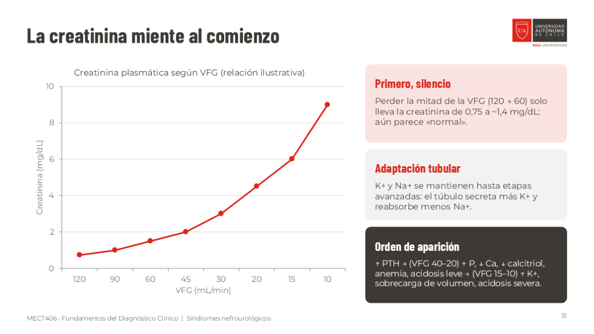
<!-- NEF d. 31 | tipo: gráfico | incluir en Word: sí -->

#### Clínica (anamnesis)

- Asintomática hasta etapas tardías; con filtrado menor de 30 aparecen poliuria, nicturia, anemia y retención nitrogenada. **[UCH, tema 50, p. 332]**
- La nicturia casi constante e isostenuria indican cronicidad; la oliguria es tardía y de mal pronóstico. **[Goic, p. 281]**

#### Exámenes y criterios

- Estimar el filtrado con fórmulas (MDRD, CKD-EPI), no con la creatinina sola. La ecografía es la primera imagen: riñones pequeños apoyan cronicidad. **[UCH, tema 50, p. 330]** **[UCH, tema 50, p. 333]**

#### Diagnóstico diferencial: agudo o crónico [NEF d. 32]

| Orienta a crónico | Orienta a agudo |
|---|---|
| Nicturia e isostenuria | Desencadenante identificable (hipovolemia, fármaco, obstrucción) |
| Anemia normocítica normocrómica | Hemoglobina normal (la anemia aparece cerca de 1 semana después) |
| Riñones menores de 10 cm (salvo diabetes, poliquistosis, amiloidosis, mieloma) | Riñones de tamaño normal |
| Fósforo alto, calcio bajo, PTH alta; cilindros céreos y anchos | Creatinina previa normal |
| Azotemia bien tolerada y exámenes previos alterados | |

#### Alarma y conducta [NEF d. 32]

Si una ERC empeora más de lo esperado, buscar lo reversible: hipovolemia, obstrucción, fármacos, IC, infección, reactivación, hipotiroidismo.

### Síndrome urémico

#### Definición [NEF d. 30]

Síntomas y signos de las etapas avanzadas de la falla renal.

#### Fisiopatología

- Toxinas urémicas, falla de sistemas y trastornos de electrolitos y ácido-base; suele aparecer con filtrado menor de 10–15 y obliga a diálisis. **[UCH, tema 50, p. 332]**

#### Clínica (anamnesis) [NEF d. 33]

| Sistema | Manifestaciones |
|---|---|
| Neurológico | Lasitud e insomnio → somnolencia, asterixis, mioclonías, convulsiones, coma; neuropatía, piernas inquietas |
| Cardiovascular | HTA, IC, pericarditis con frote y riesgo de taponamiento; ateromatosis precoz |
| Respiratorio | Kussmaul, "pulmón urémico" (alas de mariposa), derrame pleural |
| Digestivo | Anorexia, náuseas, vómitos, hipo, aliento urémico, estomatitis, hemorragia digestiva |
| Hematológico | Anemia normocítica normocrómica, equimosis, sangrado, infecciones |
| Piel y ojos | Palidez amarillenta, prurito, equimosis; ojo rojo por cristales de calcio |
| Óseo-mineral | PTH alta y calcitriol bajo: dolor, fracturas, calcifilaxis |
| Endocrino y urinario | Amenorrea, impotencia, infertilidad; nicturia, isostenuria, oliguria terminal |

#### Examen físico [NEF d. 34]

| Región | Qué buscar | Por qué |
|---|---|---|
| General | Palidez amarillenta-terrosa, facies vultuosa, compromiso de conciencia | Anemia, urocromos, toxinas |
| Respiración | Kussmaul | Acidosis metabólica |
| Boca | Aliento amoniacal, estomatitis | Degradación bacteriana de urea |
| Cuello | Ingurgitación yugular | VEC expandido |
| Corazón | Frote pericárdico (siempre), signos de taponamiento | Pericarditis urémica |
| Pulmones | Crépitos, derrame | Sobrecarga |
| Manos | Asterixis | Encefalopatía |
| Piel | Equimosis, excoriaciones | Disfunción plaquetaria, prurito |
| Extremidades inferiores | Edema, hipoestesia distal | VEC expandido, neuropatía |

- Escarcha urémica (hoy excepcional), calcifilaxis (lesiones violáceas y úlceras en dializados) y alteraciones del fondo de ojo. **[Goic, p. 281–282]**

#### Exámenes y criterios

- Alza de urea y creatinina, acidosis, hiperpotasemia, hipocalcemia, hiperfosfemia, anemia y mayor tiempo de sangría. **[UCH, tema 50, p. 333]**

*Falta: causas, diagnóstico diferencial, alarma y conducta.*

### Descarga uretral

#### Definición

- Secreción por la uretra; es la consulta más frecuente por patología del pene. Explorarla antes de que el paciente orine. **[Goic, p. 187]**

#### Causas y clínica [URO d. 45]

| Tipo | Incubación | Claves |
|---|---|---|
| Gonocócica | 2–5 días | Hombre: meatitis y secreción mucosa a purulenta. Mujer: cuello y uretra |
| No gonocócica | 1–5 semanas | *Chlamydia* 25–50 %, *Ureaplasma* 20–30 %, tricomonas 2–5 % |

#### Examen físico

- Gonocócica: purulenta, espesa, amarilla; no gonocócica: más clara y mucosa. Investigar *Chlamydia* si recurre. **[Goic, p. 187]**
- Buscar adenopatías, lesiones genitales y eritema o edema del meato. **[UCH, tema 48, p. 322]**

#### Exámenes y criterios

- Estudio del hisopado uretral y búsqueda de otras infecciones de transmisión sexual. **[UCH, tema 48, p. 323]**

*Falta: fisiopatología, diagnóstico diferencial, alarma y conducta.*

### Uropatía obstructiva baja e hiperplasia prostática benigna

#### Definición

**HPB** [NEF d. 37]

- Tres planos que no siempre coinciden: anatómico (volumen), fisiopatológico (resistencia de salida) y clínico (LUTS).
- Es histológica y muy prevalente con la edad; componente estático (volumen) y dinámico (tono alfa-adrenérgico).
- Conjunto de síntomas por obstrucción entre el cuello vesical y el extremo de la uretra. **[UCH, tema 48, p. 321]**

#### Fisiopatología [URO d. 47]

- Crecimiento progresivo tras la cuarta década; posible causa hormonal.
- Tamaño y obstrucción no guardan relación directa; no favorece ni protege del cáncer.

#### Causas de uropatía obstructiva baja [URO d. 46]

- **Hombre:** HPB, litiasis uretral, prostatitis crónica, estrechez, vejiga neurogénica (fimosis en niños).
- **Mujer:** cáncer cervicouterino, miomas, quistes, tumores; esclerosis del cuello, estrechez, divertículos.

#### Clínica (anamnesis)

Ver los síntomas por fase en la ficha Síntomas urinarios [NEF d. 36].

- En la hiperplasia aparecen primero los síntomas de vaciado y luego los de almacenamiento. **[UCH, tema 48, p. 321]**

#### Examen físico

**Globo vesical** [NEF d. 39]

- **Globo vesical:** abombamiento suprapúbico; masa media, lisa, de convexidad superior, que despierta deseo miccional; matidez.

**Tacto rectal** [NEF d. 38]

| Rasgo | HPB | Cáncer de próstata | Prostatitis aguda |
|---|---|---|---|
| Tamaño | Aumentado (grados I–IV), simétrico | Variable, asimétrico | Aumentado |
| Superficie | Lisa | Nodular, irregular | Lisa, tensa |
| Consistencia | Elástica ("goma") | Pétrea, leñosa | Blanda, edematosa |
| Límites y surco | Netos; surco puede borrarse | Mal definidos; nódulo borra el surco | Mal definidos por edema |
| Sensibilidad | Indolora | Indolora | Muy dolorosa, caliente |
| Contexto | LUTS, mayor de 50 años | Asintomático o LUTS; APE alto para el tamaño | Fiebre, disuria; tacto suave, sin masaje |

**Técnica y ética:** explicar, pedir consentimiento, ofrecer acompañante; posición de Sims, genupectoral o de pie inclinado. Completar con sensibilidad perineal, tono anal y reflejo bulbocavernoso.

- [NEF d. 38] Consistencia de la HPB: renitente, elástica.

#### Exámenes y criterios

**Estudio** [URO d. 47–48]

- **Estudio:** anamnesis (almacenamiento, vaciado, posmiccionales, calidad de vida); globo, tacto rectal, reflejos y sensibilidad perineal; orina y urocultivo, ecografía, uretrocistografía, pielografía, uroTAC, uroflujometría, cistoscopía, antígeno prostático.

**Objetivar la obstrucción** [NEF d. 39]

- **Residuo posmiccional:** ecografía o sondeo; más de 100 mL sugiere vaciado incompleto; repetir.
- **IPSS:** 7 preguntas (0–35): leve 0–7, moderado 8–19, severo 20–35; más una de calidad de vida.
- **Cartilla miccional:** mínimo 24 horas, hora y volumen.
- **Exámenes:** orina completa y urocultivo, creatinina, APE (en contexto), ecografía renal, vesical y prostática, uroflujometría.

#### Diagnóstico diferencial [NEF d. 37]

Comparación con cáncer de próstata y prostatitis en el tacto rectal.

- La hematuria **no** es esperable en la HPB: sospechar cáncer urotelial.

#### Alarma y conducta

- Retención aguda: instrumentar. Crónica: lleva a insuficiencia renal [URO d. 46].

- **Complicaciones:** retención aguda, ITU, litiasis vesical, vejiga de lucha, hidronefrosis bilateral (IRA posrenal o ERC).

### Calidad seminal alterada

#### Parámetros y causas [URO d. 41–43] ⚠

| Parámetro | Normal | Alteración | Causas |
|---|---|---|---|
| Volumen | 1,5–5 mL | Hipospermia, aspermia | Eyaculación retrógrada, obstrucción, hipogonadismo, cirugía |
| Concentración | 15 millones/mL o más | Oligozoospermia, azoospermia | Hormonas, tóxicos, alcohol, drogas, estrés |
| Movilidad | 40 % o más | Astenozoospermia | Fiebre, calor, varicocele, tabaco, sedentarismo |
| Morfología | 4 % o más normales | Teratozoospermia | Genética, tóxicos, infecciones |

**Factores:** edad, testosterona o tiroides, estilo de vida, ambiente, ISRS y alfabloqueadores.

- [URO d. 41] Hipogonadismo y obstrucción de conductos deferentes; morfología normal significa forma típica; exposición a altas temperaturas en la movilidad.

- [URO d. 43] La edad baja concentración y movilidad; hormonas: déficit de testosterona o alteración tiroidea; ambiente: químicos, radiación y calor excesivo.

*Falta: fisiopatología, clínica, examen físico, diagnóstico diferencial, alarma y conducta.*

## Parte D. Integración

### Nefrítico y nefrótico comparados [NEF d. 20]

| Rasgo | Nefrítico | Nefrótico |
|---|---|---|
| Mecanismo | Inflamación: el capilar se cierra | Permeabilidad: pasan proteínas |
| Inicio | Brusco (días) | Insidioso (semanas) |
| Edema | Leve a moderado, palpebral | Intenso, hasta anasarca |
| PA | Elevada | Normal o baja (puro) |
| Volemia | Expandida | Efectiva disminuida o variable |
| Hematuria | Protagonista, dismórfica, cilindros | Ausente o escasa (puro) |
| Proteinuria | Menor de 3,5 g/24 h | 3,5 g/24 h o más |
| Albúmina | Normal o levemente baja | Menor de 3 g/dL |
| Lípidos | Normales | Hiperlipidemia y lipiduria |
| Diuresis y VFG | Oliguria, VFG baja | Conservadas (salvo hipovolemia) |

**Pregunta:** hematuria dismórfica + proteinuria de 5 g/24 h + HTA: ¿nefrítico o nefrótico?

- [NEF d. 10, figura] La nefropatía IgA (enfermedad de Berger) figura como causa más común de glomerulonefritis primaria.

### Del hallazgo al síndrome [NEF d. 40]

| Paso | Hallazgo | Síndrome |
|---|---|---|
| ¿Hay obstrucción? | Globo vesical, LUTS de vaciado, anuria total, hidronefrosis | Uropatía obstructiva baja, IRA posrenal |
| ¿Qué muestra la orina? | Dismórficos + cilindros hemáticos + HTA y edema | Nefrítico |
| ¿Qué muestra la orina? | Proteinuria de 3,5 g/24 h o más + hipoalbuminemia + lipiduria | Nefrótico |
| ¿Cuál es el reloj? | Horas a días / semanas / más de 3 meses | IRA / IRRP / ERC; con compromiso sistémico, urémico |

### Cinco ideas finales [NEF d. 41]

1. El sedimento localiza: cilindros hemáticos (glomérulo), lipiduria (nefrótico), granulosos (túbulo).
2. El reloj clasifica la falla renal.
3. Anuria total es obstrucción hasta demostrar lo contrario: palpar y percutir el hipogastrio.
4. Nicturia, anemia y riñones pequeños indican cronicidad; frote y asterixis, uremia.
5. LUTS no es sinónimo de HPB, y la hematuria no es de la HPB.

### Síndromes urológicos [URO d. 44, 50]

Patrones que orientan; requieren anamnesis, examen y estudios (orina, imágenes, urocultivo, biopsia) [URO d. 44].

| Síndrome | Claves | Causas | Complicaciones |
|---|---|---|---|
| Nefrítico | Hematuria, proteinuria moderada, HTA, edema | Postestreptocócica, lupus | Insuficiencia renal |
| Nefrótico | Proteinuria masiva, hipoalbuminemia, edema | Cambios mínimos, glomeruloesclerosis | Trombosis, infección |
| IVU | Disuria, urgencia, fiebre | *E. coli*, gramnegativos | Pielonefritis, sepsis |
| Obstructivo | Retención, chorro débil | HPB, cálculos | Daño renal, infección |
| Funcional | Poliuria, anuria, incontinencia | Neurológicas, infecciones | Calidad de vida |

## Parte E. Síndromes y diagnósticos de la literatura

> Cuadros y temas que los PPT **no tratan** o **solo nombran**. Van resumidos y separados para no confundirlos con la materia de clase.

### Dolor nefrourológico *(los PPT no le dan un apartado propio)*

- **Renal:** distensión de la cápsula; sordo, constante, lumbar, puño-percusión positiva; distinguir del lumbago, que cambia con el movimiento. **[Goic, p. 133]**
- **Vesical:** hipogástrico intenso en la retención aguda; **prostático:** perineal «en silla de montar». **[UCH, tema 48, p. 318]**

### Cólico renal y litiasis *(los PPT lo nombran sin desarrollarlo)*

- Dolor que crece hasta ser insoportable, lumbar irradiado a ingle y genitales, con inquietud, náuseas y a menudo hematuria; al llegar el cálculo a la vejiga imita una cistitis. **[Goic, p. 133–134]**
- Causa principal la litiasis; también coágulos, cristales o papilas. Diferencial: dolor renal parenquimatoso, obstrucción intestinal, disección aórtica, apendicitis, anexitis. **[Goic, p. 133–134]**
- UCH: menor de 5 mm, cerca de 50 % de expulsión espontánea; mayor de 6 mm, menos de 5 %. El tamaño no determina la intensidad. **[UCH, tema 48, p. 321]**

### Infección urinaria: cistitis, pielonefritis y prostatitis *(los PPT la tratan en un caso y en tablas)*

- Baja (cistitis, uretritis, prostatitis) o alta (pielonefritis); casi siempre ascendente. Baja recurrente: UCH la define sobre 3 episodios en 12 meses o sobre 2 en 6. **[UCH, tema 48, p. 322]**
- **Cistitis:** disuria, polaquiuria, tenesmo, dolor suprapúbico, orina turbia; urocultivo con más de 100.000 UFC/mL. La bacteriuria asintomática solo se trata en embarazo o antes de procedimientos urinarios. **[UCH, tema 48, p. 322]**
- **Pielonefritis:** fiebre con calofríos, dolor lumbar, puño-percusión, náuseas; síntomas bajos en un tercio. Si sigue febril al cuarto día, imágenes por absceso o cálculo. **[UCH, tema 48, p. 323]**
- **Prostatitis aguda:** síntomas irritativos y obstructivos con fiebre alta, próstata dolorosa; requiere hospitalización. Crónica (más de 3 meses): infecciones repetidas y dolor perineal. **[UCH, tema 48, p. 323]**

### Proteinuria *(los PPT la tratan solo dentro de los síndromes)*

- Más de 150 mg al día; se sospecha por orina espumosa. Puede ser glomerular, tubular o por sobreproducción (mieloma). **[UCH, tema 48, p. 319]**
- La tira detecta sobre todo albúmina; el índice proteína/creatinina en muestra aislada reemplaza a la orina de 24 horas. **[UCH, tema 48, p. 319]** **[Goic, p. 138]**

### Examen de orina *(los PPT solo desarrollan el sedimento)*

- Preferir segundo chorro de la primera orina de la mañana. Nitritos: poco sensibles, muy específicos; esterasa leucocitaria: buen valor predictivo negativo. **[UCH, tema 51, p. 334–335]**
- Piuria aséptica (leucocitos con cultivo negativo): antibiótico previo, contaminación, litiasis, tumor, nefritis intersticial o gérmenes atípicos como tuberculosis y *Chlamydia*. **[UCH, tema 51, p. 336]**

### Trastornos ácido-base *(no tienen apartado en los PPT)*

- pH 7,38–7,44; pCO₂ 40 mmHg y bicarbonato 24 mEq. El trastorno metabólico lo compensa el pulmón y el respiratorio, el riñón. **[Goic, p. 319–320]**

| Trastorno **[Goic, p. 319–321]** | pH | Primario | Causas típicas |
|---|---|---|---|
| Acidosis metabólica | Bajo | Baja HCO₃⁻ | Diarrea, uremia, láctica, cetoacidosis; respiración de Kussmaul |
| Alcalosis metabólica | Alto | Sube HCO₃⁻ | Vómitos, diuréticos, hiperaldosteronismo |
| Acidosis respiratoria | Bajo | Sube pCO₂ | Hipoventilación central o pulmonar |
| Alcalosis respiratoria | Alto | Baja pCO₂ | Hipoxia, ansiedad, dolor, ventilación mecánica |

## Anexo de práctica

### Objetivos [NEF d. 3]

1. Definir cada síndrome por sus elementos cardinales.
2. Explicar cada signo desde su fisiopatología.
3. Reconocer en anamnesis, examen y orina los hallazgos que orientan.
4. Construir una aproximación sindromática desde un caso.

### Tres pacientes [NEF d. 2]

| Paciente | Relato |
|---|---|
| Matías, 9 años | Desde ayer orina "color Coca-Cola" y párpados hinchados; faringitis hace 2 semanas; PA 140/90 mmHg |
| Carolina, 34 años | 3 semanas de edema progresivo (párpados, piernas, abdomen); orina "espumosa"; PA 110/70 mmHg |
| Don Luis, 74 años | Años con chorro débil y 3 nocturias; 14 horas sin orinar y dolor suprapúbico intenso |

**Pregunta:** ¿qué síndrome sospechas en cada uno y qué buscarías primero en el examen físico?

### Caso de infección urinaria: presentación [URO d. 18–19]

Mujer de 35 años con ardor al orinar hace 48 h, polaquiuria y vaciado incompleto; 2–3 episodios al año hace 3 años. Orina inflamatoria; *E. coli* multisensible; nitrofurantoína 10 días y control.

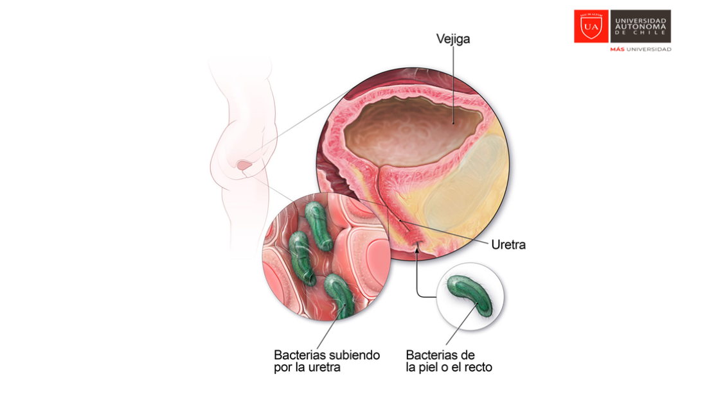
<!-- URO d. 18 | tipo: esquema | incluir en Word: opcional -->

### Evolución [URO d. 20–23]

- A los 10 días: fiebre 38,6 °C vespertina, dolor lumbar 7/10, gran compromiso general; 39 °C, taquicardia, hipotensión, dolor lumbar izquierdo. Tomó el antibiótico irregularmente. Se hospitaliza.
- Orina: glóbulos rojos 20–40 por campo, leucocitos y piocitos incontables, bacterias abundantes; *E. coli* más de 100.000 UFC. Sensible a ampicilina, cefadroxilo y ciprofloxacino; **resistente a nitrofurantoína**.
- Síntomas bajos + fiebre y dolor lumbar = **pielonefritis aguda** → sepsis → shock séptico → falla multiorgánica.

## Pendientes por verificar

Las diferencias entre láminas salen del PPT; el resto es revisión mía.

| Dónde | Observación |
|---|---|
| NEF d. 25 | La lámina mezcla "mg/kg/h" con "mL/kg/h". La diuresis se mide en mL/kg/h; parece error. |
| NEF d. 5 y 25 | Los umbrales en mL/24 h (anuria menor de 100, oliguria menor de 400) no equivalen a los de NEF d. 25 en un adulto. Confirmar cuáles se evaluarán. |
| NEF d. 13 y 15 | La NEF d. 13 dice HTA por volumen con renina suprimida; las notas de NEF d. 15 la atribuyen a activación del SRAA. Se contradicen. |
| NEF d. 31 | El texto dice cerca de 1,4 mg/dL con VFG 60 y el gráfico marca 1,5 (es ilustrativo). |
| NEF d. 2, 7, 8, 20 | Casos y preguntas dirigidas sin respuesta en el PPT. |
| NEF: Notas | La nota de NEF d. 15 mezcla texto y lista de exámenes; "Bp renal" lo interpreté como biopsia renal. |
| HID d. 16 | El segundo párrafo parece definir "mecanismos homeostáticos" en general, aunque aparece bajo el sistema osmorregulador. |
| HID d. 24 | Hay una palabra suelta, "Hemoconcentración", pegada a la definición; la dejé solo en laboratorio. |
| HID d. 28–29 | Dos láminas "Resumen: conceptos clave" sin contenido. Puede faltar material de la clase. |
| HID: Imágenes | No hay figuras de contenido. |
| URO d. 32 | Oliguria menor de 500 mL y anuria menor de 50 mL; el otro PPT usa 400 y 100. |
| URO d. 26–27 | Suele asociarse hematuria inicial a uretra anterior y terminal a cuello vesical o próstata. |
| URO d. 41–42 | Los valores citados como OMS 2021 corresponden en parte a la versión 2010; la de 2021 usa límites algo distintos. |
| URO d. 41 | Corregí "eratozoospermia" por teratozoospermia. |
| Volumen urinario | Goic: oliguria menor de 400 mL; UCH y URO d. 32: menor de 500. |
| Nefrítico: hematuria macroscópica | NEF d. 13 indica cerca de 75 %; UCH, 30–50 %. |
| Nefrótico: albúmina | UCH usa menor de 3 g/dL en el texto y menor de 2 en su tabla resumen. |
| ERC en Chile | NEF d. 30: nefropatía diabética 36 %; UCH: 32 %. |
| Hematuria: definición | UCH usa 5 o más hematíes por campo en una sección y más de 3 en la de examen de orina. |
| Cobertura de Argente | Del capítulo nefrourológico solo se usaron extractos sobre hematuria y balance hídrico. |
