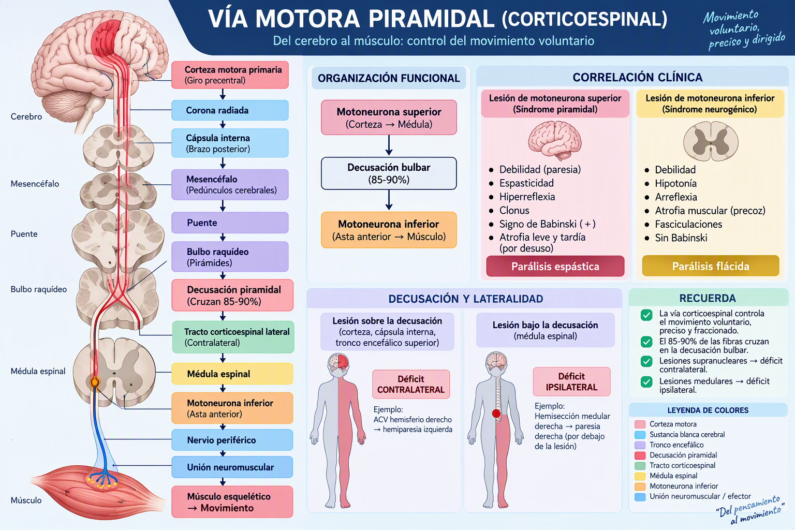
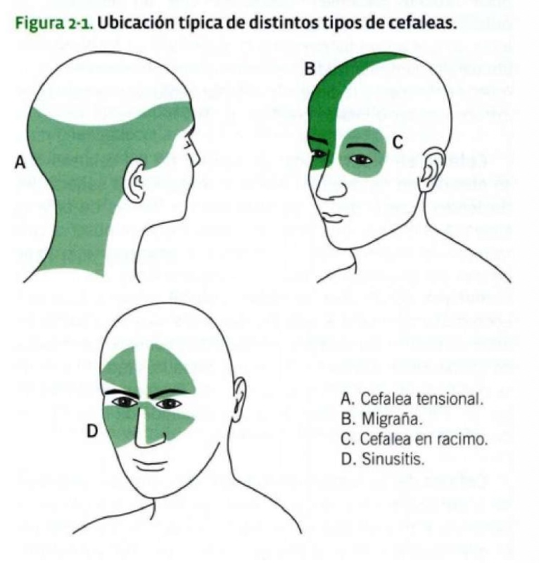
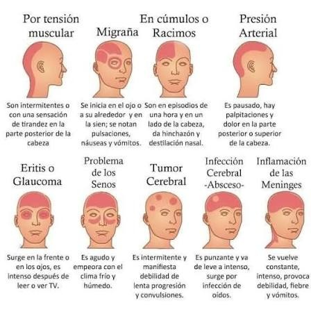
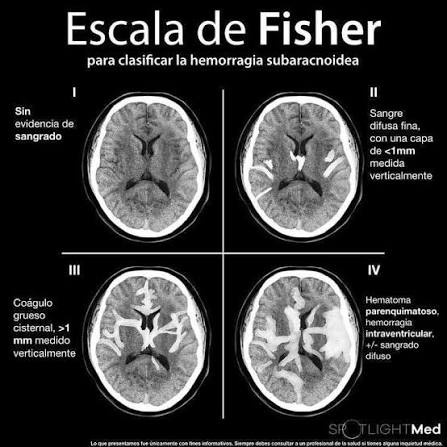
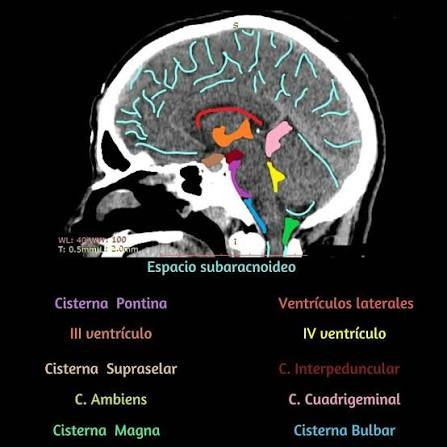
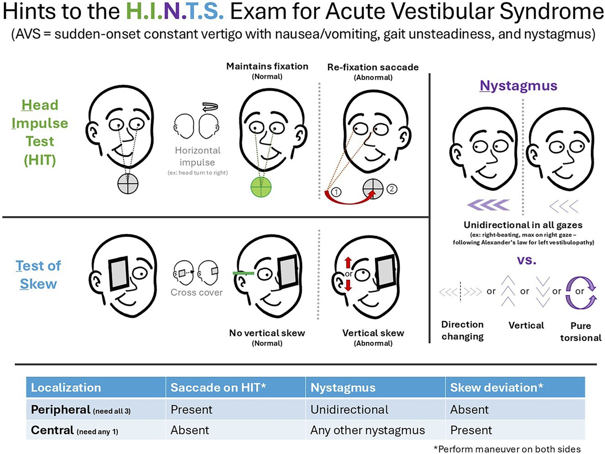
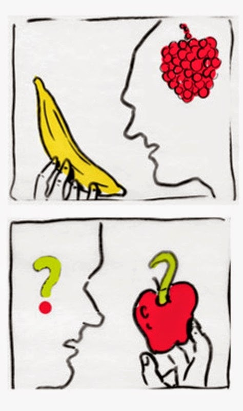

# Neurológico y neuropsiquiátrico

Fundamentos del Diagnóstico Clínico, Unidad 3.

| Código | Texto original | Fuente |
|---|---|---|
| PSIQ | [Sintomas y signos neuropsiquiatricos](Textos%20originales/Sintomas%20y%20signos%20neuropsiquiatricos.md) | PPT "Síntomas y signos neuropsiquiátricos" (Dr. Miguel Yáñez Martínez, Universidad Autónoma de Chile). |
| NEU | [Sindromes neurologicos](Textos%20originales/Sindromes%20neurologicos.md) | PPT "Síndromes neurológicos" (35 diapositivas, Universidad Autónoma de Chile). |
| Goic | *Semiología médica*, caps. 2, 15 y 25 | Página impresa; leídos en parte. |
| UCH | Manual de Semiología UCH, temas 12 y 14 | Página impresa. |
| Argente | Argente y Álvarez, caps. 72-1 y 72-2 | Extractos; sin número de página. |

> **Cómo leer:** [DIG d. 7] indica el PPT (código) y la diapositiva. "Cita:" copia la referencia de la lámina, sin contrastarla. † marca texto oculto o cortado en la lámina. ⚠ remite a la sección final de pendientes. La línea *Falta* indica apartados que los PPT no desarrollan o que no tienen espacio propio. Lo marcado **[Goic, p. N]**, **[UCH, tema, p. N]** o **[Argente, cap.]** es complemento de los libros, resumido con otras palabras.

**Siglas:** ICHD-3 (Clasificación Internacional de Cefaleas, 3.ª edición); DSM-5 (Manual Diagnóstico y Estadístico de los Trastornos Mentales, 5.ª edición); LCR (líquido cefalorraquídeo); TSH (hormona estimulante de la tiroides); HINTS (impulso cefálico, nistagmo y prueba de desviación ocular); Minsal (Ministerio de Salud); Hz (hercios); N (valor normal).

## Mapa del tema

- **Síntomas y signos:** Cefalea; Mareo y vértigo; Alteraciones de la conciencia; Praxias, gnosias y lenguaje; Alteraciones de la memoria; Astenia; Nerviosismo y ansiedad; Depresión; Hostilidad; Insomnio.
- **Síndromes:** Síndrome meníngeo; Síndrome radicular; Síndrome de hipertensión endocraneana; Síndrome piramidal (primera motoneurona); Síndromes musculares; Síndrome extrapiramidal; Síndrome cerebeloso; Demencias.
- **Solo en la literatura o apenas nombrados (Parte E):** Síndromes sensitivos; Síndrome de segunda motoneurona; Esclerosis lateral amiotrófica; Accidente cerebrovascular; Hematomas subdural y extradural.

## Parte A. Fundamentos

### Psicosemiología [PSIQ d. 4; cita: Argente-Álvarez, cap. 71]

Tres preguntas: ¿quién es el paciente?, ¿cómo padece lo que motiva su consulta?, ¿en qué áreas de su vida se manifiesta?

**Examen del estado mental:**

- Aspecto, facies, postura y conducta
- Conciencia, atención, memoria y orientación
- Afectividad: ánimo predominante y congruencia
- Pensamiento y lenguaje: velocidad y contenido
- Introspección y juicio de realidad
- Despersonalización

La angustia y la depresión acompañan a casi todos los síntomas de la medicina interna y rara vez quedan en la ficha.

### Síntomas y signos en la anamnesis [NEU d. 2]

- Trastorno de conciencia y pseudopercepciones
- Convulsiones, cefalea, alteraciones de la visión
- Sordera, tinnitus, vértigo
- Náuseas, vómitos, disfagia
- Alteración del lenguaje (expresivo, comprensivo), disartria, bradilalia, dislalia, disfemia
- Debilidad, alteración del tono, parálisis de extremidades
- Movimientos anormales
- Alteración del equilibrio y la coordinación
- Dolor y parestesias
- Alteración del control de esfínteres
- † Alteraciones de la memoria, ansiedad, depresión, apatía, excitación y manía

### Según la función afectada [NEU d. 3]

| Función | Manifestaciones |
|---|---|
| Motora | Debilidad o parálisis, movimientos involuntarios, lentitud, torpeza, inestabilidad de la marcha, rigidez |
| Sensibilidad | Pérdida o disminución, aumento, parestesias |
| Sensorial | Alteraciones del gusto y olfato, diplopía o disminución de la visión, alucinaciones |
| Sueño | Excesivo, dificultad para dormir, alteraciones durante el sueño |
| Cognitivas | Alteraciones de memoria, desorientación, incapacidad para realizar actividades aprendidas o reconocer objetos por los sentidos, dificultad para concentrarse, alteraciones conductuales |
| Lenguaje | Alteración para nominar, repetir, comprender y articular |
| Conciencia | Pérdida transitoria o alteración cuantitativa |
| Otros | Convulsiones, mareo o vértigo, cefalea y dolor urente, alteración de deglución y esfínteres |

### Función motora normal [NEU d. 15–19]

Vía del movimiento voluntario: corteza motora primaria → corona radiada → cápsula interna → tronco encefálico (mesencéfalo y puente) → pirámides bulbares → **decussación piramidal** (cruza el 85–90 %) → tracto corticoespinal lateral → médula espinal → motoneurona inferior → nervio periférico → unión neuromuscular → músculo.

Además participan el sistema extrapiramidal (ganglios basales) y el cerebelo (coordinación y equilibrio).

<!-- NEU d. 19 | tipo: infografía (parece generada con herramienta de diseño; verificar rótulos) | incluir en Word: sí -->

| Infografía [NEU d. 19] | Motoneurona superior | Motoneurona inferior |
|---|---|---|
| Clínica | Debilidad, espasticidad, hiperreflexia, clonus, Babinski (+), atrofia leve y tardía | Debilidad, hipotonía, arreflexia, atrofia precoz, fasciculaciones, sin Babinski |
| Parálisis | Espástica | Flácida |

- [NEU d. 19] Lesión sobre la decusación: déficit contralateral (p. ej., ACV derecho, hemiparesia izquierda). Bajo la decusación: ipsilateral (p. ej., hemisección medular).

- [NEU d. 19] Rótulos de la figura: brazo posterior de la cápsula interna, pedúnculos cerebrales, asta anterior.

### Claves diagnósticas del sistema motor [NEU d. 18]

| Hallazgo predominante | Diagnóstico sugerido |
|---|---|
| Debilidad + hiperreflexia + Babinski | Síndrome piramidal |
| Debilidad + atrofia + fasciculaciones + arreflexia | Motoneurona inferior |
| Rigidez + bradicinesia + temblor de reposo | Síndrome extrapiramidal |
| Ataxia + dismetría + temblor de intención | Síndrome cerebeloso |
| Debilidad proximal simétrica + sensibilidad conservada | Miopatía |
| † Ptosis + diplopía + fatigabilidad fluctuante | Unión neuromuscular |

## Parte B. Síntomas y signos

### Cefalea

#### Definición [PSIQ d. 5; cita: Goic, tabla 2-1]

Dolor de la cabeza desde las cejas hacia arriba, incluida la parte alta de la nuca. Es el dolor más frecuente, en especial en mujeres.

#### Mecanismo [PSIQ d. 5]

- **Insensibles:** cráneo, parénquima cerebral, la mayor parte de las meninges y plexos coroideos.
- **Mecanismo:** tracción, desplazamiento, inflamación o contracción muscular de estructuras sensibles.

| Extracraneanas sensibles | Intracraneanas sensibles |
|---|---|
| Piel, músculos del cráneo, aponeurosis, arterias | Senos venosos, arterias de la base, porciones de duramadre y piamadre, pares V, IX y X, tres primeros nervios cervicales |

#### Causas

**Cefaleas primarias** [PSIQ d. 7–8; cita: Goic, tabla 2-3 y figura 2-1]

| Rasgo | Tensional | Migraña (jaqueca) | En racimos (Horton) |
|---|---|---|---|
| Localización | Bilateral, occípito-nucal o "en cintillo" | Hemicránea | Unilateral: orbitaria, supraorbitaria o temporal |
| Carácter y duración | Opresiva y continua; presente al despertar | Crisis de horas a 2–3 días | Brusca, intensísima; 15 minutos a 3 horas, varias veces al día |
| Acompañantes | Tensión o depresión; no aumenta con Valsalva | Aura visual, náuseas, vómitos, fotofobia | Ojo rojo, lagrimeo, rinorrea, edema periocular |
| A quién afecta | La más frecuente; mujeres en la perimenopausia | Desde la adolescencia; familiar; más en mujeres | Más en hombres; alterna con remisiones |

Goic las agrupa en psicógenas (tensional), vasculares, sintomáticas y neuralgias. La ICHD-3 distingue primarias y secundarias.

<!-- PSIQ d. 8 | tipo: figura de libro (rotulada figura 2-1) | incluir en Word: sí -->

<!-- PSIQ d. 8 | tipo: ilustración de divulgación, sin fuente académica | incluir en Word: opcional -->

**Cefaleas secundarias** [PSIQ d. 9–10; cita: Goic, pp. 51–53]

| Causa | Claves | Urgencia |
|---|---|---|
| Hemorragia subaracnoidea | Súbita, intensísima; rigidez de nuca, pérdida de conciencia | Urgente |
| Meningitis | Global, persistente; fiebre y signos meníngeos | Urgente |
| Tumor cerebral | Nueva y progresiva; vómito en proyectil, edema de papila | Urgente |
| Hematoma subdural | Trauma → intervalo libre → cefalea, somnolencia, confusión | Urgente |
| Arteritis de la temporal | Mayor de 55 años; arteria indurada; síntomas visuales | Urgente |
| Glaucoma agudo | Dolor ocular brusco, baja de visión, midriasis, ojo rojo | Urgente |
| Hipertensión maligna | Occipital al despertar, cede en el día; fondo de ojo III–IV | En consulta ⚠ |
| Sinusitis | Frontal o malar al despertar; peor al agacharse; fiebre | En consulta |
| Vicio de refracción | Periocular, tras esfuerzo visual; peor en la tarde | En consulta |

<!-- PSIQ d. 10 | tipo: imagen de tomografía con escala | incluir en Word: sí -->

<!-- PSIQ d. 10 | tipo: imagen anatómica | incluir en Word: opcional -->

**Escala de Fisher, transcrita de la figura [PSIQ d. 10]:**

| Grado | Hallazgo en la tomografía |
|---|---|
| I | Sin evidencia de sangrado |
| II | Sangre difusa fina, capa menor de 1 mm medida verticalmente |
| III | Coágulo cisternal grueso, mayor de 1 mm |
| IV | Hematoma parenquimatoso o hemorragia intraventricular, con o sin sangrado difuso |

#### Cómo caracterizarlo: ocho preguntas [PSIQ d. 6; cita: Goic, tabla 2-2]

| Pregunta | Opciones |
|---|---|
| Localización | Hemicránea, occípito-nucal, "en cintillo", orbitaria, frontal |
| Carácter | Opresivo, pulsátil, punzante, "ramalazo" |
| Comienzo | Súbito o gradual; primer episodio o dolor conocido |
| Intensidad | Leve a intolerable; estable, fluctuante o progresiva |
| Horario | Al despertar, en la tarde, de madrugada, a hora fija |
| Agravantes | Valsalva, esfuerzo, agacharse, cambios de posición |
| Alivio | Reposo, oscuridad, analgésicos, vasoconstrictores |
| Acompañantes | Fiebre, vómito en proyectil, síntomas visuales, parestesias, compromiso de conciencia |

- El primer objetivo es descartar una cefalea secundaria (80 % son primarias). La intensidad no equivale a gravedad. **[UCH, tema 14, p. 53]**

| Rasgo **[UCH, tema 14, p. 53–54]** | Migraña | Tensional | En racimos |
|---|---|---|---|
| Perfil | Mujer joven; horas a 3 días | La más frecuente; estrés | Hombre de 20–40 años; 15 min a 3 h |
| Dolor | Hemicráneo, pulsátil, moderado a intenso | Bilateral en cintillo, opresivo, leve a moderado | Orbitario unilateral, muy intenso |
| Acompañantes | Náuseas, fotofobia, fonofobia; aura en 30 % | Ninguno | Ojo rojo, lagrimeo, rinorrea, inquietud |
| Alivio o agravantes | Empeora al moverse; cede en reposo y oscuridad | No empeora con actividad de rutina | Repite con horario |

#### Examen físico [PSIQ d. 6]

Completar con signos meníngeos, examen neurológico y **fondo de ojo**: un edema de papila cambia el enfoque.

#### Signos de alarma: regla de Ottawa [PSIQ d. 11; cita: Goic, p. 53] ⚠

Sensibilidad 100 %, especificidad 15 %.

1. Comienzo súbito e intensísimo ("la peor de mi vida")
2. Cefalea nueva o distinta después de los 40 años
3. Inicio durante un esfuerzo
4. Rigidez de nuca
5. Pérdida de conciencia
6. Flexión cervical limitada al examen

- Banderas rojas: inicio sobre 50 años, cambio de patrón, cáncer o VIH, trauma reciente, fiebre sin foco, examen neurológico alterado, compromiso de conciencia o convulsiones, despierta o aumenta con Valsalva, vómitos explosivos, inicio en trueno. **[UCH, tema 14, p. 53]**

*Falta: diagnóstico diferencial como apartado (ver tablas de causas).*

### Mareo y vértigo

Ver también: [vértigo desde el oído](11%20Oftalmologia%20y%20otorrinolaringologia.md).

#### Definición [PSIQ d. 13; cita: Goic, pp. 53–54]

| Rasgo | Mareo o vahído (seudovértigo) | Vértigo verdadero |
|---|---|---|
| Relato | "Ando en altos y bajos, como en un bote" | "Todo me da vueltas" |
| Sensación | Inestabilidad, vaivén o desvanecimiento poco definido; sin giro | Giro propio (subjetivo) o del entorno (objetivo) |
| Acompañantes | Sin síntomas vegetativos ni neurológicos | Náuseas, vómitos, sudoración, palidez; siempre nistagmo ⚠; puede haber tinnitus e hipoacusia |
| Conciencia | No se menciona | Conservada; si se pierde, pensar en otra enfermedad |

#### Causas de mareo [PSIQ d. 13]

**Causas de mareo:** ansiedad (la más frecuente), anemia severa, hipotensión ortostática, hipertensión severa, enfisema, depresión, cambios posturales en adultos mayores.

#### Cómo caracterizarlo [PSIQ d. 15; cita: Goic, p. 56]

| Pregunta | Interpretación |
|---|---|
| ¿Gira? | No: mareo (anemia, hipotensión ortostática, ansiedad). Sí: vértigo |
| ¿Cambia con la postura? | Segundos al girar en cama o mirar arriba: vértigo postural benigno |
| ¿Síntomas auditivos? | Hipoacusia fluctuante, tinnitus y plenitud ótica: Menière. Hipoacusia progresiva: neurinoma |
| ¿Signos neurológicos? | Diplopía, ataxia, compromiso de conciencia: central u otra causa; estudio neurológico |

#### Examen físico [PSIQ d. 15–16]

**Nistagmo:** buscarlo espontáneo, en todas las direcciones de la mirada y de posición (maniobra de Dix-Hallpike). Registrar dirección, sentido, duración y ritmo.

<!-- PSIQ d. 16 | tipo: esquema en inglés | video en la lámina: https://www.youtube.com/watch?v=zgqCXef-qPs | incluir en Word: sí -->

#### Diagnóstico diferencial: periférico o central [PSIQ d. 14; cita: Goic, tabla 2-5 y pp. 54–55]

| Rasgo | Periférico | Central |
|---|---|---|
| Origen | Laberinto o nervio vestibular | Núcleos vestibulares y conexiones (tronco, cerebelo) |
| Curso | Crisis recidivantes, intensas y transitorias | Más persistente, a menudo menos intenso |
| Acompañantes | Náuseas y vómitos marcados; hipoacusia y tinnitus unilaterales | Diplopía, disartria, ataxia |
| Nistagmo | Horizontal-rotatorio, un solo sentido; se inhibe al fijar la mirada | Puede ser vertical o cambiar de sentido; no se inhibe |
| Ejemplos | Vértigo postural paroxístico benigno, neuronitis vestibular, Menière, neurinoma del acústico | Isquemia cerebral transitoria, esclerosis múltiple, tumores de tronco o cerebelo |

En medicina interna la mayoría son periféricos y predomina el vértigo postural benigno.

#### Signos de alarma [PSIQ d. 15]

- Diplopía, ataxia, disartria o compromiso de conciencia: pensar en causa central u otra; estudio neurológico. Si se pierde la conciencia, pensar en otra enfermedad.

*Falta: mecanismo.*

### Alteraciones de la conciencia

#### Nivel: grado de alerta y vigilia [NEU d. 4–5, 29]

| Estado | Característica |
|---|---|
| Somnolencia | Tendencia al sueño, fácil despertar |
| Obnubilación | Respuestas lentas, desorientación leve |
| Estupor | Responde solo a estímulos intensos |
| Coma | Sin respuesta a estímulos |

#### Contenido: pensamiento, percepción y memoria [NEU d. 4–5, 29]

| Alteración | Característica |
|---|---|
| Confusión | Desorganización del pensamiento, desorientación |
| Delirio ⚠ | Alteración aguda con alucinaciones y agitación |
| Estados oníricos | Vivencias semejantes al sueño |
| Despersonalización o desrealización | Percepción alterada de sí mismo o del entorno |

#### Definición

- Conocimiento de sí y del medio con capacidad de responder; se separa en nivel (vigilia) y contenido. **[UCH, tema 12, p. 48]**

#### Mecanismo

- La vigilia depende del sistema reticular activador del tronco y su conexión con tálamo y corteza; el contenido, de la corteza. **[UCH, tema 12, p. 48]**

#### Cómo caracterizarlo

- Describir qué estímulo abre los ojos: espontáneo, verbal, táctil, doloroso o ninguno (coma). Obnubilación, estupor y sopor tienen definiciones variables entre autores. **[UCH, tema 12, p. 48]**
- **Delirium** (síndrome confusional agudo): falla brusca y fluctuante de la atención, típica del anciano, secundaria a otra enfermedad. **[UCH, tema 12, p. 48]**

#### Examen físico

- Orientación en espacio, tiempo y situación; atención (deletrear «mundo» al revés, días en orden inverso). **[UCH, tema 12, p. 48]**

| Glasgow **[UCH, tema 12, p. 49]** | Ocular | Verbal | Motora |
|---|---|---|---|
| 6 | — | — | Obedece |
| 5 | — | Orientado | Localiza el dolor |
| 4 | Espontánea | Confuso | Retira |
| 3 | A la voz | Incoherente | Flexión (decorticación) |
| 2 | Al dolor | Sonidos | Extensión (descerebración) |
| 1 | Ninguna | Ninguna | Ninguna |

- Puntúa la mejor respuesta; total 3–15. Con 8 o menos se indica intubación. **[UCH, tema 12, p. 49]**

#### Diagnóstico diferencial

- Pérdida breve de conciencia: epilepsia, síncope o crisis psicógena; preguntar a testigos. **[UCH, tema 12, p. 49]**

| Rasgo **[UCH, tema 12, p. 49–50]** | Epilepsia | Síncope | Psicógena |
|---|---|---|---|
| Antes | Privación de sueño o alcohol, fiebre, drogas | Esfuerzo, bipedestación, dolor, micción; síntomas cardíacos | Estrés emocional |
| Durante | Tónico-clónica bajo 2 min, ojos abiertos, mordedura lateral de lengua | Caída atónica | Más de 3 min, no estereotipada, ojos cerrados con resistencia |
| Después | Recuperación lenta, mialgias, amnesia | Completa en menos de 1 min | Variable, sin confusión |

- La incontinencia no distingue: ocurre en cualquier pérdida de conciencia con vejiga llena. **[UCH, tema 12, p. 50]**

*Falta: causas, exámenes de apoyo, signos de alarma.*

### Praxias, gnosias y lenguaje

#### Praxia [NEU d. 6–7]

Capacidad de planificar, organizar y ejecutar movimientos voluntarios y coordinados con un propósito. Su alteración es la **apraxia** ⚠.

- Es una función cognitiva superior: no depende solo de la fuerza o movilidad.
- Tiene finalidad (vestirse, escribir, usar herramientas).
- Requiere aprendizaje previo almacenado en la memoria motora.

**Exploración**

- **Exploración:** cierre los ojos, empuñe las manos; gesto de alegría, enojo o asombro; simule peinarse o atrapar un insecto; saludo militar; dibujar figuras geométricas.

#### Gnosia [NEU d. 8–9]

Conocimiento a través de experiencias sensoriales. Interpreta lo percibido, integra información de los sentidos y se basa en aprendizajes previos. Alteraciones mencionadas: agnosia, prosopagnosia, estereognosia ⚠.

| Gnosia simple | Capacidad de reconocer |
|---|---|
| Visual | Objetos, caras, colores o formas |
| Auditiva | Estímulos o sonidos |
| Táctil | Texturas, objetos o temperatura |
| Olfativa | Olores |
| Gustativa | Sabores |

<!-- NEU d. 9 | tipo: ilustración | incluir en Word: opcional -->

#### Afasia [NEU d. 10]

Pérdida o trastorno del lenguaje por lesión cerebral: compromiso parcial o total de la expresión (habla, escritura o signos) y/o de la comprensión del lenguaje hablado o escrito.

#### Definición

- Apraxia: incapacidad de ejecutar actos voluntarios aprendidos sin paresia, déficit sensitivo ni compromiso de conciencia. Agnosia: no reconocer estímulos con la sensibilidad primaria conservada. **[Goic, p. 211–213]**
- Afasia: trastorno cerebral del lenguaje; no incluye sordera, mudez, disartria ni los defectos por compromiso de conciencia o déficit mental. **[Goic, p. 208]**

#### Causas

- Sobre todo vasculares en el hemisferio dominante; también trauma, tumores, infecciones y demencias. **[Goic, p. 210–211]**

#### Cómo caracterizarlo

- Explorar en la afasia fluidez, comprensión (órdenes de 1 a 3 pasos), nominación, repetición, lectura y escritura. Normal: 60–70 palabras por minuto. **[Goic, p. 208–209]**

| Afasia **[Goic, p. 208–210]** | Fluidez | Comprensión | Repetición |
|---|---|---|---|
| Expresiva (Broca) | Disminuida | Casi normal | Alterada |
| De comprensión (Wernicke) | Normal o verborrea | Alterada | Alterada |
| De conducción | Normal | Normal | Muy alterada |
| Transcorticales | Según tipo | Según tipo | Conservada |
| Global | Alterada | Alterada | Alterada |

- Apraxias: ideatoria (secuencias), ideomotora (gestos), motora (movimientos finos) y específicas (bucolingual, de la marcha, constructiva). **[Goic, p. 211–212]**
- Agnosias: visual (incluye prosopagnosia), táctil (astereognosia), auditiva y del esquema corporal (negligencia, anosognosia; síndrome de Gerstmann: dedos, derecha-izquierda, cálculo y escritura). **[Goic, p. 213–214]**

#### Diagnóstico diferencial

- Orienta el comienzo (súbito en lo vascular, progresivo en tumores) y los signos asociados; confirmar con imágenes. **[Goic, p. 210–211]**

*Falta: exámenes de apoyo, signos de alarma, exploración de gnosias y lenguaje.*

### Alteraciones de la memoria

#### Definición: tipos de memoria [NEU d. 30]

- **Inmediata:** registro de estímulos (milisegundos).
- **Corto plazo u operativa:** retención breve (segundos a minutos).
- **Largo plazo:** almacenamiento duradero.
    - Declarativa (explícita): hechos y conocimientos; episódica (experiencias personales) y semántica (datos y conceptos).
    - No declarativa (implícita): habilidades, hábitos, condicionamientos.

#### Alteraciones [NEU d. 32]

| Alteración | Definición |
|---|---|
| Hipomnesia | Menor capacidad de recordar |
| Amnesia | Pérdida total o parcial |
| Amnesia retrógrada | Olvido de hechos previos |
| Amnesia anterógrada | No fija nuevos recuerdos |
| Paramnesia | Distorsión del recuerdo |
| *Déjà vu* | Sensación de haber vivido algo antes |
| *Jamais vu* | Desconoce lugares ⚠ |
| Confabulación | Recuerdos falsos |
| Hipermnesia | Aumento anormal de recuerdos |

#### Examen físico [NEU d. 31]

- Orientación temporal: fecha, día, estación
- Evocación inmediata: repetir palabras o números
- Evocación diferida: recordar tras unos minutos
- Memoria remota: hechos históricos o personales antiguos
- Pruebas: Mini-Mental, test de aprendizaje verbal

Ver también el síndrome Demencias.

*Falta: mecanismo, causas, diagnóstico diferencial, signos de alarma.*

### Astenia

#### Definición [PSIQ d. 17; cita: Argente-Álvarez, cap. 14; Goic, p. 56]

Falta o pérdida de la energía normal. La **fatiga** aparece después del esfuerzo; la **astenia** es la misma sensación antes de realizarlo.

| Forma | Descripción |
|---|---|
| Lasitud | Falta de vigor ante tareas que antes no cansaban |
| Debilidad generalizada | Dificultad anticipada para iniciar y mantener una actividad |
| Fatiga mental | Menor concentración y memoria, labilidad emocional |

#### Causas: enfoque según el peso [PSIQ d. 19; cita: Argente-Álvarez, figs. 14-1 y 14-3; Goic, p. 58]

| Situación | Grupo | Causas |
|---|---|---|
| Sin baja de peso | Funcional | Depresión y ansiedad, apnea del sueño o falta de descanso, posinfecciosa, posparto, fármacos, alcohol, drogas, fatiga crónica |
| Con baja de peso (orgánica) | Metabólica | Hiponatremia, hipopotasemia, hipercalcemia; tiroides, suprarrenal (Addison), hipófisis; diabetes, anemia, uremia |
| Con baja de peso (orgánica) | Inflamatoria | Tuberculosis, endocarditis, hepatitis, mononucleosis; autoinmunes; neoplasias |

#### Exámenes de apoyo [PSIQ d. 19]

- Astenia reciente en joven sano: pensar en hepatitis o mononucleosis.
- Examen y laboratorio normales: pedir TSH (hipotiroidismo subclínico).

#### Diagnóstico diferencial

**No confundir** [PSIQ d. 17]

| No confundir con | Clave |
|---|---|
| Debilidad muscular | Signo objetivable: miastenia, miopatías, hipopotasemia |
| Disnea | En Chile también se llama "cansancio" |
| Somnolencia | Hipersomnia: apnea del sueño, narcolepsia |
| Fatiga normal | Proporcional al esfuerzo; cede con reposo |

**Orgánica o psíquica** [PSIQ d. 18; cita: Argente-Álvarez, cuadro 14-3; Goic, pp. 57–58]

| Rasgo | Orgánica | Psíquica (funcional) |
|---|---|---|
| Horario | Vespertina | Matinal, mejora en la tarde |
| Esfuerzo y reposo | Empeora con actividad; reposo alivia | Sin relación clara; reposo no alivia |
| Evolución | Menos de 2 meses, progresiva | Más de 4 meses, fluctuante o recidivante |
| Inicio con estrés | No | Sí |
| Síntomas asociados | Pocos y específicos (fiebre, ictericia) | Múltiples e inespecíficos (insomnio, nerviosismo) |
| Peso y examen | Baja de peso, hallazgos | Peso conservado, examen normal |
| Déficit primario | De capacidad | De deseo |
| Quién lo plantea | A menudo familiar o amigo | El paciente |

*Falta: mecanismo, examen físico, signos de alarma (la baja de peso orienta a causa orgánica).*

### Nerviosismo y ansiedad

#### Definición [PSIQ d. 20; cita: Goic, pp. 59–60]

- **Nerviosismo:** término vago (desasosiego, irritabilidad, hiperexcitabilidad), visible como intranquilidad motora. Preguntar: "¿en qué nota que está nervioso?".
- **Ansiedad normal:** moderada, ocasional, transitoria y proporcionada.
- **Ansiedad patológica:** más intensa, frecuente y persistente; sin causa o desproporcionada.
- **Miedo:** ante peligro real y actual; permite adaptarse.
- **Ansiedad:** sin amenaza clara o ante peligro futuro; genera impotencia.

#### Mecanismo

- La ansiedad surge cuando la persona siente amenazada su integridad física o psicológica; se acompaña de activación autonómica y neuroendocrina. **[Goic, p. 59]**

#### Cómo caracterizarlo

- **Correlato somático:** taquicardia, alza de presión, temblor, manos sudorosas, midriasis, opresión torácica, epigástrica o cefálica.

**Crisis de angustia o pánico** [PSIQ d. 21; cita: Goic, tabla 2-8, adaptada del DSM-5]

Temor o malestar intenso, abrupto, máximo en minutos, con **4 o más** de 13 síntomas: palpitaciones; sudoración; temblor; ahogo; atragantamiento; opresión torácica; náuseas o malestar abdominal; mareo o desmayo; escalofríos o sofocos; parestesias; desrealización o despersonalización; miedo a perder el control; miedo a morir.

**Ansiedad generalizada** [PSIQ d. 21; cita: Goic, tabla 2-9, adaptada del DSM-5]

Preocupación excesiva y difícil de controlar la mayoría de los días por **6 meses o más**, con **3 o más** de: inquietud, fatigabilidad, dificultad para concentrarse, irritabilidad, tensión muscular, alteración del sueño.

- Nerviosidad transitoria reactiva a conflictos o etapas vitales; la crónica refleja conflictos duraderos o una enfermedad no detectada. **[Goic, p. 59]**
- Crisis a menudo nocturnas, de minutos a horas. La forma crónica es cíclica y el paciente la atribuye a un mal orgánico. **[Goic, p. 60]**

#### Examen físico

- Hiperventilación: respiración suspirosa, mareo, parestesias peribucales y de dedos; puede causar alcalosis, tetania y espasmo carpopedal. **[Goic, p. 60]**

#### Diagnóstico diferencial: descartar antes de concluir "es ansiedad" [PSIQ d. 22; cita: Goic, tabla 2-10]

| Enfermedades agudas graves con angustia | Causas directas de ansiedad |
|---|---|
| Infarto del miocardio, edema pulmonar agudo, taquicardia paroxística, asma, neumotórax espontáneo, embolia pulmonar masiva, aneurisma disecante de aorta | Hipertiroidismo, feocromocitoma, hipoglicemia, simpaticomiméticos, exceso de café, abstinencia de alcohol, drogas o tabaco |

Nerviosismo de comienzo reciente: descartar primero enfermedad orgánica.

*Falta: exámenes de apoyo, signos de alarma.*

### Depresión

#### Cuadro clínico [PSIQ d. 23; cita: Goic, pp. 61–62; Argente-Álvarez, cap. 71]

**Melancolía clásica:** ánimo disminuido, inhibición psicomotora, autodepreciación y culpa.

| Síntomas psíquicos | Síntomas somáticos |
|---|---|
| Tristeza, llanto, desesperanza, pesimismo, culpa, anhedonia, retardo psicomotor, irritabilidad, ansiedad, ideas de muerte o suicidio | Cansancio, despertar precoz o dificultad para dormir, anorexia y baja de peso, cefalea, dispepsia, constipación, dolor crónico, menor libido; peor en la mañana |

#### Criterios: episodio depresivo mayor [PSIQ d. 24; cita: DSM-5; Goic, tablas 2-12 a 2-14]

**5 o más** síntomas casi todos los días por **al menos 2 semanas**, incluido el 1 o el 2, con deterioro significativo y no atribuible a sustancias u otra condición médica.

1. Ánimo deprimido la mayor parte del día (nuclear)
2. Anhedonia (nuclear)
3. Cambio importante de peso o apetito
4. Insomnio o hipersomnia
5. Agitación o enlentecimiento psicomotor
6. Fatiga o pérdida de energía
7. Inutilidad o culpa excesiva
8. Menor capacidad de pensar, concentrarse o decidir
9. Ideas recurrentes de muerte o suicidio

#### Causas

- Reactiva (tras una pérdida), neurótica, endógena (sin precipitante, uni o bipolar) e involutiva. **[Goic, p. 62–63]**
- Médicas: convalecencia de infecciones (influenza, mononucleosis), hepatitis crónica, desintoxicación, aterosclerosis cerebral o inicio de demencia. **[Goic, p. 63]**

#### Diagnóstico diferencial [PSIQ d. 23]

**Depresión enmascarada:** consulta por síntomas somáticos sin mencionar tristeza. Preguntar siempre por el ánimo.

#### Signos de alarma: riesgo suicida [PSIQ d. 25; cita: Argente-Álvarez, cuadro 71-3; Goic, p. 62]

Preguntar directamente **no induce** la idea: permite detectarla.

**Preguntas graduadas:**

1. ¿Ha sentido que la vida no vale la pena?
2. ¿Ha pensado en hacerse daño o quitarse la vida?
3. ¿Ha pensado cómo? ¿Tiene un plan? ¿Lo ha intentado antes?

**Agravantes:** intentos previos, propósito de morir, método violento, edad avanzada, dolor persistente o enfermedad crónica, psicosis o delirio, alcohol o drogas, soledad, crisis económica o laboral, suicidio familiar.

**Si hay riesgo:** no dejar solo al paciente y derivar de inmediato. Línea de prevención del suicidio (Minsal): *4141.

*Falta: mecanismo, examen físico.*

### Hostilidad

#### Formas [PSIQ d. 26; cita: Goic, p. 66; Argente-Álvarez, cap. 71]

- **Abierta:** irritabilidad, exigencias, agresividad verbal o física.
- **Encubierta:** ironía, quejas reiteradas, críticas al equipo, incumplimiento.

#### Causas

- **Origen:** dolor, miedo, dependencia, frustración; ansiedad y depresión; trastornos de personalidad; psicosis paranoide o manía; hipertiroidismo, *delirium*, demencia, intoxicación o abstinencia.

#### Conducta

- **Qué hace el médico:** comprender su significado, permitir la ventilación emocional sin aceptar abusos, relación comprensiva y no crítica, reconocer la propia hostilidad.

Reconocerla mejora la relación médico-paciente.

*Falta: examen físico, exámenes de apoyo, signos de alarma.*

### Insomnio

#### Definición [PSIQ d. 27; cita: Goic, pp. 66–68, tablas 2-16 y 2-17]

Dificultad para conciliar o mantener el sueño, o sueño no reparador, con repercusión diurna.

#### Mecanismo

- El sueño es cíclico: ondas rápidas (REM, 25 %) y lentas (75 %), con ciclos de unos 90 minutos; al envejecer se hace más superficial e interrumpido. **[Goic, p. 66]**

#### Causas según el momento [PSIQ d. 27]

| Momento | Tipo | Causas |
|---|---|---|
| Al acostarse | Conciliación | Ansiedad, café, alcohol, simpaticomiméticos, dolor, prurito, tos, disnea, respiración de Cheyne-Stokes, acatisia ⚠ |
| Durante la noche | Mantención (entrecortado) | Neurosis de angustia, dolor nocturno (úlcera péptica), asma, reflujo, nicturia, apnea obstructiva, cefalea en racimos (cerca de 3 horas de dormido) |
| Madrugada | Despertar precoz | Depresión (angustia matinal), disnea paroxística nocturna, sueño fragmentado del adulto mayor |

#### Clasificación [PSIQ d. 28; cita: Goic, pp. 67–69, tablas 2-16 a 2-18]

| Criterio | Tipos |
|---|---|
| Evolución | Ocasional (una noche), transitorio (pocos días), crónico (3 o más noches por semana por más de 1 mes según Goic; el DSM-5 exige 3 meses) |
| Severidad | Leve (poca repercusión), moderado (cada noche, con irritabilidad y cansancio), severo (calidad de vida muy afectada) |
| Causa | Primario (raro), secundario (la mayoría), falso insomnio (duerme suficiente pero no le repara) |

#### Cómo caracterizarlo

- Precisar si es reciente (ambiente, café, alcohol, tabaco, simpaticomiméticos) o crónico (buscar trastornos emocionales y enfermedades). **[Goic, p. 69]**

#### Diagnóstico diferencial: hipersomnia [PSIQ d. 28]

**Hipersomnia:** somnolencia diurna excesiva. Descartar depresión, hipotiroidismo y encefalopatía metabólica. Apnea obstructiva: ronquido, apneas observadas, cuello corto y grueso, obesidad, hipertensión.

- Narcolepsia: crisis de somnolencia de 10–20 minutos con cataplexia y alucinaciones al dormirse. **[Goic, p. 68]**

*Falta: examen físico, exámenes de apoyo, signos de alarma.*

## Parte C. Síndromes

### Síndrome meníngeo

#### Fisiopatología [NEU d. 11]

Por irritación o inflamación de las meninges.

#### Causas

- Infección, sangre (hemorragia subaracnoidea) o infiltración neoplásica. **[Goic, p. 299]**

#### Clínica y examen físico [NEU d. 11]

- Cefalea holocránea, precoz, continua e intensa
- Rigidez de nuca
- Signos de Brudzinski y Kernig
- Menos frecuentes: opistótonos y trismus
- Compromiso de conciencia
- La rigidez puede deberse también a lesiones cervicales o abscesos retrofaríngeos; los signos de hipertonía desaparecen en el coma profundo. **[Goic, p. 299–300]**
- La tríada clásica completa aparece solo en 44 %; el 95 % tiene al menos dos entre fiebre, rigidez de nuca, cefalea y deterioro de conciencia. En ancianos puede predominar la confusión, con poca fiebre o rigidez. **[Argente, cap. 72-2]**

#### Exámenes y criterios [NEU d. 11]

- ¿Punción lumbar? (planteado como pregunta)
- Ante origen dudoso corresponde punción lumbar, descartando antes hipertensión endocraneana o masa. **[Goic, p. 300]**
- El líquido cefalorraquídeo es el examen más útil. Con edema de papila o foco neurológico, TC antes de la punción lumbar. **[Argente, cap. 72-2]**

#### Alarma y conducta

- La sospecha de meningitis es una emergencia: punción dentro de 30 minutos e inicio inmediato de tratamiento empírico; no diferirlo si el estudio se retrasa. **[Argente, cap. 72-2]**

*Falta: diagnóstico diferencial.*

### Síndrome radicular

#### Definición [NEU d. 12]

Síntomas sensitivos o sensitivo-motores en los dermatomos y músculos de la raíz comprometida.

#### Examen físico [NEU d. 12]

- **Signo de elongación ciática (Lasègue):** decúbito dorsal; normal, 90°.
- **Signo de elongación crural:** decúbito lateral con la pierna semiextendida.
- **Movilidad de columna alterada:** músculos rígidos, contracturados y dolorosos.

Ver también el [dolor cervical y lumbar](10%20Aparato%20locomotor.md).

#### Diagnóstico diferencial

- Si el dolor al elevar la pierna queda en cadera y muslo, explorar la cadera; el Kernig es más bilateral y con hipertonía. La dorsiflexión del pie aumenta el dolor ciático orgánico. **[Goic, p. 300]**

*Falta: fisiopatología, causas, exámenes y criterios, alarma y conducta.*

### Síndrome de hipertensión endocraneana

#### Definición

- Síntomas y signos por aumento patológico de la presión intracraneana. **[Goic, p. 300]**

#### Fisiopatología [NEU d. 13]

- Presión endocraneana normal: 10 a 16 cm de agua.
- Antes del cierre de las suturas, la hipertensión provoca macrocefalia; el cierre prematuro de suturas produce craneoestenosis.
- El aumento de un contenido se compensa desplazando líquido y sangre; agotada la compensación, pequeños volúmenes suben mucho la presión. Presión de perfusión cerebral = presión arterial media − presión intracraneana. **[Argente, cap. 72-1]**

#### Causas [NEU d. 13]

- Causas en adultos y niños mayores: proceso expansivo y aumento del LCR.
- Tumores, quistes, hematomas, infartos y abscesos; o más líquido por bloqueo (hidrocefalia, meningitis). **[Goic, p. 300–301]**

#### Clínica y examen físico [NEU d. 14]

- **Cefalea:** 100 % de los casos agudos y 90 % de los lentos; en los crónicos, matutina y con poca respuesta a analgésicos.
- **Vómito explosivo:** poco frecuente, inesperado, puede aliviar algo la cefalea.
- Disminución transitoria de la visión.
- Compromiso de conciencia de grado variable.
- **Edema papilar**, evidenciado por disminución o desaparición del latido venoso retiniano ⚠.
- **Autonómicos:** bradicardia, trastornos del ritmo respiratorio, variaciones de la presión arterial.
- Además mareo, diplopía (VI par), convulsiones y somnolencia. Una cefalea de este tipo o un edema de papila obligan a estudiar. **[Goic, p. 301–302]**
- Tríada: cefalea, vómitos y edema de papila; también bradicardia, hipertensión y deterioro de conciencia. **[Argente, cap. 72-1]**

#### Diagnóstico diferencial

- Seudotumor cerebral (trombosis venosa, fármacos como tetraciclinas, corticoides o litio, entre otros): riesgo de pérdida visual y parálisis del VI par; la punción lumbar ayuda. **[Argente, cap. 72-1]**

#### Alarma y conducta

- Bradicardia y cambios respiratorios indican compresión del tronco. Midriasis unilateral tras un trauma obliga a descartar masa aguda (hernia transtentorial). **[Goic, p. 301–302]**
- La herniación amigdaliana puede causar paro respiratorio: no hacer punción lumbar. **[Goic, p. 302]**

*Falta: exámenes y criterios.*

### Síndrome piramidal (primera motoneurona)

#### Fisiopatología

- En una lesión aguda los signos de liberación pueden tardar 2–3 semanas: al inicio solo hay paresia y reflejos superficiales alterados. **[Goic, p. 304]**

#### Clínica y examen físico [NEU d. 20]

- Paresia o parálisis, según el lugar del daño
- Hiperreflexia profunda
- Reflejos superficiales generalmente abolidos
- Reflejo plantar extensor
- Espasticidad
- Sincinesias

#### Examen físico

- El Babinski es el signo más importante; su ausencia no descarta. Sucedáneos: Oppenheim y Chaddock. **[Goic, p. 304]**

*Falta: causas, exámenes y criterios, diagnóstico diferencial, alarma y conducta.*

### Síndromes musculares

#### Definición [NEU d. 21]

Lesión primaria de la musculatura estriada voluntaria, con alteración de la motilidad y en algún momento compromiso trófico.

#### Clínica y examen físico [NEU d. 21]

- Falta de fuerza y atrofia generalmente proximales
- Generalmente hipotrofia; a veces seudohipertrofia (Duchenne)
- El dolor, sobre todo a la palpación, indica inflamación (miositis)

#### Diagnóstico diferencial [NEU d. 21]

- † **Diagnóstico diferencial:** enfermedades heredodegenerativas y miopatías, miositis secundarias, caso especial de miastenia gravis
- En la miopatía no suele haber alteración de reflejos ni fasciculaciones. La miastenia es fatigabilidad fluctuante, de músculos craneanos, que mejora con reposo. **[Goic, p. 305]**

*Falta: fisiopatología, exámenes y criterios, alarma y conducta.*

### Síndrome extrapiramidal

#### Definición [NEU d. 22]

Conserva la fuerza, pero pierde fluidez y automatismo: "no está paralizado, se mueve mal".

#### Causas

- Corea de Sydenham (niños, reumática), de Huntington (hereditaria, con demencia), hemibalismo (lesión vascular subtalámica), enfermedad de Wilson. **[Goic, p. 305–306]**

#### Clínica y examen físico [NEU d. 22]

- Fuerza conservada y reflejos normales
- Rigidez, bradicinesia, temblor
- Alteraciones de marcha y postura

**Síndrome parkinsoniano** [NEU d. 23–24]

| Signo | Características |
|---|---|
| Bradicinesia | Lentitud voluntaria, dificultad para iniciar, menor amplitud y velocidad; micrografía, hipomimia, menos parpadeo |
| Temblor de reposo | Rítmico, 4–6 Hz; disminuye con el movimiento voluntario; "contar monedas" o "hacer píldoras" |
| Rigidez | Aumento del tono independiente de la velocidad; "tubo de plomo" o "rueda dentada" (con temblor) |
| Inestabilidad | Alteración de reflejos posturales; fases avanzadas; riesgo de caídas |
| Hipomimia facial | "Cara de máscara" |
| Marcha parkinsoniana | Lenta, pasos cortos (festinante), menos braceo, dificultad para iniciar o detenerse |
| Bloqueo motor (*freezing*) | Incapacidad transitoria para iniciar o continuar la marcha, sobre todo al girar o en espacios estrechos |
| Postura encorvada | Flexión de tronco, cuello y extremidades |
| Micrografía | Escritura progresivamente pequeña y apretada |
| Hipofonía | Voz baja y monótona |
| Disfagia | Lentitud y mala coordinación orofaríngea |
| Sialorrea | Por menor frecuencia de deglución más que por mayor producción |

**Otros movimientos anormales** [NEU d. 25]

| Trastorno | Velocidad | Ritmo | Descripción |
|---|---|---|---|
| Temblor | Rítmico ⚠ | Regular | Oscilatorio |
| Corea | Rápido | Irregular | Movimiento danzante |
| Atetosis | Lento | Irregular | Retorcimiento |
| Distonía | Lento o sostenido | Variable | Posturas anormales |
| Mioclonía | Muy rápido | Brusco | Sacudida |
| Tic | Rápido | Repetitivo | Parcialmente controlable |
| Hemibalismo | Muy rápido | Irregular | Lanzamiento amplio de extremidades |

*Falta: fisiopatología, exámenes y criterios, diagnóstico diferencial, alarma y conducta.*

### Síndrome cerebeloso

#### Definición

- Alteración del control cerebeloso del movimiento estático y cinético; las manifestaciones son del mismo lado de la lesión. **[Goic, p. 306]**

#### Fisiopatología y clínica por región [NEU d. 26–28]

| Aspecto | Vestibulocerebelo (arquicerebelo) | Espinocerebelo (paleocerebelo) | Cerebrocerebelo (neocerebelo) |
|---|---|---|---|
| Región | Lóbulo floculonodular | Vermis y zonas paravermianas | Hemisferios laterales |
| Función | Equilibrio, movimientos oculares, postura | Tono, postura, coordinación de tronco y extremidades proximales | Movimientos voluntarios finos, planificación y precisión |
| Clínica | Inestabilidad, lateropulsión, base amplia, vértigo, nistagmo, reflejo vestíbulo-ocular alterado, dificultad postural | Ataxia de marcha y troncal, oscilaciones, hipotonía, reflejos pendulares, caídas | Dismetría, disdiadococinesia, temblor de intención, asinergia, descomposición del movimiento, rebote, pruebas dedo-nariz y talón-rodilla alteradas |
| Signo característico | Trastorno del equilibrio y nistagmo | Ataxia de marcha con base amplia | Incoordinación voluntaria de extremidades |

*Falta: causas, exámenes y criterios, diagnóstico diferencial, alarma y conducta.*

### Demencias

#### Definición [NEU d. 33, 35]

Síndrome de deterioro progresivo de las funciones cognitivas que interfiere con la autonomía y las actividades habituales. Puede afectar memoria, lenguaje, orientación, atención, razonamiento, juicio y conducta.

Es un trastorno neurocognitivo mayor, adquirido, crónico y generalmente progresivo, que compromete al menos dos dominios cognitivos y afecta la funcionalidad.

#### Causas

- Degenerativas (las más frecuentes; Alzheimer 60–70 %), frontotemporal, Parkinson, Huntington. Secundarias: infartos múltiples (la principal), trauma, infecciones, VIH, litio, talio, hidrocefalia normotensiva (tratable). **[Goic, p. 309]**

#### Clínica (anamnesis) [NEU d. 34]

- Pérdida de memoria, sobre todo reciente
- Dificultad para encontrar palabras o comunicarse
- Desorientación en tiempo y lugar
- Problemas con tareas cotidianas
- Cambios de personalidad o conducta
- Alteración del juicio y las decisiones

**Ejemplo clínico** [NEU d. 35]

Mujer de 78 años que olvida citas, repite preguntas, se pierde en lugares conocidos y necesita ayuda con medicamentos y finanzas: sugiere demencia inicial.

- Suele consultar la familia; falla el aprendizaje de lo nuevo. Distinguir apatía de depresión. **[Goic, p. 310]**

#### Examen físico

- Orientación, memoria común y autobiográfica, memoria inmediata (6–8 dígitos), series inversas y restas, abstracción, juicio y cálculo según escolaridad. **[Goic, p. 310–311]**
- Buscar signos vasculares focales, diabetes, tiroides, hígado e infecciones. **[Goic, p. 310]**

#### Diagnóstico diferencial

- Un deterioro mental durante una enfermedad intercurrente obliga a investigar demencia larvada. **[Goic, p. 310]**

*Falta: fisiopatología, exámenes y criterios, alarma y conducta.*

## Parte D. Integración

### Cinco preguntas para todos estos síntomas [PSIQ d. 29]

1. ¿Desde cuándo y cómo evoluciona? Reciente y progresivo orienta a orgánico; largo y fluctuante, a funcional.
2. ¿Qué patrón diario tiene y cómo responde al esfuerzo y reposo?
3. ¿Qué lo acompaña? Fiebre, baja de peso o signos neurológicos son banderas rojas.
4. ¿Qué muestra el examen físico?
5. ¿Cómo están su ánimo, sueño y vida?

Lo psíquico se diagnostica por sus propios elementos, no solo por descarte. Lo orgánico se descarta siempre.

## Parte E. Síndromes y diagnósticos de la literatura

> Cuadros y temas que los PPT **no tratan** o **solo nombran**. Van resumidos y separados para no confundirlos con la materia de clase.

### Síndromes sensitivos *(no están en los PPT)*

- **Brown-Séquard:** bajo la lesión, pérdida profunda y paresia del mismo lado, y superficial del lado opuesto. **Talámico:** hipoestesia contralateral con hiperpatía. **[Goic, p. 299]**

### Síndrome de segunda motoneurona *(el PPT no le da ficha de síndrome en este documento)*

- Paresia, reflejos disminuidos, hipotonía, atrofia precoz e intensa y a veces fasciculaciones. **[Goic, p. 304]**

### Esclerosis lateral amiotrófica *(no está en los PPT)*

- Primera y segunda motoneurona en un mismo segmento; progresiva, mortal en 3–8 años en promedio. **[Goic, p. 305]**

### Accidente cerebrovascular *(no tiene ficha en los PPT)*

- Urgencia: hemorragia intracerebral, infarto o hemorragia subaracnoidea. Los trombolíticos solo sirven en el infarto y dentro de unas 4–5 horas; hay que diferenciar con imágenes. **[Goic, p. 307]**
- **Hemorragia intracerebral:** hipertensión, esfuerzo, conciencia alterada rápida. **Infarto:** más en ancianos, arritmia o placa carotídea. **[Goic, p. 307–308]**
- **Subaracnoidea:** cefalea holocránea muy intensa, síndrome meníngeo, pocos signos focales; causa habitual, aneurisma. **[Goic, p. 308]**
- Arteria cerebral anterior: paresia mayor en la pierna. Media: cara y brazo, hemianestesia, afasia o negligencia. Posterior: hemianopsia homónima. **[Goic, p. 308]**

### Hematomas subdural y extradural *(no están en los PPT)*

- **Subdural agudo:** minutos a horas tras el trauma, a veces con intervalo libre. **Extradural:** arterial, de minutos, muy rápido. **Subdural crónico:** meses o años, como masa expansiva. Pedir TC urgente. **[Goic, p. 308–309]**

## Anexo de práctica

### Resultados de aprendizaje [PSIQ d. 2]

1. Caracterizar cada síntoma con un interrogatorio dirigido: inicio, evolución, patrón, factores y acompañantes.
2. Distinguir causa orgánica de funcional o psíquica con la anamnesis y el examen físico.
3. Reconocer banderas rojas que obligan a estudio inmediato o derivación.
4. Explorar ánimo, ansiedad y riesgo suicida con preguntas directas y respetuosas.

Nivel esperado: reconocer y caracterizar el síntoma, plantear hipótesis sindromáticas y saber cuándo derivar. El diagnóstico psiquiátrico específico corresponde al especialista.

### Caso de apertura [PSIQ d. 3]

Mujer de 34 años que trabaja en turnos: "ando con mareos, cansada y con dolor de cabeza; hace como tres meses que no duermo bien". Antes de diagnosticar, aclarar qué significa cada palabra:

| Dice | Preguntar |
|---|---|
| Mareo | ¿Todo gira? ¿Inestabilidad? ¿Siente que se va a desmayar? |
| Cansada | ¿Sin energía? ¿Le falta el aire? ¿Sueño de día? |
| Dolor de cabeza | ¿Dónde, cómo es, cómo empezó, qué lo acompaña? |
| No duermo bien | ¿Le cuesta dormirse, despierta de noche o muy temprano? |

### Caso de pausa [PSIQ d. 12]

Hombre de 68 años, tres semanas de cefalea temporal derecha persistente, un episodio de visión borrosa del ojo derecho de cinco minutos y arteria temporal engrosada, nodular y dolorosa. ¿Qué diagnóstico no se puede dejar pasar?

### Cierre del caso [PSIQ d. 30]

Cefalea bilateral opresiva "en cintillo", diaria, sin cambio con Valsalva; inestabilidad sin giro ni síntomas auditivos o neurológicos; amanece cansada, mejora en la tarde y el reposo no alivia; despierta a las 4 a. m.; perdió el interés por todo; madre fallecida hace cuatro meses; examen normal y peso estable.

- ¿Qué síndrome planteas?
- ¿Qué pregunta falta y no puede omitirse?
- ¿Qué descartarías con exámenes simples?

## Pendientes por verificar

Las diferencias entre láminas salen del PPT; el resto es revisión mía.

| Dónde | Observación |
|---|---|
| PSIQ d. 9 | El color del borde separa urgentes de no urgentes. La hipertensión maligna aparece como "de consulta", pero habitualmente se considera una emergencia. Consultar. |
| PSIQ d. 11 | Los criterios corresponden a la regla de Ottawa para hemorragia subaracnoidea; la original dice "edad de 40 años o más" y "dolor o rigidez de cuello". |
| PSIQ d. 13 | "Siempre hay nistagmo" es una afirmación fuerte: en el vértigo postural puede verse solo con la maniobra. |
| PSIQ d. 27 | Asocia "acatisia" con piernas inquietas; suelen considerarse cuadros distintos. |
| PSIQ d. 8 | La ilustración de divulgación contiene erratas ("Eritis" por iritis). |
| PSIQ d. 30 | Las preguntas del caso quedan sin respuesta en el PPT. |
| NEU d. 5 | "Delirio" describe lo que suele llamarse *delirium*; en psicopatología, delirio es una idea falsa irreductible. |
| NEU d. 6, 8 | Apraxia, agnosia, prosopagnosia y estereognosia solo se nombran. La estereognosia es la capacidad normal; su alteración es la astereognosia. |
| NEU d. 14 | La pérdida del latido venoso es un signo precoz de apoyo, no equivale por sí sola a edema de papila. |
| NEU d. 25 | En la columna "velocidad", el temblor dice "rítmico", que no es una velocidad. |
| NEU d. 32 | *Jamais vu* es más amplio: sensación de extrañeza ante algo conocido. |
| Presión endocraneana | Goic confirma 10–16 cm de agua. |
| Síntomas psiquiátricos | Complemento breve desde Goic cap. 2; hostilidad, astenia y memoria quedan sin agregados. |
| Cobertura de Argente | Solo extractos de hipertensión endocraneana y meníngeo; no se usó el archivo de psiquiatría. |

- NEU: Corregí erratas: "Kerning" (Kernig), "Bradicinesia (" y "Micro" (micrografía), "casoso".
