# Aparato locomotor

Fundamentos del Diagnóstico Clínico, Unidad 3.

| Código | Texto original | Fuente |
|---|---|---|
| LOC | [Aparato locomotor SOMA](Textos%20originales/Aparato%20locomotor%20SOMA.md) | PPT "SOMA" (Dr. Miguel Yáñez Martínez, Medicina, sede Temuco, primavera 2026). |
| Goic | *Semiología médica*, cap. 7 | Página impresa; leído en parte. |
| UCH | Manual de Semiología UCH, temas 52 a 54 | Página impresa; no se usó el tema 55 (examen físico). |
| Argente | Argente y Álvarez, cap. 32 | Extractos; sin número de página. |

> **Cómo leer:** [DIG d. 7] indica el PPT (código) y la diapositiva. "Cita:" copia la referencia de la lámina, sin contrastarla. † marca texto oculto o cortado en la lámina. ⚠ remite a la sección final de pendientes. La línea *Falta* indica apartados que los PPT no desarrollan o que no tienen espacio propio. Lo marcado **[Goic, p. N]**, **[UCH, tema, p. N]** o **[Argente, cap.]** es complemento de los libros, resumido con otras palabras.

**Siglas:** AR (artritis reumatoidea); LES (lupus eritematoso sistémico); ES (esclerosis sistémica); VIH (virus de inmunodeficiencia humana); MCF, IFP, MTF (articulaciones metacarpofalángicas, interfalángicas proximales, metatarsofalángicas); AINE (antiinflamatorios no esteroidales); VHS (velocidad de hemosedimentación); TBC (tuberculosis); EMG (electromiografía); RM (resonancia magnética); TC (tomografía computarizada); PET/TC (tomografía por emisión de positrones con TC); ULNT (pruebas de tensión neural del miembro superior); LR (razón de verosimilitud); OR (razón de probabilidades); HR (razón de riesgos instantáneos); S y E (sensibilidad y especificidad); APS (atención primaria de salud); LCA (ligamento cruzado anterior); TVP (trombosis venosa profunda); AVE (accidente vascular encefálico); EESS (extremidad superior); MSK (musculoesquelético); PDE-5 (fosfodiesterasa 5); IV (intravenosa).

## Mapa del tema

- **Síntomas y signos:** Dolor articular y rigidez; Dolor cervical y cervicobraquialgia; Dolor lumbar y ciático.
- **Síndromes:** Lesiones musculoesqueléticas: evaluación general; Esguinces y lesiones de rodilla; Lesiones de tendones y músculos; Lesiones de nervio periférico; Fracturas y luxaciones.
- **Solo en la literatura o apenas nombrados (Parte E):** Artrosis; Artritis reumatoide; Artritis séptica; Gota y otros cristales; Pelviespondilopatías; Hombro doloroso; Reumatismos de partes blandas de brazo y mano; Dolor de cadera, rodilla y pie por partes blandas; Polimialgia, fibromialgia y enfermedades del tejido conectivo.

## Parte A. Fundamentos

### Anatomía funcional del cuello [LOC d. 21]

| Estructura | Clave |
|---|---|
| Occipucio-atlas-axis | Gran parte de rotación y flexoextensión en C1–C3; occipitoatlas solo flexoextiende (cerca de 30°) |
| C3–C7 | Mayor lateralización y flexión; C5–C6 y C6–C7, discopatía más frecuente |
| Apófisis unciformes | C3–C7; estabilizan, sin sinovial |
| Interapofisarias | Sinoviales |
| Disco | Anillo inervado en sus 2/3 posteriores; núcleo pulposo |
| Raíces | Salen entre unciformes (delante) e interapofisarias (detrás) |
| Arterias vertebrales | De la subclavia; forman el tronco basilar |
| Cadena simpática | Ganglios superior, medio y estrellado |

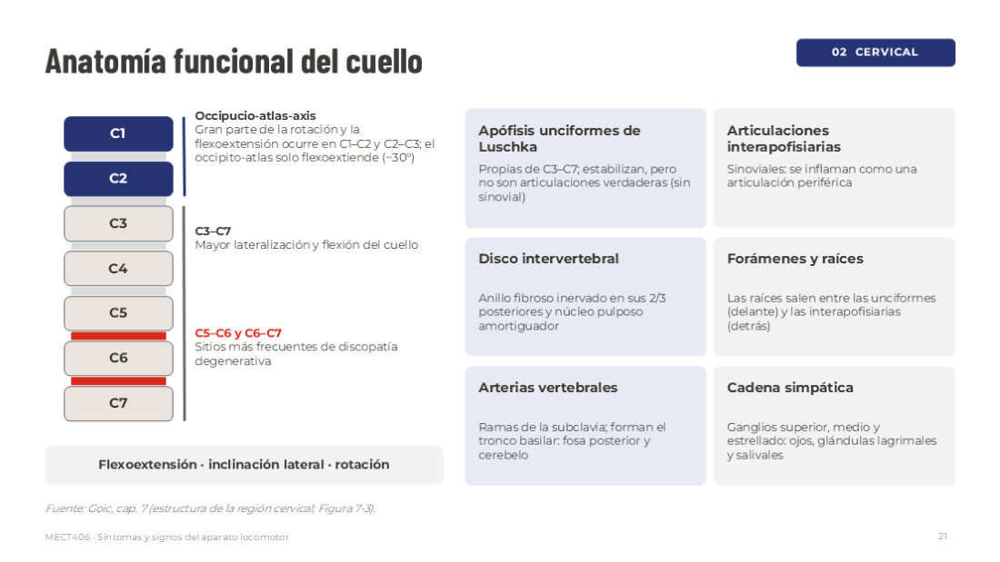
<!-- LOC d. 21 | tipo: esquema | incluir en Word: opcional -->

- [LOC d. 21] Apófisis unciformes de Luschka: no son articulaciones verdaderas. El núcleo pulposo amortigua. Las raíces salen por los forámenes. Las arterias vertebrales irrigan fosa posterior y cerebelo. La cadena simpática llega a ojos y glándulas lagrimales y salivales. Movimientos: flexoextensión, inclinación lateral y rotación; las interapofisarias se inflaman como una articulación periférica.

### Raíces C5 a C8 [LOC d. 22]

| Raíz | Dolor y sensibilidad | Motor | Reflejo |
|---|---|---|---|
| C5 | Hombro y cara lateral del brazo | Deltoides | Bicipital |
| C6 | Antebrazo lateral y pulgar | Bíceps, extensores de muñeca | Estilorradial |
| C7 | Dedo medio | Tríceps, flexores de muñeca | Tricipital |
| C8 | Borde cubital y meñique | Flexores e intrínsecos de la mano | Ninguno |

- [LOC d. 22] Cervicalgia: incluye base del cráneo, hombros, escápulas y tórax alto. La irradiación no radicular es "pesada" o "cansada", occipital, interescapular o al tórax anterior. Truco: pulgar e índice forman un "6" (C6); hacia cubital siguen C7 y C8.

### Anatomía y hernia lumbar [LOC d. 30]

- La médula termina en el borde inferior de L2; debajo está la cauda equina.
- Cada raíz sale bajo su vértebra, delante de las interapofisarias.
- El anillo es más débil atrás: protrusión posterolateral comprime la raíz.
- Sensibles: raíz, interapofisarias, anillo externo, periostio, ligamentos.
- El dolor se localiza mal y suele ser bilateral por anastomosis.

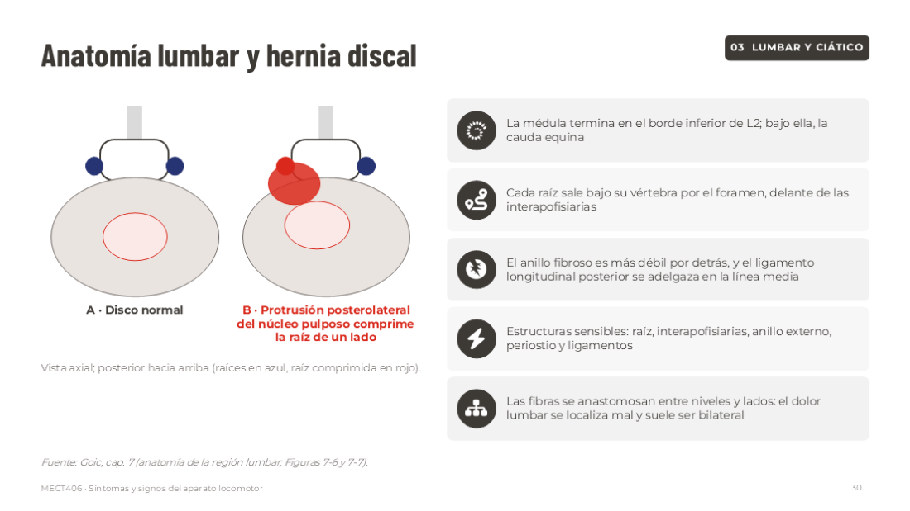
<!-- LOC d. 30 | tipo: esquema | incluir en Word: sí -->

- [LOC d. 30] El ligamento longitudinal posterior se adelgaza en la línea media; la raíz sale por el foramen.

### Raíces L4, L5 y S1 [LOC d. 33]

| Raíz | Sensibilidad | Motor | Reflejo | Prueba |
|---|---|---|---|---|
| L4 | Pierna y maléolo mediales | Cuádriceps, tibial anterior | Rotuliano | Agacharse y pararse |
| L5 | Pierna lateral, dorso del pie, primer ortejo | Extensor del hallux, dorsiflexión | Sin reflejo confiable | Caminar en talones |
| S1 | Borde lateral y planta | Tríceps sural | Aquiliano | Caminar en puntillas |

Hernia L4–L5 suele comprimir L5; L5–S1, la raíz S1.

## Parte B. Síntomas y signos

### Dolor articular y rigidez

#### Definición: nomenclatura y síntomas cardinales

**Nomenclatura** [LOC d. 8]

- **Artralgia:** dolor articular sin inflamación. **Artritis:** dolor con signos inflamatorios.
- **Mialgia:** músculo. **Polialgia:** difuso, articular y vecino. **Entesitis:** inserción tendinosa. **Tendinitis:** tendón. **Bursitis:** bursa.
- Agudo: menos de 4 semanas; crónico: 4 o más.
- Intensidad 1–10: leve, moderado o severo.

**Cuatro síntomas cardinales** [LOC d. 7; cita: tabla 7-2]

| Síntoma | Detalle |
|---|---|
| Dolor | Artralgia, artritis, mialgia, polialgia, entesitis, tendinitis, bursitis |
| Rigidez | Corta: menos de 45 min; larga: más de 45 min ⚠. Se describe como dificultad o torpeza matinal |
| Pérdida de función | Debilidad; impotencia funcional (secuela objetivable) |
| Inflamación | Calor, eritema, aumento de volumen, pérdida funcional |

- UCH separa dolor agudo y crónico en 6 semanas (Goic, en 4). **[UCH, tema 52, p. 338]** **[Goic, p. 140]**

#### Mecanismo: dónde duele indica qué falla [LOC d. 5; cita: Goic, cap. 7, tabla 7-1]

| Estructura | Causas |
|---|---|
| Hueso | Fractura, necrosis ósea aséptica, tumor |
| Cartílago | Artrosis |
| Líquido sinovial | Cristales (gota, seudogota), infección |
| Membrana sinovial | Artritis inflamatoria: AR, mesenquimopatías |
| Tendón | Tendinitis, rotura |
| Bursa | Bursitis |
| Cápsula y ligamentos | Esguince, inestabilidad |
| Entesis | Entesitis: espondiloartritis, psoriasis |

El cartílago no tiene inervación ni irrigación: el dolor nace de sinovial, cápsula, hueso y estructuras periarticulares.

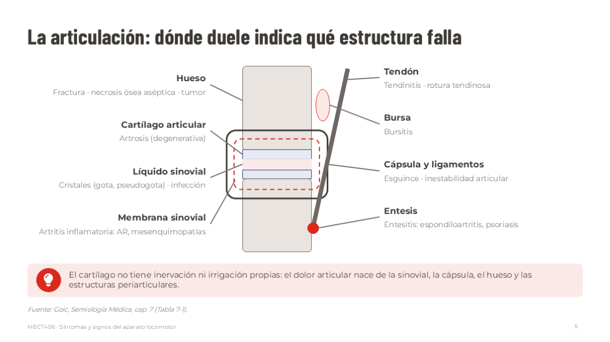
<!-- LOC d. 5 | tipo: esquema | incluir en Word: sí -->

#### Causas

**Monoartritis** [LOC d. 11; cita: tabla 7-3; Stewart 2021; Gessl 2024; QingSong 2024]

| Grupo | Causas |
|---|---|
| Inflamatoria por cristales | Urato (gota), pirofosfato de calcio (seudogota), apatita |
| Inflamatoria infecciosa | Bacteriana, viral, micobacterias, micótica |
| No inflamatoria | Artrosis, necrosis aséptica, tumoral, traumática, mecánica |

- Monoartritis aguda: **descartar infección**; artrocentesis (recuento, Gram, cultivo, cristales).
- Gota: la lámina menciona el doble contorno ecográfico y "exactitud global similar" ⚠.
- Cadera dolorosa del niño: fiebre (OR 6,0), no apoyo (OR 5,2), VHS y leucocitos altos orientan a artritis séptica sobre sinovitis transitoria.

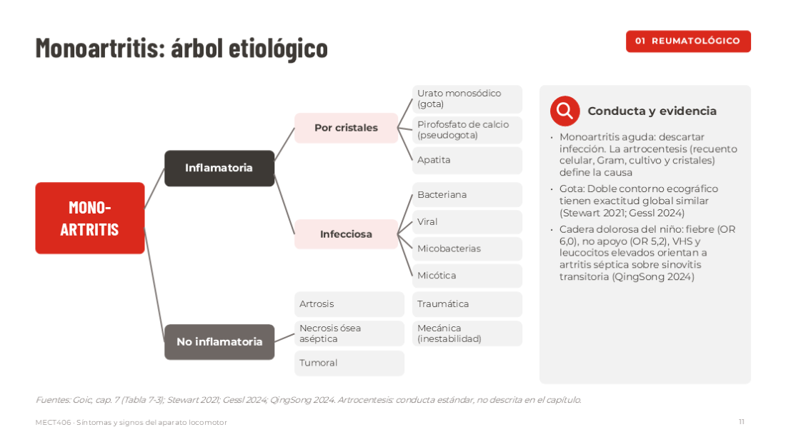
<!-- LOC d. 11 | tipo: árbol | incluir en Word: opcional -->

- [LOC d. 11] La lámina aclara que la artrocentesis es conducta estándar no descrita en el capítulo citado.

**Poliartritis** [LOC d. 12; cita: tabla 7-3; Mehta 2025; De Marco 2023]

| Grupo | Causas |
|---|---|
| Inflamatoria no infecciosa | AR, enfermedad reumática, mesenquimopatías (LES, ES), espondiloartropatías seronegativas, cristales |
| Inflamatoria infecciosa | Postinfecciosa (reactiva), VIH |
| No inflamatoria | Artrosis, osteoartropatía pulmonar, hemofilia |

- Aditiva, simétrica, pequeñas articulaciones de manos y rigidez mayor de 45 min: AR.
- Migratoria: enfermedad reumática.
- Psoriasis asintomática: sinovitis subclínica 2,5 veces más frecuente.
- Artritis psoriática precoz: oligoarticular, precedida de artralgias y entesopatía.

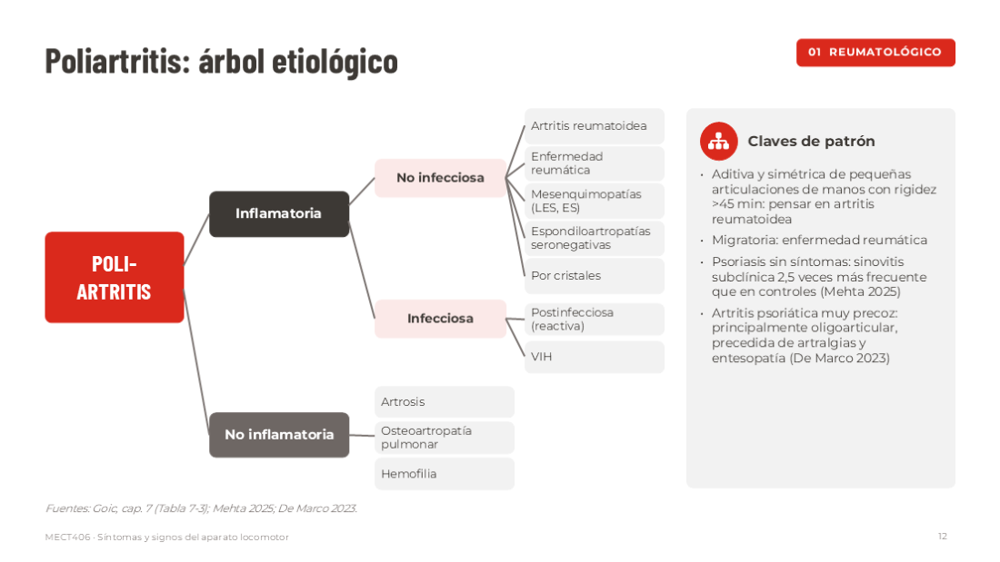
<!-- LOC d. 12 | tipo: árbol | incluir en Word: opcional -->

- Por edad, en la monoartritis: en niños, infección, trauma y hemofilia; 17–50 años, infección, cristales y espondiloartropatías; sobre 50, infección, cristales, artrosis y neoplasia. **[Argente, cap. 32]**
- Poliartritis aguda: virus (VIH, hepatitis B, parvovirus, Epstein-Barr) o bacterias; crónica (más de 6 semanas): artritis reumatoide y lupus. **[UCH, tema 53, p. 346]**

#### Cómo caracterizarlo

**Anamnesis "ALICIA + 3R"** [LOC d. 9; mnemotecnia docente]

| Letra | Variable | Detalle |
|---|---|---|
| A | Aparición | Súbita (cristales, trauma) o paulatina (degenerativa, tumoral) |
| L | Localización | Articular, periarticular o difusa; uni o bilateral |
| I | Intensidad | 1–10 |
| C | Carácter | Sordo, punzante, pesado, lancinante (radicular) |
| I | Irradiación | Radicular o esclerotómica |
| A | Atenuantes y agravantes | Actividad, reposo, movimiento, tos, estornudo |
| R | Ritmo | Diurno o nocturno; rigidez. Dolor nocturno y en reposo alarma: infección, metástasis, fractura osteoporótica |
| R | Repercusión | Limitación diaria, útil para seguimiento |
| R | Revisión por sistemas | Fiebre, peso, piel, ojos, mucosas, intestino, fármacos, familia |

**Número y patrón** [LOC d. 10]

- **Monoartritis:** 1 articulación. **Oligoartritis:** 2 a 4. **Poliartritis:** 5 o más.

| Dimensión | Opciones |
|---|---|
| Evolución | Aditiva (se suman); migratoria (salta y deja indemne la anterior) |
| Tamaño | Grandes (hombro, cadera, rodilla); pequeñas (MCF, IFP, MTF) |
| Topografía | Proximal (hombros, caderas); distal (manos, pies) |
| Simetría | Simétrica o asimétrica |

**Irradiación** [LOC d. 15]

| Rasgo | Radicular | Esclerotómica |
|---|---|---|
| Trayecto | Dermatoma | Difuso |
| Signos | Hipoestesia, parestesias, hiporreflexia, paresia | Ausentes; a veces hiperestesia regional |
| Origen | Compresión (hernia, osteofito) o inflamación de la raíz | Músculo, partes blandas, interapofisarias, periostio, víscera |
| Carácter | Agudo, lancinante, eléctrico | Sordo, profundo |

**Revisión por sistemas** [LOC d. 18]

| Sistema | Hallazgos y asociación |
|---|---|
| Ojo | Sequedad ocular y bucal (Sjögren); uveítis (pelviespondilopatías, Behçet); escleritis |
| Piel | Psoriasis, eritema nodoso, lesiones de LES, esclerodermia, dermatomiositis |
| Mucosas | Úlceras (LES, artritis reactiva, Behçet) |
| Vascular | Raynaud; pulso radial ausente (Takayasu); cefalea frontal (arteritis temporal) |
| Respiratorio | Vía aérea alta (granulomatosis con poliangeítis); fibrosis (ES) |
| Digestivo | Colitis ulcerosa y Crohn con artritis o pelviespondilopatía |
| Neurológico | Signos meníngeos (LES, Behçet); mononeuritis múltiple (vasculitis) |
| General | Compromiso general, fiebre, baja de peso |

Además: fármacos, antecedentes familiares, factores emocionales.

**Fenómeno de Raynaud** [LOC d. 19; cita: Costa 2024]

Secuencia **palidez → cianosis → rubor**; gatillo frío o estrés; ciclo de 5–10 minutos.

- **Primario:** sin enfermedad asociada, sin úlceras ni necrosis.
- **Secundario:** LES, esclerodermia, enfermedad mixta. En ES y mesenquimopatías, bloqueadores de calcio, inhibidores PDE-5 y prostaciclina IV reducen las crisis.

- [LOC d. 19] En la fase de palidez los dedos están fríos, dolorosos, "como muertos"; la cianosis es por estasis y el rubor por hiperemia de reperfusión.
- Primero separar dolor referido (examen articular normal), luego articular o de partes blandas y, si es articular, inflamatorio o mecánico. **[UCH, tema 52, p. 338–339]**
- Contar articulaciones: 1, mono; 2–4, oligo; 5 o más, poliartritis. Definir tamaño, simetría, eje o periferia y si es aditiva o migratoria. **[UCH, tema 53, p. 346]** **[Argente, cap. 32]**
- Evolución orientadora: aguda autolimitada (gota), crónica aditiva (artritis reumatoide, lupus), migratoria (fiebre reumática, gonocócica), recurrente (cristales). **[UCH, tema 52, p. 339–340]**

#### Examen físico: movilidad activa y pasiva [LOC d. 14]

| Activa | Pasiva | Origen | Ejemplos |
|---|---|---|---|
| Disminuida | Disminuida | Articular | Artritis, artrosis |
| Disminuida | Normal | Periarticular | Tendinitis, bursitis |
| Normal | Normal | Referido | Cólico biliar (hombro), infarto (brazo, mandíbula) |

En duda, palpar la zona sensible.

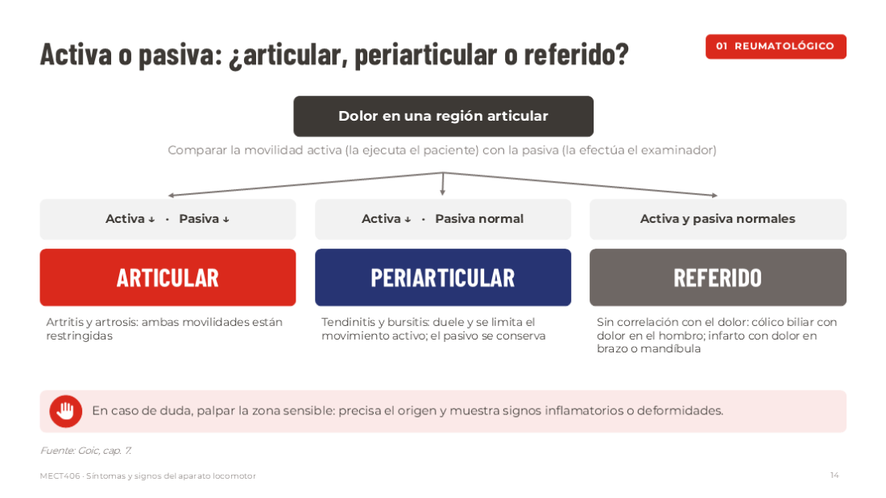
<!-- LOC d. 14 | tipo: algoritmo | incluir en Word: sí -->

- Dolor articular: duele la movilidad activa y pasiva en todos los planos; extraarticular: sobre todo la activa. **[UCH, tema 52, p. 338]** **[Goic, p. 141]**
- Examinar todo el cuerpo: nódulos (Heberden, Bouchard, reumatoides, tofos), piel, ojos. El calor es el signo más útil de artritis; el eritema aparece sobre todo en cristales e infección. **[UCH, tema 52, p. 341]** **[UCH, tema 53, p. 345]**

#### Exámenes de apoyo

- Líquido sinovial: más de 2.000 leucocitos/mm³ indica inflamación; sospechar infección con recuento muy alto, mayoría de polimorfonucleares y glucosa baja. Pedir Gram, cultivo y cristales. **[Argente, cap. 32]** **[UCH, tema 53, p. 345]**

#### Diagnóstico diferencial

**Inflamatorio o mecánico** [LOC d. 13]

| Rasgo | Inflamatorio | Mecánico o degenerativo |
|---|---|---|
| Rigidez matinal | Más de 45 min en AR; 30 min o más en lumbago inflamatorio | Menos de 30 min |
| Reposo | No alivia o empeora | Alivia |
| Actividad | Mejora | Empeora |
| Dolor nocturno | Frecuente, de madrugada | Raro |
| Examen | Calor, eritema, aumento de volumen | Crujido, deformidad, sin calor |
| AINE | Buena respuesta | Variable |
| Ejemplos | AR, espondiloartritis, polimialgia, cristales | Artrosis, tendinopatías, lesiones mecánicas |

**Rigidez según el cuadro** [LOC d. 16; cita: Hemmig 2022]

| Cuadro | Rigidez |
|---|---|
| Artrosis y extraarticulares | Menos de 30 min; cede con movimiento |
| AR | Más de 45 min (criterio diagnóstico) |
| Pelviespondilopatía | Nocturna o de madrugada, dorsal y lumbar; cede parcialmente |
| Polimialgia reumática | Mayores de 55 años; hombros, cuello, caderas y muslos hasta mediodía; buscar arteritis subclínica (23 %) |

Rigidez prolongada + artritis o dolor lumbar nocturno: plantear cuadro inflamatorio.

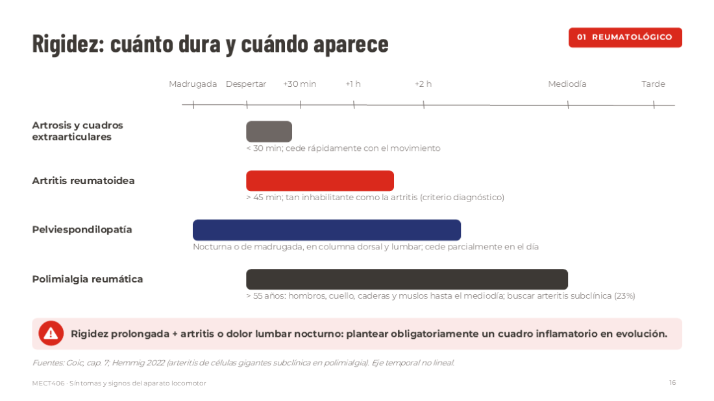
<!-- LOC d. 16 | tipo: línea de tiempo | incluir en Word: sí -->

- [LOC d. 16] En la AR la rigidez es tan inhabilitante como la artritis. En la polimialgia, la arteritis subclínica buscada es la de células gigantes.

**Debilidad: músculo o nervio** [LOC d. 17]

| Grado | Fuerza |
|---|---|
| 0 | Sin contracción |
| 1 | Contracción sin movimiento |
| 2 | Movimiento sin gravedad |
| 3 | Vence la gravedad |
| 4 | Vence resistencia parcial |
| 5 | Normal |

- Preguntar si puede levantarse de la silla o subir un peldaño. Debilidad no es rigidez.
- **Miopatía:** proximal (cinturas, cuello, tronco); disfagia en casos graves; sin trastorno sensitivo.
- **Neuropatía o radiculopatía:** distal, en dermatomas; parestesias, hipoestesia, hiporreflexia, paresia.

#### Signos de alarma

**Signos sistémicos:** úlceras mucosas, púrpura palpable, hiperreactividad vascular, pulsos disminuidos, daño ocular.

- Dolor nocturno y en reposo: infección, metástasis o fractura osteoporótica [LOC d. 9].
- Monoartritis aguda: descartar infección [LOC d. 11].
- Toda monoartritis es infecciosa mientras no se demuestre lo contrario; atención al paciente con poliartritis tratado con corticoides. **[Argente, cap. 32]**

### Dolor cervical y cervicobraquialgia

#### Definición [LOC d. 22]

- **Cervicalgia:** cuello y vecindad (30–50 % de adultos).
- **Cervicobraquialgia:** irradiación al brazo, radicular o esclerotómica.
- Lo más común es irradiación no radicular, que puede simular angina.

#### Causas "DINAMITAR" [LOC d. 23; cita: tabla 7-5]

| Letra | Grupo | Ejemplos |
|---|---|---|
| D | Degenerativas (la más frecuente) | Discales, espondilosis, espondiloartrosis |
| I | Inflamatorias | Pelviespondilopatías, AR |
| N | Neoplásicas | Metástasis |
| A | Arteriales | Insuficiencia vertebrobasilar, disección carotídea |
| M | Musculoligamentosas | Calcificaciones, entesitis, fibromialgia |
| I | Infecciosas | *Salmonella*, estafilococo, TBC, hongos |
| T | Traumáticas | Fracturas, esguince, latigazo |
| A | Ansiedad | Ansiedad, depresión, simulación |
| R | Referidas | Tiroides, faringe, adenopatías, carótida, angina atípica |

- [LOC d. 23] Calcificaciones heterotópicas entre las musculoligamentosas; la categoría A final son causas psicógenas; las infecciones cursan con fiebre y VHS alta.
- Además: tumor de Pancoast (dolor radicular con miosis y ptosis), síndrome del opérculo torácico, lesiones del plexo. **[Goic, p. 145]**
- Dolor irradiado al cuello con movilidad normal: tiroiditis, absceso retrofaríngeo, disección carotídea, angina atípica, adenopatías. **[Goic, p. 145]**

#### Cómo caracterizarlo: seis patrones [LOC d. 24; cita: Fundaun 2022; Hamdan 2025]

| Patrón | Claves |
|---|---|
| Degenerativa | La consulta más frecuente; 75 % de mayores de 65 años con cambios; mala correlación imagen-síntomas; grave si comprime |
| Traumática | Latigazo; esguince en flexión, sobrecarga facetaria en extensión; rasgos neuropáticos en 34 % |
| Inflamatoria | Rigidez y fusión; en AR, subluxación atlantoaxoidea y compresión medular |
| Infecciosa | Dolor intenso, fiebre, leucocitosis, VHS alta; TBC más larvada |
| Neoplásica u osteoporótica | Metástasis; fractura osteoporótica que la simula |
| Por cristales | Hidroxiapatita: febril, simula infección |

- [LOC d. 24] Latigazo: impacto posterior inesperado con flexión-extensión brusca. La infecciosa cursa además con postración. En la inflamatoria hay destrucción ligamentosa C1–C2.

#### Examen físico: maniobras para radiculopatía [LOC d. 27; cita: Lin 2025; Thoomes 2026] ⚠

| Maniobra | Sensibilidad | Especificidad |
|---|---|---|
| Spurling | 0,53 | 0,92 |
| ULNT 1 | 0,70 | 0,71 |
| ULNT combinadas | 0,97 | 0,51 |
| Alivio por abducción | 0,49 | 0,76 |

- **Spurling** (extensión, inclinación al lado sintomático, compresión axial): confirma. La lámina indica LR+ 3,28 y LR− 0,28.
- **ULNT combinadas** negativas (4 pruebas): descartan; certeza muy baja.

- [LOC d. 27] La lámina usa las reglas SpPin (Spurling confirma) y SnNout (ULNT combinadas descartan); el dato de Spurling viene de un metaanálisis.
- Cervicobraquialgia: el dolor aumenta con Valsalva; maniobra de Spurling; explorar dermatomas, fuerza y reflejos. **[UCH, tema 54, p. 349]**

#### Exámenes de apoyo [LOC d. 28]

| Examen | Uso |
|---|---|
| Radiografía | Inicial; sobre 60 años cambios habituales |
| TC | Mejor definición ósea |
| RM | Radiculopatía, mielopatía, infección, absceso, metástasis, esclerosis múltiple |
| Cintigrafía | Lesión destructiva no visible; inespecífica |
| EMG y conducción | Confirma daño, identifica raíz, descarta miopatía |
| Estudio vascular | Síntomas carotídeos o vertebrobasilares |
| Ecografía | Tiroides, tumores, glándulas salivales |

- [LOC d. 28] La RM detecta también absceso peridural; el estudio vascular evalúa el territorio y la severidad de la obstrucción.
- Sobre los 60 años los cambios degenerativos en la radiografía son habituales y no siempre explican el cuadro; resonancia ante compromiso radicular o medular, infección o metástasis. **[Goic, p. 145]**

#### Diagnóstico diferencial

**Médula, raíz o arterias** [LOC d. 25; cita: Peters 2025]

- **Mielopatía:** osteofitos y estrechez; debilidad de extremidades inferiores, marcha inestable, retención urinaria e incontinencia fecal.
- **Insuficiencia vertebrobasilar:** obstrucción parcial (mareo, vértigo, náuseas al rotar); completa (caída súbita). Requiere estudio vascular.
- **Compresión radicular:** osteofitos o hernia; dolor dermatómico y déficit; confirmar con examen y EMG o RM.
- Solo 2 de 19 guías describen tamizaje vascular completo antes de manipular: preguntar mareo, vértigo, cefalea súbita y déficit.

- [LOC d. 25] Oclusión vertebrobasilar completa: pérdida súbita del tono postural. La compresión radicular rara vez se debe a tumor intramedular.

**Dolor que no viene del cuello** [LOC d. 26; cita: Dengler 2022; Yuan 2022]

- **Tumor de Pancoast:** dolor radicular + Horner.
- **Plexo braquial:** trauma directo, compresión o tracción.
- **Opérculo torácico:** síntomas isquémicos y neurológicos al abducir y elevar; definido por consenso.
- Movilidad normal sin puntos dolorosos: pensar en origen extracervical.
- **Referido:** tiroiditis (hasta 16 % en Hashimoto), absceso retrofaríngeo, disección carotídea, angina atípica, adenopatías.

- [LOC d. 26] Horner del tumor de Pancoast: miosis y ptosis por lesión de la cadena simpática. Plexo: p. ej., brazo en hiperabducción durante la anestesia. Opérculo torácico o síndrome del escaleno, sin evidencia de nivel 1.

#### Signos de alarma [LOC d. 24–25]

- Mielopatía, insuficiencia vertebrobasilar y compresión medular por subluxación atlantoaxoidea.
- Antes de manipular, preguntar mareo, vértigo, cefalea súbita y déficit.
- Vértigo o disartria sugieren compromiso vertebral; también dolor nocturno con rigidez, déficit sensitivo o motor y cambios de color o volumen del brazo. **[UCH, tema 54, p. 349]**

*Falta: mecanismo (ver Fundamentos).*

### Dolor lumbar y ciático

#### Definición [LOC d. 31; cita: Bento da Silva 2024]

Dolor lumbar localizado que puede llegar a sacro, glúteos y muslos posteriores, sin carácter radicular. **Agudo:** menos de 4 semanas; intermedio: 4 semanas a 2 meses; **crónico:** más de 2 meses.

- [LOC d. 31] El lumbago crónico se llama reagudizado si hay crisis.

#### Causas [LOC d. 37; cita: tabla 7-7]

| Origen | Causas |
|---|---|
| Partes blandas | Musculoligamentosas, posturales, traumáticas, fibrositis |
| Columna | Degenerativas, fracturas, pelviespondilopatías, infecciones (TBC, absceso), metabólicas (osteoporosis, osteomalacia, hiperparatiroidismo, Paget), neoplasias, malformaciones (listesis, raquiestenosis) |
| Referido | Renal (cólico a genitales, caminar alivia), aórtico (masa pulsátil, soplo, pulsos), retroperitoneal (nocturno, movilidad normal), ginecológico, úlcera duodenal, páncreas |

- [LOC d. 37] Columna: degenerativas discales e interapofisarias; infecciosas bacterianas, TBC y absceso epidural; neoplasias primitivas, metástasis, leucemia, linfoma y mieloma.

#### Cómo caracterizarlo: síndromes lumbosacros [LOC d. 32; cita: tabla 7-6]

| Síndrome | Raíces o causa | Claves |
|---|---|---|
| Cruralgia | L2–L4 | Dolor en muslo, menos fuerza, rotuliano perdido; prono con extensión lo reproduce |
| Lumbociática | L4–S1 | Muslo, pierna y pie; aquiliano ausente, hipoestesia, paresia; Lasègue (+), aumenta con tos |
| Cauda equina (urgencia) | Plexo sacro | Silla de montar, retención urinaria, incontinencia; hernia central, ciática bilateral |
| Claudicación lumbar | Raquiestenosis | Dolor al caminar en ambas piernas, alivio al detenerse; no en reposo ni de noche |

- [LOC d. 32] En la lumbociática el dolor aumenta también con estornudo y defecación.
- Cerca de la mitad mejora en 2 semanas y 90 % en 6; es crónico sobre 12. El 90–98 % es mecánico. **[UCH, tema 54, p. 351]**
- Facetario irradiado (el más frecuente en Chile): glúteo y muslo sin pasar el hueco poplíteo, aumenta con extensión y rotación, examen neurológico normal. Lumbociática: bajo la rodilla. **[UCH, tema 54, p. 351–352]**

#### Examen físico

**Examen y Schober** [LOC d. 39] ⚠

1. **Inspección:** postura, contracturas, escoliosis, movilidad, expansión torácica.
2. **Palpación:** espinosas, paravertebrales, crestas, regiones isquiáticas y trocantéreas.
3. **Movilidad:** flexoextensión; Schober modificado.
4. **Neurológico:** trofismo, fuerza, marcha, reflejos, sensibilidad, elongación.

**Schober modificado:** marcas 10 cm sobre y 5 cm bajo la línea de crestas ilíacas; en flexión debe aumentar al menos 6 cm.

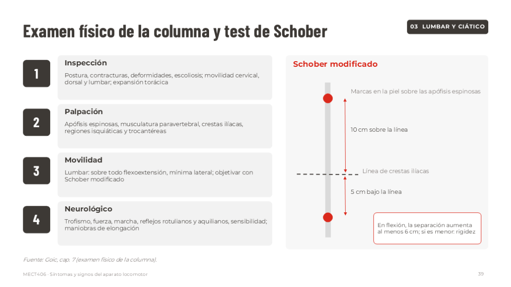
<!-- LOC d. 39 | tipo: esquema | incluir en Word: sí -->

**Maniobras de elongación** [LOC d. 34; cita: Nee 2022]

| Maniobra | Técnica |
|---|---|
| Lasègue | Elevar la pierna extendida en supino |
| Gowers-Bragard | Dorsiflexión del pie |
| Lasègue contralateral | Elevar la pierna sana reproduce el dolor: compresión severa |
| Lasègue sentado | Extender la rodilla sentado |
| Estiramiento femoral | Prono con extensión del muslo (cruralgia) |

Fiabilidad al menos moderada con dorsiflexión; el contralateral es poco reproducible; medir grados no ayuda (error 13°–20°).

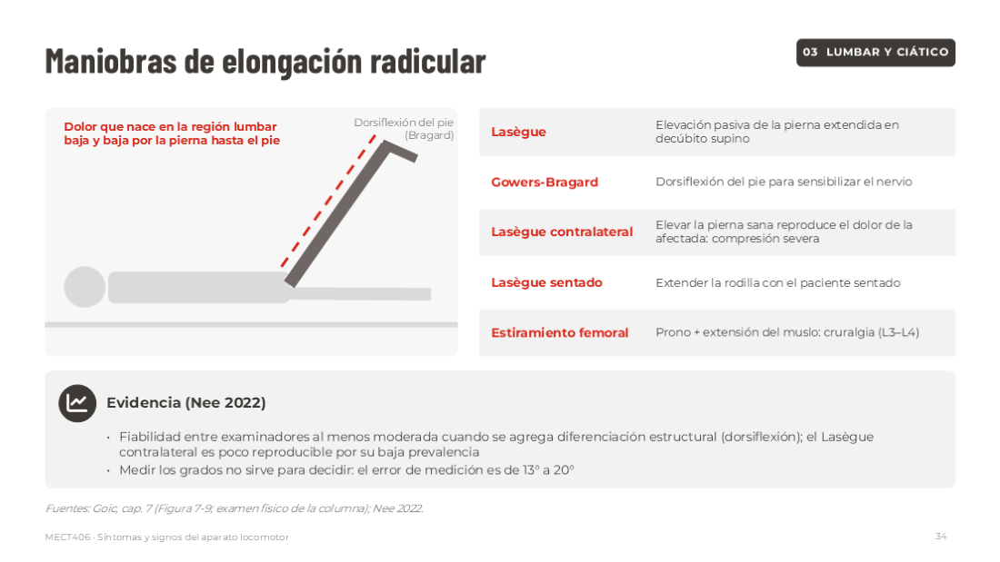
<!-- LOC d. 34 | tipo: esquema | incluir en Word: sí -->

- Lasègue para L4–S1; O'Connell para raíces altas (L2–L4). Pensar en síndrome piriforme. **[UCH, tema 54, p. 352]**

#### Exámenes de apoyo

**Imágenes en el lumbago** [LOC d. 41; cita: Maamari 2023; Belavy 2022]

La mayoría no las necesita al inicio (suele remitir en una semana). **Estudio precoz:** menor de 25 o mayor de 60; trauma; dolor nocturno o persistente; diabetes, nefropatía o neoplasia; signos radiculares.

| Examen | Uso |
|---|---|
| Radiografía | Lesiones óseas o discales crónicas |
| TC | Lesión ósea primaria o metastásica |
| RM | Hernia, canal, infección, médula, sacroilíacas |
| Angio-TC o angio-RM | Aneurisma, páncreas, riñón |
| EMG | Radiculopatía dudosa |
| Laboratorio | Hemograma, VHS, función renal y hepática, orina; electroforesis si hay sospecha de mieloma |

Espondilodiscitis: RM S 90 %, E 72 %; PET/TC S 93 %, E 80 %. Solo educar al clínico no redujo las derivaciones (OR 0,87).

**Glosario radiológico** [LOC d. 40]

Regla: "-osis" es degenerativo; "-itis", inflamatorio o infeccioso.

| Término | Significado |
|---|---|
| Discopatía | Degeneración del disco |
| Espondilosis | Osteofitos ("pico de loro") |
| Espondiloartrosis | Degeneración interapofisaria |
| Raquiestenosis | Estrechez del canal |
| Espondiloartritis | Lesión interapofisaria inflamatoria |
| Sindesmofitos | Puentes óseos en pelviespondilopatías |
| Espondilodiscitis | Infección del disco |
| Listesis | Desplazamiento vertebral |

- [LOC d. 40] La espondilosis es la proliferación ósea que acompaña a la discopatía.
- El dolor agudo simple suele ceder en una semana y no requiere radiografía inicial. TC para hueso; resonancia para nervio, infección y sacroilíacas. **[Goic, p. 150]**
- Según contexto: hemograma, VHS, perfil bioquímico, función renal, orina y electroforesis. **[Goic, p. 150–151]**

#### Diagnóstico diferencial

**Cinco perfiles** [LOC d. 38]

| Perfil | Dolor nocturno o reposo | Rigidez | Movilidad | Irradiación |
|---|---|---|---|---|
| Mecánico | No; con actividad o de pie | Breve | Poco alterada | Esclerotómica |
| Inflamatorio | Sí, de madrugada | 30 min o más | Limitada, Schober reducido | Glúteos |
| Radicular | Puede, por contractura | Variable | Escoliosis antálgica | Dermatoma bajo rodilla |
| Grave | Sí, invalidante | Severa | Muy limitada | Variable |
| Visceral | Variable | No | Conservada, sin puntos dolorosos | Anterior, genitales |

Dolor intenso con movilidad normal: buscar causa visceral.

- [LOC d. 38] Mecánico: movilidad poco alterada pese a radiografía severa. Grave: no puede moverse en la cama.

**Ocho rasgos inflamatorios** [LOC d. 31]

**Ocho rasgos inflamatorios:** menor de 40 años; más de 3 meses; dolor nocturno; peor en la mañana; rigidez de 30 min o más; no alivia con reposo; mejora con actividad; respuesta a AINE.

Sugiere pelviespondilopatía (estudiar sacroilíacas con RM). LR− 0,3: su ausencia reduce la probabilidad; su presencia casi no la aumenta.

- Referido: úlcera duodenal, cólico renal, tumor pancreático, linfoma, aneurisma aórtico roto (masa y pulsos alterados), causas ginecológicas. **[Goic, p. 150]**

#### Signos de alarma

**Banderas rojas "NO TE FÍES"** [LOC d. 35; cita: Williams 2023; Maselli 2022]

| Letra | Bandera |
|---|---|
| N | Neurológico (déficit progresivo, no deambula) y nocturno o en reposo |
| O | Oncológico: cáncer previo, baja de peso, anemia |
| T | Trauma o caída significativa |
| E | Edad menor de 25 o mayor de 60 |
| F | Fiebre o infección reciente |
| Í | Inmunosupresión, diabetes, nefropatía, neoplasia |
| E | Esteroides prolongados |
| S | Silla de montar y esfínteres |

Una sola discrimina poco; para fractura en APS: trauma, edad avanzada y corticoides.

**Cauda equina** [LOC d. 36; cita: Hennessy 2025; Mustafa 2023]

- Sospechar: anestesia en silla de montar, retención o incontinencia urinaria o fecal, ciática bilateral o déficit nuevo.
- **RM urgente**; tacto rectal y residuo posmiccional conservan valor.
- En 110 estudios, síntomas usados para definirla: urinaria 40 %, sensitiva perianal 25,5 %, intestinal 18,2 %. Solo 14,5 % usa una definición establecida.

*Falta: mecanismo (ver Anatomía y hernia lumbar).*

## Parte C. Síndromes

### Lesiones musculoesqueléticas: evaluación general

#### Fisiopatología

**Daño tisular** [LOC d. 44; cita: tabla 7-9]

- **Inflamación traumática:** dolor en el foco, edema, equimosis, hematoma.
- **Pérdida de soporte:** impotencia, deformidad, crujido; cadera en rotación externa.
- **Pérdida articular:** hemartrosis en horas o sinovitis en días, bloqueo, inestabilidad ("bostezo").
- **Complicaciones:** pulsos ausentes o asimétricos, aumento leñoso (compartimental), déficit neurológico o tendinoso, alteraciones tróficas.
- Columna: rigidez refleja; en luxofractura mantener en decúbito dorsal.

- [LOC d. 44] Impotencia inmediata; deformidad marcada en fémur o tibia; la extremidad superior se sostiene con la mano sana. En columna puede haber tortícolis postraumático.

**Edema, equimosis y hematoma** [LOC d. 45]

- Edema aumenta en horas y se estabiliza a las 24 h; equimosis violácea en días, desciende; luego ocre verdosa.
- **Equimosis:** blanda, con fóvea, no fluctuante; su extensión refleja el daño.
- **Hematoma:** sensible y fluctuante; puede crecer y disecar.

- [LOC d. 45] En la reparación ceden dolor, calor y rubor. El hematoma se forma por disrupción de tejidos y vasos perforantes.

#### Clínica (anamnesis): historia del trauma [LOC d. 43; cita: tabla 7-8]

| Elemento | Informa | Detalle |
|---|---|---|
| Energía | Gravedad | Alta energía: riesgo de politrauma |
| Dirección y duración | Mecanismo | Relato y huellas de impacto |
| Otras estructuras | Complicaciones | Médula, urogenital, vasos, nervios |
| Contaminación | Infección | Heridas tetanígenas; articulación o foco expuesto |

**Orden:** todo el paciente → toda la extremidad → fractura o luxación.

- [LOC d. 43] Alta energía: tránsito, caídas de altura, derrumbes, desastres; examen especialmente meticuloso. Heridas tetanígenas: potreros, acequias, alcantarillados, mataderos, basurales. Si penetra articulación o foco de fractura, la infección es desastrosa.

#### Exámenes y criterios: reglas de Ottawa [LOC d. 55; cita: Gomes 2022; Stiell]

| Radiografía | Condición | Más cualquiera de |
|---|---|---|
| Tobillo | Dolor maleolar | Sensibilidad en borde posterior o punta de maléolo (6 cm distales) lateral o medial; no da 4 pasos |
| Pie | Dolor en mediopié | Sensibilidad en base del 5.º metatarsiano o navicular; no da 4 pasos |

Tobillo en adultos: sensibilidad 0,91, especificidad 0,25. Sirve para descartar.

- [LOC d. 55] Datos de 15 estudios y 8560 pacientes; si es positiva no confirma (muchos falsos positivos).

#### Alarma y conducta

**Síndrome compartimental** [LOC d. 46; cita: Lorange 2023]

- Dolor que no cede al inmovilizar; dolor marcado al movilizar pasivamente los dedos; volumen leñoso; déficit y pulsos alterados son tardíos. Evitar yeso cerrado.
- Probabilidad según método: clínica 21 %, presión 29 %, ambas 68 %.

**Inmovilización** [LOC d. 45]

- Inmovilizar con férula, valva o yeso abierto; **nunca yeso cerrado**.

*Falta: definición, causas, diagnóstico diferencial.*

### Esguinces y lesiones de rodilla

#### Definición y grados [LOC d. 47]

| Grado | Lesión |
|---|---|
| I | Distensión |
| II | Rotura parcial |
| III | Rotura completa de cápsula y ligamento |

#### Causas y punto débil según la edad [LOC d. 47]

| Edad | Punto débil |
|---|---|
| Niños hasta 14–16 años | Fisis |
| Jóvenes y adultos | Ligamento: tobillo lateral, colateral medial de rodilla |
| Adultos mayores | Hueso |

#### Examen físico

**Esguinces** [LOC d. 47]

Comparar el bostezo con el lado sano; si siguió la actividad, es menor; un grado III puede ser luxación reducida.

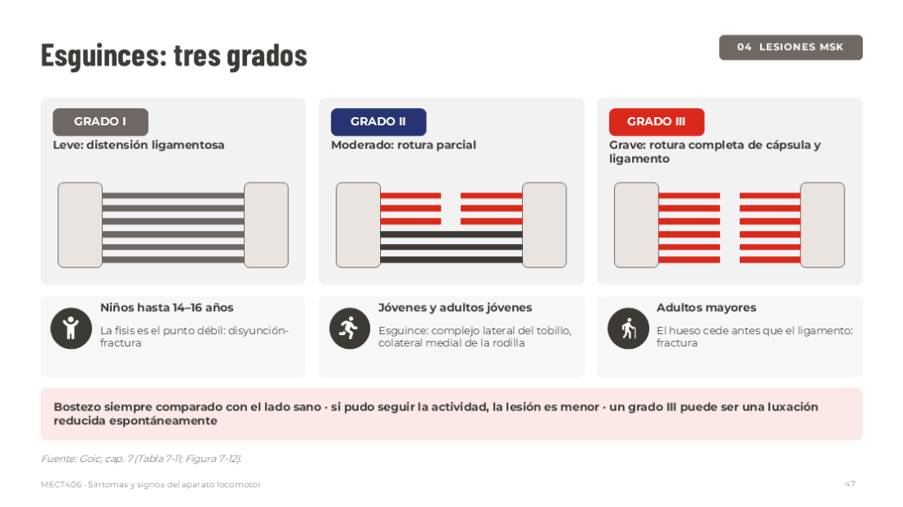
<!-- LOC d. 47 | tipo: esquema | incluir en Word: sí -->

**Rodilla** [LOC d. 48; cita: Sokal 2022; Rana 2026]

| Prueba de LCA | Sensibilidad | Especificidad |
|---|---|---|
| Cajón anterior | 0,83 | 0,85 |
| Lachman | 0,81 | 0,85 |
| *Pivot shift* | 0,55 | 0,94 |
| *Lever sign* | 0,83 | 0,91 |

La lámina propone *pivot shift* para confirmar y *lever sign* para descartar.

**Menisco** [LOC d. 48]

**Menisco:** torsión con pie fijo (jóvenes) o degenerativa; derrame a los 2–3 días, resalte y bloqueos, dolor en interlínea, no puede encuclillarse; flexión forzada con rotación localiza.

| Menisco | Clínica S / E | RM S / E |
|---|---|---|
| Medial | 85 % / 95 % | 90 % / 91 % |
| Lateral | 75 % / 93 % | 81 % / 82 % |

- [LOC d. 48] El Lachman rinde menos de lo que se creía en lesiones posagudas y completas.

*Falta: fisiopatología, exámenes y criterios como apartado (ver rendimiento de la RM en Menisco), diagnóstico diferencial, alarma y conducta.*

### Lesiones de tendones y músculos

#### Causas, clínica y exámenes [LOC d. 49; cita: Aminlari 2021; Peng 2023]

| Lesión | Claves |
|---|---|
| Dedo en martillo | Falange distal caída; radiografía y derivar; férula y cirugía similares |
| Aquiles | "Pedrada"; no camina en puntas; comprimir gemelos no flexiona el pie; ecografía S 95 %, E 99 % |
| Bíceps (porción larga) | Sensación de nervio que se corta; abultamiento |
| Espontáneas | AR o fractura antigua |
| Abiertas | Explorar vaso, nervio y tendón; déficit puede diferirse |

- [LOC d. 49] Martillo: trauma axial con flexión violenta; avulsión ósea. Aquiles: chasquido al iniciar un pique; radiografía normal. Bíceps: infrecuente, por retracción del vientre muscular. Espontáneas: extensor largo del pulgar y extensores de meñique y anular. En heridas de extensores del dorso el déficit puede aparecer días después.

#### Diagnóstico diferencial: desgarro o trombosis [LOC d. 50; cita: Grange 2023]

| Rasgo | Desgarro | Flebotrombosis |
|---|---|---|
| Antecedente | Sin molestias; tirón al correr | Puede haber molestias |
| Inicio | Súbito | Gradual |
| Dolor | Unión del gemelo medial | Línea media, extenso |
| Edema | Cede con reposo nocturno | Cede en parte |
| Equimosis | Días después, distal | Habitualmente ausente |

Más afectados: tríceps sural, bíceps femoral, aductores. En isquiotibiales, cabeza larga del bíceps (70 %) y unión miotendínea (52 %).

*Falta: definición, fisiopatología, alarma y conducta.*

### Lesiones de nervio periférico

#### Clasificación de Seddon [LOC d. 51]

| Tipo | Lesión | Pronóstico |
|---|---|---|
| Neuroapraxia | Mielina; axón indemne | Completa en 3–6 semanas |
| Axonotmesis | Axón y vaina; epineuro conservado | Regenera en 2–6 meses |
| Neurotmesis | Sección total | Sin recuperación espontánea; microcirugía |

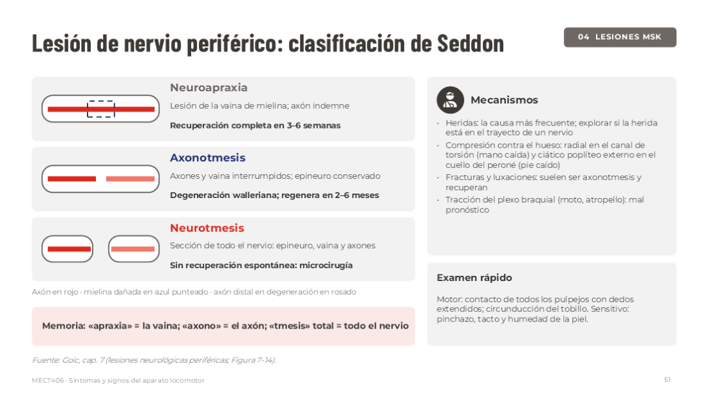
<!-- LOC d. 51 | tipo: esquema | incluir en Word: sí -->

- [LOC d. 51] Axonotmesis: degeneración walleriana. Compresión del radial en el canal de torsión y del ciático poplíteo externo en el cuello del peroné. Tracción del plexo en accidentes de moto o atropello. Mnemotecnia: "apraxia" la vaina, "axono" el axón, "tmesis" total.

#### Causas [LOC d. 51]

- **Mecanismos:** heridas (más frecuente), compresión (radial: mano caída; peroneo: pie caído), fracturas, tracción del plexo braquial (mal pronóstico).

#### Examen físico [LOC d. 51]

- **Examen:** juntar pulpejos con dedos extendidos, circunducir tobillo; pinchazo, tacto y humedad.

*Falta: fisiopatología, clínica como apartado, exámenes y criterios, diagnóstico diferencial.*

### Fracturas y luxaciones

#### Definición [LOC d. 52]

- **Fractura:** solución de continuidad ósea. Tipos: completa, tallo verde, expuesta, conminuta, patológica.
- **Luxación:** desplazamiento articular; subluxación si hay contacto parcial. **Luxofractura:** ambas.

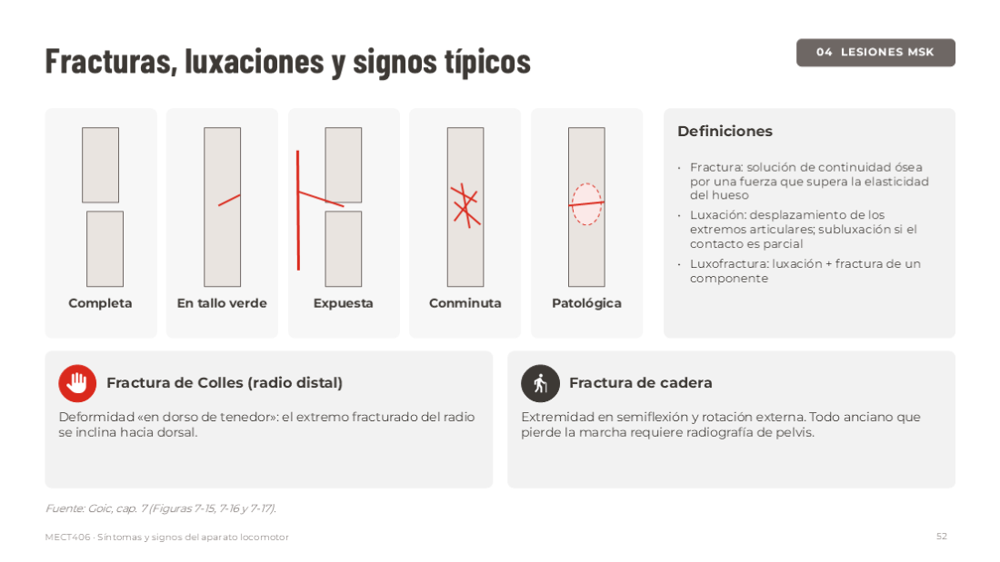
<!-- LOC d. 52 | tipo: esquema | incluir en Word: sí -->

- [LOC d. 52] La fractura ocurre cuando la fuerza supera la elasticidad del hueso; en la luxofractura se fractura un componente.

#### Causas: adulto mayor, hueso patológico y fatiga [LOC d. 54; cita: Ariie 2024; Hoenig 2023]

- **Mayor:** fracturas con trauma mínimo; sobre 75 años, deterioro cognitivo y AVE aumentan caídas. Riesgo de fractura de cadera tras fractura previa: cadera HR 2,86; húmero 2,02; radio 1,66.
- **Patológica:** trauma trivial con gran deformidad; quistes (niños), metástasis (adultos), osteoporosis (ancianos).
- **Fatiga:** carga repetida (metatarsianos 2 y 5, tibia); radiografía inicial normal, callo a las 3–4 semanas. Alto riesgo: cuello femoral, navicular, tibia anterior, quinto metatarsiano.

- [LOC d. 54] Ceden vértebras y metáfisis. Fatiga típica en soldados y deportistas.

#### Clínica y examen físico [LOC d. 52]

- **Colles:** "dorso de tenedor".
- **Cadera:** semiflexión y rotación externa; anciano que pierde la marcha requiere radiografía de pelvis.

- [LOC d. 52] En la fractura de Colles el extremo distal del radio se inclina hacia dorsal.

#### Niño [LOC d. 53; cita: Kappelhof 2022; Shah 2025; Jari 2025]

- Tallo verde: se rompe una cortical. Disyunción fisaria: puede parecer contusión.
- Dolor localizado y no apoya con radiografía normal: tratar como fractura; placas comparativas.
- Signo de almohadilla grasa sin fractura visible: fractura oculta en 44,6 %.

- Manifestaciones musculoesqueléticas: 32 % en leucemia aguda, 30 % en neuroblastoma.

- [LOC d. 53] Tallo verde: hueso elástico y periostio grueso, sin cabalgamiento. Signo de la almohadilla grasa en el codo (supracondílea 43 %). Lactantes y preescolares no relatan ni colaboran; fisis y epífisis cartilaginosas son radiotransparentes. Dolor óseo o artritis puede ser la primera señal de leucemia o neuroblastoma.

#### Alarma y conducta: maltrato [LOC d. 53]

- **Maltrato:** lesiones múltiples, poco claras o repetidas en menores de 2 años: hospitalizar y denunciar. Frenillo roto (LR+ 6,6), hemorragias retinianas (LR+ 11), equimosis en glúteos o cuello.

*Falta: fisiopatología (más allá de la definición), exámenes y criterios como apartado, diagnóstico diferencial.*

## Parte D. Integración

### Algoritmo [LOC d. 56]

| Paso | Si | Evaluar |
|---|---|---|
| ¿Traumatismo? | Sí | Energía y mecanismo; paciente y extremidad; pulsos, nervio, compartimento, herida; Ottawa |
| ¿Columna? | Sí | Banderas rojas; radicular; inflamatorio o mecánico; referido |
| Articular periférico | No es columna | Activa y pasiva; número y patrón; inflamatorio o mecánico; extraarticular |

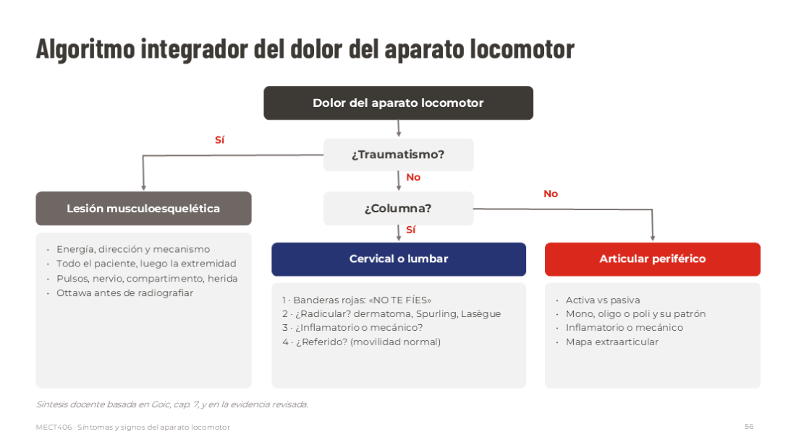
<!-- LOC d. 56 | tipo: algoritmo | incluir en Word: sí -->

## Parte E. Síndromes y diagnósticos de la literatura

> Cuadros y temas que los PPT **no tratan** o **solo nombran**. Van resumidos y separados para no confundirlos con la materia de clase.

### Artrosis *(los PPT la nombran como causa)*

- Degeneración del cartílago, sobre todo en mayores de 50: dolor mecánico, rigidez de menos de media hora; rodillas, cadera, columna, interfalángicas y base del pulgar (rizartrosis). Heberden (distales) y Bouchard (proximales). **[UCH, tema 53, p. 345]**
- **Cadera:** dolor inguinal irradiado a muslo y rodilla, no al trocánter. **[UCH, tema 54, p. 352]**

### Artritis reumatoide *(los PPT la usan solo en la comparación)*

- Mujeres de 30–50 años; poliartritis simétrica de metacarpofalángicas, interfalángicas proximales y muñecas, con rigidez matinal de más de 1 hora; respeta las distales. **[UCH, tema 53, p. 346]**
- Tardíamente ráfaga cubital, cuello de cisne y ojal; nódulos en superficies extensoras. **[UCH, tema 53, p. 346]**
- Factor reumatoide, anti-CCP, VHS y PCR altas; erosiones. Aumenta el riesgo cardiovascular, de infecciones y de pérdida ósea. **[UCH, tema 53, p. 347]**

### Artritis séptica *(los PPT la mencionan como diagnóstico a descartar)*

- Emergencia: mono u oligoartritis aguda en edades extremas, inmunosuprimidos o drogas endovenosas; artrocentesis. Diferenciar de la reactiva (cultivo negativo). **[UCH, tema 53, p. 347]**
- Rodilla la más frecuente; *S. aureus* en adultos, gonococo en sexualmente activos. La radiografía puede ser normal la primera semana. **[Argente, cap. 32]**

### Gota y otros cristales *(los PPT apenas la nombran)*

- Urato; hombres con riesgo vascular, alcohol y carne; fármacos como diuréticos y aspirina. Crisis con máximo en 24 horas que cede en 5–8 días, típicamente podagra; tofos y litiasis en la crónica. **[UCH, tema 53, p. 347]**

### Pelviespondilopatías *(los PPT las mencionan sin desarrollarlas)*

- Espondilitis anquilosante, reactiva, psoriática y asociada a enfermedad intestinal; factor reumatoide negativo. **[UCH, tema 53, p. 347]**
- Lumbago inflamatorio, artritis asimétrica de piernas, entesitis, dactilitis, uveítis; test de Schober. **[UCH, tema 53, p. 348]**
- **Reactiva:** tras infección genitourinaria o intestinal; conjuntivitis, uretritis, queratodermia. **Psoriática:** interfalángicas distales y lesiones de uñas. **[UCH, tema 53, p. 348]**

### Hombro doloroso *(no está en los PPT)*

- Lo habitual es el pinzamiento subacromial: dolor anterolateral, nocturno, arco doloroso 60–120°. Debilidad marcada sugiere rotura del manguito; ecografía de elección. **[UCH, tema 54, p. 349–350]**
- Capsulitis adhesiva: gran limitación activa y pasiva; diabéticos, hipotiroideos, 60–80 años. **[UCH, tema 54, p. 350]**

### Reumatismos de partes blandas de brazo y mano *(no están en los PPT)*

- Epicondilitis lateral (extensores) y medial (flexores); bursitis del olécranon. **[UCH, tema 54, p. 350–351]**
- Túnel carpiano: parestesias nocturnas de tres dedos y medio; Tinel, Phalen. De Quervain: dolor radial, Finkelstein. **[UCH, tema 54, p. 351]**

### Dolor de cadera, rodilla y pie por partes blandas *(no están en los PPT)*

- Tendinitis glútea (dolor lateral), pinzamiento femoroacetabular (inguinal, joven deportista), pubalgia. **[UCH, tema 54, p. 352]**
- Disfunción patelofemoral: primera causa de dolor anterior de rodilla en menores de 40. **[UCH, tema 54, p. 352]**
- Túnel del tarso; fascitis plantar (dolor al primer paso); tendinitis aquiliana, con riesgo de rotura (Thompson). **[UCH, tema 54, p. 353]**

### Polimialgia, fibromialgia y enfermedades del tejido conectivo *(los PPT las tratan solo en parte)*

- Dolor generalizado: fibromialgia, depresión, artrosis difusa, cáncer, hipotiroidismo, hiperlaxitud. **[UCH, tema 52, p. 340]**
- **Lupus:** mujeres jóvenes; eritema malar, úlceras, artritis, riñón, serosas y citopenias. **Polimiositis o dermatomiositis:** debilidad proximal; eritema heliotropo y pápulas de Gottron. **Esclerosis sistémica:** Raynaud, esclerodactilia, disfagia y fibrosis pulmonar. **[UCH, tema 52, p. 344]**

## Anexo de práctica

### Pregunta 1 [LOC d. 2]

Hombre de 64 años, hipertenso mal controlado, con dolor retroesternal súbito, máximo desde el inicio, irradiado a región interescapular y lumbar. PA 190/110 mmHg en brazo derecho y 150/90 en el izquierdo, pulsos femorales débiles, soplo diastólico aórtico nuevo, ECG sin alteración del ST. ¿Diagnóstico más probable?

a) Infarto con supradesnivel del ST · b) Tromboembolismo pulmonar masivo · c) Disección aórtica · d) Pericarditis aguda · e) Neumotórax espontáneo

### Pregunta 2 [LOC d. 3]

Hombre de 58 años, fumador de 40 paquetes-año, con 3 semanas de edema de cara, cuello y tórax alto, yugulares ingurgitadas, circulación colateral torácica y voz bitonal. ¿Qué estructuras explican el cuadro?

a) Vena cava superior y nervio laríngeo recurrente · b) Vena cava inferior y nervio frénico · c) Esófago y conducto torácico · d) Timo y nervio vago · e) Aorta descendente y cadena simpática

### Objetivos [LOC d. 4]

- Caracterizar el dolor y distinguir patrón inflamatorio de mecánico.
- Clasificar el compromiso articular (mono, oligo, poli) y orientar su causa.
- Diferenciar dolor radicular, esclerotómico y referido en columna.
- Reconocer banderas rojas y complicaciones.

## Pendientes por verificar

Las diferencias entre láminas salen del PPT; el resto es revisión mía.

| Dónde | Observación |
|---|---|
| LOC d. 27 | LR+ 3,28 y LR− 0,28 no coinciden con S 0,53 y E 0,92, que darían cerca de 6,6 y 0,51. Pueden venir de análisis distintos; confirmar. |
| LOC d. 39 | En el Schober modificado suele considerarse anormal un aumento menor de 5 cm y usarse la línea de las espinas ilíacas posterosuperiores. La lámina dice 6 cm y crestas, citando a Goic. |
| LOC d. 7, 13, 16, 31 | Los cortes de rigidez (30 y 45 min) y de cronicidad (4 semanas, 2 y 3 meses) cambian según el contexto. Estudiarlos por separado. |
| LOC d. 11 | La frase sobre gota está incompleta: no dice contra qué se compara el doble contorno. |
| LOC d. 2–3 | Preguntas sin respuesta en el PPT; corresponden a temas cardiovasculares y mediastínicos. |
| LOC: Referencias | Hay artículos de 2021 a 2026 citados solo por autor y año. |
| Dolor agudo o crónico | Goic corta en 4 semanas; UCH y Argente, en 6. |
| Nódulos de Bouchard | El texto UCH tiene una errata: corresponden a las interfalángicas proximales. |
| Examen físico segmentario | El tema 55 de UCH describe maniobras por articulación y no se incorporó. |
