# Oftalmología y otorrinolaringología

Fundamentos del Diagnóstico Clínico, Unidad 3.

| Código | Texto original | Fuente |
|---|---|---|
| VOO | [Vascular oftalmologico y otologico](Textos%20originales/Vascular%20oftalmologico%20y%20otologico.md) | PPT "Semiología vascular, oftalmológica y otológica" (Dr. Miguel Yáñez Martínez, primavera 2026). Bibliografía que declara: Goic A, Chamorro G, Reyes H. *Semiología Médica*, 4.ª ed., Mediterráneo, 2018, caps. 10, 11 y 12. |
| Goic | *Semiología médica*, caps. 11 y 12 | Página impresa. |
| UCH | Manual de Semiología UCH, temas 21 y 22 | Página impresa; el tema 21 se leyó en parte. |
| Argente | Argente y Álvarez, cap. 27 | Extractos; sin número de página. |

> **Cómo leer:** [DIG d. 7] indica el PPT (código) y la diapositiva. "Cita:" copia la referencia de la lámina, sin contrastarla. † marca texto oculto o cortado en la lámina. ⚠ remite a la sección final de pendientes. La línea *Falta* indica apartados que los PPT no desarrollan o que no tienen espacio propio. Lo marcado **[Goic, p. N]**, **[UCH, tema, p. N]** o **[Argente, cap.]** es complemento de los libros, resumido con otras palabras.

**Siglas:** EEII (extremidades inferiores); HTA (hipertensión arterial); LES (lupus eritematoso sistémico); D (dioptría); PRK (queratectomía fotorrefractiva); LASIK (queratomileusis in situ asistida con láser); LIO (lente intraocular); AV (agudeza visual); ATM (articulación temporomandibular); LCR (líquido cefalorraquídeo).

## Mapa del tema

- **Síntomas y signos:** Vicios de refracción y presbicia; Ojo rojo; Síntomas cardinales del oído; Otalgia y otorrea; Hipoacusia; Vértigo y tinnitus.
- **Síndromes:** Glaucoma agudo; Queratitis e iritis.
- **Solo en la literatura o apenas nombrados (Parte E):** Patología de párpados; Estrabismo y ambliopía; Examen pupilar y síndrome de Horner; Alteraciones del campo visual; Desprendimiento de vítreo y de retina; Otitis externa; Otitis media aguda, crónica y con efusión; Vértigo postural paroxístico benigno y Ménière.

## Parte A. Fundamentos

### Bases ópticas [VOO d. 16]

- **Emetropía:** enfoca en la retina los rayos paralelos (5 m o más) sin acomodar.
- **Acomodación:** el músculo ciliar aumenta la curvatura del cristalino.
- **Dioptría:** D = 1 / f (m); leer a 0,33 m exige 3 D.
- **Ametropía:** vicio de refracción. **Anisometropía:** distinta refracción entre ojos.
- Clínica: visión borrosa, astenopía, menor AV.

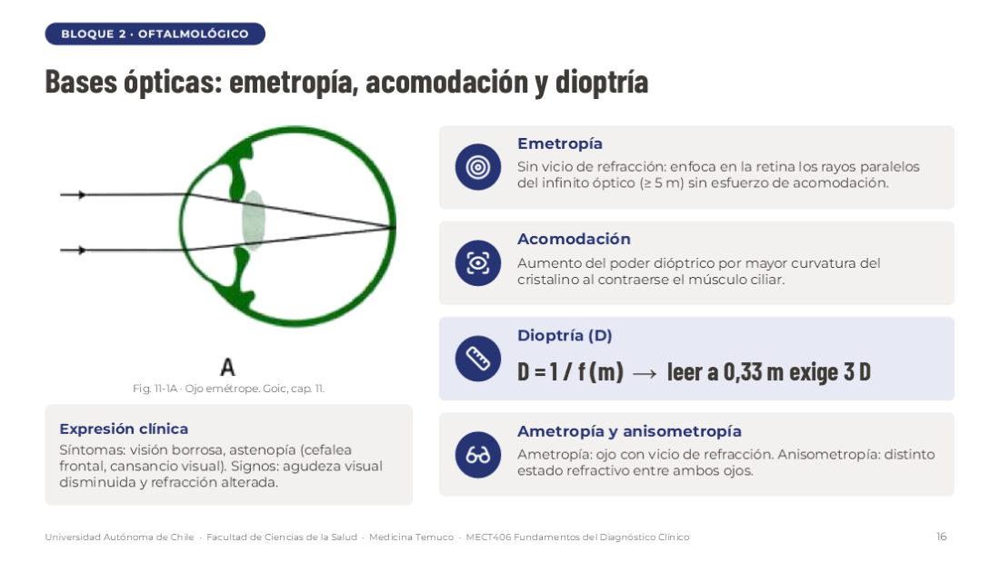
<!-- VOO d. 16 | tipo: esquema (fig. 11-1A) | incluir en Word: opcional -->

- [VOO d. 16] La astenopía es cefalea frontal y cansancio visual.

## Parte B. Síntomas y signos

### Vicios de refracción y presbicia

#### Definición

- Vicio de refracción: ametropía [VOO d. 16].
- Presbicia: no es vicio de refracción; es el agotamiento de la acomodación [VOO d. 18].

#### Causas, clínica y corrección

**Vicios de refracción** [VOO d. 17]

| Rasgo | Miopía | Hipermetropía | Astigmatismo |
|---|---|---|---|
| Foco | Delante de la retina | Detrás | Sin foco único |
| Causa | Ojo largo o exceso de poder | Desajuste; a veces ojo pequeño | Curvatura corneal asimétrica |
| Clínica | Ve mal de lejos; más de 6 D es alta, riesgo retinal | Peor de cerca, astenopía | Grande: menor AV; pequeño: astenopía |
| Lente | Esférico negativo | Esférico positivo | Cilíndrico o tórico |

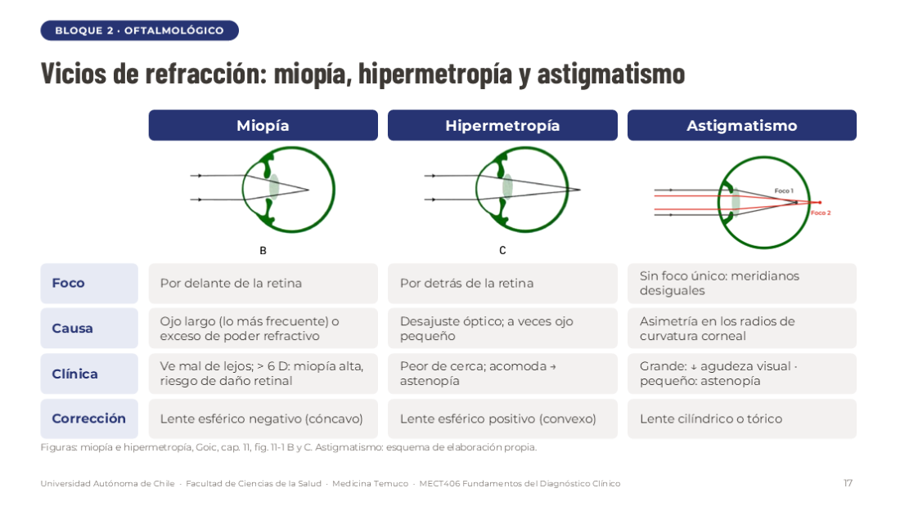
<!-- VOO d. 17 | tipo: esquema | incluir en Word: sí -->

- [VOO d. 17] Lente negativo cóncavo, positivo convexo; en el astigmatismo hay meridianos desiguales.

**Presbicia y síndrome visual por computador** [VOO d. 18]

- **Presbicia:** no es vicio de refracción; se agota la acomodación (cerca de los 40 años). Lentes positivos de cerca, bifocales o multifocales.
- **Por computador:** menos parpadeo y acomodación sostenida; cefalea, visión borrosa, dolor cervical, ojo rojo y seco, fatiga, diplopía, mareo, dificultad para reenfocar. Medidas: parpadear, lágrimas artificiales, mirar lejos.

- [VOO d. 18] La persona aleja la lectura. Corregir considerando defecto de lejos, edad y ocupación. Agravan la mala iluminación y las corrientes de aire.

#### Examen y tratamiento [VOO d. 19]

- **Objetivos:** retinoscopía, autorrefractómetro (sobredimensiona la miopía).
- **Subjetivo:** montura o foróptero, un ojo a la vez; indispensable salvo en quien no colabora.
- Niños: cicloplejía (ciclopentolato, tropicamida, atropina).
- **Excimer:** refracción estable, 20–25 años o más; PRK (superficie), LASIK (estroma).
- **Intraocular:** LIO fáquico o extracción de cristalino con LIO multifocal.

- [VOO d. 19] Subjetivo con optotipos. Lentes: anteojos o de contacto sobre la córnea. Atropina solo ocasionalmente. LASIK se hace bajo un colgajo; el excimer requiere córnea apta.

#### Cómo caracterizarlo

- Astigmatismo: contornos dobles, mala visión de cerca y lejos; hipermetropía: de cerca (aleja y entrecierra los ojos); miopía: de lejos. **[UCH, tema 21, p. 134]**
- Miopía: hay un punto cercano nítido, más cercano mientras más alta. **[Goic, p. 175]**

#### Examen físico

- Medir agudeza visual de cada ojo, de cerca y de lejos, con y sin lentes, con cartilla de Snellen (a 6 m) o «E»; figuras en menores de 3 años. Si no ve optotipos: cuenta dedos, movimiento de manos, luz. **[UCH, tema 21, p. 133–134]**
- Agujero estenopeico: si la visión mejora, sugiere vicio de refracción. **[UCH, tema 21, p. 134]**

| Agudeza visual **[UCH, tema 21, p. 134]** | Valor |
|---|---|
| Normal | 1 a 0,3 |
| Discapacidad visual | Menor de 0,3 |
| Ceguera (OMS) | Menor de 0,05 |
| Ceguera legal en Chile | Menor de 0,1 (20/200) |

#### Signos de alarma

- Una pérdida aguda de visión obliga a pensar en urgencias: desprendimiento de retina, glaucoma, causas vasculares retinales o neuropatía óptica. **[UCH, tema 21, p. 133]**

*Falta: diagnóstico diferencial.*

### Ojo rojo

#### Definición [VOO d. 20]

Hiperemia de la parte expuesta del ojo (conjuntiva, epiesclera, esclera).

#### Causas [VOO d. 20]

| Estructura | Cuadro | Gravedad |
|---|---|---|
| Conjuntiva | Conjuntivitis (la más frecuente) | Habitualmente benigna |
| Córnea | Queratitis, erosión, úlcera, cuerpo extraño | Potencialmente grave |
| Esclera | Escleritis (rara, sensible, vasculitis) | Potencialmente grave |
| Iris y cuerpo ciliar | Iritis, iridociclitis | Potencialmente grave |
| Cámara anterior estrecha | Glaucoma agudo | Máxima urgencia |

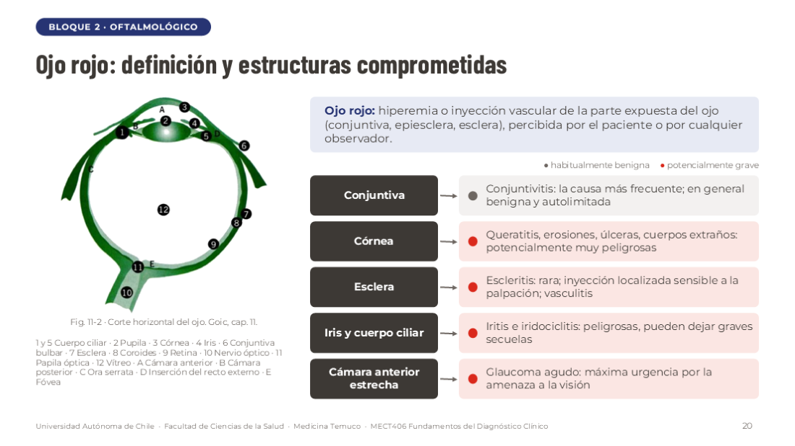
<!-- VOO d. 20 | tipo: esquema numerado (fig. 11-2) | incluir en Word: opcional -->

- [VOO d. 20] Leyenda de la figura: cuerpo ciliar, pupila, córnea, iris, conjuntiva bulbar, esclera, coroides, retina, nervio óptico, papila, vítreo, cámaras anterior y posterior, ora serrata, inserción del recto externo, fóvea.

**Causas no graves** [VOO d. 24]

| Cuadro | Claves |
|---|---|
| Conjuntivitis aguda | Ardor, ojo pegado, sin dolor ni visión borrosa; antibiótico tópico si infecciosa; prurito y quemosis si alérgica |
| Oftalmía neonatal (excepción grave) | Gonocócica hasta demostrar lo contrario |
| Hemorragia subconjuntival | Mancha localizada, tras Valsalva; se reabsorbe en unos 10 días |
| Orzuelo | Absceso doloroso en la pestaña; calor y antibiótico |
| Chalazión | Granuloma de Meibomio, quístico; suele requerir excisión |

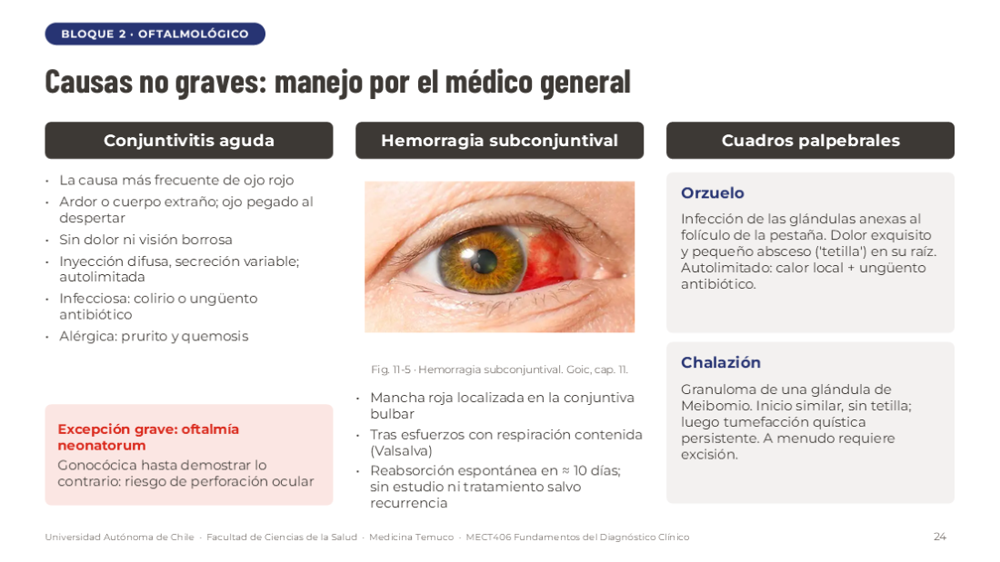
<!-- VOO d. 24 | tipo: fotos y texto (fig. 11-5) | incluir en Word: opcional -->

- [VOO d. 24] Orzuelo: glándulas anexas al folículo de la pestaña, absceso en "tetilla". Hemorragia subconjuntival: estudiar solo si recurre.

#### Cómo caracterizarlo [VOO d. 21]

| No graves | Graves: derivar |
|---|---|
| Secreción, legañas | Visión borrosa que no cede al parpadear |
| Ardor, arenilla | Dolor ocular verdadero |
| Prurito (alérgica) | Fotofobia |
| Síntomas respiratorios altos | Halos de colores |

- **Superficial** (inyección conjuntival): periférico, respeta el limbo; sin dolor, fotofobia ni baja de visión. **Profundo** (ciliar): anillo periquerático. **[UCH, tema 21, p. 140]** **[Argente, cap. 27]**
- La visión borrosa que no cede al parpadear nunca se ve en la conjuntivitis sin compromiso corneal. **[Goic, p. 178]**

#### Examen físico [VOO d. 22]

Herramientas: tabla de Snellen, linterna oblicua, fluoresceína, anestésico (solo para examinar), lupa. Comparar con el ojo sano.

**Inyección conjuntival o ciliar** [VOO d. 23]

| Rasgo | Conjuntival | Ciliar |
|---|---|---|
| Distribución | Difusa, bulbar y palpebral | Anillo violáceo periquerático |
| Significado | Conjuntivitis | Queratitis, iridociclitis, glaucoma |

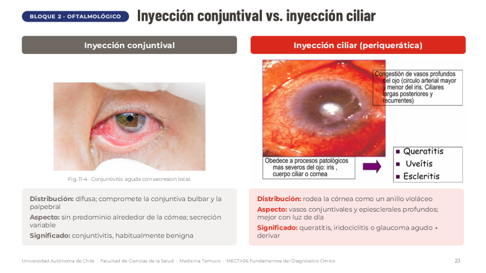
<!-- VOO d. 23 | tipo: fotos | incluir en Word: sí -->

- [VOO d. 23] La ciliar son vasos profundos, se ve mejor con luz de día; la figura la asocia a queratitis, uveítis y escleritis.

- [VOO d. 22] Fluoresceína tiñe defectos epiteliales. Cámara estrecha: con luz lateral la mitad opuesta del iris queda en sombra. Ojo duro: palpación bidigital. Proptosis: órbita o seno cavernoso.
- Basta agudeza visual y linterna oblicua, con fluoresceína, anestésico y lupa si hay; comparar con el ojo sano. **[Goic, p. 178]**

#### Diagnóstico diferencial

Distinguir causas graves de no graves (tablas anteriores) y ver las fichas Glaucoma agudo y Queratitis e iritis.

| Rasgo **[UCH, tema 21, p. 141]** | Glaucoma agudo | Iridociclitis | Conjuntivitis | Hemorragia subconjuntival |
|---|---|---|---|---|
| Secreción | No | No | Sí | No |
| Visión | Mala | Regular o mala | Normal | Normal |
| Dolor | Intenso | Moderado | Urente | No |
| Córnea | Opaca | Puede estar edematosa | Normal | Normal |
| Pupila | Midriática ⚠ | Miótica | Normal | Normal |

| Conjuntivitis **[UCH, tema 21, p. 140]** | Prurito | Secreción | Adenopatía | Reacción |
|---|---|---|---|---|
| Viral (la más frecuente) | No | Acuosa | Común | Folicular |
| Bacteriana (más en niños) | No | Purulenta | Inusual | Papilar |
| Alérgica | Intenso | Mucosa o acuosa | No | Papilar |

#### Signos de alarma [VOO d. 22]

1. Menor AV
2. Inyección ciliar
3. Brillo corneal alterado u opacidad
4. Pupila alterada
5. Cámara anterior estrecha
6. Ojo duro
7. Proptosis (causa más frecuente: distiroidismo)

**Un solo signo basta para derivar.**

**Algoritmo** [VOO d. 27]

Sin signos de peligro: manejo general. Con signos: derivar (glaucoma, inmediato; queratitis e iritis, precoz).

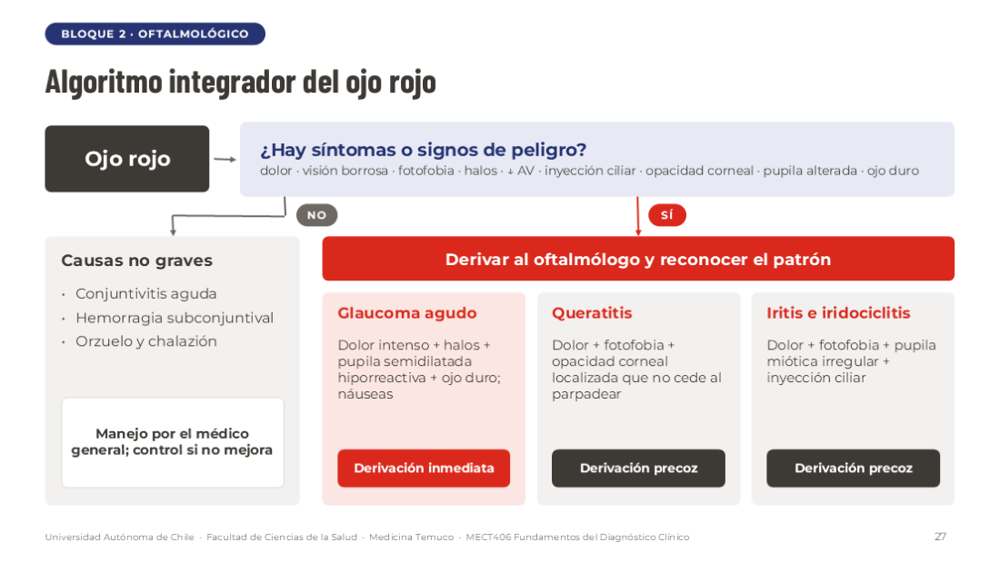
<!-- VOO d. 27 | tipo: algoritmo | incluir en Word: sí -->

- Derivar con urgencia la conjuntivitis neonatal, hiperaguda purulenta, dolorosa, con baja de visión, fotofobia, anillo periquerático o sin resolver en 2 semanas. **[UCH, tema 21, p. 140]**
- No indicar colirios con corticoides (agravan infecciones como la herpética; glaucoma, cataratas) ni anestésicos (daño corneal). **[Goic, p. 181]**

*Falta: mecanismo, exámenes de apoyo (más allá de los usados en el examen).*

### Síntomas cardinales del oído

#### Definiciones [VOO d. 29]

| Síntoma | Definición |
|---|---|
| Otalgia | Dolor de oído, verdadero o reflejo |
| Otorrea | Descarga por el conducto |
| Hipoacusia | Menor audición |
| Vértigo | Ilusión de giro |
| Tinnitus | Zumbido |

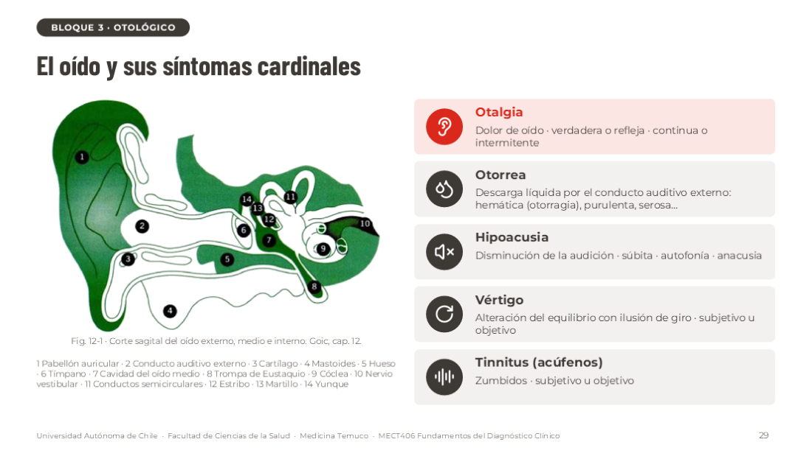
<!-- VOO d. 29 | tipo: esquema numerado (fig. 12-1) | incluir en Word: opcional -->

- [VOO d. 29] Leyenda de la figura: pabellón, conducto auditivo externo, cartílago, mastoides, hueso, tímpano, oído medio, trompa de Eustaquio, cóclea, nervio vestibular, conductos semicirculares, estribo, martillo, yunque. El tinnitus se llama también acúfeno.

### Otalgia y otorrea

#### Causas

**Otalgia verdadera** [VOO d. 30; tabla 12-2]

| Frecuentes | Menos frecuentes |
|---|---|
| Otitis externa difusa, forúnculo, cuerpo extraño, otitis media | Trauma, laceración, fractura del peñasco, tumores |

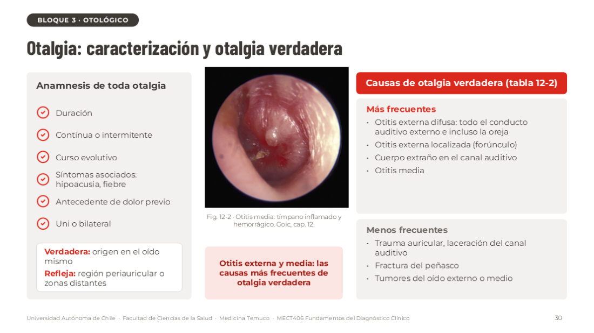
<!-- VOO d. 30 | tipo: otoscopía (fig. 12-2) | incluir en Word: sí -->

**Otalgia refleja** [VOO d. 31]

| Origen | Causas |
|---|---|
| Boca | Infección dental, glositis, estomatitis |
| Faringe | Faringitis, amigdalitis, absceso, postamigdalectomía, neoplasia |
| ATM | Disfunción: "agua en el oído" |
| Laringe e hipofaringe | Epiglotitis, laringitis, neoplasia, artritis cricoaritenoidea |
| Esófago | Esofagitis, cuerpo extraño |
| Cuello y nervios | Tiroiditis, aneurisma carotídeo, neuralgias (V, geniculado, IX, esfenopalatino) |

- [VOO d. 31] Faringe: absceso periamigdalino, postamigdalectomía, neoplasia de tonsila. Laringe: neoplasia supraglótica o de seno piriforme. Neuralgias: trigémino, geniculado, glosofaríngeo, esfenopalatino.
- Otras causas reflejas: columna cervical y reflujo gastroesofágico. **[UCH, tema 22, p. 142]**

#### Cómo caracterizarlo

**Anamnesis:** duración, continuidad, curso, hipoacusia y fiebre, episodios previos, lateralidad.

No suele haber hipoacusia; pedir que señale el dolor; **examinar siempre hipofaringe y laringe**.

**Otorrea** [VOO d. 32]

- Otorrea: hemática, purulenta, serosa, ceruminosa, acuosa, serohemática, mucopurulenta, clara, con manchas negras. Causa común: otitis.
- Preguntar irradiación, intensidad, evolución, agravantes y lado. Orientan: piscina (otitis externa), resfrío (media), avión o buceo (barotrauma), alergia (efusión). **[UCH, tema 22, p. 142]**
- Hipoacusia sugiere otalgia primaria; fiebre, otitis media o mastoiditis. **[UCH, tema 22, p. 142]**

#### Herpes zóster [VOO d. 32]

- Zóster: otalgia intensa; vesículas en conducto y pabellón. Con parálisis facial: **Ramsay Hunt**.

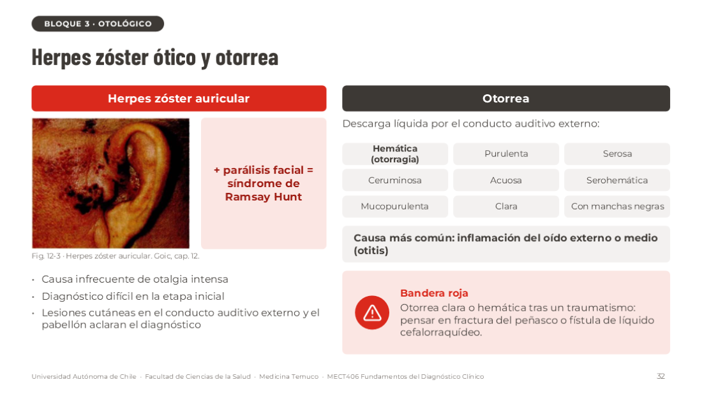
<!-- VOO d. 32 | tipo: foto (fig. 12-3) | incluir en Word: sí -->

#### Examen físico

- Otoscopía traccionando el pabellón arriba y atrás (en niños, atrás y abajo); el cono luminoso normal está en el cuadrante anteroinferior. **[UCH, tema 22, p. 142]**
- Dolor al movilizar la oreja o presionar el trago: otitis externa; dolor retroauricular: puede ser otitis media. **[Argente, cap. 27]**

#### Signos de alarma [VOO d. 32]

- **Bandera roja:** otorrea clara o hemática tras trauma (fractura del peñasco o fístula de LCR).
- Baja de peso obliga a sospechar neoplasia. **[UCH, tema 22, p. 142]**

*Falta: definición propia (ver Síntomas cardinales), mecanismo, exámenes de apoyo.*

### Hipoacusia

#### Definición [VOO d. 29, 33]

Menor audición. **Anacusia:** pérdida total. **Autofonía:** resonancia de la propia voz.

#### Mecanismo

- **Transmisión:** oído externo o medio. **Sensorioneural:** desde el órgano de Corti a la corteza. **[UCH, tema 22, p. 144]**

#### Causas y examen físico [VOO d. 33]

| Prueba o rasgo | Conductiva | Neurosensorial |
|---|---|---|
| Sitio | Oído externo o medio | Cóclea o nervio |
| Causas | Cerumen, otitis, perforación | Presbiacusia, ruido, ototóxicos, sordera súbita |
| Weber | Lateraliza al afectado | Lateraliza al sano |
| Rinne | Negativo (ósea > aérea) | Positivo (aérea > ósea, ambas disminuidas) |

- [VOO d. 33] Weber: diapasón en el vértex. Rinne: mastoides frente a conducto. Conductiva por tapón de cerumen; autofonía en disfunción tubaria.
- Transmisión: cerumen, cuerpo extraño, otoesclerosis, otitis. Sensorioneural: presbiacusia, neurinoma del acústico, ototóxicos (aminoglucósidos), ruido. **[UCH, tema 22, p. 144–145]**

#### Cómo caracterizarlo

- Edad de inicio, progresión, lateralidad (bilateral: presbiacusia; unilateral reciente: buscar tumor), acompañantes, ruido, fármacos, familia e impacto. Pérdida total: cofosis. **[UCH, tema 22, p. 144]**

#### Examen físico

- Weber (diapasón en la línea media): sin lateralizar es normal o simétrica; lateraliza al enfermo en la de transmisión y al sano en la sensorioneural. **[UCH, tema 22, p. 144]**
- Rinne (mastoides y luego junto al oído): positivo (aérea mejor) es normal o sensorioneural; negativo, de transmisión. **[UCH, tema 22, p. 145]**

#### Signos de alarma [VOO d. 33]

- **Sordera súbita** (neurosensorial en 72 h o menos): derivación urgente.
- Inicio súbito o progresión rápida. **[UCH, tema 22, p. 144]**

*Falta: exámenes de apoyo (más allá de Weber y Rinne), diagnóstico diferencial como apartado.*

### Vértigo y tinnitus

Ver también: [vértigo periférico o central](09%20Neurologico%20y%20neuropsiquiatrico.md).

#### Definición

- Vértigo: falsa sensación de movimiento propio o del entorno, habitualmente rotatoria; el mareo es vaivén o inestabilidad, inespecífico. **[UCH, tema 22, p. 146]**

#### Causas

- **Periférico** (cerca de 85 %): vértigo postural paroxístico, Ménière, neuronitis, neurinoma, laberintitis. **Central:** tumores de tronco o cerebelo, trauma, ACV. **[UCH, tema 22, p. 147]**

#### Cómo caracterizarlo [VOO d. 34]

- Vértigo subjetivo (gira la persona) u objetivo (gira el entorno). Diferenciar de inestabilidad y presíncope; signos focales: origen central.
- Tinnitus subjetivo (el más frecuente) u objetivo (audible, p. ej. pulsátil). Estudiar si es unilateral, pulsátil o con hipoacusia asimétrica.

- [VOO d. 34] La plenitud ótica, con hipoacusia y tinnitus, orienta a origen laberíntico.
- Por tiempo: episódico recurrente (segundos a minutos), agudo (menos de 48 h), crónico o agudo recurrente; buscar gatillantes. **[UCH, tema 22, p. 146–147]**

| Nistagmo **[UCH, tema 22, p. 148]** | Periférico | Central |
|---|---|---|
| Dirección | Horizontal-rotatorio, fase rápida al lado sano | Cualquiera, incluida vertical |
| Al fijar la mirada | Disminuye o desaparece | No cambia o aumenta |
| Ley de Alexander | Se cumple | No se cumple |

#### Signos de alarma

- Sugieren ACV: inicio brusco con riesgo cardiovascular, focalidad, compromiso de conciencia, diplopía, disartria, inestabilidad intensa, cefalea nueva grave. Fiebre y otalgia intensa: laberintitis. **[UCH, tema 22, p. 147]**

*Falta: mecanismo, examen físico, exámenes de apoyo.*

## Parte C. Síndromes

### Glaucoma agudo

#### Fisiopatología [VOO d. 25]

- **Mecanismo:** cámara estrecha (mayores de 50) → midriasis → el iris obstruye el trabéculo → alza de presión → isquemia del nervio óptico → ceguera en horas.

#### Clínica (anamnesis) [VOO d. 25]

- **Síntomas:** dolor intenso o cefalea, visión borrosa, halos; pueden dominar náuseas, vómitos y dolor abdominal.

- [VOO d. 25] La midriasis ocurre en penumbra o por colirio midriático. Dolor ocular y periorbitario; casi nunca es simultáneo en ambos ojos.

#### Examen físico [VOO d. 25]

- **Signos:** menor AV, inyección ciliar, córnea edematosa, pupila semidilatada ovalada hiporreactiva, ojo duro.

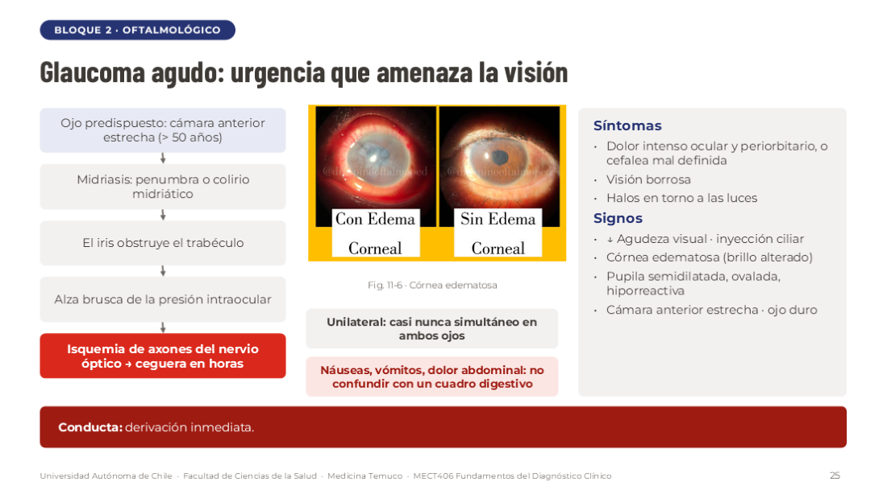
<!-- VOO d. 25 | tipo: esquema y foto (fig. 11-6) | incluir en Word: sí -->

#### Exámenes y criterios

- Argente exige medir la presión intraocular: su aumento confirma el diagnóstico. **[Argente, cap. 27]**

#### Alarma y conducta [VOO d. 25]

- Unilateral. **Derivación inmediata.**
- Si el oftalmólogo no puede atender en una hora, iniciar: pilocarpina 2 % cada 15 minutos, acetazolamida 500 mg oral y eventualmente manitol IV. **[Goic, p. 181]**
- Luego iridectomía o iridotomía con láser en ambos ojos. **[Goic, p. 181]**

*Falta: diagnóstico diferencial como apartado.*

### Queratitis e iritis

#### Clínica, signos y causas [VOO d. 26]

| Rasgo | Queratitis | Iritis o iridociclitis |
|---|---|---|
| Síntomas | Dolor, fotofobia, visión borrosa | Dolor, fotofobia, visión borrosa |
| Signos | Opacidad que no cede, inyección ciliar; lesión dendrítica en herpes | Pupila miótica irregular (sinequias), inyección ciliar |
| Causa | Tóxicos, virus, bacterias, hongos | Múltiples; recidivante |

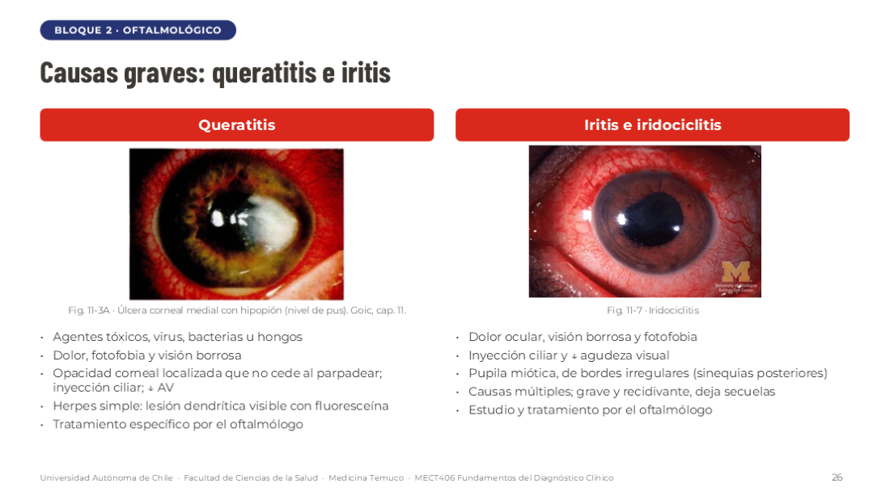
<!-- VOO d. 26 | tipo: fotos (figs. 11-3A y 11-7) | incluir en Word: sí -->

#### Alarma y conducta

- Ambas las trata el oftalmólogo; la iritis es recidivante y puede dejar secuelas graves. **[Goic, p. 181]**

*Falta: definición, fisiopatología, exámenes y criterios.*

## Parte D. Integración

### Síntesis [VOO d. 35]

- Várices de pie; Trendelenburg y Perthes orientan, eco-Doppler confirma.
- Úlcera arterial dolorosa y sin pulsos; venosa maleolar interna; neurotrófica indolora con pulsos.
- Ojo rojo con dolor, visión borrosa, fotofobia o halos: derivar. No prescribir corticoides ni anestésicos tópicos.
- Otalgia sin hipoacusia y otoscopia normal: origen reflejo.

## Parte E. Síndromes y diagnósticos de la literatura

> Cuadros y temas que los PPT **no tratan** o **solo nombran**. Van resumidos y separados para no confundirlos con la materia de clase.

### Patología de párpados *(los PPT solo tratan orzuelo y chalazión)*

- Ptosis (párpado caído), entropión (invertido, roza la córnea), ectropión (evertido, ojo seco), lagoftalmos (no cierra), blefaritis (borde inflamado). El chalazión suele ser indoloro; el orzuelo duele. **[UCH, tema 21, p. 138–139]**

### Estrabismo y ambliopía *(no está en los PPT)*

- Foria: desviación latente; tropia: manifiesta. La ambliopía es la pérdida visual irreversible asociada. Es GES en menores de 9 años. **[UCH, tema 21, p. 137]**
- Examen: Hirschberg (reflejo luminoso en las pupilas) y cover test. **[UCH, tema 21, p. 137–138]**

### Examen pupilar y síndrome de Horner *(el PPT no desarrolla el examen pupilar)*

- Reflejo fotomotor directo y consensual (II y III par); defecto pupilar aferente relativo: la pupila enferma se contrae menos al iluminarla directamente. **[UCH, tema 21, p. 135]**
- Horner: miosis y ptosis por lesión simpática cervical (disección carotídea, tumor de Pancoast). **[UCH, tema 21, p. 135]**

### Alteraciones del campo visual *(no está en los PPT)*

- Nervio óptico: pérdida del mismo ojo; quiasma: hemianopsia bitemporal; detrás del quiasma: homónima. Se evalúa por confrontación. **[UCH, tema 21, p. 137–138]**

### Desprendimiento de vítreo y de retina *(no está en los PPT)*

- Vítreo posterior, propio de la edad: miodesopsias («moscas») y fotopsias. Con baja de agudeza o de campo visual, pensar en desprendimiento de retina. **[UCH, tema 21, p. 133]**

### Otitis externa *(el PPT solo la nombra)*

- Dolor intenso a la tracción del pabellón y trago positivo, otorrea simultánea, sin fiebre habitual; conducto edematoso con tímpano sano. Con predominio de prurito: hongos. **[UCH, tema 22, p. 143]**
- **Necrotizante:** inmunosuprimidos; dolor persistente, posible compromiso de pares craneales; es urgencia. **[UCH, tema 22, p. 143]**

### Otitis media aguda, crónica y con efusión *(el PPT solo nombra la otitis media)*

- **Aguda:** dolor brusco, fiebre, hipoacusia; tímpano rojo y abombado; la otorrea sigue al dolor y lo alivia. **[UCH, tema 22, p. 143]**
- **Crónica:** perforación por más de 3 meses, otorrea repetida e hipoacusia sin dolor. El colesteatoma es su complicación temida y exige derivación urgente. **[UCH, tema 22, p. 143]**
- **Con efusión:** primera causa de hipoacusia infantil, sin fiebre. **[UCH, tema 22, p. 143]**

### Vértigo postural paroxístico benigno y Ménière *(los PPT apenas los nombran en este documento)*

- **VPPB:** otolitos (canal posterior en 80 %); crisis de segundos con cambios de posición, sobre todo en mayores de 60. **[UCH, tema 22, p. 148]**
- **Ménière:** alteración de la endolinfa; crisis más largas y espontáneas, con hipoacusia y tinnitus. **[UCH, tema 22, p. 148]**

## Anexo de práctica

### Resultados de aprendizaje [VOO d. 2]

- Caracterizar várices y diferenciar úlceras arteriales, venosas y neurotróficas.
- Explicar vicios de refracción y reconocer signos de peligro del ojo rojo.
- Caracterizar otalgia y otorrea, distinguir otalgia verdadera de refleja.

## Pendientes por verificar

Las diferencias entre láminas salen del PPT; el resto es revisión mía.

| Dónde | Observación |
|---|---|
| VOO d. 33–34 | La lámina declara que usa semiología estándar porque el extracto del capítulo 12 termina en la p. 183: revisar el resto en Goic. |
| Glaucoma: pupila | Goic describe pupila semidilatada; UCH, midriática. |
| Chalazión | Goic: al inicio duele como el orzuelo; UCH: en general indoloro. |
| Goic cap. 12 | El archivo entregado termina en la p. 183: falta el resto de otorrea, hipoacusia, vértigo y tinnitus. |
